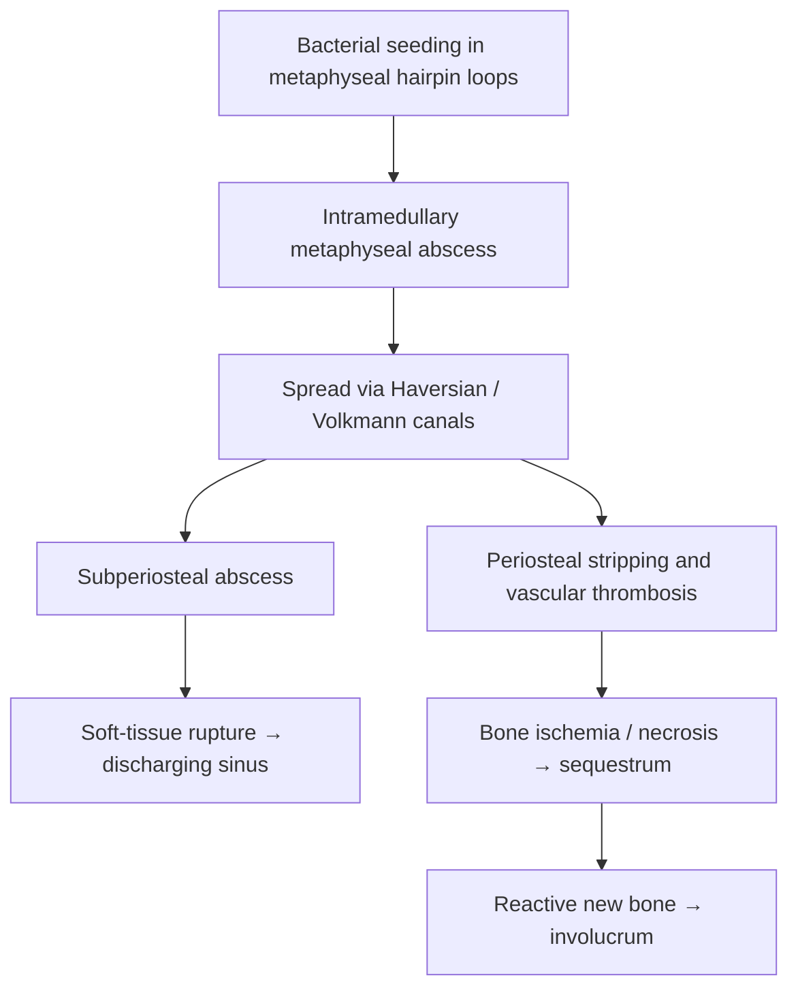
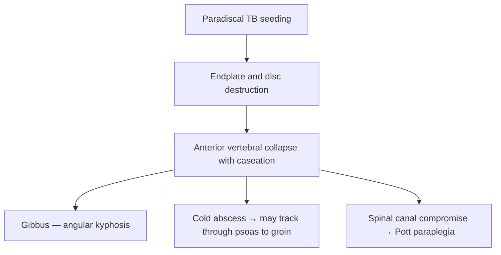

---
tags:
  - medicine/orthopaedics
  - exam-notes
chapter: 6
---

# Orthopaedics Chapter 06: Bone & Joint Infections

## Overview of Musculoskeletal Infections

Infections of the musculoskeletal system represent critical orthopedic emergencies capable of causing rapid permanent structural destruction, growth arrest, functional disability, and life-threatening sepsis. They are classified by tissue localization:
* **Osteomyelitis**: Pyogenic or granulomatous infection of the bone matrix and medullary cavity.
* **Septic Arthritis**: Purulent bacterial infection of the synovial joint cavity causing rapid enzymatically mediated cartilage destruction (chondrolysis).
* **Skeletal Tuberculosis**: Chronic granulomatous infection predominantly targeting the axial spine (Pott's Spondylitis) and major weight-bearing joints.

---

## 1. Acute Pyogenic Osteomyelitis

### 1.1 Etiology & Microbiological Spectrum
* **Overall Most Common Organism**: **Staphylococcus aureus** ($>80\%$ of all cases across all age groups) due to surface adhesins that bind specifically to bone matrix sialoproteins and fibronectin.
* **Special Population Etiologies**:
  * *Sickle Cell Disease*: **Salmonella species** (most common due to microvascular intestinal infarction and hyposplenism), followed by *S. aureus*.
  * *Neonates ($<28\text{ days}$)*: **Group B Streptococcus** (*Streptococcus agalactiae*), *Escherichia coli*, and *S. aureus*.
  * *Intravenous Drug Abusers & Puncture Wounds Through Footwear*: **Pseudomonas aeruginosa**.
  * *Animal Bites (Cat/Dog)*: **Pasteurella multocida**.
  * *Human Bites / Clenched Fist Injuries*: **Eikenella corrodens**.
  * *Prosthetic Hardware / Joint Implants*: **Staphylococcus epidermidis** (coagulase-negative, producing protective adherent biofilm).

### 1.2 Anatomical Predilection & Pathophysiology

![[images/Osteomyelitis_Anatomy.png]]

*Sequestrum, involucrum and sinus — schematic.*

* **Primary Site**: The **Metaphysis** of rapidly growing long bones (most commonly **Distal Femur** $> \text{Proximal Tibia} > \text{Proximal Humerus}$).
* **Anatomical Reasons for Metaphyseal Vulnerability**:
  1. *Hairpin Loop Vascular Architecture*: Nutrient arteries terminate in non-anastomotic, hairpin-shaped capillary loops at the metaphyseal-physeal junction, discharging into large sinusoidal veins.
  2. *Sluggish Blood Flow*: Abrupt vascular widening causes marked hemodynamic slowing, allowing circulating bacteria to settle and adhere.
  3. *Deficient Phagocytosis*: The metaphyseal sinusoidal system lacks an active reticuloendothelial macrophage response.
  4. *Cancellous Structure*: Highly vascular, porous trabecular bone permits intraosseous hematoma collection following minor unremembered trauma.
* **Pathological Cascade & Sequential Stages**:
  1. **Inflammation & Abscess Formation ($<24\text{ hours}$)**: Bacterial proliferation induces acute neutrophilic inflammation, tissue necrosis, and intra-medullary pressure elevation.
  2. **Subperiosteal Abscess ($24\text{--}48\text{ hours}$)**: Suppuration tracks laterally through Haversian and Volkmann's canals, stripping the flexible periosteum off the cortical bone.
  3. **Vascular Thrombosis & Cortical Necrosis**: Elevated subperiosteal pressure and bacterial endotoxins cause thrombosis of periosteal and nutrient blood vessels, depriving the cortex of its blood supply.
  4. **Sequestrum Formation**: A segment of devascularized, necrotic dead bone separated from living tissue by infected granulation tissue.
  5. **Involucrum Formation ($\sim 7\text{--}10\text{ days}$)**: Stripped periosteum lays down a thick shell of reactive, dense new subperiosteal bone surrounding the dead sequestrum.
  6. **Cloaca & Discharging Sinus**: Suppurative pus breaches defects in the involucrum (**Cloaca**) and tracks through soft tissue to exit via a skin opening (**Discharging Sinus**).

### 1.3 Clinical Presentation & Diagnostics
* **Clinical Features**: High-grade fever with chills, severe localized constant bone pain, intense point tenderness over the metaphysis, local warmth, swelling, and refusal to bear weight or move the adjacent limb (pseudoparalysis).
* **Laboratory Investigations**: Marked leukocytosis with left shift (neutrophilia $85\text{--}90\%$), elevated Erythrocyte Sedimentation Rate (ESR), and elevated C-Reactive Protein (CRP; most sensitive marker for monitoring treatment response).
* **Radiological Imaging**:
  * *Plain Radiography*: Initial X-rays are normal during the first 24–48 hours. Earliest sign ($24\text{--}48\text{ hours}$) is blurring/loss of soft tissue fat planes. Bony changes (**periosteal elevation**, cortical lucency, and lytic bone destruction) appear only after **$7\text{--}14\text{ days}$** when $>30\text{--}50\%$ of bone mineral density is lost.
  * *Magnetic Resonance Imaging (MRI)*: **Most sensitive modality ($>95\%$)** in early acute osteomyelitis; detects bone marrow edema within **24 hours** of disease onset.
  * *Ultrasound*: Highly effective in pediatric patients for identifying subperiosteal fluid collections prior to radiographic changes.
  * *Gold Standard Diagnosis*: Bone biopsy and aspirate culture for microbiological identification and antibiotic sensitivity testing.

### 1.4 Management Protocols
* **Empiric Parenteral Antibiotic Therapy**: Initiate immediate high-dose IV antibiotic coverage immediately after obtaining blood and bone cultures. Standard regimen: IV Anti-staphylococcal Penicillin (Flucloxacillin / Nafcillin) or Vancomycin/Daptomycin (for suspected MRSA) plus a 3rd Generation Cephalosporin (Ceftriaxone). Duration: minimum **2 weeks parenteral IV therapy followed by 4 weeks oral therapy** (total 6 weeks).
* **Surgical Debridement / Drainage**: Indicated if a subperiosteal or intramedullary abscess is confirmed on ultrasound/MRI, or if symptoms fail to improve within 48 hours of IV antibiotic initiation. Perform surgical subperiosteal release and metaphyseal cortical drilling ("windowing") to decompress intraosseous pressure.

---

## 2. Chronic Osteomyelitis, Brodie's Abscess & Clinical Variants

### 2.1 Chronic Pyogenic Osteomyelitis
* **Pathology**: Sequelae of inadequately treated or undiagnosed acute osteomyelitis. Characterized by persistent avascular dead bone (**Sequestrum**), encasing new bone (**Involucrum**), persistent **Discharging Sinuses**, and a avascular fibrotic scar tissue bed shielding bacteria from systemic antibiotics.
* **Eponymous Sequestrum Taxonomy**:

| Sequestrum Type | Structural Appearance / Features | Associated Etiology |
| :--- | :--- | :--- |
| **Tubular / Pencil Sequestrum** | Elongated, dense tubular cortical bone fragment | **Chronic Pyogenic Osteomyelitis** |
| **Coke / Rice-Grain / Feathery** | Coarse, porous, flaky, or sandy bone fragments | **Tubercular Osteomyelitis (TB)** |
| **Ring / Annular Sequestrum** | Circular bone fragment at pin-site or stump margin | **External Fixator Pin-Tract Infection** / Amputation Stump (Thermal Necrosis) |
| **Ivory Sequestrum** | Uniformly dense, smooth, hyper-sclerotic bone | **Syphilitic Osteomyelitis** |
| **Black / Bombay Sequestrum** | Pigmented, dark necrotic bone fragment | **Fungal Osteomyelitis** / Actinomycosis |
| **Kissing Sequestrum** | Dual opposing articular bone sequestra | **Joint Tuberculosis** (Knee TB > Pott's Spine) |

* **Surgical Management Protocols**:
  * **Sequestrectomy**: Surgical removal of all avascular, infected sequestrum fragments.
  * **Saucerization**: Surgical excision of the unyielding, overhanging bony walls of the chronic cavity, transforming a deep bone pit into a shallow, smooth "saucer" to eliminate dead space and allow surrounding soft tissue collapse.
  * **Paprika Sign**: Intraoperative benchmark determining the surgical margin of viable bone. Debridement proceeds until fine, punctate bleeding ("paprika spots") is visualized from viable bone Haversian canals.
  * *Obliteration of Dead Space*: Managed via local antibiotic-impregnated polymethylmethacrylate (PMMA) bead chains, autologous cancellous bone grafting, or muscle flap coverage.
* **Major Complications**: Pathological fractures through involucral defects, secondary systemic AA amyloidosis, growth arrest/deformity, and **Marjolin's Ulcer** (development of aggressive **Squamous Cell Carcinoma** in a long-standing, chronic discharging sinus tract, occurring after 20–30 years).

### 2.2 Subacute Osteomyelitis (Brodie's Abscess)
* **Pathophysiology**: A localized, indolent subacute form of osteomyelitis occurring when host immune defenses are high and the infecting pathogen (*S. aureus*) exhibits low virulence. The infection is successfully contained within a intraosseous cavity.
* **Predilection Site**: Metaphysis of the **Proximal Tibia** (most common overall), followed by the distal femur.
* **Clinical Presentation**: Child or young adult presenting with chronic or intermittent **nocturnal leg pain** and localized tenderness, often mimicking an Osteoid Osteoma. Systemic symptoms (fever, leukocytosis) are characteristically absent.
* **Radiological Findings**:
  * *Plain Radiograph*: Well-circumscribed, oval lytic radiolucent lesion within the metaphysis, surrounded by a thick, heavy sclerotic wall.
  * *MRI T1/T2*: **Penumbra Sign** — a characteristic T1-hyperintense rim surrounding the central fluid cavity, representing vascularized granulation tissue lining the abscess wall.
* **Treatment**: Surgical curettage and antibiotic cover; cavity packing with autologous bone graft if large.

### 2.3 Garré's Sclerosing Osteomyelitis
* **Features**: A distinct chronic form of osteomyelitis occurring in children and young adults, characterized by intense, exuberant subperiosteal **cortical sclerosis and thickening** of long bone diaphyses (most commonly mandible and tibia).
* **Radiology & Pathology**: Marked cortical thickening without purulent abscess formation, sequestrum, or sinus tracts.

---

## 3. Septic Arthritis

### 3.1 Pathophysiology & Emergency Status
Septic arthritis is an acute bacterial infection of the joint space representing a paramount **surgical emergency**:
1. Bacteria enter the joint via hematogenous spread (most common), direct penetrating trauma, or extension from contiguous metaphyseal osteomyelitis (in joints where the metaphysis is intracapsular, such as the hip, shoulder, elbow, and ankle).
2. Bacterial proliferation triggers an explosive influx of polymorphonuclear neutrophils (PMNs).
3. Neutrophil autolysis releases lysosomal proteolytic enzymes (**metalloproteinases** and **collagenases**) alongside bacterial toxins, causing rapid chondrolysis and **irreversible destruction of hyaline articular cartilage within 24–48 hours**.
4. End-stage sequelae of untreated septic arthritis is complete joint obliteration and **bony ankylosis**.

### 3.2 Clinical Presentation & Position of Ease
* **Symptoms**: Sudden onset of severe, agonizing monoarticular joint pain, high-grade fever, systemic toxicity, and total inability to bear weight or move the joint.
* **Position of Ease**: To accommodate maximum intra-articular fluid volume and minimize intracapsular capsular tension/pain, the patient maintains the joint in a specific posture:
  * **Hip Joint**: Held in **Flexion, Abduction, and External Rotation** (the **FABER** posture).
  * **Knee Joint**: Held in **$5\text{--}30^\circ$ of Flexion**.
* **Differential Diagnostic Criteria (Kocher Criteria for Pediatric Septic Hip vs. Transient Synovitis)**:
  1. Non-weight-bearing on affected side.
  2. Erythrocyte Sedimentation Rate (ESR) $>40\text{ mm/hr}$.
  3. Fever $>38.5^\circ\text{C}$ ($101.3^\circ\text{F}$).
  4. Serum White Blood Cell (WBC) count $>12,000/\mu\text{L}$.
  * *Risk Assessment*: Presence of 4/4 criteria yields a $>99\%$ probability of Septic Arthritis.

### 3.3 Diagnostic Fluid Analysis & Management
* **Emergency Diagnostic Aspiration**: Joint fluid aspiration is mandatory prior to antibiotic administration:
  * *Purulent Septic Profile*: Grossly purulent/turbid fluid, **WBC count $>50,000/\mu\text{L}$** (frequently $>100,000/\mu\text{L}$) with **$>75\text{--}90\%$ PMN neutrophils**, markedly decreased synovial glucose ($<50\%$ of blood glucose), and elevated lactate.
* **Treatment Protocols**:
  * **Urgent Joint Arthrotomy (Treatment of Choice)**: Emergency surgical incision, drainage, and high-volume tidal irrigation/lavage of the joint cavity to clear bacterial burden, pus, and destructive lysosomal enzymes.
  * *Empiric Antimicrobial Coverage*: High-dose IV antibiotics (Vancomycin + 3rd Gen Cephalosporin) for 2–3 weeks, followed by oral antibiotics for 2–3 weeks.
  * *Post-operative Traction*: Joint distraction via skin traction to prevent articular surface contact and cartilage erosion.

### 3.4 Tom Smith's Arthritis (Infantile Septic Arthritis of the Hip)
* **Pathophysiology**: Septic arthritis of the hip occurring in infants ($<1\text{ year}$ of age).
* **Anatomical Vulnerability**: In infants $<1\text{--}2$ years of age, transphyseal blood vessels cross the growth plate, directly connecting the metaphyseal sinusoids to the epiphyseal cartilage. Furthermore, the proximal femoral metaphysis lies entirely **intracapsular** within the hip joint.
* **Destructive Sequelae**: Pyogenic infection causes catastrophic destruction (chondrolysis) of the unossified, cartilaginous femoral head epiphysis and proximal femoral growth plate.
* **Long-Term Clinical Manifestations**: Complete disappearance of the femoral head, pathological hip dislocation, shortening, marked limb length discrepancy, and an unstable, hypermobile **flail hip joint** with a positive Trendelenburg sign.

---

## 4. Skeletal Tuberculosis (Pott's Disease & Tuberculous Arthritis)

![[images/Potts_Spine.png]]

*Pott disease vertebral collapse — schematic.*

### 4.1 Etiology & Anatomical Distribution
Skeletal tuberculosis accounts for $1\text{--}3\%$ of all tuberculosis cases, arising from hematogenous dissemination of *Mycobacterium tuberculosis* from a primary pulmonary or visceral focus:
* **Frequency of Musculoskeletal Sites**:
  1. **Spine (TB Spondylitis / Pott's Disease)**: Accounts for **$50\%$ of all skeletal TB cases**.
  2. **Hip Joint (TB Coxitis)**: Second most common site ($15\%$).
  3. **Knee Joint**: Third most common site ($10\%$).
* **Spinal Location**: Most commonly involves the **Thoracolumbar Junction ($T_{12}\text{--}L_1$)**, followed by the thoracic and lumbar spine. In children, cervical spine involvement is relatively more frequent.

### 4.2 Pathological Patterns of Pott's Spine
* **Anatomical Subtypes**:
  1. **Paradiscal Type (Most Common, $>80\%$)**: Primary hematogenous seeding occurs in the anterior subchondral bone of adjacent vertebral endplates via Batson's venous plexus. Infection destroys the intervening intervertebral disc and adjacent vertebral endplates.
  2. **Central Type**: Infection originates in the center of the vertebral body, causing rapid vertebral body collapse and wedging while initially sparing the intervertebral disc (common in children).
  3. **Anterior Subperiosteal Type**: Infection spreads beneath the anterior longitudinal ligament, stripping periosteum and compromising segmental blood supply to multiple contiguous vertebrae.
  4. **Appendiceal / Posterior Type**: Involves neural arch, pedicles, laminae, or spinous processes.

### 4.3 Cold Abscess Mechanics & Deformities
* **Cold Abscess Anatomy**: Tuberculous caseous necrosis forms a "cold" abscess—lacking typical signs of acute pyogenic inflammation (no heat, marked erythema, or acute pain).
  * *Lumbar Spine / Psoas Abscess*: Caseous material tracks down the **Psoas muscle sheath**, presenting as a fluctuant cold abscess in the iliac fossa, groin, or femoral triangle beneath the inguinal ligament.
  * *Thoracic Spine*: Presents as a fusiform or paraspinal "bird's nest" abscess on AP radiograph.
  * *Cervical Spine*: Retropharyngeal cold abscess causing dysphagia, stridor, or tracking into the posterior triangle of the neck.
* **Gibbus Deformity**: Progressive caseous destruction and anterior vertebral body collapse cause the posterior neural arch to tilt, resulting in a sharp, single-level angular posterior kyphotic knuckle (**Gibbus Deformity**).
* **Pott's Paraplegia**: Spinal cord compression in TB spine, categorized by onset:
  * *Early-Onset Paraplegia* (Active Disease Phase): Caused by mechanical compression from cold abscess, retropulsed bone sequestrum, granulation tissue, or caseous debris. Excellent prognosis following medical/surgical decompression.
  * *Late-Onset Paraplegia* (Healed Disease Phase): Caused by dense internal bony ridge, spinal canal stenosis, or mechanical friction over a severe fixed gibbus deformity. Poor neurological recovery.

### 4.4 Clinical Variants & Tuberculous Arthritis
* **Caries Sicca**: A dry, sclerotic form of shoulder joint tuberculosis occurring predominantly in elderly adults, characterized by severe wasting, pain, and fibrous ankylosis without cold abscess formation.
* **Spina Ventosa (Tuberculous Dactylitis)**: Tuberculous osteomyelitis of the short tubular bones of the hands and feet in infants and young children ($<5\text{ years}$). Subperiosteal new bone formation causes expansile, ballooned cortical expansion with central bone destruction ("sausage-like expanded digit").
* **Tuberculous Joint Pathology (TB Arthritis)**: Characterized by chronic granulomatous synovitis, subchondral erosions, and **Fibrous Ankylosis** as the end-stage sequelae (in contrast to pyogenic arthritis which heals with bony ankylosis).

### 4.5 Management & The "Middle Path" Regimen
* **Anti-Tubercular Therapy (ATT)**: The cornerstone of management. Standard multidrug regimen (Isoniazid, Rifampicin, Pyrazinamide, Ethambutol) administered for **12 to 18 months** in skeletal TB.
* **Trikamdas "Middle Path" Regimen**: Conservative medical management with ATT combined with rigid spinal bracing (Taylor's brace / Milwaukee brace) and bed rest, reserving surgical intervention strictly for specific complications.
* **Indications for Surgical Decompression & Fusion**:
  1. Progressive or non-recovering neurological deficit (Pott's Paraplegia) despite ATT.
  2. Severe, progressive spinal instability or severe gibbus deformity ($>60^\circ$).
  3. Failure of medical therapy (persistent pain, cold abscess enlargement).
  4. Biopsy-proven uncertain diagnosis.
  * *Surgical Procedure*: Anterior radical debridement, cold abscess evacuation, anterior spinal cord decompression, and structural autologous tricortical iliac crest bone graft fusion (e.g., Hong Kong operation).
