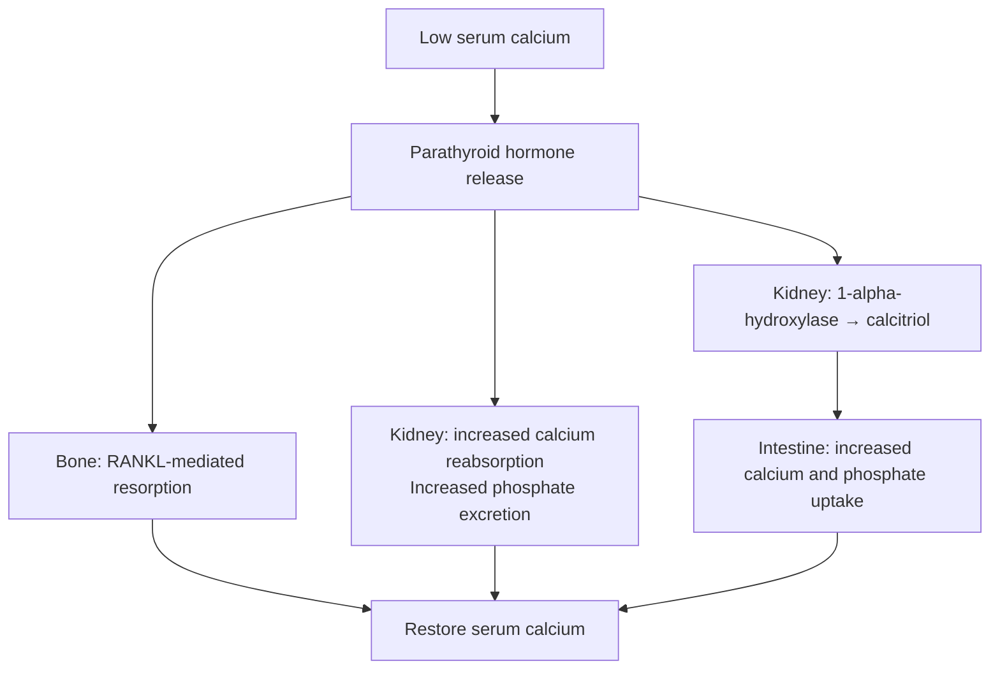
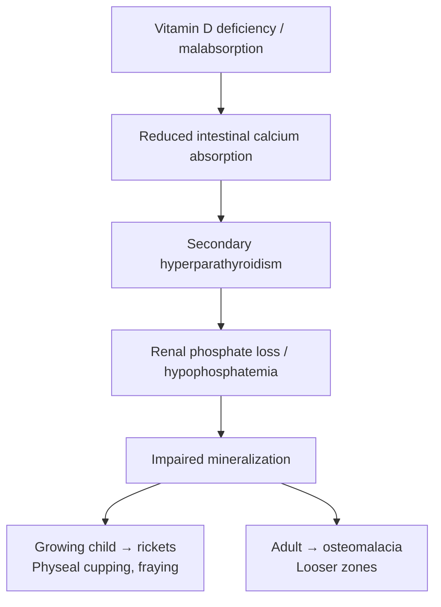
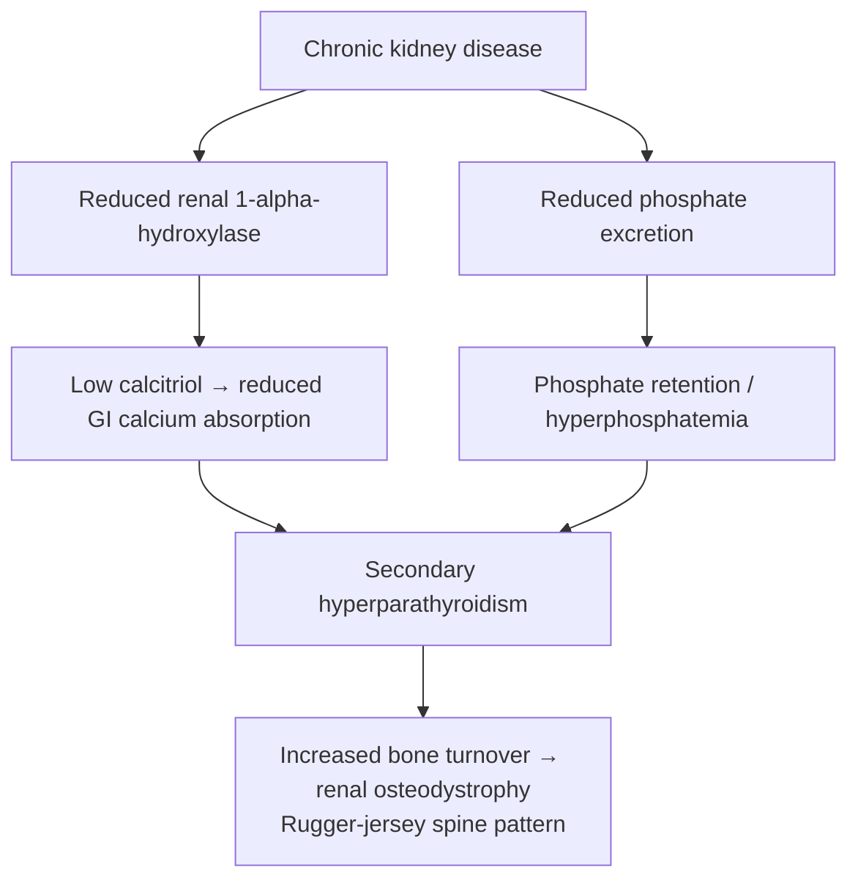

---
tags:
  - medicine/orthopaedics
  - exam-notes
chapter: 7
---

# Orthopaedics Chapter 07: Metabolic & Endocrine Bone Disorders

## 1. Calcium, Phosphate & Vitamin D Homeostasis

- Bone metabolic physiology depends on a tightly regulated hormonal equilibrium maintained between systemic extracellular calcium ($Ca^{2+}$), inorganic phosphate ($PO_4^{3-}$), and structural bone matrix turnover.
- This endocrine axis is driven by three primary regulators: Parathyroid Hormone (PTH), 1,25-dihydroxyvitamin $D_3$ ($1,25(\text{OH})_2\text{D}_3$ / Calcitriol), and Calcitonin.

### Endocrine Triad Dynamics
* **Parathyroid Hormone (PTH)**: Secreted by chief cells of parathyroid glands in response to hypocalcemia ($<8.5\text{ mg/dL}$).
  * *Bone Effect*: Binds PTH receptors on osteoblasts, upregulating **RANKL** expression to bind RANK on pre-osteoclasts, driving osteoclast maturation and bone resorption.
  * *Renal Effect*: Increases distal convoluted tubule $Ca^{2+}$ reabsorption, inhibits proximal tubule $PO_4^{3-}$ reabsorption (phosphaturic effect), and stimulates renal **1-$\alpha$-hydroxylase** expression.
* **Calcitriol ($1,25(\text{OH})_2\text{D}_3$)**: Formed via epidermal UV-B photolysis ($7\text{-dehydrocholesterol} \rightarrow \text{cholecalciferol}$), liver 25-hydroxylation (via 25-hydroxylase), and renal 1-$\alpha$-hydroxylation.
  * *Action*: Enhances enterocyte synthesis of calbindin, driving active intestinal absorption of both $Ca^{2+}$ and $PO_4^{3-}$.
* **Calcitonin**: Secreted by parafollicular C-cells of thyroid gland in response to hypercalcemia ($>10.5\text{ mg/dL}$). Direct osteoclast inhibitor that suppresses bone resorption and promotes urinary calcium excretion.

---

## 2. Rickets & Osteomalacia

*Rickets: metaphyseal cupping and fraying — schematic.*

- Rickets and osteomalacia represent metabolic conditions characterized by defective mineralization of uncalcified organic bone matrix (osteoid).
- The primary pathophysiological distinction is anatomical: **Rickets** occurs in the skeletally immature child prior to growth plate (physeal) fusion, directly disrupting endochondral ossification, whereas **Osteomalacia** occurs in mature adult bone after physeal closure, affecting intramembranous and Haversian remodeling.

### Rickets
* **Etiology**: Nutritional Vitamin D deficiency (most common), dietary calcium restriction, malabsorption, renal 1-$\alpha$-hydroxylase deficiency (Vitamin D-dependent rickets Type I), end-organ calcitriol receptor resistance (Vitamin D-dependent rickets Type II), or X-linked hypophosphatemic rickets (mutation in *PHEX* gene causing elevated FGF-23 and renal phosphate wasting).
* **Histopathology**: Expansion and disorganization of the hypertrophic zone (Zone IV) of the growth plate with failure of apoptosis and delayed mineralization of cartilage matrix.
* **Clinical Manifestations**:
  * *Skull*: **Craniotabes** (softening of cranial bones with ping-pong ball sensation on pressure; earliest physical sign appearing in infants $<6\text{ months}$), delayed fontanelle closure, frontal bossing (*caput quadratum*).
  * *Thorax*: **Rachitic Rosary** (painless nodular enlargement of costochondral junctions due to hypertrophic cartilage accumulation), **Harrison's Sulcus** (transverse indentation along lower chest wall at diaphragmatic insertion), Pectus carinatum (pigeon chest).
  * *Extremities*: Broadening/widening of wrists and ankles (epiphyseal-metaphyseal expansion), **Genu Varum** (bowing of legs in walking toddlers) or **Genu Valgum** (knock-knees in older children), marfanoid gait.
* **Radiological Features**:
  1. Metaphyseal **widening**, **cupping** (concave saucerization of metaphyseal line), and **fraying** (brush-border irregular margin).
  2. Increased distance between epiphysis and metaphysis (widened physes).
  3. Generalized osteopenia with thinned cortical margins.

### Osteomalacia
* **Clinical Presentation**: Diffuse, deep, aching bone pain (worsened by weight-bearing), proximal muscle weakness (waddling gait due to pelvic girdle myopathy), and spontaneous pathological microfractures.
* **Radiological Pathognomonic Sign**: **Looser's Zones / Pseudo-fractures / Milkman's Lines**.
  * *Appearance*: Narrow (1–3 mm), radiolucent bands oriented perpendicular to the bone cortex, surrounded by a subtle sclerotic margin.
  * *Anatomical Stress Sites*: Axillary border of scapula, medial femoral neck, pubic rami, ribs, and posterior proximal ulna.

---

## 3. Scurvy (Vitamin C Deficiency)

- Scurvy is an acquired nutritional deficiency of **L-ascorbic acid (Vitamin C)** resulting in severe impairment of collagen synthesis.
- Ascorbate functions as an essential electron-donor cofactor for **prolyl hydroxylase** and **lysyl hydroxylase**, enzymes responsible for the post-translational hydroxylation of proline and lysine residues in triple-helical Type I and Type II collagen chains.

### Pathophysiology & Clinical Features
Failure of collagen hydroxylation leads to unstable collagen triple-helices, defective vessel basement membranes, capillary fragility, and an inability of osteoblasts to deposit osteoid matrix.

* **Cutaneous & Mucosal Signs**: Perifollicular hemorrhages, corkscrew hairs, petechiae, ecchymoses, swollen bleeding hyperplastic gums (gingival purpura), and impaired wound healing.
* **Musculoskeletal Signs**: Subperiosteal hematomas causing excruciating bone pain, joint hemarthroses, pseudoparalysis (child holds legs motionless in a "frog-leg posture" due to severe bone tenderness), and scorbutic costochondral junction enlargement (sharp, step-off "scorbutic rosary" as opposed to the smooth nodular rachitic rosary).

### Pathognomonic Radiological Findings

| Radiological Sign | Anatomical Site & Pathological Basis |
| :--- | :--- |
| **Ground-Glass Diaphysis** | Diffuse diaphyseal osteopenia with pencil-thin cortical margins (*cortical thinning*). |
| **White Line of Frankel** | Thick, dense radiopaque transverse line at the metaphysis representing hyper-mineralized calcified matrix (*Zone of provisional calcification*). |
| **Trümmerfeld Zone** | Translucent radiolucent band immediately proximal to Frankel's line, representing a zone of shattered trabeculae and microfractures (*Scorbutic zone*). |
| **Pelkan's Spur** | Lateral bony spur protruding from the metaphyseal margin, formed by periosteal elevation at the fracture site. |
| **Wimberger's Ring Sign** | Thin, dense sclerotic calcified ring completely encircling a pale radiolucent epiphyseal ossification center. |
| **Subperiosteal Hematomas** | Large soft-tissue radiopacities along long bone shafts that calcify during healing. |

---

## 4. Parathyroid & Renal Bone Disorders

Alterations in parathyroid gland secretion and chronic renal impairment severely disrupt mineral homeostasis, resulting in distinct osseous structural alterations.

### Primary Hyperparathyroidism
Autonomous oversecretion of PTH (most commonly due to a solitary parathyroid adenoma [85%] or parathyroid hyperplasia) drives excessive uncoupled osteoclastic bone resorption.

* **Laboratory Profile**: Elevated serum $Ca^{2+}$, decreased serum $PO_4^{3-}$, markedly elevated serum intact PTH, elevated Alkaline Phosphatase (ALP), and hypercalciuria.
* **Skeletal Manifestations**:
  * **Subperiosteal Cortical Resorption**: Pathognomonic early sign best visualized along the radial aspect of the middle phalanges of the 2nd and 3rd fingers, and the distal clavicles.
  * **Salt-and-Pepper Skull**: Granular, mottled radiolucency of the calvarium caused by multiple tiny lytic areas.
  * **Brown Tumors (Osteitis Fibrosa Cystica)**: Expansile lytic bone lesions filled with fibrous tissue, vascularized granulation tissue, micro-fractures, and osteoclast-like giant cells with hemosiderin deposition. Common in long bones, ribs, and mandible.

### Secondary Hyperparathyroidism & Renal Osteodystrophy
Renal osteodystrophy develops in Chronic Kidney Disease (CKD) stages 4–5 ($GFR <30\text{ mL/min}$). Loss of functional renal parenchyma leads to reduced 1-$\alpha$-hydroxylase activity (causing hypocalcemia) and phosphate retention (causing hyperphosphatemia). Hyperphosphatemia directly stimulates PTH secretion while binding ionized calcium.

* **Laboratory Profile**: Decreased or normal serum $Ca^{2+}$, elevated serum $PO_4^{3-}$, markedly elevated PTH, decreased calcitriol.
* **Pathognomonic Radiological Sign**: **Rugger-Jersey Spine**.
  * *Appearance*: Alternating horizontal bands of high and low bone density in the vertebral bodies. Thickened, sclerotic subchondral endplates (top and bottom of vertebra) appear bright white, surrounding a central osteopenic, translucent vertebral body, mimicking the horizontal stripes of a rugby jersey.

---

## 5. Osteoporosis, Paget's & Genetic Bone Dysplasias

### Osteoporosis

*Trabecular density comparison — schematic.*

Osteoporosis is a systemic skeletal disease characterized by low bone mass, microarchitectural deterioration of bone tissue, and a consequent increase in bone fragility and susceptibility to fracture. Unlike osteomalacia, the ratio of mineralized matrix to collagen matrix is normal, but the total volume of bone tissue is severely reduced.

* **Diagnostic Gold Standard**: Dual-Energy X-ray Absorptiometry (DEXA) scan at the femoral neck and lumbar spine.
  * *T-Score Definitions* (standard deviations relative to young adult reference population):
    * *Normal*: $T\text{-score} \ge -1.0$.
    * *Osteopenia*: $-2.5 < T\text{-score} < -1.0$.
    * *Osteoporosis*: $T\text{-score} \le -2.5$.
    * *Severe / Established Osteoporosis*: $T\text{-score} \le -2.5$ plus presence of one or more fragility fractures (e.g., vertebral compression fracture, distal radius Colles' fracture, femoral neck fracture).

### Paget's Disease of Bone (Osteitis Deformans)
Paget's disease is a focal, progressive disorder of bone remodeling characterized by excessive, disorganized osteoclastic bone resorption followed by irregular, chaotic osteoblastic bone formation.

* **Three Histopathological Phases**:
  1. *Osteolytic Phase*: Massive osteoclast proliferation causing focal lytic resorption ("Blade of grass" / "Candle flame" lytic lesion in long bones; *Osteoporosis circumscripta* in skull).
  2. *Mixed / Disorganized Phase*: Concurrent rapid osteolysis and osteogenesis forming a mosaic woven bone pattern separated by prominent cement lines ("Jigsaw puzzle" pattern).
  3. *Osteosclerotic Phase*: Quiescent phase dominated by thickened, coarse, brittle osteosclerotic bone with enlarged dimensions.
* **Classic Radiological Signs**: **Cotton Wool Skull** (thickened calvarium with fluffy sclerotic patches), **Picture Frame Vertebra** (cortex thickened on all four sides of vertebral body surrounding central osteopenia), **Ivory Vertebra**, widening and bowing of long bones (saber tibia).
* **Clinical & Systemic Complications**: Bone pain, increasing hat size, sensorineural hearing loss (due to internal auditory meatus entrapment), high-output cardiac failure (due to extensive cutaneous/bone arteriovenous shunts), and malignant transformation to **Osteosarcoma** ($1\%$).

### Osteogenesis Imperfecta (Brittle Bone Disease)
* **Genetics**: Autosomal dominant (Types I–IV) mutations in $\text{COL1A1}$ or $\text{COL1A2}$ genes encoding the $\alpha_1$ and $\alpha_2$ chains of Type I Collagen.
* **Clinical Features**: Recurrent pathological fractures from trivial trauma, **blue sclera** (thin sclera exposing underlying choroid plexus), **dentinogenesis imperfecta** (translucent, discolored yellow-brown teeth), conductive hearing loss (otosclerosis of ossicles), and hypermobile joints.

### Osteopetrosis (Marble Bone Disease / Albers-Schönberg Disease)
* **Pathophysiology**: Autosomal recessive or dominant defect in osteoclast function, most commonly due to mutations in the **Carbonic Anhydrase II** gene or TCIRG1 proton pump. Osteoclasts are unable to acidify Howship's lacunae to dissolve bone mineral matrix, causing complete failure of bone resorption.
* **Clinical Manifestations**: Heavy, dense, but chalk-like extremely brittle bones prone to frequent pathological fractures. Loss of medullary cavity causes severe bone marrow failure leading to **pancytopenia** and compensatory extramedullary hematopoiesis (hepatosplenomegaly). Encroachment on cranial nerve foramina causes blindness and facial palsy.
* **Pathognomonic Radiological Findings**:
  1. **Bone-Within-a-Bone Appearance** (Endobone sign inside vertebral bodies and short tubular bones).
  2. **Erlenmeyer Flask Deformity** (marked flaring and widening of metaphyseal regions of long bones, particularly the distal femur).
  3. Uniform, dense radiopacity of entire skeleton (*Marble bones*).
