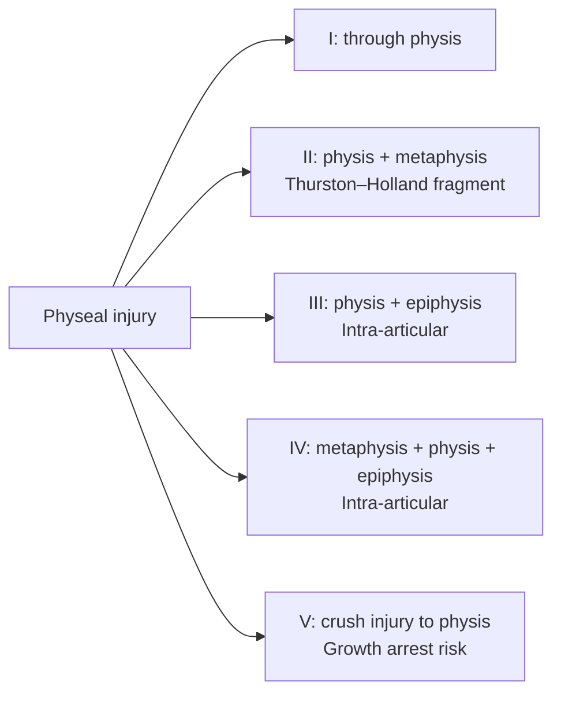
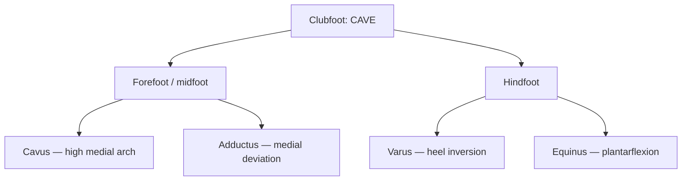
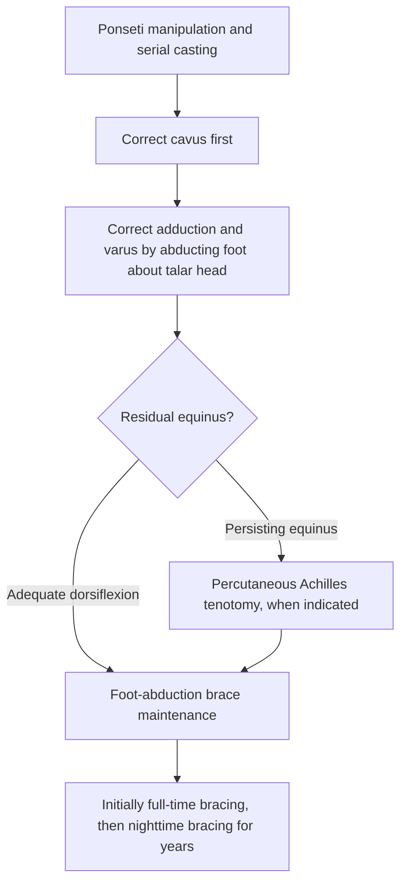
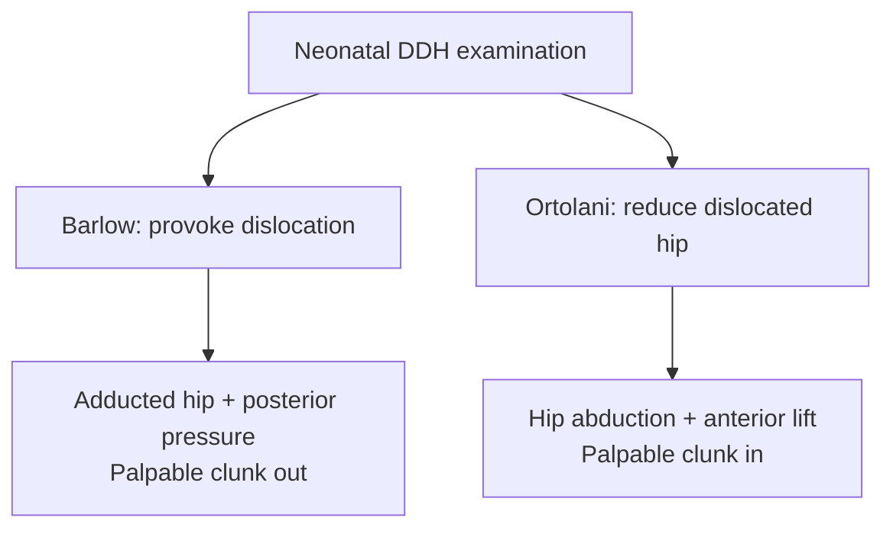
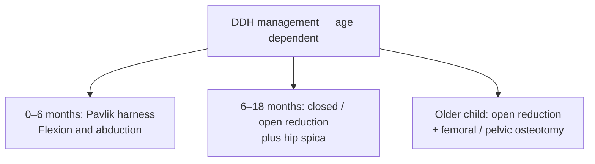

---
tags:
  - medicine/orthopaedics
  - exam-notes
chapter: 8
---

## 1. Salter-Harris Classification of Growth Plate Injuries

*Online diagram, not downloaded: [Zerodamage / Dr Frank Gaillard](https://commons.wikimedia.org/wiki/File:SalterHarris.svg). Requires internet in Obsidian.*

*Salter–Harris injury patterns I–V — schematic.*

- The pediatric physis (epiphyseal growth plate) is composed of hyaline cartilage organized into four histopathological zones: **Reserve (Resting) Zone**, **Proliferative Zone**, **Hypertrophic Zone** (maturation, degeneration, and provisional calcification), and **Endochondral Ossification Zone** (metaphysis).
- Because cartilaginous physes possess lower shear strength than mature bone or surrounding joint capsules, trauma in skeletally immature children characteristically results in physeal disruptions.

### Salter-Harris Classification & Clinical Implications (Mnemonic: *SALTR*)

| Type | Classification Description | Anatomical Fracture Course | Prognosis & Surgical Management |
| :--- | :--- | :--- | :--- |
| **Type I** | **S**eparated / Straight across | Fracture line passes purely through the hypertrophic zone of the physis, completely separating epiphysis from metaphysis. | Excellent prognosis. Closed reduction and cast immobilization. Minimal risk of growth arrest. |
| **Type II** | **A**bove | Fracture line extends along the physis and exits proximally through the **metaphysis**. | **Most common physeal injury (75%)**. Metaphyseal triangular fragment termed the **Thurston-Holland Sign** (corner sign). Excellent prognosis with closed reduction. |
| **Type III** | **L**ower | Fracture line extends along the physis and exits distally through the **epiphysis** into the joint cavity. | **Intra-articular fracture**. Requires anatomical reduction to prevent articular step-off and physeal bridging bar formation. |
| **Type IV** | **T**hrough | Vertical fracture extending completely through metaphysis, physis, and epiphysis into joint space. | **Intra-articular fracture**. High risk of premature partial physeal arrest and angular growth deformity. Requires open anatomical reduction and non-crossing fixation. |
| **Type V** | **R**ammed / Ruined | Severe axial compression / crush force applied directly to the physis, destroying the germinal zone. | **Worst prognosis**. Initial radiographs often appear normal; inevitably leads to complete premature physeal closure, angular deformity, and limb length discrepancy. |

* **Rang's Extension (Type VI)**: Perichondrial ring of LaCroix injury (avulsion of outer perichondrial ring leading to peripheral osseous bridge formation and progressive angular limb deformity).

---

## 2. Congenital Talipes Equinovarus (CTEV / Clubfoot)

*Clubfoot: CAVE components — schematic.*

- Congenital Talipes Equinovarus (CTEV) is a complex 3D congenital foot deformity characterized by idiopathic dysplasia of all soft tissues (tendons, ligaments, capsule) and talocalcaneonavicular joint subluxation.
- Incidence is approximately $1\text{ in } 1000$ live births, with a male predilection ($M:F = 2:1$) and bilateral involvement in $50\%$ of cases.

### The 4 Primary Deformities (Mnemonic: *CAVE*)

*Visual reference: Clinical clubfoot before correction: the equinovarus position is visible. [Original image and attribution](https://commons.wikimedia.org/wiki/File:CTEV_pre_management.jpg). Online image; internet required.*
1. **C**avus: Exaggerated height of the medial longitudinal arch, driven by tight intrinsic foot muscles and **Flexor Hallucis Longus (FHL)** / Flexor Digitorum Longus (FDL).
2. **A**dduction: Medial deviation of the forefoot and midfoot at the tarsometatarsal (Lisfranc) and talonavicular joints, driven by tight **Tibialis Posterior**.
3. **V**arus: Inversion and adduction of the hindfoot/calcaneus at the subtalar joint.
4. **E**quinus: Fixed plantar flexion at the ankle joint (talocrural joint), driven by a severely shortened **Tendo-Achilles** (gastrocnemius-soleus complex).

### Radiological Metrics
* **Kite's Angle (Talo-Calcaneal Angle)**:
  * Measured on AP and lateral foot radiographs between the longitudinal axes of the talus and calcaneus.
  * *Normal*: $20^\circ\text{--}40^\circ$ (the lines intersect).
  * *CTEV*: **$<20^\circ$** (the talus and calcaneus lie parallel to each other due to calcaneal adduction and inversion).

### Management: The Ponseti Method

*Visual reference: Published CTEV deformity-correction sequence (review details alongside the text). [Original image and attribution](https://commons.wikimedia.org/wiki/File:Order_of_correction_of_deformity_in_CTEV.jpg). Online image; internet required.*
The gold standard for CTEV correction is the **Ponseti Serial Above-Knee Casting Technique**, initiated in the first few weeks of life while neonatal tissues retain maximum compliance due to maternal circulating relaxin.

1. **Sequential Order of Correction**:
   * **C**avus is corrected first by supinating the forefoot to align the forefoot with the hindfoot (elevating the 1st metatarsal).
   * **A**dduction and **V**arus are corrected simultaneously by abducting the foot in supination while applying steady counter-pressure over the **lateral aspect of the head of the talus** (never apply pressure over the calcaneus or calcaneocuboid joint).
   * **E**quinus is corrected last after hindfoot varus is fully corrected.
2. **Percutaneous Achilles Tenotomy**: Required in $>90\%$ of CTEV cases to achieve full dorsiflexion ($>15^\circ$) once cavus, adduction, and varus are completely corrected.
3. **Splint Maintenance**: **Denis Browne Bar Splint** (boots attached to a metal bar held at $70^\circ$ external rotation on the affected side and $45^\circ$ on the normal side) worn 23 hours/day for 3 months, then at night until 4–5 years of age to prevent relapse.
4. **Surgical Interventions for Resistant / Neglected Cases**:
   * *Turco's Extensive Soft Tissue Release* (posteromedial release).
   * *Tibialis Anterior Tendon Transfer* (to lateral cuneiform for dynamic recurrent varus in children $>30\text{ months}$).
   * *Triple Arthrodesis* (surgical fusion of subtalar, talonavicular, and calcaneocuboid joints) reserved for rigid, painful neglected deformities in skeletally mature children ($>10\text{--}12\text{ years}$).

---

## 3. Developmental Dysplasia of the Hip (DDH)

Developmental Dysplasia of the Hip (DDH) encompasses a spectrum of neonatal hip instability ranging from subtle acetabular dysplasia to complete femoral head dislocation out of the acetabulum. Female infants are affected 6 times more frequently than males ($F:M = 6:1$).

### Risk Factors
Firstborn infants, female sex, breech presentation, positive family history, oligohydramnios, and swaddling with legs forced in extension/adduction. Associated with **Congenital Muscular Torticollis** ($20\%$) and congenital foot deformities.

### Clinical Diagnostic Tests

* **Barlow's Provocative Test**: Infant placed supine with hips flexed to $90^\circ$ and fully adducted. Posterior pressure applied along the femoral shaft pushes an unstable femoral head **out** of the acetabulum with a palpable "clunk".
* **Ortolani's Reduction Test**: Flexed hip is gently abducted while lifting the greater trochanter anteriorly. Relocates a dislocated femoral head back **into** the acetabulum with a distinct palpable "clunk".
* **Galeazzi's Sign (Allis Sign)**: Performed in infants $>3\text{--}6\text{ months}$ (after tightness prevents Barlow/Ortolani). Infant supine with hips flexed $90^\circ$ and feet flat on the table; demonstrates apparent shortening of the thigh on the affected side (**unequal knee heights**).
* **Asymmetry of Thigh / Gluteal Skin Folds** & **Restricted Hip Abduction** in flexion.

### Radiological Assessment

*Visual reference: Radiographic reference measurements in hip dysplasia. [Original image and attribution](https://commons.wikimedia.org/wiki/File:X-ray_of_measurements_in_hip_dysplasia.jpg). Online image; internet required.*

*Developmental dysplasia: Hilgenreiner and Perkins reference lines — schematic.*

* **Ultrasound (USG)**: Gold standard modality for infants $<6\text{ months}$ (before ossification of femoral head). Evaluates the **Alpha angle** ($>60^\circ$ is normal) and **Beta angle**.
* **Pelvic Radiograph Lines** (For infants $>6\text{ months}$):
  * **Hilgenreiner's Line**: Horizontal line drawn through bilateral triradiate cartilages of acetabula.
  * **Perkin's Line**: Vertical line drawn perpendicular to Hilgenreiner's line through the outermost lateral margin of the acetabular roof.
  * *Normal Femoral Head Position*: In the **inferomedial quadrant** created by the intersection of Hilgenreiner's and Perkin's lines. In DDH, the femoral head lies in the **superolateral quadrant**.
  * **Shenton's Line**: Continuous smooth parabolic arc drawn along the inferior border of the superior pubic ramus and medial aspect of the femoral neck. **Disrupted / broken in DDH**.
  * **Acetabular Index**: Angle between Hilgenreiner's line and a line along the acetabular roof ($>30^\circ$ indicates acetabular dysplasia).

---

## 4. Pediatric Hip Avascular Necrosis & SCFE

### Legg-Calvé-Perthes Disease (Perthes Disease)

*Visual reference: Radiograph of untreated Legg–Calvé–Perthes disease. [Original image and attribution](https://commons.wikimedia.org/wiki/File:Unbehandelter_Perthes.jpg). Online image; internet required.*

> Perthes disease is osteochondritis NOT OSTEONECROSIS
> Osteonecrosis occurs due to osteochondritis

Perthes disease is an idiopathic, self-limiting avascular necrosis (osteonecrosis) of the proximal femoral head epiphysis occurring in young children (ages 4–8 years, male-to-female ratio $4:1$).

* **Clinical Presentation**: 
	* Insidious onset of an antalgic or **painless limp**, mild aching pain in the hip, thigh, or knee (referred pain along obturator nerve), and 
	* restricted internal rotation and abduction of the hip.
	* **Adduction + External Rotation** → ==Weird Combo right?==
	* History of recent trauma not acute trauma
* **Radiological Stages (Catterall & Herring Classifications)**:
  1. *Early Phase*: Soft tissue swelling, widened joint space.
  2. *Avascular / Necrotic Phase*: Subchondral fracture line (**Crescent Sign** of Catterall), sclerosis of femoral head.
  3. *Fragmentation Phase*: Lytic fragmentation and collapse of femoral head epiphysis.
  4. *Re-ossification / Healing Phase*: New bone formation.
  5. *Residual Phase*: Healed femoral head with deformity (**Coxa Plana** / flattened head, **Coxa Magna** / enlarged head).
* **Management**: Principle is **containment** (keeping the spherical femoral head centered inside the acetabular socket during remodeling). Managed with Scottish Rite orthosis, petrie casts, or containment osteotomies (Salter iliac osteotomy / femoral varus osteotomy).

### Slipped Capital Femoral Epiphysis (SCFE)

*Visual reference: Frog-leg lateral radiograph of slipped capital femoral epiphysis. [Original image and attribution](https://commons.wikimedia.org/wiki/File:SCFE_FROG_B%26W.jpg). Online image; internet required.*
SCFE is a Salter-Harris Type I physeal fracture characterized by the posteromedial displacement of the proximal femoral epiphysis relative to the metaphysis (the femoral neck shifts anteriorly and externally rotates, making the head look like "ice cream slipping off a cone").

* **Demographics**: Obese adolescent males (ages 10–15 years) during the pubertal growth spurt. Associated with hypothyroidism, growth hormone therapy, and hypogonadism.
* **Clinical Presentation**: 
	* **adduction + external rotation + acute trauma history**
	* Dull, aching hip, groin, or **referred knee pain**, antalgic gait, 
	* limb held in fixed **external rotation**, and compulsory external rotation of the hip when flexed to $90^\circ$ (**Obligate External Rotation**).
* **Pathognomonic Radiological Sign**: **Trethowan's Sign** on AP radiograph.
  * *Definition*: 
	  * **Klein's Line** (drawn along the superior border of the femoral neck) normally intersects a portion of the outer epiphyseal head. In SCFE, Klein's line **fails to intersect** the epiphysis due to posteromedial slippage.
* **Management**: Emergency operative stabilization via **In-situ Single Cannulated Screw Fixation** to prevent progressive displacement and secondary avascular necrosis.

---

## 5. Osteochondroses & Traction Apophysitis

Osteochondroses represent a group of pediatric developmental disorders characterized by localized ischemic necrosis or traction apophysitis at secondary ossification centers.

| Condition Name | Anatomical Target Site | Clinical Characteristics & Demographics |
| :--- | :--- | :--- |
| **Osgood-Schlatter Disease** | Tibial Tuberosity Apophysis | Traction apophysitis at patellar tendon insertion in athletic adolescents (10–15 yrs); focal tenderness and swelling over tibial tuberosity. |
| **Köhler's Disease** | Tarsal Navicular Bone | Self-limiting AVN of tarsal navicular in young boys (3–7 yrs); painful foot limp; radiograph shows flattened, sclerotic navicular bone. |
| **Freiberg's Disease** | 2nd Metatarsal Head | Osteonecrosis of 2nd metatarsal head in adolescent females; painful forefoot weight-bearing (metatarsalgia). |
| **Sever's Disease** | Calcaneal Apophysis | Traction apophysitis of calcaneus at Achilles tendon insertion in active children (8–12 yrs); posterior heel pain. |
| **Kienböck's Disease** | Carpal Lunate Bone | Osteonecrosis of carpal lunate in adults (20–40 yrs); wrist pain, reduced grip strength; associated with negative ulnar variance. |
| **Panner's Disease** | Capitellum of Humerus | Osteochondrosis of capitellum in young athletes ($<10\text{ yrs}$); dull elbow pain and restricted extension. |
| **Scheuermann's Disease** | Vertebral Ring Apophyses | Juvenile structural thoracic kyphosis ($>45^\circ$) due to anterior wedging ($\ge 5^\circ$ across $\ge 3$ consecutive vertebrae) and Schmorl's nodes. |
