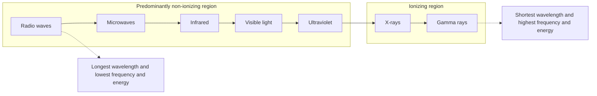
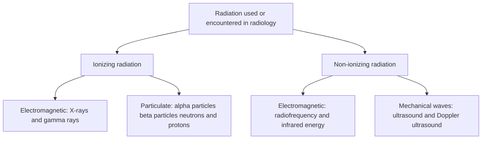

# Chapter 01: Discovery, Electromagnetic Spectrum & Radiation Physics

## 1.1 Discovery & History of Radiology

### The Birth of Diagnostic Imaging
Radiology was founded on **November 8, 1895**, by German physicist **Wilhelm Conrad Röntgen** at the University of Würzburg. While experimenting with Crookes cathode-ray tubes, Röntgen observed fluorescence on a nearby barium platinocyanide screen. He identified a new form of penetrating electromagnetic energy and named them **X-rays** (where "X" signifies the mathematical unknown).

> [!NOTE] Historical Landmark: "Bertha's Hand"
> The first human radiograph ever recorded was taken by Röntgen of his wife Bertha's hand in late December 1895. The image clearly revealed the bony phalanges and her metal wedding ring. This historic event led to Röntgen receiving the **inaugural Nobel Prize in Physics in 1901**.

### Key Historical Figures & Milestones
The field evolved rapidly through major technological breakthroughs led by pioneering scientists:

| Scientist | Contribution / Discovery | Year / Milestone |
| :--- | :--- | :--- |
| **Wilhelm Conrad Röntgen** | Discovery of X-rays | Nov 8, 1895 (Nobel Prize 1901) |
| **Henri Becquerel** | Discovery of Natural Radioactivity | 1896 (Father of Radioactivity) |
| **Marie & Pierre Curie** | Discovery of Radium & Polonium | 1898 (Pioneers in Nuclear Medicine) |
| **Charles Dotter** | Father of Interventional Radiology (Balloon Angioplasty) | 1964 |
| **Sir Godfrey Hounsfield & Allan Cormack** | Invention of Computed Tomography (CT) / EMI Scanner | 1972 (Nobel Prize 1979) |
| **Robert Egan** | Standardization of Mammography | 1960s |
| **John Wild & Ian Donald** | Medical and Obstetric Ultrasonography | 1950s |
| **Paul Lauterbur & Peter Mansfield** | Development of Clinical Magnetic Resonance Imaging (MRI) | 1970s (Nobel Prize 2003) |
| **Felix Bloch & Edward Purcell** | Nuclear Magnetic Resonance (NMR) Principle | 1946 (Nobel Prize 1952) |
| **Lars Leksell** | Invention of Gamma Knife Stereotactic Radiosurgery | 1967 |

> [!TIP] Commemorative Date
> **November 8th** is celebrated globally as the **International Day of Radiology (IDoR)**.

---

## 1.2 Electromagnetic (EM) Spectrum & Radiation Classification

### The Electromagnetic Spectrum
Electromagnetic radiation consists of oscillating electric and magnetic fields traveling through space at the speed of light. All electromagnetic waves share a fundamental constant: **velocity ($c = 3 \times 10^8 \text{ m/s}$ in a vacuum)**.

### Fundamental Wave Equations
Electromagnetic waves are governed by wave mechanics linking energy ($E$), frequency ($\nu$), and wavelength ($\lambda$):

$$c = \nu \cdot \lambda$$

$$E = h \cdot \nu = \frac{h \cdot c}{\lambda}$$

Where:
- $c = \text{Speed of Light } (3 \times 10^8 \text{ m/s})$
- $h = \text{Planck's Constant } (6.626 \times 10^{-34} \text{ J}\cdot\text{s} \text{ or } 4.135 \times 10^{-15} \text{ eV}\cdot\text{s})$
- $\nu = \text{Frequency (Hz or } \text{s}^{-1})$
- $\lambda = \text{Wavelength (meters or nm)}$

### Classification: Ionizing vs. Non-Ionizing Radiation
Radiation is categorized into two distinct classes based on its capability to strip orbital electrons from biological atoms (ionization threshold $\approx 10\text{--}13\text{ eV}$):

#### Detailed Modality & Physics Comparison

| Parameter | Ionizing Radiation | Non-Ionizing Radiation |
| :--- | :--- | :--- |
| **Energy Threshold** | $> 10\text{--}13\text{ eV}$ | $< 10\text{ eV}$ |
| **Mechanism** | Ejects orbital electrons, creating ion pairs and free radicals | Induces atomic vibration, rotation, or excitation without electron ejection |
| **Electromagnetic Types** | Diagnostic X-rays, Gamma ($\gamma$) rays, Cosmic rays | Radio waves, Microwaves, Infrared, Visible light, UV rays |
| **Particulate Types** | Alpha ($\alpha$) particles, Beta ($\beta$) particles, Protons, Neutrons | None (Sound waves are mechanical pressure waves) |
| **Diagnostic Modalities** | Plain Radiography, Fluoroscopy, CT Scan, Mammography, PET/SPECT | Ultrasonography (USG), Echocardiography, MRI, Thermography |
| **Biological Damage** | High (DNA strand breaks, cell death, mutagenesis) | Low/Thermal (Tissue heating, mechanical agitation) |

### Biological Damaging Power vs. Penetrating Power

> [!WARNING] High-Yield Physics Rule
> **Damaging / Ionizing Power** is directly proportional to **Linear Energy Transfer (LET)** and charge mass. **Penetrating Power** is inversely proportional to mass and LET.

1. **Ionizing / Damaging Power**:
   $$\alpha\text{-particles} > \beta\text{-particles} > \text{X-rays} > \gamma\text{-rays}$$
   *Alpha particles ($\alpha = {}_2^4\text{He}^{2+}$) possess double positive charge and heavy atomic mass, causing maximum localized tissue ionization per unit path length (highest LET). Therefore, $\alpha$-emitters are never used for diagnostic imaging.*

2. **Penetrating Power**:
   $$\text{Neutrons} > \gamma\text{-rays} > \text{X-rays} > \beta\text{-particles} > \alpha\text{-particles}$$
   *Alpha particles are stopped by a sheet of paper or human skin; Beta particles require aluminium shielding; X-rays and $\gamma$-rays require dense lead or concrete shielding.*

| Radiation type | Nature | Relative penetration | Typical attenuation or shielding |
| --- | --- | --- | --- |
| Alpha particles (α) | Heavy, positively charged helium nuclei | Very low | Stopped by paper or the superficial layer of skin |
| Beta particles (β) | Energetic electrons or positrons | Greater than alpha, but limited | Usually attenuated by plastic or thin aluminium; shielding depends on energy |
| X-rays and gamma rays | High-energy electromagnetic photons | High | Attenuated by lead, concrete or other dense shielding; not completely stopped by a thin apron |
| Neutrons | Uncharged particles | High; strongly dependent on energy | Shielding commonly uses hydrogen-rich materials such as water or polyethylene; boron may capture thermal neutrons |

### X-Rays vs. Gamma ($\gamma$) Rays: The Origin Rule

> [!IMPORTANT] The Defining Distinction
> The **ONLY** fundamental physical difference between an X-ray photon and a $\gamma$-ray photon is their **site of origin**:
> - **X-rays**: Produced **extra-nuclearly** (electron cloud interactions or electron deceleration at the anode target).
> - **Gamma ($\gamma$) rays**: Produced **intra-nuclearly** (spontaneous decay/disintegration of an unstable radioactive nucleus).

---

## 1.3 Inverse Square Law & Radiation Physics Equations

### The Inverse Square Law
The intensity ($I$) of an unattenuated radiation beam emitting from a point source is **inversely proportional to the square of the distance ($d$)** from the source.

$$I \propto \frac{1}{d^2}$$

$$\frac{I_1}{I_2} = \left(\frac{d_2}{d_1}\right)^2 \quad \implies \quad I_1 \cdot d_1^2 = I_2 \cdot d_2^2$$

**Inverse-square law**

For a point source in a uniform medium, intensity decreases with the square of the distance:

$$I \propto \frac{1}{d^2}$$

$$\frac{I_1}{I_2}=\left(\frac{d_2}{d_1}\right)^2$$

| Distance from source | Relative beam area | Relative intensity |
|---|---:|---:|
| \(d\) | 1 | \(I\) |
| \(2d\) | 4 | \(I/4\) |
| \(3d\) | 9 | \(I/9\) |

The relationship assumes a point source and negligible attenuation or scatter between source and measurement point.

### Practical Clinical Applications
1. **Radiation Safety**: Doubling the distance from an X-ray tube or patient (scatter source) reduces exposure to **one-fourth ($\frac{1}{4}$) or 25%** of the original dose. Tripling distance reduces exposure to **one-ninth ($\frac{1}{9}$) or ~11%**.
2. **Radiography Distance Optimization**: Adjusting Source-to-Image Distance (SID) requires proportional adjustment of tube output ($\text{mAs}$) to maintain uniform film optical density.

---

## Summary Key Points for Revision
- **Wilhelm Röntgen** discovered X-rays on **Nov 8, 1895** (First image: Bertha's hand).
- **Ionizing radiation** ($>10\text{--}13\text{ eV}$) includes X-rays, $\gamma$-rays, $\alpha$, $\beta$, and neutrons.
- **Speed of light ($c = 3 \times 10^8\text{ m/s}$)** is constant across all electromagnetic waves.
- **X-rays originate extra-nuclearly**; **Gamma rays originate intra-nuclearly**.
- **Alpha particles** have the highest ionizing power/damaging capability (highest LET) but the lowest penetrating power.
- **Inverse Square Law**: Doubling distance reduces radiation exposure by $75\%$ ($1/4\text{th}$ intensity).
