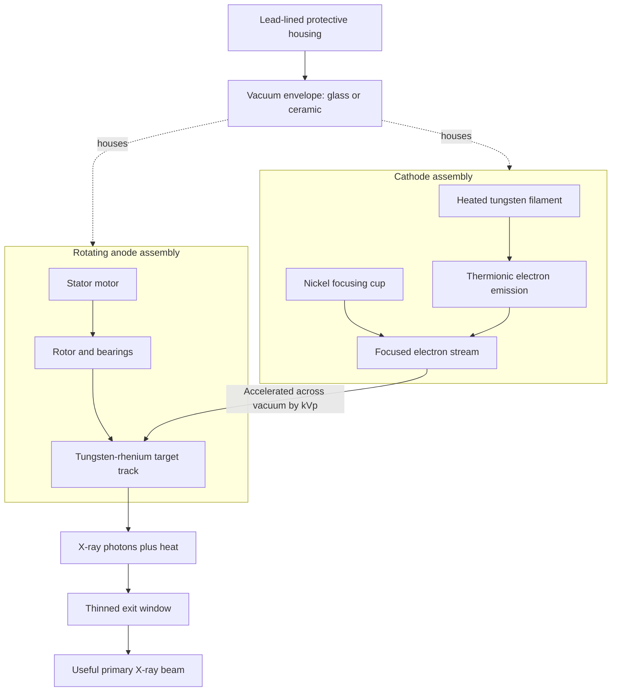
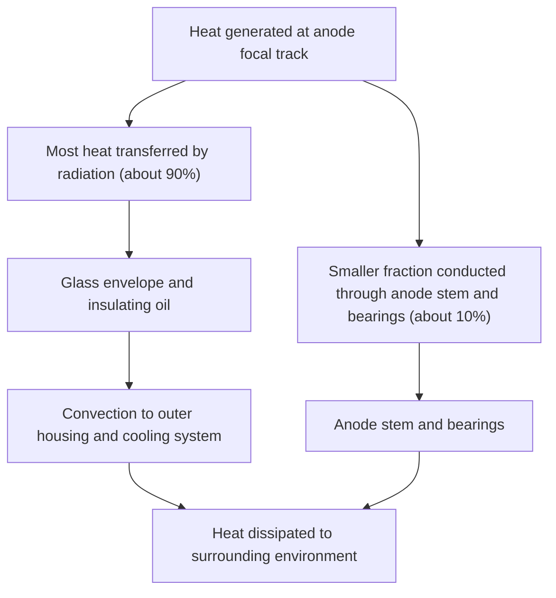

# Chapter 02: Production & Interactions of X-Rays

## 2.1 X-Ray Tube Construction & Physics

### Tube Architecture & Components
An X-ray tube is a highly specialized diode vacuum envelope designed to convert kinetic energy from accelerated electrons into X-ray photons ($\approx 1\%$ efficiency) and thermal heat ($\approx 99\%$ wasted energy).

### Component Metallurgy & Physical Roles

| Tube Component | Material Composition | Primary Physical Function & Rationale |
| :--- | :--- | :--- |
| **Glass Envelope** | Pyrex glass / Ceramic | Maintains high vacuum ($10^{-6}\text{ mmHg}$); prevents gas collision and filament burnout. Thinned at **exit window**. |
| **Protective Housing** | Lead-lined cast steel | Absorbs isotropic off-focus leakage radiation (limits leakage to $<1\text{ mGy/hr}$ at 1 meter). |
| **Cooling Medium** | Dielectric Oil Bath | Surrounds vacuum tube inside housing; provides electrical insulation and cooling. |
| **Cathode Filament** | **Tungsten (99%) + Thorium (1%)** | Source of electrons via thermionic emission. Tungsten has a high melting point ($3380^\circ\text{C}$); Thorium increases thermionic efficiency. |
| **Focusing Cup** | Nickel / Stainless steel | Negatively charged cup enclosing filament; electrostatically condenses electron cloud into a tight beam toward focal spot. |
| **Anode Target (Diagnostic)**| **Tungsten (90%) + Rhenium (10%) alloy** | Target for high-speed electron impact. Rhenium prevents surface crazing/pitting from thermal cycling. |
| **Anode Target (Mammography)**| **Molybdenum ($Z=42$) / Rhodium ($Z=45$)** | Produces low-energy characteristic X-rays ($17.5\text{--}20.2\text{ keV}$) for optimal soft-tissue breast contrast. |
| **Anode Stem & Rotor** | Molybdenum stem / Copper rotor | Molybdenum has low thermal conductivity (protects motor bearings); Copper rotor interacts with external stator coils for induction rotation. |

### Anode Heat Dissipation & Anode Types
Because **$>99\%$ of electron kinetic energy is converted into heat**, thermal management is vital:

1. **Rotating Anode**: Rotates at **3,000 to 10,000 RPM** during exposure. Spreads electron impact over a large circular track (beveled target angle $7^\circ\text{--}20^\circ$), increasing instantaneous thermal capacity by up to $1000\times$ compared to stationary anodes.
2. **Stationary Anode**: Consists of a small tungsten button embedded in a copper block. Used only in low-power units (dental radiography, mobile/field X-ray units).

---

## 2.2 Mechanisms of X-Ray Generation

X-ray production begins at the cathode via **Thermionic Emission**: heating the filament with low-voltage current ($\approx 10\text{ V}, 3\text{--}6\text{ A}$) creates a space-charge electron cloud. Applying high kilovoltage ($\text{kVp}$) accelerates electrons across the vacuum gap toward the anode.

When accelerated electrons collide with target tungsten atoms, two distinct X-ray generation mechanisms occur:

| Feature | Bremsstrahlung radiation | Characteristic radiation |
| --- | --- | --- |
| Basic mechanism | Incident electron is decelerated or deflected in the electric field of a target nucleus. | An incident electron ejects an inner-shell electron; an outer-shell electron fills the vacancy. |
| Photon energy | Variable; produces a continuous spectrum. | Discrete; equals the difference between electron-shell binding energies. |
| Dependence | Depends on incident electron energy and target nuclear charge. | Depends on the target element and the shell transition. |
| Spectrum | Continuous background up to the maximum photon energy set by kVp. | Sharp characteristic peaks superimposed on the continuum when the threshold energy is exceeded. |

### Detailed Comparison of X-Ray Spectra

| Feature | Bremsstrahlung (Braking) Radiation | Characteristic Radiation |
| :--- | :--- | :--- |
| **Etymology** | German for "Braking Radiation" | Named for target element's unique atomic shell binding energies |
| **Primary Contribution** | **Chief source (70–80%)** of X-rays in diagnostic radiography | Minor source (20–30%) in general X-rays; **Major source in Mammography** |
| **Atomic Interaction** | High-speed electron passes close to heavy nucleus; Coulomb attraction decelerates electron, emitting lost kinetic energy as a photon | High-speed electron strikes inner-shell (K-shell) electron, ejecting it. Outer-shell electron (L or M) drops down to fill vacancy |
| **Energy Spectrum** | **Continuous spectrum** (range of photon energies from zero up to maximum $\text{kVp}$) | **Discrete spectrum** (fixed specific photon energies equal to difference between shell binding energies) |
| **Tungsten Target Value** | Heterogeneous energies ($0\text{ to } \text{kVp}$) | Tungsten K-characteristic X-rays have fixed energy of **$\approx 69.5\text{ keV}$** (requires $\text{kVp} \ge 69.5$) |

**Qualitative X-ray energy spectrum**

An X-ray tube produces a continuous bremsstrahlung spectrum extending from low photon energies to the maximum energy set by the selected kVp. Characteristic radiation appears as narrow peaks at element-specific energies once the incident electrons can eject an inner-shell electron. The graph is therefore best understood as a continuous background with discrete peaks superimposed, rather than as a sequence of process steps.

| Spectrum component | Appearance | Energy characteristic |
|---|---|---|
| Bremsstrahlung | Continuous distribution | Photon energies range up to the tube potential (kVp) |
| Characteristic radiation | Discrete peaks | Fixed shell-transition energies of the anode material |

---

## 2.3 X-Ray Interactions with Matter (Patient's Body)

When an X-ray beam traverses patient tissue, photons undergo attenuation through absorption and scattering. Diagnostic radiology relies on five fundamental atomic interactions:

| Interaction | Typical energy range or condition | What happens | Imaging relevance |
| --- | --- | --- | --- |
| Coherent (Rayleigh) scattering | Predominantly very low photon energies | Photon changes direction without ionization or meaningful energy transfer. | Minor contribution to diagnostic image formation; contributes to scatter. |
| Photoelectric effect | Favoured at lower diagnostic energies and in high-atomic-number materials | Photon is completely absorbed and ejects a bound electron. | Important source of subject contrast, especially between bone/iodine and soft tissue. |
| Compton scattering | Common across much of the diagnostic energy range | Photon transfers part of its energy to an outer-shell electron and is deflected. | Major source of scatter and image fog; reduces contrast and increases occupational exposure. |
| Pair production | Photon energy above 1.022 MeV in the nuclear field | Photon energy is converted into an electron-positron pair. | Relevant to high-energy radiotherapy physics, not routine diagnostic radiography. |
| Photo-disintegration | Very high photon energies, typically above nuclear binding-energy thresholds | Photon is absorbed by a nucleus, which emits a nucleon or other nuclear particle. | Relevant mainly to high-energy radiation interactions. |

### Comprehensive Interaction Matrix

| Parameter | Photoelectric Effect | Compton Scattering | Coherent (Thomson) Scattering |
| :--- | :--- | :--- | :--- |
| **Photon Energy Level** | **Low energy** (Dominates at $< 50\text{ keV}$) | **Mid-to-High energy** ($50\text{ keV to } 10\text{ MeV}$) | Very low energy ($< 10\text{ keV}$) |
| **Target Electron** | **Inner-shell electron** (K or L shell) | **Outer-shell weakly bound electron** | Whole atom / bound electrons |
| **Energy Transfer** | **Complete absorption** ($E_{\text{photon}} = E_{\text{binding}} + E_{\text{kinetic}}$) | **Partial absorption** (energy shared between electron and scattered photon) | Zero energy absorption (only direction changes) |
| **Byproducts** | Photoelectron + Positive Ion + **Characteristic X-ray** | Recoil Photoelectron + **Scattered Photon** | Deflected photon of identical energy |
| **Dependence on Atomic Number ($Z$)** | Highly dependent: **$\propto Z^3$** | Independent of $Z$ (depends on electron density) | Minimal ($\propto Z^2$) |
| **Dependence on Energy ($E$)** | Inversely proportional: **$\propto 1/E^3$** | Decreases slowly with increasing energy ($1/E$) | Decreases with energy |
| **Clinical Effect** | **Desirable**: Chief source of high subject contrast (differentiates bone, soft tissue, fat) | **Undesirable**: Primary source of scatter radiation, personnel exposure, and image fogging | Minimal contribution to image noise |
| **Dominant Modality** | **Mammography** (Low $\text{kVp}$, high $Z$ difference) | **General Diagnostic Radiography & CT** | None |

| Feature | Photoelectric effect | Compton scattering |
| --- | --- | --- |
| Target electron | Tightly bound inner-shell electron. | More loosely bound outer-shell electron. |
| Photon outcome | Completely absorbed. | Scattered photon retains part of its energy. |
| Electron outcome | Photoelectron is ejected; characteristic radiation or Auger emission may follow. | Recoil electron is ejected. |
| Energy dependence | More likely at lower photon energies and with higher atomic number. | Depends primarily on electron density and is less dependent on atomic number. |
| Radiographic effect | Increases differential attenuation and image contrast. | Produces scatter, reducing image contrast. |

### High-Energy Non-Diagnostic Interactions
1. **Pair Production**: Occurs at high energies ($> 1.02\text{ MeV}$). Incident photon interacts with nuclear electromagnetic field, disappearing to create an electron-positron pair ($e^- + e^+$). Relevant in radiotherapy and PET annihilation physics.
2. **Photodisintegration**: Occurs at extreme energies ($> 10\text{ MeV}$). Incident photon strikes nucleus directly, causing emission of nuclear fragments/neutrons. Relevant in high-energy industrial accelerators.

---

## Summary Key Points for Revision
- **X-ray Tube Efficiency**: $< 1\%$ X-rays, $> 99\%$ heat.
- **Cathode**: Tungsten-Thorium filament (Thermionic emission source).
- **Anode Target**: Tungsten-Rhenium alloy (Rotating anode, $3000\text{--}10000\text{ RPM}$).
- **Bremsstrahlung**: Chief source ($70\text{--}80\%$) of diagnostic X-rays; continuous spectrum.
- **Characteristic Radiation**: Discrete spectrum; predominant mechanism in mammography.
- **Photoelectric Effect**: Low energy, inner shell, complete absorption, $\propto Z^3/E^3$, produces **high subject contrast**.
- **Compton Effect**: Mid-high energy, outer shell, partial scatter, independent of $Z$, chief source of **scatter radiation and film fog**.
