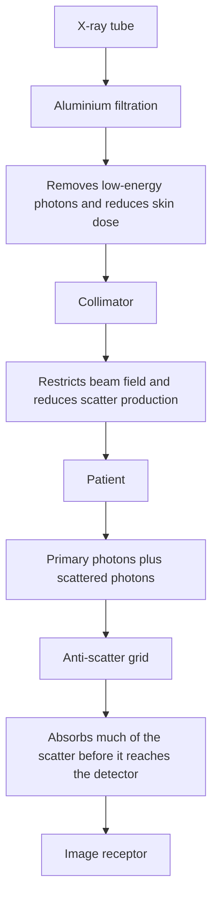
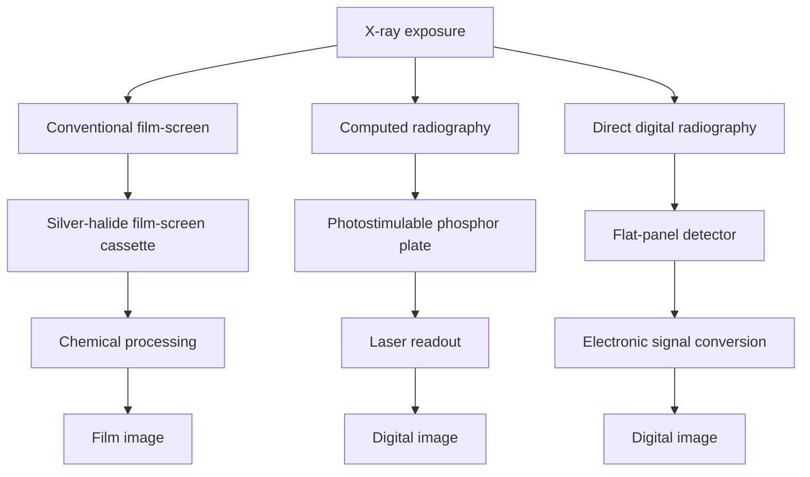

# Chapter 03: Radiographic Technique, Exposure Factors & Digital Imaging

## 3.1 Exposure Parameters & Film Density/Contrast

Radiographic quality relies on two primary technical parameters controlled at the operator console: **Kilovoltage Peak ($\text{kVp}$)** and **Milliampere-Seconds ($\text{mAs}$)**.

| Parameter | Mainly controls | Increasing the parameter generally causes | Principal imaging effect |
| --- | --- | --- | --- |
| Kilovoltage peak (kVp) | Maximum electron kinetic energy and X-ray photon energy | Greater beam penetration and a higher proportion of higher-energy photons | Changes beam quality and subject contrast; higher kVp generally reduces subject contrast. |
| Milliampere-seconds (mAs) | Total number of electrons crossing the tube and therefore photon quantity | More X-ray photons and greater receptor exposure | Changes image receptor exposure; with other factors fixed, dose generally increases with mAs. |

### Exposure Factor Matrix

| Parameter | Physics & Definition | Primary Effect on Image | Optimization Rules & Clinical Pearls |
| :--- | :--- | :--- | :--- |
| **Kilovoltage Peak ($\text{kVp}$)** | Electrical potential difference between cathode and anode; determines maximum kinetic energy of electrons | Controls X-ray **Beam Quality & Penetration**. Chief determinant of **Radiographic Contrast**. | $$\text{Contrast} \propto \frac{1}{\text{kVp}}$$   - **Low $\text{kVp}$ ($60\text{--}70\text{ kV}$)**: High contrast / short scale (black & white; bone, mammography). - **High $\text{kVp}$ ($120\text{--}150\text{ kV}$)**: Low contrast / wide latitude (chest imaging). |
| **Milliampere-Seconds ($\text{mAs}$)** | Product of tube current ($\text{mA}$) and exposure duration ($\text{seconds}$); $\text{mAs} = \text{mA} \times \text{s}$ | Controls X-ray **Beam Quantity / Total Photons**. Chief determinant of **Film Density / Blackening**. | $$\text{Film Density} \propto \text{mAs}$$   - **Under-exposed (Low $\text{mAs}$)**: Pale, grainy / quantum mottle. - **Over-exposed (High $\text{mAs}$)**: Excessively dark / black view. - **Morbidly Obese Patients**: **Increase $\text{mAs}$** to maintain density without over-penetration. |

> [!TIP] The 15% Rule
> A **15% increase in $\text{kVp}$** produces the same change in film density as **doubling the $\text{mAs}$**. Conversely, a 15% reduction in $\text{kVp}$ is equivalent to halving the $\text{mAs}$.

---

## 3.2 Radiographic Projections, Image Quality, Grids & Receptors

### Radiographic Projections: PA vs. AP Views

Chest radiographs and body projections are positioned to minimize geometric magnification and object-to-image distance (OID).

| Feature | PA chest projection | AP chest projection |
| --- | --- | --- |
| Usual setting | Standard erect chest radiograph. | Portable or bedside imaging, often in a supine or semi-erect patient. |
| Beam path | Posterior to anterior. | Anterior to posterior. |
| Typical source-to-image distance | Long, commonly about 180 cm. | Often shorter than standard PA imaging. |
| Heart position relative to detector | Heart is relatively close to detector. | Heart is farther from detector. |
| Apparent cardiac size | Less magnification; more reliable assessment of heart size. | Magnification can create apparent cardiomegaly. |

| Parameter | Postero-Anterior (PA) View | Antero-Posterior (AP) View |
| :--- | :--- | :--- |
| **Clinical Role** | **Standard routine view** (Erect chest radiograph) | Bedside / Portable unit (supine/debilitated patients) |
| **Source-to-Image Distance (SID)** | **$6\text{ feet} / 72\text{ inches} / 180\text{ cm}$** | Shorter distance ($100\text{ cm}$) |
| **Beam Path** | Enters patient's posterior surface $\rightarrow$ exits anterior surface | Enters patient's anterior surface $\rightarrow$ exits posterior surface |
| **Cardiac Magnification** | **Minimal / True Heart Size** (Heart is anterior, close to film) | **False Cardiomegaly** (Heart is distant from film, magnified by diverging beam) |

### Beam Modification: Filtration, Collimation & Anti-scatter Grids

#### Hardware Function & Composition

1. **Aluminium Filtration**: Minimum $2.5\text{ mm}$ Al equivalent filter removes low-energy non-diagnostic photons, "hardening" the beam and reducing patient skin dose.
2. **Lead Collimator / Cones**: Adjustable lead shutters that limit the X-ray field size. Restricting field size decreases scatter production and improves contrast.
3. **Anti-scatter Grids (Bucky Grid)**:
   - Invented by Gustav Bucky; consists of alternating thin **lead strips** and radiolucent interspaces (plastic/aluminium) placed between patient and image receptor.
   - **Mechanism**: Passes parallel primary unattenuated photons while absorbing angled scattered photons.
   - **Effect**: Significantly **improves image contrast**, but requires increased exposure factors (**increases patient dose by $2\text{--}6\times$**).

### Radiographic Densities
Tissues attenuate X-rays differentially based on atomic density, producing **five basic densities** on plain radiographs:

| Material or tissue | Relative radiographic density | Usual appearance |
| --- | --- | --- |
| Air | Lowest attenuation | Black (most radiolucent) |
| Fat | Low attenuation | Dark grey |
| Soft tissue and fluid | Intermediate attenuation | Light grey |
| Bone and calcium | High attenuation | White |
| Metal or dense contrast | Very high attenuation | Very bright white (most radiopaque) |

### Image Receptor Evolution: Film-Screen vs. CR vs. DR

| Parameter | Conventional Film-Screen | Computed Radiography (CR) | Direct Digital Radiography (DR) |
| :--- | :--- | :--- | :--- |
| **Receptor Material** | **Silver Bromide ($\text{AgBr}$)** emulsion on polyester base | **Photostimulable Phosphor (PSP)** plate: Barium fluorohalide with Europium ($\text{BaFBr:Eu}^{2+}$) | **Flat-Panel Detector**: Amorphous Selenium (Direct) or Amorphous Silicon + CsI (Indirect) |
| **Processing Method** | Darkroom chemical developing/fixing (Red safelight) | Laser scanner digitizer (Red helium-neon laser releases trapped electrons as blue light) | Direct electronic signal readout to computer workstation |
| **Workflow Speed** | Slowest ($5\text{--}10\text{ minutes}$) | Moderate ($1\text{--}2\text{ minutes}$) | **Fastest ($< 5\text{ seconds}$)** |
| **Dynamic Range** | Narrow (Fixed exposure latitude) | Wide | **Widest** |
| **Reusability** | Single use | Reusable (erased with bright white light) | Reusable (permanent solid-state panel) |

---

## Summary Key Points for Revision
- **$\text{kVp}$ Controls Beam Quality & Contrast**: Lower $\text{kVp} \implies$ higher contrast.
- **$\text{mAs}$ Controls Beam Quantity & Density**: Higher $\text{mAs} \implies$ darker film density.
- **15% Rule**: $15\%$ increase in $\text{kVp} \equiv$ doubling the $\text{mAs}$.
- **PA Chest View**: Standard $180\text{ cm}$ distance, true cardiac shadow size.
- **AP Chest View**: Bedside portable, false cardiomegaly.
- **Aluminium Filter**: Removes soft low-energy X-rays, reduces skin dose.
- **Anti-scatter Grids**: Lead lines absorb scatter, improve contrast, increase patient dose.
- **5 Radiographic Densities**: Air (blackest) $<$ Fat $<$ Soft Tissue $<$ Bone $<$ Metal (whitest).
- **Digital Receptors**: CR uses **Photostimulable Phosphor (PSP)** plates; DR uses **Amorphous Selenium/Silicon** flat-panels.
