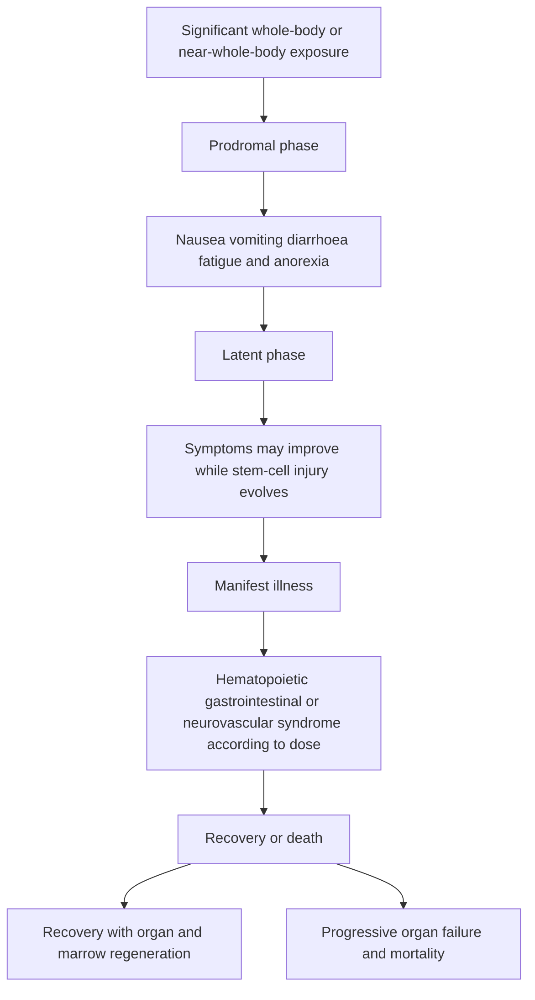

# Chapter 05: Biological Effects of Radiation and Acute Syndromes

> [!NOTE]
> Biological damage from ionizing radiation occurs via direct interaction with critical targets (DNA) or indirect interaction via radiolysis of water molecules creating reactive oxygen species (ROS) / free radicals. Biological effects are classified clinically into **Deterministic (Tissue Reactions)** and **Stochastic Effects**.

---

## 5.1 Deterministic vs. Stochastic Effects

| Feature | Deterministic effects (tissue reactions) | Stochastic effects |
| --- | --- | --- |
| Threshold | Generally have a dose threshold below which the effect is not expected. | No threshold is assumed for radiation-protection purposes. |
| What increases with dose? | Severity increases once the threshold is exceeded. | Probability of the effect increases with dose. |
| Typical examples | Skin erythema, epilation, cataract and tissue injury at sufficiently high doses. | Radiation-induced malignancy and heritable effects. |
| Dose-response description | Threshold followed by increasing severity. | Increasing probability with dose; severity is not considered dose-dependent in the same way. |

### Comprehensive Comparison Matrix

| Parameter / Feature | **Deterministic Effects (Tissue Reactions)** | **Stochastic Effects** |
| :--- | :--- | :--- |
| **Fundamental Nature** | Cell killing / loss of functional parenchymal cells | DNA mutation / oncogenic transformation in a viable cell |
| **Threshold Dose** | **YES** — Clear dose threshold below which effect does NOT occur | **NO** — No threshold (Linear No-Threshold / LNT model) |
| **Severity vs. Dose** | **Dose-Dependent** (higher dose = more severe damage) | **Dose-Independent** (severity is fixed regardless of dose) |
| **Probability vs. Dose** | Zero below threshold; 100% well above threshold | **Dose-Dependent Probability** (higher dose = higher risk of occurrence) |
| **Time of Appearance** | Early / Acute (days to weeks); Late tissue fibrosis (months) | Delayed / Latent (Years to decades; Leukemias: 2–7 yrs, Solid cancers: 10–30 yrs) |
| **Clinical Examples** | • Skin erythema ($2\text{ Gy}$) • Epilation / Hair Loss ($3\text{ Gy}$) • Cataracts ($0.5\text{ Gy}$) • Permanent Sterility ($3.5 - 5\text{ Gy}$) • Acute Radiation Syndromes | • Radiation Carcinogenesis (Leukemia, Papillary Thyroid CA, Breast CA, Osteosarcoma) • Hereditary / Genetic Mutations in germ cells |

> [!WARNING]
> **Linear No-Threshold (LNT) Model**:
> Current radiation protection standards assume that **any dose of radiation, no matter how small, carries a proportional risk of inducing stochastic effects (cancer or genetic mutations)**. There is no "safe" lower limit for stochastic risk.

---

## 5.2 Acute Radiation Syndromes (ARS)

**Acute Radiation Syndrome (ARS)** (historically called radiation sickness) is an acute deterministic illness caused by whole-body (or near-whole-body) exposure to a high dose of penetrating ionizing radiation ($>1\text{ Gy}$) delivered over a very short duration (minutes to hours).

---

### The Three Classic Clinical Syndromes of ARS

| Approximate whole-body dose range in the outline | Major target tissue | Acute radiation syndrome pattern |
| --- | --- | --- |
| 1–2 Gy | Bone-marrow stem and progenitor cells | Hematopoietic syndrome predominates. |
| 6–10 Gy | Gastrointestinal crypt epithelium | Gastrointestinal syndrome becomes prominent. |
| Above approximately 20–30 Gy | Neurovascular and other rapidly affected systems | Neurovascular/CNS syndrome may predominate. |

#### 1. Hematopoietic (Bone Marrow) Syndrome ($1 - 2\text{ Gy}$ Threshold; $2 - 6\text{ Gy}$ Peak)
* **Target Organ**: Hematopoietic progenitor stem cells in bone marrow and lymphatic system.
* **Pathophysiology**: Cessation of blood cell production. ==Lymphocytes drop first== (within hours), followed by granulocytes and platelets over 2–4 weeks.
* **Clinical Features**: Severe lymphopenia, neutropenia, thrombocytopenia, mucosal bleeding, petechiae, fever, and opportunistic bacterial infections.
* **Prognosis**: Potentially survivable with supportive care (barrier isolation, broad-spectrum antibiotics, blood transfusions, recombinant G-CSF / Granulocyte Colony-Stimulating Factor). $LD_{50/60}$ (lethal dose for 50% of population in 60 days without treatment) is $\sim 3.5 - 4.5\text{ Gy}$.

#### 2. Gastrointestinal (GI) Syndrome ($6 - 10\text{ Gy}$ Threshold)
* **Target Organ**: Basal stem cells in the intestinal crypts of Lieberkühn.
* **Pathophysiology**: Loss of crypt cell regeneration leads to denudation of intestinal villi, breakdown of mucosal barrier, massive fluid/electrolyte shift, and intestinal bacterial translocation.
* **Clinical Features**: Severe intractable nausea, vomiting, bloody diarrhea (dysentery), severe dehydration, abdominal cramps, paralytic ileus, sepsis, and septic shock.
* **Prognosis**: Usually fatal within 10–14 days despite aggressive fluid resuscitation and intensive care.

#### 3. Central Nervous System (CNS) / Neurovascular Syndrome ($> 20 - 30\text{ Gy}$ Threshold)
* **Target Organ**: Microvascular endothelial cells of brain parenchyma and cerebral capillaries.
* **Pathophysiology**: Severe endothelial destruction, fluid leakage, acute cerebral edema, increased intracranial pressure (ICP), and direct nerve cell damage.
* **Clinical Features**: Immediate onset of severe nausea/vomiting, extreme agitation, confusion, ataxia, intractable headache, generalized convulsions, coma, and shock.
* **Prognosis**: 100% fatal within 24 to 72 hours.

---

## 5.3 Fetal & Gestational Radiation Effects

The human embryo/fetus is exceptionally radiosensitive due to rapid cell proliferation and organ differentiation. The nature of biological injury depends strictly on the **gestational age** at exposure.

| Gestational period (approximate) | Developmental stage | Potential radiation effect |
| --- | --- | --- |
| 0–2 weeks after conception | Pre-implantation | Classically described as an all-or-none period: embryonic loss or survival without a major structural malformation. |
| 2–8 weeks after conception | Organogenesis | Greater susceptibility to structural malformations. |
| 8–15 weeks after conception | Early fetal period | Greater susceptibility to severe ==neurodevelopmental effects==. |
| 15–25 weeks after conception | Later fetal period | ==Neurodevelopmental risk generally decreases but does not disappear.== |
| After approximately 25 weeks | Later fetal period | Structural teratogenic risk is lower; stochastic childhood cancer risk remains relevant. |

### Gestational Stage Breakdown

#### 1. Pre-Implantation Period ($0 - 2\text{ Weeks}$ Post-Conception)
* **Principle**: **"All-or-None" Law**.
* High-dose radiation ($> 0.1\text{ Gy}$) causes embryonic death and spontaneous abortion.
* If the embryo survives, it develops normally without structural malformations because uncommitted blastomeres repair or compensate completely.

#### 2. Period of Major Organogenesis ($2 - 8\text{ Weeks}$ Post-Conception)
* **Principle**: Peak susceptibility for **structural congenital malformations (Teratogenesis)**.
* Specific organs affected depend on the exact day of exposure (e.g., neural tube defects, skeletal anomalies, cleft palate, renal dysgenesis).
* Growth retardation and organ hypoplasia are prominent.

#### 3. Early Fetal Period ($8 - 15\text{ Weeks}$ Post-Conception)
* **Principle**: **Maximum vulnerability window for Central Nervous System (CNS) damage**.
* Rapid neuroblast proliferation and migration to the cerebral cortex occur during this window.
* Radiation disrupts neuroblast migration, leading to **severe intellectual disability (mental retardation)**, microcephaly, and severe IQ reduction (loss of $\sim 25 - 30\text{ IQ points per Gy}$).

#### 4. Late Fetal Period ($15 - 25\text{ Weeks}$ Post-Conception)
* Risk of severe mental retardation persists but is significantly lower than in the $8 - 15$ week window.
* Risk becomes minimal after 25 weeks gestation.

#### 5. Late Gestation / Third Trimester ($> 25\text{ Weeks}$)
* Primary hazard shifts from deterministic structural defects to **stochastic risks** (induction of childhood leukemia and solid tumors).

> [!IMPORTANT]
> **The $5\text{ rad}$ ($50\text{ mGy}$) Safety Rule**:
> According to the American College of Obstetricians and Gynecologists (ACOG) and ICRP, **a cumulative fetal radiation dose of $< 5\text{ rad}$ ($50\text{ mGy}$) is NOT associated with an increased risk of fetal anomalies or pregnancy loss**. Virtually all routine diagnostic X-rays and CT scans deliver doses well below this $50\text{ mGy}$ threshold.

---

> [!TIP]
> **Summary Thresholds for Exams**:
> - **Skin Erythema**: $2\text{ Gy}$
> - **Epilation (Temporary)**: $3\text{ Gy}$
> - **Cataractogenesis**: $0.5\text{ Gy}$
> - **Permanent Sterility (Males/Females)**: $3.5 - 5\text{ Gy}$
> - **Hematopoietic Syndrome**: $1 - 2\text{ Gy}$
> - **GI Syndrome**: $6 - 10\text{ Gy}$
> - **CNS Syndrome**: $> 20 - 30\text{ Gy}$
> - **Fetal Safe Threshold**: $5\text{ rad}$ ($50\text{ mGy}$)
