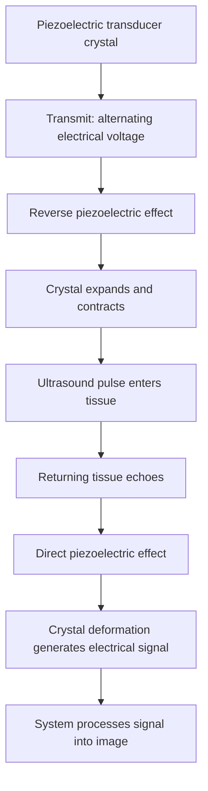

# Chapter 08: Ultrasonography (USG) & Doppler Physics

## 8.1 Physical Basis & Transducers

Ultrasonography (USG) is a non-ionizing, real-time cross-sectional imaging modality utilizing high-frequency mechanical sound waves ($>20,000 \text{ Hz}$; diagnostic range **2 to 18 MHz**) transmitted into body tissues.

### The Piezoelectric Effect & Transducer Metallurgy
Ultrasound production and reception depend on the **Piezoelectric Effect**, discovered by Pierre and Jacques Curie:
1. **Reverse Piezoelectric Effect (Transmission)**: An alternating electrical voltage applied across synthetic ceramic crystals—primarily **Lead Zirconate Titanate (PZT)**—causes mechanical expansion and contraction of the crystal lattice, generating high-frequency acoustic waves.
2. **Direct Piezoelectric Effect (Reception)**: Returning mechanical acoustic echoes strike the PZT crystal, causing physical lattice deformation that generates a proportional electrical voltage processed into image pixels.

### Transducer Construction
- **PZT Crystal Element**: Thickness determines fundamental resonance frequency ($\text{Thickness} = \frac{1}{2} \text{Wavelength}$).
- **Damping Layer (Backing Material)**: Attached to the rear of the PZT crystal; absorbs backward sound waves and dampens crystal ringing to produce short pulse lengths, maximizing axial resolution.
- **Matching Layer**: Placed on the front face of the crystal; bridges the severe acoustic impedance mismatch between the PZT crystal ($Z \approx 30 \times 10^6 \text{ Rayls}$) and human soft tissue ($Z \approx 1.5 \times 10^6 \text{ Rayls}$).
- **Acoustic Coupling Gel**: Eliminates the thin air layer between probe and skin (air $Z = 0.0004 \times 10^6 \text{ Rayls}$, which would otherwise reflect $99.9\%$ of the acoustic beam).

### Acoustic Impedance & Reflection
The boundary reflection of sound waves depends on differences in **Acoustic Impedance ($Z$)**:

$$Z = \rho \times c$$

*(where $\rho = \text{tissue density in kg/m}^3$, and $c = \text{speed of sound in tissue in m/s}$).*

- **Speed of Sound in Soft Tissue**: Standardized at **$1540 \text{ m/s}$** (Air $= 330 \text{ m/s}$; Bone $= 4080 \text{ m/s}$).
- **Specular Reflection**: Occurs at large, smooth tissue interfaces (e.g., diaphragm, liver capsule). The greater the difference in $Z$ between two tissues, the greater the intensity of reflected echo.

### Frequency vs. Spatial Resolution vs. Depth Trade-Off

$$\text{Attenuation} \propto \text{Frequency}$$

| Feature | High-frequency probe | Low-frequency probe |
| --- | --- | --- |
| Typical frequency range in the outline | 7.5–15 MHz | 2–5 MHz |
| Wavelength | Shorter. | Longer. |
| Spatial resolution | Higher. | Lower. |
| Attenuation | Higher. | Lower. |
| Penetration | Shallower. | Deeper. |
| Common applications | Thyroid, breast, scrotum and superficial vessels. | Abdomen, pelvis and obstetric imaging. |

### Transducer Array Architectures

| Transducer Type | Frequency Range | Beam Profile & Footprint | Primary Clinical Applications |
| :--- | :--- | :--- | :--- |
| **Linear Array** | $7.5 - 15.0 \text{ MHz}$ | Flat rectangular footprint; parallel vertical beam lines | Superficial structures: Thyroid, Breast, Scrotum, Musculoskeletal, Peripheral Vessels |
| **Curved / Convex Array** | $2.0 - 5.0 \text{ MHz}$ | Curved convex footprint; blunted sector pie-shaped field | Deep abdominal organs, Pelvis, Obstetrics & Gynecology |
| **Phased Array** | $1.5 - 3.5 \text{ MHz}$ | Small flat footprint; electronic beam steering/focusing forming a triangular sector | Cardiac imaging (Echocardiography), Transcranial Doppler, Intercostal windows |

---

## 8.2 Acoustic Terminology & Artifacts

### Gray-Scale Echogenicity Spectrum

| Term | Typical appearance | Examples in the outline |
| --- | --- | --- |
| Hyperechoic | Bright or white. | Bone, calculi, gas interfaces and surgical clips. |
| Isoechoic | Similar echogenicity to surrounding reference tissue. | Normal solid-organ parenchyma. |
| Hypoechoic | Darker grey. | Many solid lesions and lymph nodes. |
| Anechoic | Black; no internal echoes in a simple fluid collection. | Simple cyst, urine and bile. |

1. **Hyperechoic (Bright White)**: Reflects a high percentage of sound waves (e.g., bone, gallstones, renal calculi, fat, gas).
2. **Isoechoic (Mid-Gray)**: Echo intensity equal to surrounding reference parenchyma (e.g., liver vs. spleen).
3. **Hypoechoic (Dark Gray)**: Reflects few sound waves (e.g., solid tumors, lymph nodes, muscle).
4. **Anechoic (Jet Black)**: Complete transmission of sound waves without reflection (e.g., simple cysts, full urinary bladder, gallbladder bile, clear serum).

### High-Yield Ultrasound Artifacts

| Artefact | Mechanism | Typical appearance / example |
| --- | --- | --- |
| Posterior acoustic shadowing | Strong reflection or absorption by a highly attenuating structure limits sound transmission beyond it. | Dark shadow deep to a gallstone or calcification. |
| Posterior acoustic enhancement | Low attenuation through fluid allows more sound to reach tissues deep to the fluid. | Increased brightness deep to a simple cyst or fluid-filled structure. |

> [!IMPORTANT]
> **Diagnostic Artifact Features**:
> 1. **Posterior Acoustic Shadowing**: Sound beam strikes a highly attenuating structure (gallstone, renal calculus, bone). All sound is reflected or absorbed, leaving a **clean dark acoustic shadow** posterior to the lesion.
> 2. **Posterior Acoustic Enhancement**: Sound beam passes through a low-attenuation fluid structure (cyst, distended bladder). Less energy is absorbed compared to adjacent solid tissue, causing tissues posterior to the fluid to appear **inappropriately bright/hyperechoic**.
> 3. **Comet-Tail / Ring-Down Artifact**: Formed by rapid reverberation of sound between closely spaced strong reflectors (e.g., cholesterol crystals in gallbladder adenomyomatosis, surgical staples, gas bubbles).
> 4. **Mirror-Image Artifact**: Sound beam strikes a smooth, highly reflective specular surface (e.g., diaphragm) at an angle. Echoes bounce back and forth before returning to the probe, creating a **false duplicate image** on the opposite side of the reflector (e.g., liver tissue mirrored above the diaphragm into the chest cavity).

---

## 8.3 Doppler Ultrasound Physics

Doppler ultrasound measures changes in acoustic frequency resulting from moving reflectors (primarily **Red Blood Cells [RBCs]**) relative to the stationary transducer.

$$\Delta f = f_r - f_t = \frac{2 f_0 v \cos\theta}{c}$$

*(where $\Delta f = \text{Doppler frequency shift}$, $f_0 = \text{transmitted frequency}$, $v = \text{RBC velocity}$, $\theta = \text{angle of insonation}$, and $c = \text{speed of sound in tissue } 1540 \text{ m/s}$).*

| Insonation angle (θ) | cos θ | Doppler shift implication |
| --- | --- | --- |
| 0° | 1.0 | Maximum Doppler shift for a given velocity. |
| 60° | 0.5 | Half the maximum shift; commonly used as the upper practical angle for vascular velocity measurements. |
| 90° | 0 | No Doppler shift from flow aligned perpendicular to the beam. |

The Doppler equation is:

$$\Delta f=\frac{2f_0v\cos\theta}{c}$$

Angle correction matters because velocity estimates become increasingly sensitive to small angle errors at larger insonation angles.

> [!WARNING]
> **The $90^\circ$ Insonation Angle Rule**:
> If the ultrasound beam is perpendicular ($90^\circ$) to the blood vessel, $\cos 90^\circ = 0$. The calculated Doppler shift drops to **ZERO**, falsely suggesting **complete absence of blood flow**. The insonation angle must ALWAYS be steered to **$\le 60^\circ$**.

### Clinical Doppler Modes

1. **Color Doppler**:
   - Assigns color pixels to mean Doppler frequency shifts overlaid on 2D B-mode images.
   - **BART Rule**: **B**lue **A**way, **R**ed **T**owards the transducer. (Color denotes direction relative to probe, NOT arterial vs. venous blood!).

2. **Pulsed Wave (PW) Spectral Doppler**:
   - Uses a single PZT crystal gated to sample blood flow velocity at a specific depth sample volume (gate).
   - **Aliasing Artifact**: Occurs when peak flow velocity exceeds the **Nyquist Limit** ($\text{Nyquist Limit} = \frac{\text{Pulse Repetition Frequency [PRF]}}{2}$). Causes the spectral peak to wrap around the baseline. *Fix*: Increase scale/PRF, shift baseline, or lower operating frequency.

3. **Power Doppler (Energy Doppler)**:
   - Displays total amplitude/power of the Doppler signal rather than frequency shift or velocity.
   - **Advantages**: Independent of insonation angle ($\theta$), no aliasing, highly sensitive to low-volume, slow microvascular flow (e.g., renal cortical ischemia, testicular torsion, tumor angiogenesis).
   - **Disadvantage**: Gives no velocity or directional information.

4. **Resistive Index (RI)**:
   - Quantifies downstream arterial vascular resistance from spectral waveforms:
   $$\text{RI} = \frac{\text{Peak Systolic Velocity (PSV)} - \text{End Diastolic Velocity (EDV)}}{\text{Peak Systolic Velocity (PSV)}}$$
   - *Normal Kidney RI*: $<0.70$. An $\text{RI} > 0.70 - 0.75$ indicates elevated intrarenal resistance (e.g., acute cellular transplant rejection, acute tubular necrosis, severe obstructive uropathy).
