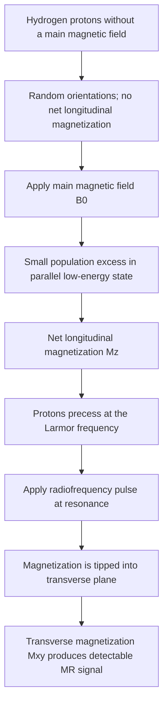
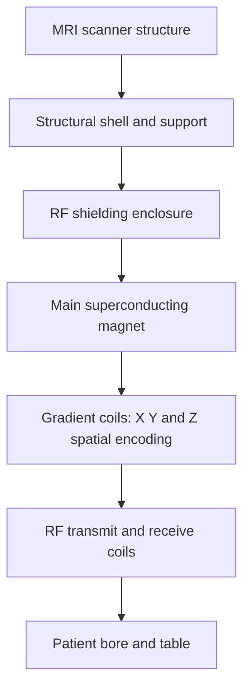

# Chapter 09: Magnetic Resonance Imaging (MRI) Principles

## 9.1 Physical Principle of NMR & Hydrogen Proton Dynamics

Magnetic Resonance Imaging (MRI) generates high-contrast cross-sectional images without ionizing radiation by manipulating the magnetic properties of hydrogen protons ($^1\text{H}$) abundant in body water and fat.

### Nuclear Spin & The Larmor Equation
Unpaired nuclear protons possess an intrinsic quantum property known as **Spin**, giving them a small magnetic moment ($\mu$). 
When a patient is placed inside a main static magnetic field ($B_0$, measured in Tesla):
1. Protons align either parallel (low-energy state) or anti-parallel (high-energy state) to $B_0$. A slight excess aligns parallel, creating a **Net Longitudinal Magnetization Vector ($M_z$)**.
2. Protons wobble (precess) around the $B_0$ axis at a specific resonant frequency defined by the **Larmor Equation**:

$$\omega_0 = \gamma \times B_0$$

- $\omega_0 = \text{Larmor Precessional Frequency (MHz)}$
- $\gamma = \text{Gyromagnetic Ratio of Hydrogen } (42.58 \text{ MHz/Tesla})$
- $B_0 = \text{Main Static Magnetic Field Strength (Tesla)}$

> [!NOTE]
> **Resonant Precessional Frequencies**:
> - At **1.5 Tesla**: $\omega_0 = 42.58 \times 1.5 = \mathbf{63.87 \text{ MHz}}$ (Radiofrequency spectrum).
> - At **3.0 Tesla**: $\omega_0 = 42.58 \times 3.0 = \mathbf{127.74 \text{ MHz}}$.

### Radiofrequency (RF) Pulse Excitation
To detect a signal, a short **Radiofrequency (RF) Pulse** tuned precisely to the Larmor frequency is transmitted into the patient via excitation coils. This delivers energy via resonance:
- Tips the longitudinal vector $M_z$ into the transverse plane ($90^\circ$ flip angle), creating **Transverse Magnetization ($M_{xy}$)**.
- Causes precessing protons to spin synchronously in-phase.

---

## 9.2 Relaxation Times & Image Weighting

When the RF pulse is turned off, the absorbed energy is released as protons return to equilibrium (**Relaxation**). This generates a measurable RF signal in receiver coils.

| Feature | T1 relaxation (spin–lattice) | T2 relaxation (spin–spin) |
| --- | --- | --- |
| What changes? | Recovery of longitudinal magnetization (Mz). | Loss of transverse magnetization (Mxy). |
| Physical description | Energy transfer from excited spins to their surroundings. | Loss of phase coherence between spins. |
| Characteristic time | T1 is the time for longitudinal magnetization to recover to about 63% of its final value. | T2 is the time for transverse magnetization to decay to about 37% of its initial value. |
| Typical image association | Short T1 tissues are relatively bright on T1-weighted images; fat is a common example. | Long T2 tissues are relatively bright on T2-weighted images; fluid and oedema are common examples. |

### $T_1$ Relaxation (Spin-Lattice / Longitudinal Recovery)
- Process by which precessing protons transfer absorbed thermal energy to the surrounding molecular lattice, recovering longitudinal magnetization ($M_z$).
- **$T_1$ Time**: Time required for $M_z$ to recover to **$63\%$ of its maximum original value**.
- **$T_1$ Brightness Rule**: 
	- Tissues that exchange energy quickly (e.g., **Fat**, proteinaceous fluid, subacute methemoglobin blood, gadolinium) have a **Short $T_1$** and appear **HYPERINTENSE (Bright White)** on $T_1\text{W}$ images. 
	- Pure water/CSF has a long $T_1$ and appears **HYPOINTENSE (Dark)**.

### $T_2$ Relaxation (Spin-Spin / Transverse Decay)
- Process by which precessing protons lose phase coherence due to magnetic interactions between neighboring proton spins, causing decay of transverse magnetization ($M_{xy}$).
- **$T_2$ Time**: Time required for $M_{xy}$ to decay down to **$37\%$ of its initial value**.
- **$T_2$ Brightness Rule**: 
	- Tissues with mobile hydrogen molecules (e.g., **Water, CSF, Edema, Tumor, Inflammation**) retain transverse coherence longer, having a **Long $T_2$** and appearing **HYPERINTENSE (Bright White)** on $T_2\text{W}$ images. 
	- Fat has a shorter $T_2$ and appears intermediate to dark.

### Pulse Sequence Timing Parameters (TR & TE)
Image weighting is controlled by manipulating two user-selected timing intervals:
1. **Repetition Time (TR)**: Interval between successive 90° RF excitation pulses.
2. **Echo Time (TE)**: Interval between the 90° RF pulse and reading the peak signal echo.

| Image Weighting                    | Repetition Time (TR)          | Echo Time (TE)               | Bright Structures (Hyperintense)                                                                          | Dark Structures (Hypointense)                                                                           |
| :--------------------------------- | :---------------------------- | :--------------------------- | :-------------------------------------------------------------------------------------------------------- | :------------------------------------------------------------------------------------------------------ |
| **$T_1$-Weighted ($T_1\text{W}$)** | **Short** ($<600 \text{ ms}$) | **Short** ($<30 \text{ ms}$) | Subcutaneous Fat, Myelin, Subacute Blood (Methemoglobin), Contrast                                        | <mark style="background: #BBFABBA6;">Water, CSF, Urine </mark>, ==Chronic Scarring==, ==Calcification== |
| **$T_2$-Weighted ($T_2\text{W}$)** | **Long** ($>2000 \text{ ms}$) | **Long** ($>80 \text{ ms}$)  | <mark style="background: #BBFABBA6;">Water, CSF, Urine</mark>, Bile, Cysts, Vasogenic Edema, Inflammation | Cortical Bone, ==Fibrous Tissue==, Air, ==Calcification==                                               |
| **Proton Density (PD)**            | **Long** ($>2000 \text{ ms}$) | **Short** ($<30 \text{ ms}$) | Cartilage, Menisci, Tendons, Ligaments (high SNR)                                                         | Air, Cortical Bone                                                                                      |

### Specialized Advanced MRI Sequences

| Sequence | Core mechanism | Typical signal effect / clinical use |
| --- | --- | --- |
| FLAIR | T2-weighted inversion-recovery sequence that suppresses free-fluid signal. | CSF becomes dark; useful for periventricular lesions and selected subarachnoid or parenchymal abnormalities. |
| STIR | Inversion-recovery sequence timed to suppress fat signal. | Fat becomes dark; useful for marrow oedema, soft-tissue oedema and selected musculoskeletal applications. |
| DWI with ADC map | Sensitive to microscopic water diffusion. | Restricted diffusion is typically bright on DWI and dark on ADC; useful in acute ischaemic stroke and other cellular lesions. |

> [!IMPORTANT]
> **Key Sequence Characteristics**:
> - **FLAIR (Fluid Attenuated Inversion Recovery)**: A $T_2\text{W}$ sequence with an inversion recovery pulse that ==specifically nulls signal from free fluid (CSF appears **BLACK==**). Makes subtle bright lesions adjacent to ventricles (e.g., **Multiple Sclerosis demyelinating plaques**) stand out clearly.
> - **STIR (Short Tau Inversion Recovery)**: ==Suppresses fat signal==, <mark style="background-color: #ffd1e4; color: #5c203d;">making marrow edema, occult fractures, and soft tissue inflammation stand out as bright $T_2$ signals.</mark> *Pitfall*: STIR cannot be used post-gadolinium because gadolinium shortens $T_1$ to the null point of fat, canceling enhancement.
> - **DWI & ADC Map (Acute Stroke Workup)**:
>   - **Restricted Diffusion**: When cytotoxic edema impairs intracellular water movement (e.g., within 30 minutes of acute ischemic stroke onset), water molecules cannot diffuse freely.
>   - *Appearance*: **BRIGHT (Hyperintense) on DWI** and **DARK (Hypointense) on ADC Map**.

---

## 9.3 Hardware, Signal Terminology & Safety Rules

### MRI Scanner Components
1. **Main Superconducting Magnet**: Made of **Niobium-Titanium (NbTi)** wire loops cooled by ==**Liquid Helium**== to **$4.2 \text{ Kelvin}$ ($-269^\circ\text{C}$)** to achieve zero electrical resistance, maintaining a permanent static field ($B_0 = 1.5 \text{ T or } 3.0 \text{ T}$).
2. **Gradient Coils**: Three orthogonal electromagnetic coils ($X, Y, Z$) inside the bore that create small linear magnetic field gradients for spatial encoding (slice selection, phase encoding, frequency encoding). *Note*: Rapid switching of gradient coils creates the loud banging acoustic noise during scanning.
3. **Faraday Cage**: A continuous ==copper== mesh/sheet enclosure lining the entire MRI room walls, floor, and window to prevent external environmental radio waves (radio stations, cellular signals) from corrupting the delicate MRI signal.

### Signal Intensity Terminology Matrix

| Signal Intensity Term | Appearance | Typical Tissues / Substances |
| :--- | :--- | :--- |
| **Hyperintense** | Bright White | $T_1\text{W}$: Subcutaneous fat, methemoglobin, gadolinium. $T_2\text{W}$: CSF, cysts, edema, tumor. |
| **Isointense** | Intermediate Gray | Normal brain parenchyma, solid viscera. |
| **Hypointense** | Dark Gray / Black | $T_1\text{W}$: CSF, urine, edema. $T_2\text{W}$: Tendons, ligaments, acute blood. |
| **Signal Void** | Jet Black (No signal on ALL sequences) | **Cortical Bone** (lack of mobile $^1\text{H}$ protons), **Air** (paranasal sinuses, lungs), **Flowing Blood** (flow void), **Surgical Metal / Calcification**. |

### MRI Safety Rules & Contraindications

> [!WARNING]
> **Crucial MRI Safety Warnings**:
> 1. **The Magnet is ALWAYS ON!**: Superconducting magnets never turn off between patients. Metallic objects brought into Zone IV become lethal airborne projectiles (**Projectile / Missile Effect**).
> 2. **Absolute Contraindications**:
>    - Non-MRI compatible cardiac pacemakers / Implantable Cardioverter-Defibrillators (ICDs).
>    - Metallic intraocular foreign bodies (risk of retinal tear/blindness).
>    - Ferromagnetic cerebral aneurysm clips (risk of fatal displacement).
>    - Cochlear implants.
> 3. **Thermal Risk (RF Heating & Specific Absorption Rate - SAR)**: RF pulses induce electrical currents in long metallic wires (e.g., ==ECG leads, deep brain stimulators==), causing severe ==skin contact burns.==
> 4. **Acoustic Noise**: Patients MUST wear earplugs or headphones (gradient coil vibration exceeds $100 - 110 \text{ dBA}$).
> 5. **Emergency Quench**: Controlled rapid boil-off of liquid helium coolant ($>1000 \text{ Liters}$) venting to the outside atmosphere. Deployed ONLY during life-threatening projectile entrapment or building fire. *Risk*: Helium gas leak into bore causes rapid asphyxiation and frostbite.
> 6. **Pregnancy Safety**: Non-contrast MRI is safe across **ALL trimesters** at 1.5 T or 3.0 T (no ionizing radiation). Gadolinium contrast is avoided due to unknown fetal risks.
