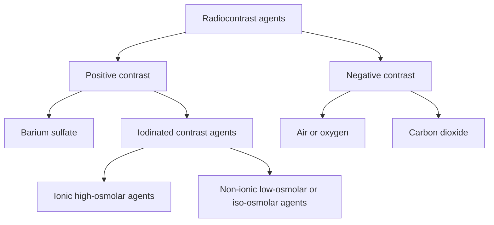
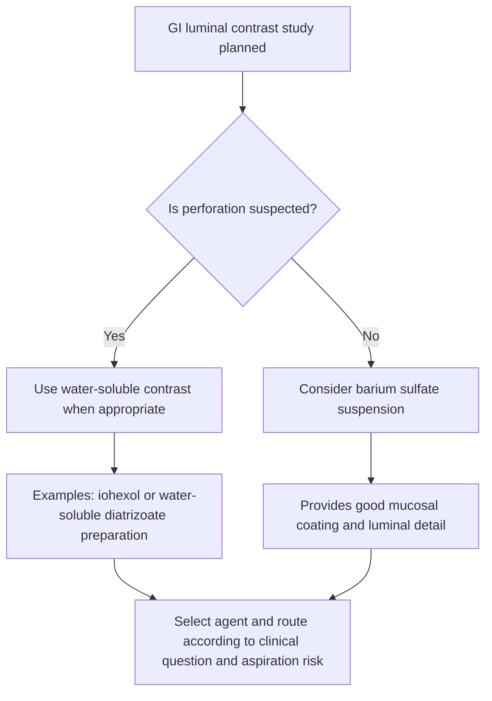
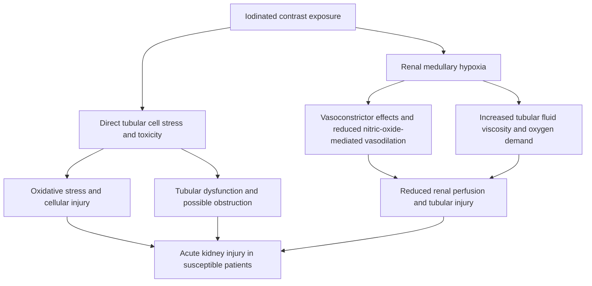

---
tags:
  - radiology
  - contrast-media
  - iodinated-contrast
  - barium
  - ci-aki
  - obsidian-md
title: Chapter 10 - Radiocontrast Agents (X-Ray & CT)
---

# Chapter 10: Radiocontrast Agents (X-Ray & CT)

## 10.1 Classification & General Principles

Radiocontrast agents are pharmaceuticals administered to temporarily alter the tissue density or attenuation coefficient of anatomical structures relative to surrounding tissues, thereby enhancing image contrast on conventional radiographs, fluoroscopy, and computed tomography (CT).

> [!NOTE]
> Contrast agents do not emit radiation themselves; rather, they modify the attenuation of the incident X-ray beam passing through the body via photoelectric absorption or physical gas displacement.

| Feature | Positive contrast | Negative contrast |
| --- | --- | --- |
| Physical basis | High atomic number and greater X-ray attenuation. | Low density and low X-ray attenuation. |
| Radiographic appearance | Radiopaque; appears white. | Radiolucent; appears dark. |
| Examples | Barium sulfate and iodinated contrast agents. | Air and carbon dioxide. |
| Typical role | Opacifies vessels, organs or luminal structures. | Provides gas contrast or distends a lumen in selected studies. |

### Key Physical Parameters
* **Atomic Number ($Z$)**: Attenuation via the photoelectric effect is directly proportional to $Z^3$.
  * Iodine ($Z = 53$, K-edge = $33.2\text{ keV}$)
  * Barium ($Z = 56$, K-edge = $37.4\text{ keV}$)
* **Osmolality**: The number of particles per kilogram of solvent ($\text{mOsm/kg H}_2\text{O}$). High osmolality relative to plasma ($290\text{ mOsm/kg}$) induces endothelial damage, vasodilation, pain, and fluid shifts.
* **Viscosity**: Fluid resistance to flow, determined by molecule size, concentration, and temperature. Pre-warming contrast to $37^\circ\text{C}$ significantly reduces viscosity, allowing smoother injection through automated power injectors.

---

## 10.2 Barium Sulfate ($\text{BaSO}_4$)

Barium sulfate is an insoluble inorganic salt ($Z = 56$) formulated as an aqueous suspension exclusively for gastrointestinal (GI) luminal evaluation (barium swallow, barium meal, barium follow-through, and barium enema).

### Indications & Technique
* **Single-Contrast Study**: Barium suspension fills the lumen, demonstrating strictures, masses, diverticula, and gross mucosal defects.
* **Double-Contrast Study**: Barium coats the mucosal surface while gas-forming crystals (sodium bicarbonate/citric acid) distend the lumen with $\text{CO}_2$. Essential for detecting subtle mucosal ulcerations, early carcinomas, and polyps.

> [!WARNING]
> ### Barium Perforation Hazard
> **Absolute Contraindication**: Suspected or known gastrointestinal tract perforation, bowel ischemia, or impending dehiscence.
> * If barium leaks into the peritoneal or mediastinal cavity, it triggers an intense, irreversible **granulomatous foreign-body reaction** leading to severe **chemical peritonitis**, extensive fibrotic adhesions, retroperitoneal fibrosis, hypovolemic shock, and high mortality.
> * **Rule**: Whenever perforation or anastomotic leak is suspected, ALWAYS use a **water-soluble iodinated contrast agent** (e.g., Iohexol, Gastrografin).

---

## 10.3 Iodinated Radiocontrast Agents

Iodinated contrast media (ICM) are tri-iodinated benzene ring derivatives used for intravenous, intra-arterial, intrathecal, and cavitary administration.

### Chemical Evolution & Generations

1. **High-Osmolar Contrast Media (HOCA - First Generation)**:
   * **Ionic Monomers** (e.g., Diatrizoate, Metrizoate, Iothalamate).
   * Ratio 1.5 (3 iodine atoms per 2 dissolved ions).
   * Osmolality: $1500 - 2000\text{ mOsm/kg}$ ($5-8\times$ plasma).
   * High incidence of nausea, vomiting, heat sensation, hemodynamic instability, and allergic reactions.

2. **Low-Osmolar Contrast Media (LOCA - Second Generation)**:
   * **Non-Ionic Monomers** (e.g., Iohexol, Iopromide, Iopamidol) and **Ionic Dimers** (e.g., Ioxaglate).
   * Ratio 3.0 (3 iodine atoms per 1 non-dissociating molecule).
   * Osmolality: $600 - 800\text{ mOsm/kg}$ ($2-3\times$ plasma).
   * Significantly improved patient tolerance and lower adverse reaction profile.

3. **Iso-Osmolar Contrast Media (IOCM - Third Generation)**:
   * **Non-Ionic Dimers** (e.g., Iodixanol).
   * Ratio 6.0 (6 iodine atoms per 1 non-dissociating molecule).
   * Osmolality: $\approx 290\text{ mOsm/kg}$ (equal to human blood plasma).
   * Lowest sensation of heat/discomfort; preferred in high-risk renal and cardiac patients.

---

## 10.4 Adverse Contrast Reactions & Management

Adverse reactions to iodinated contrast are classified by timing (acute vs. delayed) and mechanism (anaphylactoid/idiosyncratic vs. chemotoxic/non-idiosyncratic).

### Reaction Severity & Emergency Treatment

| Severity Class | Symptoms & Signs | Pathophysiology | Immediate Emergency Management |
| :--- | :--- | :--- | :--- |
| **Mild** | Limited urticaria/pruritus, cutaneous flushing, nausea, retching, nasal congestion | Mild histamine release / vagal tone | Observation, reassurance; oral **Diphenhydramine** ($25-50\text{ mg}$) if pruritus persists. |
| **Moderate** | Diffuse urticaria, facial edema, mild bronchospasm/wheezing, tachycardia | Anaphylactoid histamine cascade | Supplemental $\text{O}_2$; IV **Diphenhydramine** ($50\text{ mg}$); inhaled **Albuterol** for bronchospasm; IV fluids. |
| **Severe** | Laryngeal edema, severe bronchospasm, anaphylactic shock, hypotension, cardiac arrest | Severe systemic anaphylaxis / vascular collapse | **IM Epinephrine (1:1000)** $0.3-0.5\text{ mg}$ ($0.3-0.5\text{ mL}$) in anterolateral thigh; IV fluid bolus ($0.9\%$ Saline); airway management. |

> [!IMPORTANT]
> ### Epinephrine Administration in Contrast Anaphylaxis
> * **First-Line Route**: Intramuscular (IM) injection into the anterolateral mid-thigh ($1:1000$ concentration, dose $0.3-0.5\text{ mg}$ in adults).
> * **Repeat Frequency**: May repeat every $5-15\text{ minutes}$ if refractory.
> * **IV Epinephrine ($1:10,000$)**: Reserved strictly for profound hypotensive shock or cardiac arrest under continuous ICU/ECG monitoring due to lethal arrhythmia risk.

---

## 10.5 Contrast-Induced Acute Kidney Injury (CI-AKI)

Contrast-Induced Acute Kidney Injury (historically termed Contrast-Induced Nephropathy / CIN) is defined as a sudden decline in renal function occurring within $24-72\text{ hours}$ following intravascular iodinated contrast administration, without an alternative identifiable cause.

### Diagnostic Criteria
An absolute increase in Serum Creatinine of $\ge 0.3\text{ mg/dL}$ ($\ge 26.5\ \mu\text{mol/L}$) or a relative increase of $\ge 50\%$ from baseline within $48-72\text{ hours}$.

### Risk Stratification & Prophylaxis
* **Primary Risk Factor**: Pre-existing chronic kidney disease (CKD) with an estimated Glomerular Filtration Rate (eGFR) $< 30\text{ mL/min/1.73 m}^2$ (for IV contrast) or $< 45\text{ mL/min/1.73 m}^2$ (for intra-arterial cardiac catheterization).
* **Synergistic Risk Factors**: Diabetic nephropathy, dehydration/hypovolemia, congestive heart failure, concurrent nephrotoxic drugs (NSAIDs, aminoglycosides, amphotericin B).

> [!TIP]
> ### Prevention Protocols
> 1. **Volume Expansion (Gold Standard)**: Intravenous $0.9\%$ Isotonic Saline infusion ($1.0 - 1.5\text{ mL/kg/h}$) started $3-12\text{ hours}$ before and continued $6-12\text{ hours}$ after contrast injection.
> 2. **Contrast Minimization**: Use lowest diagnostic volume of LOCA or IOCM.
> 3. **Metformin Rule**: In diabetic patients with eGFR $< 30\text{ mL/min/1.73 m}^2$, withhold Metformin at the time of contrast administration and restart after $48\text{ hours}$ only after verifying stable renal function (prevents fatal **Lactic Acidosis** if CI-AKI develops).
