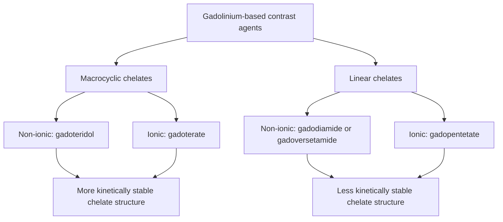
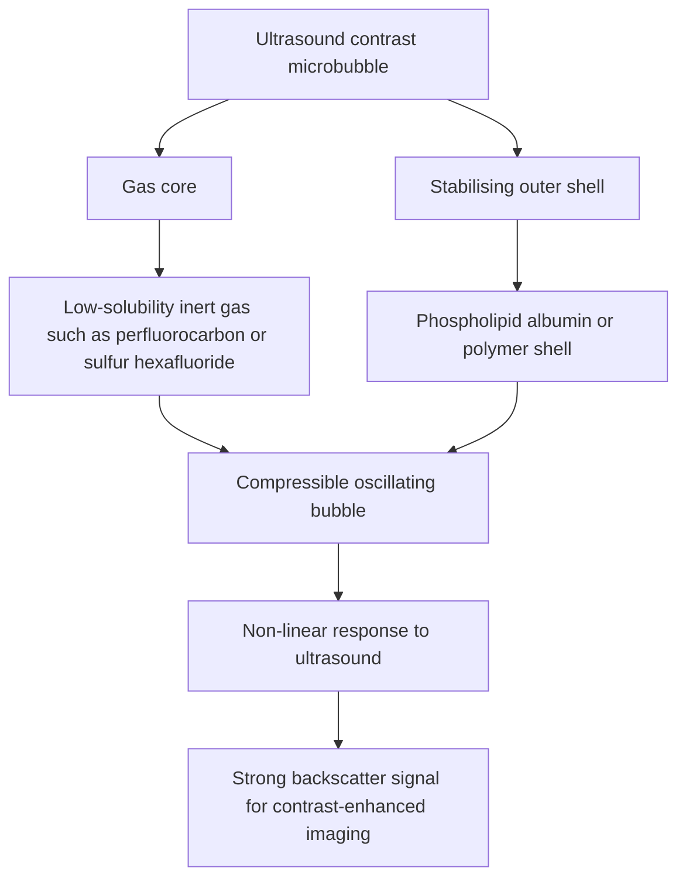

---
tags:
  - radiology
  - mri-contrast
  - gadolinium
  - nsf
  - microbubbles
  - ultrasound-contrast
  - obsidian-md
title: Chapter 11 - MRI & Ultrasound Contrast Media
---

# Chapter 11: MRI & Ultrasound Contrast Media

## 11.1 Gadolinium-Based Contrast Agents (GBCAs)

Gadolinium ($Z = 64$) is a rare-earth heavy metal exhibiting strong **paramagnetism** due to its 7 unpaired inner-shell electron spins ($4f^7$ configuration).

> [!NOTE]
> Free unchelated Gadolinium ($\text{Gd}^{3+}$) is extremely toxic, displacing calcium in biological processes, accumulating in bone, liver, and brain tissue. Therefore, all clinical GBCAs consist of $\text{Gd}^{3+}$ tightly bound to organic **chelating ligands**.

| Feature | Macrocyclic chelate | Linear chelate |
| --- | --- | --- |
| Structure | Gadolinium is enclosed in a rigid cage-like ligand. | Gadolinium is held by a more open-chain ligand. |
| Chelate stability | Generally higher kinetic stability. | Generally lower kinetic stability than macrocyclic agents. |
| Gadolinium release | Less prone to dechelation under physiological conditions. | Greater potential for dechelation and transmetallation. |
| NSF association | Most macrocyclic agents are in the lowest-risk ACR group. | Some linear agents are associated with higher NSF risk; risk category is agent-specific. |

### Mechanism of Action
* GBCAs do not emit signal or appear directly on MRI images.
* Instead, paramagnetic $\text{Gd}^{3+}$ ions generate localized fluctuating magnetic fields that accelerate the energy transfer of nearby water hydrogen protons to the lattice.
* **$T_1$ Shortening Effect**: Reduces the $T_1$ relaxation time of neighboring tissue protons $\rightarrow$ results in **hyperintense (bright white) signal** on $T_1$-weighted sequences.
* **$T_2^*$ Susceptibility Effect**: At high concentrations (e.g., bolus dynamic perfusion MRI), GBCAs induce local magnetic field inhomogeneities, causing rapid T2* dephasing $\rightarrow$ results in **hypointense (dark) signal**.

---

## 11.2 Nephrogenic Systemic Fibrosis (NSF)

Nephrogenic Systemic Fibrosis (formerly Nephrogenic Fibrosing Dermopathy) is a severe, debilitating, and potentially fatal systemic scleroderma-like fibrosing disease linked exclusively to GBCA exposure in patients with severe renal impairment.

### Pathophysiology
In severe renal failure, delayed excretion of GBCAs prolongs blood circulation time. Unstable **linear non-ionic chelates** undergo **transmetallation** (freeing $\text{Gd}^{3+}$ ions in exchange for endogenous zinc/copper/calcium). Free $\text{Gd}^{3+}$ deposits in tissues, recruiting circulating CD34+ fibrocytes and triggering massive, relentless collagen deposition.

┌────────────────────────────────────────────────────────────────────────┐
│                      Pathophysiologic Cascade of NSF                   │
└───────────────────────────────────┬────────────────────────────────────┘
                                    │
                                    ▼
       Severe Renal Failure (eGFR < 30 mL/min/1.73 m²) + Linear GBCA
                                    │
                                    ▼
         Prolonged In-Vivo Circulation Time (Half-life: 1.5h -> 30h+)
                                    │
                                    ▼
      Transmetallation & Dechelation (Release of Free Toxic Gd3+)
                                    │
                                    ▼
     Tissue Deposition in Skin, Fascia, Myocardium, Lungs & Muscles
                                    │
                                    ▼
     CD34+ Fibrocyte Recruitment & TGF-beta Mediated Fibrosis Surge
                                    │
                                    ▼
     Severe Contractures, Brawny Skin Thickening & Systemic Failure

### Clinical Presentation & ACR Risk Stratification

* **Clinical Features**: Brawny, wood-like thickening and hardening of the skin starting in the lower extremities; painful flexion contractures leading to wheelchair dependence; systemic involvement of pleura, pericardium, myocardium, and skeletal muscle.

| ACR Risk Category | Agent Examples | Clinical Policy in Severe Renal Impairment (eGFR $< 30\text{ mL/min/1.73 m}^2$) |
| :--- | :--- | :--- |
| **Group 1 (Highest Risk)** | Gadodiamide (Omniscan), Gadoversetamide (Optimark), Gadopentetate dimeglumine (Magnevist) | **Contraindicated**. Linked to the vast majority of all historical NSF cases. |
| **Group 2 (Lowest Risk)** | Gadoterate meglumine (Dotarem), Gadobutrol (Gadavist), Gadoteridol (Prohance) | **Permitted with caution** if medically necessary; macrocyclic stability prevents transmetallation. |
| **Group 3 (Intermediate)**| Gadoxetate disodium (Eovist - hepatobiliary agent) | Limited data; exercise caution. |

---

## 11.3 Ultrasound Contrast Agents (Microbubbles)

Ultrasound contrast agents (UCAs) consist of encapsulated **microbubbles** filled with high-molecular-weight inert fluorinated gas surrounded by an outer shell.

### Physical Architecture
* **Gas Core**: Perfluorocarbon (e.g., Perflutren) or Sulfur Hexafluoride ($\text{SF}_6$). Insoluble gases with low diffusibility that prevent rapid dissolution into blood.
* **Shell**: Phospholipid monolayer, albumin, or synthetic polymer shell ($1-3\ \mu\text{m}$ thick) preventing gas coalescence.
* **Size Dimension**: $1 - 4\ \mu\text{m}$ diameter (smaller than human erythrocytes $\approx 7\ \mu\text{m}$), allowing unrestricted passage through pulmonary capillary beds without causing microembolism.

### Acoustic Physics & Clinical Applications
1. **Acoustic Backscatter & Resonance**: Under ultrasound acoustic pressure waves, microbubbles oscillate non-linearly (expanding during rarefaction, contracting during compression), generating strong **harmonic signals** that dramatically enhance intravascular Doppler and gray-scale imaging.
2. **Excretion Safety**: The outer lipid shell is metabolized by the liver, while the gas core is excreted exclusively via **pulmonary exhalation** within $10-15\text{ minutes}$. 
3. **No Renal Toxicity**: Safe for administration in patients with acute kidney injury, severe renal failure, or iodine/gadolinium allergies without risk of CI-AKI or NSF.
