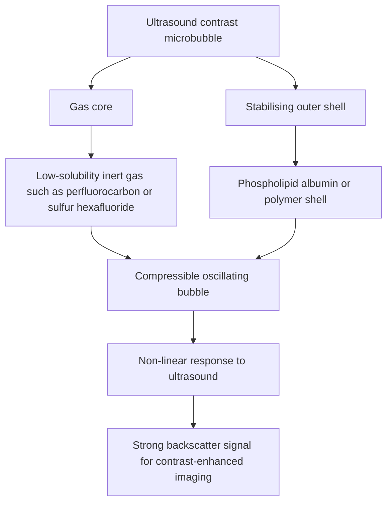

---
tags:
  - radiology
  - mri-contrast
  - gadolinium
  - nsf
  - microbubbles
  - ultrasound-contrast
  - obsidian-md
title: Chapter 11 - MRI & Ultrasound Contrast Media
---

# Chapter 11: MRI & Ultrasound Contrast Media
# MRI
Magnetic Resonance Imaging (MRI) contrast agents function fundamentally ==differently from iodinated radiocontrast media== used in conventional radiography and Computed Tomography (CT). While X-ray radiocontrast agents directly absorb and attenuate ionizing radiation photons, MRI contrast media exert an indirect effect on signal intensity by altering the magnetic relaxation dynamics ”specifically the longitudinal ($T_1$) and transverse ($T_2$) relaxation times" of hydrogen nuclei ($H^+$ ions) in adjacent tissue water molecules.

## 1. Biophysical Principles and Relaxation Mechanics

The diagnostic utility of MRI contrast agents relies on their ability to modify local magnetic microenvironments. The gyromagnetic property of hydrogen protons causes them to precess when exposed to an external static magnetic field. Application of a radiofrequency (RF) pulse tips the net magnetization vector into the transverse plane. Relaxation time is the duration required for hydrogen ions to return from the transverse axis to their baseline longitudinal axis, a process that varies distinctly across different biological tissues.

Contrast media are categorized primarily by their predominant effect on relaxation times and the resulting image signal alteration.

### T1 Relaxation Agents (Positive Contrast Media)
Paramagnetic substances, most notably ==gadolinium== ($Gd$, atomic number $Z=64$) and ==manganese== ($Mn$), possess unpaired valence electrons that generate local magnetic dipoles. These dipoles accelerate energy transfer from precessing hydrogen protons to the surrounding molecular lattice, a mechanism termed spin-lattice interaction.

This spin-lattice interaction significantly shortens the $T_1$ relaxation time. Because tissues with shorter $T_1$ relaxation times recover longitudinal magnetization more rapidly between radiofrequency pulses, they emit higher signal intensity on $T_1$-weighted ($T_1\text{W}$) pulse sequences, presenting as a hyperintense (bright white) region.

### T2 Relaxation Agents (Negative Contrast Media)
Superparamagnetic agents, primarily ==Superparamagnetic Iron Oxide (SPIO)== compounds such as ferumoxides, consist of larger crystal aggregates that disturb local magnetic field homogeneity. This micro-environmental inhomogeneity accelerates the dephasing of proton spins across transverse planes, a mechanism termed spin-spin interaction.

By predominantly shortening $T_2$ and $T_2^*$ relaxation times, SPIO agents ==cause rapid decay of transverse magnetization==. ==Tissues taking up superparamagnetic agents appear hypointense (dark or black) on $T_2$-weighted ($T_2\text{W}$) sequences.==

| Contrast Category | Magnetic Property | Primary Physicochemical Mechanism | Dominant Signal Modification | Representative Compounds |
| :--- | :--- | :--- | :--- | :--- |
| **Positive Contrast Agents** | Paramagnetic | Shortens $T_1$ relaxation time via spin-lattice interaction | **Hyperintense (Bright)** on $T_1\text{W}$ sequences | Gadolinium complexes ($Gd$-DTPA), Manganese complexes |
| **Negative Contrast Agents** | Superparamagnetic | Shortens $T_2$ relaxation time via spin-spin interaction and dephasing | **Hypointense (Dark)** on $T_2\text{W}$ sequences | Superparamagnetic Iron Oxide (SPIO / Ferumoxide) |

---

## 2. Anatomical Classification and Biodistribution

In addition to their magnetic properties, MRI contrast media are categorized according to their physiological distribution, tissue specificity, and metabolic clearance pathways within the human body.

### Extracellular Fluid (ECF) Space Agents
Intravascular and extracellular fluid space agents represent the most widely utilized MRI contrast media in clinical practice. Gadolinium-diethylene triamine pentaacetic acid ($Gd$-DTPA) is the classic prototype. 

Following intravenous administration, ECF agents distribute rapidly throughout the vascular system and extracellular interstitial space. They do not cross intact lipid cell membranes, nor do they penetrate an intact Blood-Brain Barrier (BBB). Elimination occurs rapidly via passive glomerular filtration in the kidneys.

### Hepatocyte-Selective and Biliary Contrast Agents
Specialized paramagnetic complexes undergo dual clearance pathways, being cleared both by glomerular filtration and by active uptake into functioning liver parenchyma via hepatocyte membrane transporters.
* **Gadoxetate Disodium ($Gd$-EOB-DTPA)**: Taken up selectively by functioning hepatocytes and excreted into the biliary tree, enabling high-resolution delayed hepatobiliary phase imaging.
* **Gadobenate Dimeglumine ($Gd$-BOPTA)**: Exhibits combined extracellular distribution and partial biliary excretion.
* **Mangafodipir Trisodium ($Gd$-Manganese DPDP)**: A manganese-based paramagnetic agent selectively accumulated by functional hepatic parenchyma.

These agents are indispensable for differentiating hepatic lesions containing functional hepatocytes (such as Focal Nodular Hyperplasia) from non-hepatocyte lesions or hepatic malignancies.

### Reticuloendothelial System (RES) Targeted Agents
Superparamagnetic Iron Oxide (SPIO / Ferumoxide) agents are targeted specifically to the Reticuloendothelial System. Following intravenous injection, SPIO particles are recognized as foreign matter and actively phagocytosed by functional reticuloendothelial cells, specifically Kupffer cells lining the hepatic sinusoids.

In healthy hepatic tissue, Kupffer cell uptake of SPIO leads to marked $T_2$ shortening and signal loss (darkening). Conversely, focal nodular hyperplasia (FNH) demonstrates increased Kupffer cell activity, whereas malignant liver tumors or metastases lack functional Kupffer cells and do not take up SPIO, remaining bright relative to the darkened background liver parenchyma.

---

## 3. Central Nervous System Dynamics and Blood-Brain Barrier Integrity

In neuroimaging, contrast enhancement is governed by the structural integrity of the microvascular endothelium forming the Blood-Brain Barrier (BBB).

> Under physiological conditions, the tight junctions of the cerebral capillary endothelium prevent Gadolinium complexes from extravasating into the brain parenchyma. Consequently, normal brain tissue exhibits no parenchymal enhancement following intravenous contrast administration.

When pathological processes disrupt endothelial tight junctions, contrast media leak into the interstitial space of the brain, producing regional $T_1$ hyperintensity.

### Glioma Grading and Enhancement Characteristics
The degree of contrast enhancement in primary central nervous system neoplasms reflects the extent of neo-angiogenesis and vascular BBB breakdown:
* **Low-Grade Gliomas**: Typically maintain relative microvascular integrity and do not exhibit contrast enhancement following Gadolinium administration.
* **High-Grade Gliomas**: High-grade tumors (such as Anaplastic Astrocytoma and Glioblastoma) undergo extensive microvascular proliferation and endothelial destruction, demonstrating intense contrast enhancement.

---

## 4. Nephrogenic Systemic Fibrosis (NSF) and Gadolinium Toxicity

Although elemental Gadolinium ($Z=64$) possesses potent paramagnetic qualities, uncomplexed $Gd^{3+}$ ions are highly toxic. Free gadolinium interferes with endogenous calcium-dependent physiological processes, necessitating chelation with organic ligands such as DTPA to ensure safe biological transit and renal excretion.

In patients with severe underlying renal impairment, delayed excretion of gadolinium chelates significantly increases the risk of a severe, potentially fatal adverse reaction known as Nephrogenic Systemic Fibrosis (NSF).

### Pathophysiology and Clinical Manifestations
When renal clearance is prolonged, gadolinium complexes undergo transmetallation, releasing free $Gd^{3+}$ ions into systemic tissues. The deposited gadolinium triggers a robust local immune response and systemic tissue fibrosis, progressing through recognizable clinical phases:
1. **Prodromal Phase**: Localized pain, proctitis, erythema, and marked swelling, typically initiating in the lower legs.
2. **Cutaneous Induration**: Progressive thickening and hardening of the skin and subcutaneous tissues (dermal fibrosis), giving the indurated skin a characteristic "cobblestone" appearance.
3. **Contractures and Systemic Involvement**: Formation of severe joint flexion contractures, shiny hide-bound skin, and progressive fibrosis of internal organs.
4. **End-Stage Course**: Severe physical disability, cachexia, and death.

### Patient Risk Stratification
The probability of developing NSF correlates directly with the degree of underlying renal impairment at the time of contrast administration:

| Risk Category | Clinical Renal Status & eGFR Parameters | Actionable Guideline |
| :--- | :--- | :--- |
| **Higher Risk of NSF** | • Chronic Kidney Disease (CKD Stage 4 or Stage 5) • Estimated GFR $< 30\text{ mL/min/1.73 m}^2$ • End-Stage Renal Disease on hemodialysis or peritoneal dialysis • Acute renal insufficiency / Acute Kidney Injury (AKI) | **Strictly Contraindicated.** Gadolinium contrast must be avoided unless no diagnostic alternative exists. |
| **Intermediate Risk** | • Moderate CKD Stage 3 • Estimated GFR $30 - 59\text{ mL/min/1.73 m}^2$ | **Use with Caution.** Select lowest-risk macrocyclic agents at minimal diagnostic doses. |
| **No Risk of NSF** | • Normal or mildly impaired renal function • Estimated GFR $> 60\text{ mL/min/1.73 m}^2$ | **Standard Administration Permitted.** |

### Compound Risk Profiles
Gadolinium contrast compounds vary substantially in their chemical stability and likelihood of dissociation, dictating their propensity to cause NSF:

* **High Risk of NSF (Linear Non-Ionic / Ionic Chelates)**:
  * *Gadodiamide (Omniscan)*: Represents the single most common cause of NSF; regulatory agencies have banned or withdrawn its clinical use.
  * *Gadopentetate Dimeglumine (Magnevist)*: Second most frequent cause of NSF.
  * *Gadoversetamide (Optimark)*.
* **Intermediate Risk of NSF (Linear Polyfunctional Chelates)**:
  * *Gadobenate Dimeglumine (MultiHance)*.
  * *Gadoxetate Disodium (Eovist / Primovist)*.
* **Low Risk of NSF (Macrocyclic Chelates)**:
  * *Gadobutrol (Gadovist / Gadavist)*.
  * *Gadoteridol (ProHance)*.

Macrocyclic compounds encase the $Gd^{3+}$ ion within a rigid molecular ring, offering maximum thermodynamic stability, which dramatically minimizes the release of free toxic gadolinium.

---

## 5. Clinical Contraindications, Dosing Rules, and Special Populations

Safe clinical utilization of MRI contrast agents requires strict adherence to renal screening, interval administration rules, and gestation/lactation guidelines.

### Summary of Contraindications
Administration of Gadolinium-based contrast agents is contraindicated in the following scenarios:
1. **Severe Renal Failure**: Patients with an eGFR below $30\text{ mL/min/1.73 m}^2$, acute renal insufficiency, or end-stage renal failure.
2. **Recent Prior Exposure**: Patients who have received a dose of Gadolinium contrast within the preceding 24 hours.
3. **Prior Hypersensitivity**: Patients with a documented history of severe allergic or anaphylactoid reaction to gadolinium compounds.
4. **High NSF Risk Profile**: Presence of severe CKD combined with systemic inflammatory states that accelerate tissue deposition.

### Pregnancy Guidelines
Ionizing radiation imaging modalities carry strict dose restrictions during gestation, where single procedures below $5\text{ rad}$ ($50\text{ mGy}$) show no harmful fetal effects. In contrast, magnetic resonance safety depends on whether contrast is administered:

> **Non-contrast MRI** is considered safe across all trimesters of pregnancy when clinically indicated, provided imaging is performed on a 1.5 Tesla scanner.

Conversely, Gadolinium-based contrast agents cross the placental barrier into the fetal circulation. Because of potential risk to the developing fetus, contrast-enhanced MRI (CE-MRI) should be avoided during pregnancy unless unequivocally necessary to improve clinical outcomes.

### Lactation and Breastfeeding Guidelines
Following intravenous administration to a lactating mother, minimal amounts of gadolinium enter the milk supply. Clinical evidence establishes that less than 0.04% of the administered maternal gadolinium dose is excreted into breast milk, and less than 1% of the ingested milk quantity is absorbed across the infant gastrointestinal tract.

Consequently, official radiological guidelines confirm that **breastfeeding can be safely continued without interruption** following maternal gadolinium contrast administration.
# Ultrasound Contrast Agents (Microbubbles)

Ultrasound contrast agents (UCAs) consist of encapsulated **microbubbles** filled with high-molecular-weight inert fluorinated gas surrounded by an outer shell.

### Physical Architecture
* **Gas Core**: Perfluorocarbon (e.g., Perflutren) or Sulfur Hexafluoride ($\text{SF}_6$). Insoluble gases with low diffusibility that prevent rapid dissolution into blood.
* **Shell**: Phospholipid monolayer, albumin, or synthetic polymer shell ($1-3\ \mu\text{m}$ thick) preventing gas coalescence.
* **Size Dimension**: $1 - 4\ \mu\text{m}$ diameter (smaller than human erythrocytes $\approx 7\ \mu\text{m}$), allowing unrestricted passage through pulmonary capillary beds without causing microembolism.

### Acoustic Physics & Clinical Applications
1. **Acoustic Backscatter & Resonance**: Under ultrasound acoustic pressure waves, microbubbles oscillate non-linearly (expanding during rarefaction, contracting during compression), generating strong **harmonic signals** that dramatically enhance intravascular Doppler and gray-scale imaging.
2. **Excretion Safety**: The outer lipid shell is metabolized by the liver, while the gas core is excreted exclusively via **pulmonary exhalation** within $10-15\text{ minutes}$. 
3. **No Renal Toxicity**: Safe for administration in patients with acute kidney injury, severe renal failure, or iodine/gadolinium allergies without risk of CI-AKI or NSF.

