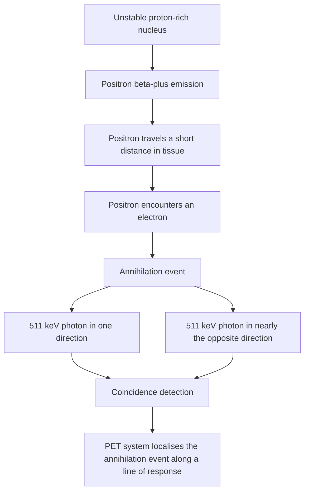

---
tags:
  - radiology
  - nuclear-medicine
  - technetium
  - pet-scan
  - fdg
  - scintigraphy
  - obsidian-md
title: Chapter 12 - Radionuclides, Scintigraphy & PET Imaging
---

# Chapter 12: Radionuclides, Scintigraphy & PET Imaging

## 12.1 Nuclear Medicine Fundamentals

Nuclear medicine utilizes unsealed radioactive substances (radiopharmaceuticals) administered systemically to evaluate functional physiological and biochemical processes at the cellular and molecular level.

> [!NOTE]
> Unlike diagnostic X-ray and CT where the radiation source is external to the patient, in nuclear medicine **the patient becomes the radiation source**, emitting gamma rays ($\gamma$) or positrons ($\beta^+$) that are detected by external gamma cameras or PET scanners.

### Radiopharmaceutical Architecture
A radiopharmaceutical consists of two components:
1. **Radionuclide (Tag)**: The radioactive isotope emitting detectable photons or particles (e.g., $\text{Tc}^{99\text{m}}$, $^{18}\text{F}$, $^{123}\text{I}$).
2. **Pharmaceutical (Carrier)**: The biological molecule or ligand that targets specific tissue receptors, metabolic pathways, or organ perfusion (e.g., MDP for bone, DTPA for kidney, FDG for glucose metabolism).

### Technetium-99m ($\text{Tc}^{99\text{m}}$) - The Workhorse Isotope
Technetium-99m accounts for $>80\%$ of all diagnostic nuclear medicine procedures worldwide due to its ideal physical and logistic properties:
* **Production**: Produced continuously via a **Molybdenum-99 / Technetium-99m Generator** ("Moly cow"). $^{99}\text{Mo}$ ($t_{1/2} = 66\text{ hours}$) decays into $^{99\text{m}}\text{Tc}$, which is eluded ("milked") as sodium pertechnetate ($\text{Na}^{99\text{m}}\text{TcO}_4$).
* **Physical Half-Life ($t_{1/2}$)**: $6.0\text{ hours}$ — long enough for complex imaging, short enough to minimize patient radiation dose.
* **Gamma Energy**: $140\text{ keV}$ monoenergetic $\gamma$-ray emission. Ideally suited for crystal detection in gamma camera sodium iodide ($\text{NaI}$) detectors with minimal tissue attenuation.
* **No Beta Particle Emission**: Pure isometric transition decay without high-dose particulate $\beta$-emission.

---

## 12.2 Major Scintigraphic Applications & Clinical Profiles

Scintigraphy uses a Gamma Camera equipped with lead collimators, a large $\text{NaI(Tl)}$ scintillation crystal, and photomultiplier tubes (PMTs) to form planar or 3D SPECT (Single-Photon Emission Computed Tomography) images.

| Study group | Radiopharmaceutical examples | Primary application or target |
| --- | --- | --- |
| Bone scintigraphy | Technetium-99m MDP | Hydroxyapatite adsorption at sites of active osteoblastic bone turnover. |
| Renal cortical imaging | Technetium-99m DMSA | Renal cortical function and cortical scarring. |
| Renal dynamic imaging | Technetium-99m DTPA; technetium-99m MAG3 | Glomerular filtration or tubular extraction and drainage, respectively. |
| Renal vascular assessment | Captopril renography using a renal tracer | Selected evaluation of renovascular hypertension. |
| GI bleeding | Technetium-99m-labelled autologous red blood cells | Detection of active or intermittent gastrointestinal bleeding. |
| Meckel diverticulum | Technetium-99m pertechnetate | Detection of ectopic gastric mucosa. |
| Hepatobiliary imaging | Technetium-99m IDA derivatives (HIDA-type agents) | Hepatocyte uptake and biliary excretion; gallbladder visualisation. |

| Radiopharmaceutical | Main target or mechanism | Clinical application |
| --- | --- | --- |
| Tc-99m MDP | Adsorption onto hydroxyapatite at sites of active bone remodelling. | Bone scintigraphy and osteoblastic lesions. |
| Tc-99m-labelled RBCs | Remains within the vascular compartment; accumulates where blood extravasates. | Localisation of active GI bleeding. |
| Tc-99m pertechnetate | Taken up by gastric mucosal cells. | Meckel scan for ectopic gastric mucosa. |
| Tc-99m HIDA-type agents | Hepatic uptake followed by biliary excretion. | Hepatobiliary scintigraphy and gallbladder assessment. |
| F-18 FDG | Glucose analogue transported into cells and phosphorylated; intracellular trapping follows. | PET imaging of metabolically active tissues and many malignancies. |

### Diagnostic Scintigraphy Summary Table

| Clinical Application | Radiopharmaceutical | Mechanism & Target | Key Diagnostic Threshold / Findings |
| :--- | :--- | :--- | :--- |
| **Skeletal Metastases** | $\text{Tc}^{99\text{m}}$-MDP (Methylene Diphosphonate) | Adsorption onto hydroxyapatite crystal matrix at sites of active bone remodeling | "Hot spots" in osteoblastic metastases (e.g., prostate, breast CA); "Superbone scan" in diffuse metastases. |
| **Lower GI Bleeding** | $\text{Tc}^{99\text{m}}$-labeled Autologous RBCs | Radiolabeled RBCs pool at sites of active vascular extravasation | **Most sensitive modality**; detects minimal active lower GI bleeding down to **$0.1\text{ mL/min}$**. |
| **Meckel's Diverticulum**| $\text{Tc}^{99\text{m}}$-Pertechnetate ($\text{TcO}_4^-$) | Taken up selectively by mucin-secreting epithelial cells of ectopic gastric mucosa | Focal right lower quadrant "hot spot" appearing simultaneously with gastric mucosa uptake. |
| **Acute Cholecystitis** | $\text{Tc}^{99\text{m}}$-HIDA / DISIDA | Extracted by hepatocytes and excreted into biliary tree | **Gold Standard**; non-visualization of gallbladder at $1-4\text{ hours}$ confirms cystic duct obstruction. |
| **Renal Cortical Anatomy**| $\text{Tc}^{99\text{m}}$-DMSA (Dimercaptosuccinic Acid) | Binds to renal proximal tubular cells; $50\%$ bound at $1\text{ hour}$ | Excellent cortical detail; detects acute pyelonephritis and permanent cortical scars. |
| **Renal Dynamic / PUJ** | $\text{Tc}^{99\text{m}}$-MAG3 (Mercaptoacetyltriglycine) | Active renal tubular secretion; high extraction ratio | **Choice for Pelvi-Ureteric Junction (PUJ) obstruction**; F+20 furosemide washout curve evaluation. |

---

## 12.3 Positron Emission Tomography (PET) Imaging

PET imaging utilizes radionuclides that decay by **Positron ($\beta^+$) Emission**.

### Physics of Positron Annihilation
1. An unstable proton-rich nucleus converts a proton into a neutron, emitting a **positron** ($\beta^+$) and a neutrino.
2. The emitted positron travels a short distance ($1-3\text{ mm}$) through tissue, losing kinetic energy until it collides with a ambient **free electron** ($e^-$).
3. **Annihilation Event**: Mass of both particles is completely converted into pure energy, emitting **two $511\text{ keV}$ gamma photons** traveling in **exact $180^\circ$ opposite directions**.
4. **Coincidence Ring Detection**: The PET scanner ring detects both $511\text{ keV}$ photons arriving simultaneously ($10-15\text{ nanosecond}$ coincidence window), precisely pinpointing the line of response (LOR) without physical lead collimators.

### $^{18}\text{F}$-FDG & The Warburg Effect
* **Fluorodeoxyglucose ($^{18}\text{F}$-FDG)**: An analog of glucose tagged with $^{18}\text{F}$ ($t_{1/2} = 110\text{ minutes}$).
* **Cellular Trapping Mechanism**:
  1. FDG enters cells via overexpressed **GLUT-1 / GLUT-3 glucose transporters**.
  2. Hexokinase phosphorylates FDG into **FDG-6-Phosphate**.
  3. Because FDG-6-Phosphate lacks a 2'-hydroxyl group, it **cannot undergo further glycolysis** or glycogen synthesis, and cannot exit the cell, becoming **trapped inside metabolic cells**.
* **Warburg Effect**: Malignant cancer cells display dramatically accelerated anaerobic glycolysis, overexpressing GLUT transporters and hexokinase $\rightarrow$ intense radiotracer accumulation ("hot spots").
