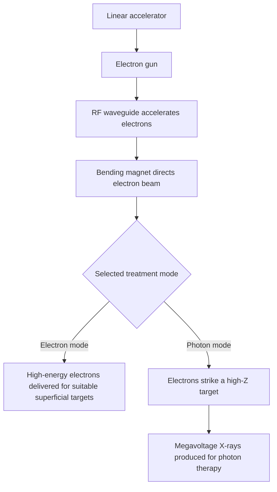

---
tags:
  - radiology
  - radiotherapy
  - linac
  - brachytherapy
  - bragg-peak
  - obsidian-md
title: Chapter 13 - Principles of Radiotherapy & Brachytherapy
---

# Chapter 13: Principles of Radiotherapy & Brachytherapy

## 13.1 External Beam Radiotherapy (EBRT / Teletherapy)

External Beam Radiotherapy delivers high-energy ionizing radiation from a source located outside the patient's body to target malignant tumors while sparing adjacent critical normal tissues.

### Treatment Machinery & Sources
1. **Medical Linear Accelerator (LINAC)**:
   * Accelerates electrons to near speed of light using microwave radiofrequency cavities.
   * **Electron Mode**: Direct high-energy electron beam ($4 - 22\text{ MeV}$) for superficial lesions (skin cancer, chest wall).
   * **Photon Mode**: Electrons strike a high-$Z$ target (tungsten) generating megavoltage X-rays ($6 - 18\text{ MV}$) for deep-seated visceral tumors.
2. **Cobalt-60 ($^{60}\text{Co}$) Teletherapy Unit**:
   * Radioactive $^{60}\text{Co}$ isotope ($t_{1/2} = 5.26\text{ years}$) decays by $\beta^-$ emission followed by two high-energy gamma rays ($1.17\text{ MeV}$ and $1.33\text{ MeV}$, average $1.25\text{ MeV}$).

### The Bragg Peak Phenomenon (Proton & Heavy Ion Therapy)
* **Photons / Megavoltage X-Rays**: Deposit peak dose near the surface ($1.5 - 3.0\text{ cm}$ depth) and continue attenuating exponentially through the entire body, delivering unwanted "exit dose" to tissues beyond the tumor.
* **Proton / Heavy Particle Beam**: Protons travel through tissue depositing minimal dose initially, then abruptly discharge nearly **$100\%$ of their energy at a precise depth** (the **Bragg Peak**), followed by a sharp zero-dose drop-off.
* **Clinical Advantage**: Spares normal tissue beyond the tumor volume; ideal for pediatric malignancies, ocular melanoma, and tumors adjacent to critical structures (spinal cord, brainstem).

**Qualitative depth-dose profile**

The original plot compares the depth-dose characteristics of photon beams with the Bragg peak of proton/heavy-ion beams. It is a physical curve, not a process diagram, so it is represented here in words rather than as a Mermaid flowchart.

- **Photon beams:** dose builds up beneath the surface and then decreases with depth; dose continues beyond the target, producing an exit dose.
- **Proton and heavy-ion beams:** relatively low entrance dose is followed by a pronounced Bragg peak near the end of range and a sharp distal fall-off, with little dose beyond the stopping point.

| Feature | Photon beams (X-rays) | Proton / heavy-ion beams |
| --- | --- | --- |
| Entrance dose | Usually appreciable; may include a skin-sparing build-up region for megavoltage photons. | Relatively low entrance dose compared with the peak dose. |
| Depth-dose pattern | Dose decreases beyond the build-up region and continues beyond the target. | Dose rises to a Bragg peak near the end of particle range. |
| Exit dose | Present. | Minimal beyond the Bragg peak, with a sharp distal fall-off. |
| Dose distribution advantage | Widely available and useful for many tumour geometries. | Can reduce dose to tissues distal to the target when range and anatomy are accurately controlled. |

---

## 13.2 Brachytherapy

Brachytherapy involves placing sealed radioactive sources directly inside or immediately adjacent to the tumor mass.

### Classification by Dose Rate & Technique
* **Low Dose Rate (LDR)**: $0.4 - 2.0\text{ Gy/hour}$. Continuous low-dose exposure over days (e.g., $^{125}\text{I}$ or $^{103}\text{Pd}$ permanent seeds for prostate cancer).
* **High Dose Rate (HDR)**: $> 12.0\text{ Gy/hour}$. High-activity source delivered via computerized remote afterloading machines over minutes (e.g., $^{192}\text{Ir}$ for cervical/endometrial cancer).

| Brachytherapy Technique | Placement Anatomical Site | Clinical Applications |
| :--- | :--- | :--- |
| **Intracavitary** | Placed inside natural body cavities via applicators (Fletcher-Suit-Delclos applicator) | **Cervical Carcinoma**, Endometrial Carcinoma. |
| **Interstitial** | Placed directly into tissue parenchyma via needles/tubes | **Prostate Cancer**, Breast Cancer, Soft tissue sarcoma. |
| **Surface Mold / Plaque** | Applied onto skin or mucosal surface | Ocular Melanoma (Iodine-125 plaque), Skin carcinoma. |
| **Intraluminal** | Placed inside tubular organ lumens via catheters | Esophageal Carcinoma, Endobronchial carcinoma. |

### Common Brachytherapy Isotopes
* **Iridium-192 ($^{192}\text{Ir}$)**: Workhorse HDR isotope; $t_{1/2} = 73.8\text{ days}$; average gamma energy $0.38\text{ MeV}$.
* **Iodine-125 ($^{125}\text{I}$)**: LDR prostate permanent seed implants; $t_{1/2} = 59.4\text{ days}$; low energy $28\text{ keV}$.
* **Cesium-137 ($^{137}\text{Cs}$)**: Historical LDR intracavitary cervix therapy; $t_{1/2} = 30\text{ years}$.

---

## 13.3 Radiation Modifiers: Sensitizers & Protectors

Chemical agents administered concurrently with radiation to modify the biological damage response.

| Category | Examples in the outline | Mechanism or intended effect |
| --- | --- | --- |
| Radiosensitizers | Oxygen, platinum compounds such as cisplatin, and hypoxic-cell sensitizers such as misonidazole. | Increase tumour-cell response to radiation, for example by fixing oxygen-mediated DNA damage or augmenting DNA injury. |
| Radioprotectors | Amifostine and selected sulfhydryl compounds. | Scavenge reactive oxygen species or otherwise reduce radiation injury in normal tissues. |
| Thyroid blockade for radioiodine exposure | Potassium iodide. | Saturates thyroid iodide uptake pathways and reduces uptake of radioactive iodine; it is not a general radioprotector against external radiation. |

1. **Radiosensitizers (Tumor Enhancers)**:
   * **Oxygen ($\text{O}_2$)**: Most potent natural radiosensitizer. Fixes free radical DNA damage ($\text{OER} \approx 2.5 - 3.0$).
   * **Cisplatin**: Inhibits sublethal DNA damage repair and cross-links DNA; mainstay of concurrent chemoradiation in head & neck and cervical cancer.
   * **5-Fluorouracil (5-FU)**: Sensitizes gastrointestinal malignancies during RT.

2. **Radioprotectors (Normal Tissue Shields)**:
   * **Amifostine (WR-2721)**: Organic thiophosphate prodrug cleaved by alkaline phosphatase in normal vascular endothelium into active free thiol, which **scavenges radiation-induced free radicals (ROS)**. Used to prevent xerostomia (dry mouth) during head & neck RT.
   * **Potassium Iodide (KI)**: Saturates the thyroid gland with non-radioactive iodine to prevent thyroid uptake of radioactive iodine isotopes ($^{131}\text{I}$ or $^{131}\text{I}$ nuclear fallout).
