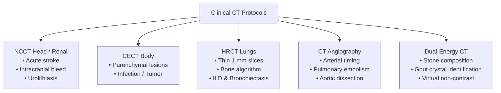
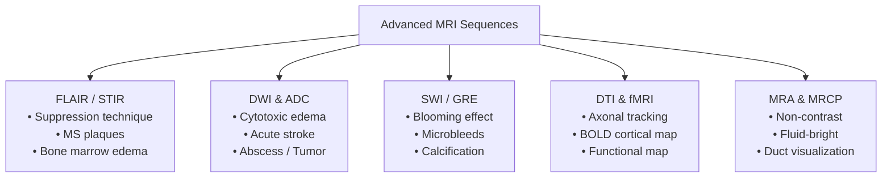

## 1. Ultrasonography (USG): Principles, Transducers, Modes & Advanced Modalities

Ultrasonography operates on the **pulse-echo principle**. Electric voltage applied to synthetic ceramic crystals—most commonly **Lead Zirconate Titanate ($\text{PZT}$)**—induces rapid mechanical contraction and expansion via the **Reverse Piezoelectric Effect**, generating high-frequency longitudinal acoustic sound waves ($\ge 20{,}000 \text{ Hz}$; clinical diagnostic range $2\text{--}15 \text{ MHz}$). As these acoustic waves travel through body tissues, they encounter interfaces between tissues with differing **acoustic impedances** ($Z = \rho \cdot c$, where $\rho$ is tissue density and $c$ is speed of sound in tissue, averaging $1540 \text{ m/s}$ in soft tissue). Partial reflection of the sound beam occurs at these acoustic boundaries, returning echo signals to the transducer, which converts mechanical sound deformation back into electrical signals via the **Direct Piezoelectric Effect**.

### 1.1 Operational Modes of Ultrasound

* **A-mode (Amplitude Mode)**: A single-dimensional graphic display where returning acoustic echoes appear as vertical deflection spikes along a horizontal baseline. The height of each spike corresponds to echo amplitude, while the position along the baseline reflects tissue depth. A-mode provides precise linear distance measurements and is primarily utilized in **ophthalmology** for orbital biometry and calculating the axial length of the globe.
* **B-mode (Brightness Mode)**: The foundational two-dimensional grayscale imaging mode. Returning echo amplitudes are converted into pixels of varying brightness along a 2D matrix. High-amplitude echoes from dense structural boundaries appear bright (hyperechoic), while low-amplitude or non-reflecting structures appear dark (hypoechoic or anechoic).
* **M-mode (Motion Mode)**: Displays a continuous 1D acoustic line over time along a moving axis, offering extremely high temporal resolution. It is essential for analyzing rapidly moving cardiovascular structures in **echocardiography** (such as valvular excursion and wall thickness dynamics) and evaluating **lung sliding** in emergency ultrasonography (demonstrating the classic "sea-shore sign" in normal lung pleura versus the "barcode / stratosphere sign" in pneumothorax).
* **Doppler Modalities**: Based on the **Doppler Shift Effect**, where the frequency of reflected sound waves changes proportionally to the velocity of moving red blood cells ($\Delta f = \frac{2 f_0 v \cos\theta}{c}$).
  * **Color Doppler**: Overlays a color-coded velocity display of moving blood flow onto a 2D grayscale B-mode image. Directional flow is mapped using the **BART rule** (**B**lue **A**way from the probe, **R**ed **T**owards the probe). The optimal Doppler insonation angle ($\theta$) is **$45^\circ\text{--}60^\circ$**; an angle of $90^\circ$ produces zero frequency shift ($\cos 90^\circ = 0$), creating a false appearance of absent blood flow.
  * **Pulsed Wave (PW) / Spectral Doppler**: Measures quantitative velocity waveforms over time within a specified sample volume, displaying Peak Systolic Velocity (PSV) and End Diastolic Velocity (EDV). Peripheral high-resistance arteries display a **triphasic waveform**, whereas low-resistance visceral and cerebral vessels display a **monophasic waveform**.
  * **Power Doppler**: Maps the total integrated amplitude of returning Doppler signals rather than flow velocity or direction. It is angle-independent and highly sensitive for detecting low-velocity microvascular perfusion (e.g., pyelonephritis, testicular ischemia, or tumor neovascularity).
  * **Duplex & Triplex Scanning**: Duplex scanning combines real-time B-mode structural imaging with Pulsed Wave Spectral Doppler; Triplex scanning adds real-time Color Doppler mapping.

### 1.2 Transducer Architecture & Clinical Selection

The operational frequency of an ultrasound transducer dictates its spatial resolution and depth of penetration. High-frequency sound waves undergo rapid attenuation, limiting penetration depth, whereas low-frequency waves penetrate deep tissues at the expense of axial resolution.

| Transducer Type | Frequency Range | Physical Geometry | Penetration vs. Resolution | Key Clinical Applications |
| :--- | :--- | :--- | :--- | :--- |
| **Linear Array** | $7.5\text{--}15 \text{ MHz}$ | Flat rectangular footprint | High spatial resolution; shallow penetration ($\le 4\text{--}5 \text{ cm}$) | Thyroid, breast, scrotal, vascular access, and musculoskeletal imaging |
| **Curvilinear / Convex** | $2.0\text{--}5.0 \text{ MHz}$ | Curved wide footprint | Deep penetration ($\le 20\text{--}25 \text{ cm}$); lower resolution | Transabdominal, renal, hepatobiliary, and obstetrical imaging |
| **Phased Array (Sector)** | $1.5\text{--}3.5 \text{ MHz}$ | Small square footprint | Deep penetration; narrow acoustic window | Transthoracic echocardiography and transfontanelle neonatal neurosonography |
| **Endocavitary** | $7.0\text{--}10.0 \text{ MHz}$ | Curved narrow probe shaft | High resolution; close-proximity cavity imaging | Transvaginal (TVS), Transrectal (TRUS), and pelvic pathology |
| **Endoscopic (EUS)** | $5.0\text{--}20.0 \text{ MHz}$ | Intraluminal endoscopic tip | Ultra-high resolution; resolves 5-layer GI wall | Local T-staging of esophageal and pancreatic malignancies |

### 1.3 Advanced & Specialized Ultrasound Technologies

* **3D & 4D Ultrasound**: 3D USG reconstructs static multiplanar volumetric datasets to evaluate fetal facial dysmorphisms, uterine structural anomalies (e.g., septate or bicornuate uterus), and complex skeletal dysplasia; 4D USG provides continuous, real-time dynamic acquisition of 3D volumetric images.
* **Ultrasound Elastography**: Measures mechanical tissue stiffness, exploiting the principle that malignant or fibrotic tissues are significantly firmer than surrounding parenchyma.
  * **Strain Elastography**: Qualitative technique relying on operator-applied manual physical compression to measure tissue deformation.
  * **Shear Wave Elastography (SWE)**: Quantitative technique utilizing high-intensity acoustic radiation force impulses (ARFI) to generate transverse shear waves. Measuring shear wave velocity ($\text{m/s}$) or Young's modulus ($\text{kPa}$) allows precise non-invasive staging of chronic liver fibrosis and cirrhosis (**Fibroscan**).
* **High-Intensity Focused Ultrasound (HIFU)**: Delivers focused, high-energy acoustic beams to a tightly localized focal spot, raising tissue temperatures above $65\text{--}85^\circ\text{C}$ to induce selective coagulation necrosis and thermal ablation without damaging intervening structures. Used for non-invasive treatment of uterine leiomyomas, localized prostate carcinoma, and painful bone metastases.

---

## 2. Computed Tomography (CT): Physics, Generations, Modes & Protocols

Computed Tomography constructs cross-sectional tomographic images by measuring the differential attenuation of X-ray photons passing through tissues from multiple angles. Tissue density is quantified using the **Hounsfield Unit (HU)** scale:

$$\text{HU} = 1000 \times \frac{\mu_{\text{tissue}} - \mu_{\text{water}}}{\mu_{\text{water}}}$$

On this scale, distilled water is calibrated to $0 \text{ HU}$, air to $-1000 \text{ HU}$, fat to $-100 \text{ to } -50 \text{ HU}$, acute blood to $+50 \text{ to } +80 \text{ HU}$, contrast-enhanced vessels to $+100 \text{ to } +300 \text{ HU}$, and cortical bone to $+1000 \text{ HU}$.

### 2.1 Technological Evolution of CT Generations

* **1st Generation**: Translate-rotate design utilizing a single pencil beam of X-rays paired with a single sodium iodide detector. Scans required several minutes per slice.
* **2nd Generation**: Translate-rotate design utilizing a narrow fan-beam geometry and a linear detector array, reducing acquisition times.
* **3rd Generation**: Rotate-rotate design where an X-ray tube producing a wide fan beam and a curved bank of detectors rotate synchronously $360^\circ$ around the patient. Ring artifacts occur if a single detector fails. This forms the architectural basis of modern CT scanners.
* **4th Generation**: Rotate-stationary design featuring a rotating X-ray tube inside a fixed $360^\circ$ outer ring of stationary detectors.
* **Helical / Spiral CT**: Enabled by **slip-ring technology**, which supplies continuous electrical power to the rotating gantry without physical cable wrapping. This allows continuous gantry rotation while the patient couch moves continuously through the aperture, permitting full anatomical volume acquisition within a single breath-hold.
* **Multidetector CT (MDCT)**: Features multiple parallel rows of solid-state detectors (e.g., 64, 128, or 320 slices) paired with 3D cone-beam X-ray geometry. MDCT achieves **isotropic voxel resolution** (equal sub-millimeter dimensions in X, Y, and Z axes), enabling high-resolution 3D reconstructions and dynamic angiographic studies.

### 2.2 Clinical CT Modes & Diagnostic Protocols

* **Non-Contrast CT (NCCT)**: Performed without intravenous iodinated contrast media. It is the immediate first-line imaging modality for acute head trauma, hyperacute ischemic versus hemorrhagic stroke (to rapidly exclude intracranial hemorrhage prior to thrombolytic therapy), and unenhanced urinary tract evaluation for acute urolithiasis.
* **Contrast-Enhanced CT (CECT)**: Incorporates IV administration of non-ionic iodinated contrast media ($300\text{--}370 \text{ mg I/mL}$) to opacify vascular structures and enhance parenchymal organ contrast. Essential for staging malignancies, diagnosing intra-abdominal abscesses, and evaluating acute visceral trauma.
* **High-Resolution CT (HRCT)**: Employs ultra-thin section collimation ($0.5\text{--}1.5 \text{ mm}$) paired with high-spatial-frequency edge-enhancement reconstruction algorithms. It is the gold-standard diagnostic modality for evaluating **Interstitial Lung Disease (ILD)** (e.g., idiopathic pulmonary fibrosis, hypersensitivity pneumonitis), bronchiectasis, temporal bone ossicular chain fractures, and CT cisternography for CSF rhinorrhea.
* **CT Angiography (CTA)**: Rapid MDCT acquisition timed precisely to peak arterial opacification using automated bolus-tracking software. Serves as the primary investigation for acute **Pulmonary Thromboembolism (CTPA)**, aortic dissection, visceral arterial bleeding, and intracranial aneurysms.
* **Dual-Energy CT (DECT) / Spectral CT**: Utilizes two distinct X-ray energy spectra (typically $80 \text{ kVp}$ and $140 \text{ kVp}$), produced either by dual X-ray sources, fast kVp-switching, or layered dual-detector arrays. DECT exploits energy-dependent photoelectric attenuation differences to:
  * Differentiate urinary calculus composition (e.g., uric acid vs. calcium oxalate stones).
  * Identify monosodium urate crystal deposits in gouty arthritis.
  * Generate **Virtual Non-Contrast (VNC)** images from contrast-enhanced scans, reducing patient radiation exposure.
  * Differentiate iodine enhancement from dense vascular calcification or metallic stents.
* **Cardiac CT & Agatston Calcium Scoring**: Electrocardiographically (ECG)-gated MDCT acquisition. Non-contrast cardiac CT quantifies **Coronary Artery Calcium (CAC)** burden using the Agatston score for cardiovascular risk stratification, while contrast-enhanced CT Coronary Angiography (CTCA) provides non-invasive evaluation of coronary luminal stenosis.
* **Whole-Body CT (WBCT / Pan-Scan)**: Standardized rapid polytrauma resuscitation protocol comprising non-contrast CT of the brain and cervical spine, followed immediately by single-pass contrast-enhanced CT of the chest, abdomen, and pelvis.

---

## 3. Magnetic Resonance Imaging (MRI): Physics, Sequences, Modes & Contrast

MRI operates without ionizing radiation. Tissues are placed within a strong static magnetic field ($B_0$, typically $1.5 \text{ or } 3.0 \text{ Tesla}$), causing tissue hydrogen protons ($^1\text{H}$) to align along the magnetic axis and precess at the **Larmor Frequency**:

$$\omega_0 = \gamma \cdot B_0$$

where $\gamma$ is the gyromagnetic ratio ($42.58 \text{ MHz/T}$ for hydrogen). Applying a radiofrequency (RF) pulse at the Larmor frequency tips the net magnetization vector into the transverse plane. When the RF pulse ceases, protons undergo **$T_1$ Longitudinal Relaxation** (spin-lattice energy transfer) and **$T_2$ Transverse Relaxation** (spin-spin dephasing).

### 3.1 Core Structural MRI Sequences

* **$T_1$-Weighted ($T_1\text{W}$)**: Uses short Repetition Time (TR) and short Echo Time (TE). Highlights anatomical architecture. **Fat appears hyperintense (bright white)**, whereas water, CSF, cortical bone, and acute ischemia appear hypointense (dark).
* **$T_2$-Weighted ($T_2\text{W}$)**: Uses long TR and long TE. Highly sensitive for pathological alterations and edema. **Water, CSF, and inflammatory fluid appear hyperintense (bright white)**, whereas fat appears intermediate-to-dark.
* **Proton Density (PD)**: Uses long TR and short TE to minimize $T_1$ and $T_2$ relaxation differences, creating contrast based strictly on relative hydrogen proton concentration. Excellent for evaluating fibrocartilaginous joint structures (e.g., knee menisci and labral tears).

### 3.2 Advanced Diagnostic Sequences & Functional Modes

* **FLAIR (Fluid Attenuation Inversion Recovery)**: A $T_2\text{W}$-based pulse sequence incorporating an initial $180^\circ$ inversion pulse tailored to suppress signal from free-flowing cerebrospinal fluid. Free CSF appears **jet black**, making periventricular hyperintense demyelinating lesions in **Multiple Sclerosis**, subarachnoid hemorrhage, and superficial cortical edema strikingly conspicuous.
* **STIR (Short Tau Inversion Recovery)**: A specialized fat-suppression sequence that nulls the signal from adipose tissue. Highly sensitive for demonstrating sub-cortical **bone marrow edema**, occult fractures, acute osteomyelitis, and active sacroiliitis in ankylosing spondylitis.
* **DWI (Diffusion-Weighted Imaging) & ADC Map**: Measures the microscopic, unconstrained Brownian motion of water molecules in tissue extracellular spaces. Conditions that restrict extracellular water movement—such as cytotoxic edema in **acute ischemic stroke**, dense intracellular pus in brain abscesses, or hypercellular neoplasms—demonstrate **BRIGHT signal intensity on DWI paired with DARK signal intensity on the quantitative Apparent Diffusion Coefficient (ADC) map**. DWI detects hyperacute cerebral infarction within $15\text{--}30 \text{ minutes}$ of vascular occlusion.
* **SWI (Susceptibility-Weighted Imaging) / GRE**: High-resolution 3D gradient-echo sequence exceptionally sensitive to local magnetic field inhomogeneities caused by paramagnetic blood breakdown products (hemosiderin, deoxyhemoglobin) and mineral deposits. Displays a characteristic **"blooming artifact"** (hypointense signal expansion), essential for diagnosing microhemorrhages, cerebral cavernous malformations, diffuse axonal injury (DAI), and cerebral amyloid angiopathy.
* **DTI (Diffusion Tensor Imaging / Tractography)**: Measures anisotropic (directional) water diffusion along organized myelinated nerve fibers. Mathematical tensor algorithms generate detailed 3D color-coded maps of cerebral white matter tracts (e.g., corticospinal tract, arcuate fasciculus), vital for neurosurgical operative planning near eloquent brain regions.
* **fMRI (Functional MRI)**: Utilizes the **Blood Oxygen Level Dependent (BOLD)** contrast mechanism. Increased regional neuronal activity triggers localized hyperemic over-perfusion, altering the local ratio of oxyhemoglobin (diamagnetic) to deoxyhemoglobin (paramagnetic). Used to non-invasively map motor, language, and visual cortical areas during pre-surgical planning.
* **MRA (MR Angiography)**: Depicts vascular lumens using non-contrast **Time-Of-Flight (TOF)** or **Phase-Contrast (PC)** techniques, which exploit signal differences from moving blood protons, or contrast-enhanced techniques using IV gadolinium.
* **ASL (Arterial Spin Labeling)**: A non-invasive perfusion MRI technique that uses magnetically inverted arterial blood water protons as an endogenous diffusible tracer, enabling quantitative measurement of Cerebral Blood Flow (CBF) without IV contrast administration.
* **MRCP (MR Cholangiopancreatography)**: A non-contrast, heavily $T_2$-weighted technique where static fluid within the biliary tree and pancreatic duct acts as an intrinsic positive contrast medium (appearing bright white), while surrounding solid parenchyma appears dark.

### 3.3 MRI Contrast Media & Safety Profiles

Unlike CT contrast media, MRI contrast agents exert an **indirect effect** by modulating local proton relaxation rates:

* **Paramagnetic $T_1$ Agents**: Formulated from **Gadolinium ($\text{Gd}^{3+}$, $Z=64$)**, which possesses 7 unpaired $4f$ valence electrons. Gadolinium shortens tissue $T_1$ relaxation times, producing a **positive (bright white)** signal on $T_1\text{W}$ images. Intact vascular capillary endothelial tight junctions prevent gadolinium from crossing the normal Blood-Brain Barrier (BBB); enhancement indicates BBB disruption (e.g., high-grade gliomas, active MS plaques, abscesses).
* **Superparamagnetic $T_2$ Agents**: Formulated from **Superparamagnetic Iron Oxide (SPIO)** particles. They induce marked localized magnetic field distortions, shortening $T_2/T_2^*$ relaxation times to produce a **negative (dark)** signal. SPIO particles are selectively phagocytosed by functional reticuloendothelial Kupffer cells in healthy hepatic parenchyma.
* **Nephrogenic Systemic Fibrosis (NSF) Risk**: A severe, potentially fatal systemic fibrosing disorder associated with gadolinium administration in patients with acute kidney injury or severe chronic kidney disease ($\text{eGFR} < 30 \text{ mL/min/1.73 m}^2$). Transmetallation releases toxic free $\text{Gd}^{3+}$, triggering widespread tissue fibrosis. Macrocyclic chelates (e.g., Gadoterate, Gadobutrol) possess high thermodynamic stability and carry a significantly lower risk of NSF than linear chelates (e.g., Gadodiamide).

---

## 4. Comparative Modality & Protocol Selection Matrix

| Clinical Scenario | First-Line Modality | Preferred Sequence / Protocol | Primary Diagnostic Finding / Advantage |
| :--- | :--- | :--- | :--- |
| **Hyperacute Ischemic Stroke** | MRI (or NCCT to exclude bleed) | DWI + ADC Map | Detects cytotoxic edema within minutes as bright signal on DWI / dark on ADC |
| **Acute Head Trauma / Hemorrhage** | NCCT Brain | Non-contrast thin axial slices | Rapid identification of hyperdense acute extra-axial or intra-axial hematoma |
| **Acute Pulmonary Embolism** | MDCT Angiography | CT Pulmonary Angiography (CTPA) | Direct luminal visualization of pulmonary arterial filling defects |
| **Interstitial Lung Disease (ILD)** | Chest CT | High-Resolution CT (HRCT) | 1 mm slices showing reticulation, traction bronchiectasis, and honeycombing |
| **Multiple Sclerosis Plaques** | MRI Brain & Spine | FLAIR & $T_1\text{W}$ Post-Contrast | Periventricular hyperintense plaques; active plaques show gadolinium enhancement |
| **Acute Cholecystitis / Biliary Leak** | Ultrasonography | B-mode + Color Doppler | Gallbladder wall thickening ($>3 \text{ mm}$), sonographic Murphy sign, and fluid |
| **Staging Chronic Liver Fibrosis** | USG Elastography | Shear Wave Elastography (SWE) | Non-invasive quantitative measurement of tissue stiffness ($\text{kPa}$) |
| **Acute Urolithiasis** | NCCT Abdomen & Pelvis | Unenhanced low-dose CT | High-density hyperdense stone visualization without IV contrast risks |
| **Bone Marrow Edema / Osteomyelitis** | MRI | STIR / $T_2\text{W}$ Fat-Suppressed | Nulled fat signal exposes high signal intensity in edematous trabecular bone |
| **Renal Function Impairment ($\text{eGFR} < 30$)** | USG or Non-Contrast MRI | Non-contrast B-mode or ASL/TOF | Avoids risks of Iodinated Contrast AKI and Gadolinium-induced NSF |
