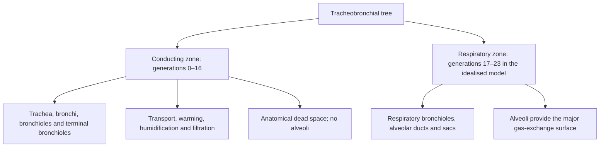
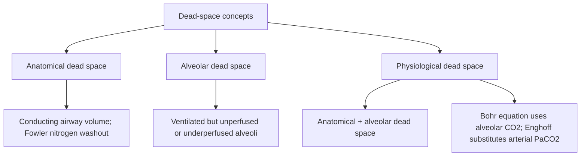
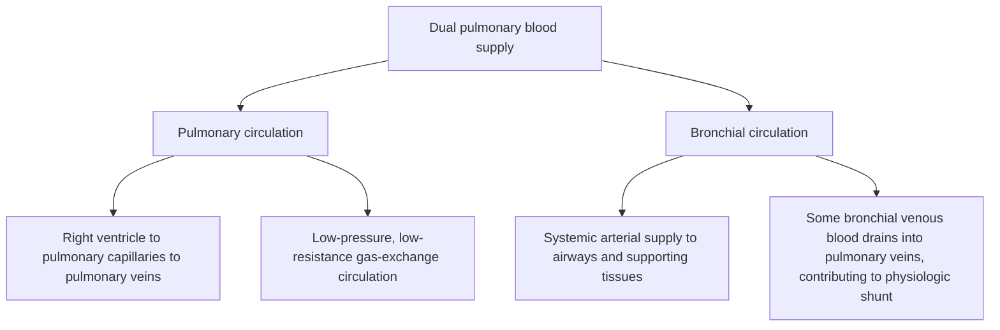

# Topic 01 — Structure of the Respiratory System: Lungs, Airways and Dead Space

## 1. Structural Architecture of the Tracheobronchial Tree
A commonly taught idealised model describes about **23 airway generations (Z0–Z23)**, with the conducting zone ending around the terminal bronchioles and the respiratory zone beginning at respiratory bronchioles. Actual branching and generation counts vary between individuals and lung regions.

### Functional Zones
1. **Conducting Zone (Generations Z0–Z16):**
   * Includes the trachea, mainstem bronchi, lobar bronchi, segmental bronchi, terminal bronchioles.
   * **Function:** Gas transport, humidification, warming ($37^\circ\text{C}$), filtration, and clearance.
   * **Anatomical Dead Space ($V_D$):** Constitutes approximately **$150\text{ mL}$** ($2\text{ mL/kg}$ or $1\text{ mL/lb}$ of body weight).
   * No meaningful alveolar gas exchange occurs here because the conducting airways lack alveoli; the airway wall is not an alveolar blood–gas interface.

2. **Respiratory Zone (Generations Z17–Z23):**
   * Includes respiratory bronchioles (Z17–Z19), alveolar ducts (Z20–Z22), and alveolar sacs (Z23).
   * **Function:** Molecular gas exchange.
   * Outcroppings of alveoli appear at Z17. Total alveolar surface area is often estimated at roughly **50–100 m²** in adults; the estimate varies by method and body size.

---

## 2. Histopathological Transitions Along the Respiratory Tract

| Airway Level | Epithelial Type | Cartilage Support | Smooth Muscle | Secretory / Specialized Cells |
| :--- | :--- | :--- | :--- | :--- |
| **Trachea & Main Bronchi** | Pseudostratified ciliated columnar with goblet cells | C-shaped hyaline cartilage rings | Trachealis muscle posteriorly | Goblet cells, submucosal seromucinous glands |
| **Lobar & Segmental Bronchi** | Pseudostratified ciliated columnar | Irregular cartilage plates | Helical smooth muscle layers | Decreasing goblet cells and glands |
| **Bronchioles (<1 mm)** | Simple ciliated columnar | **Absent** | Well-developed smooth muscle | **Club cells (Clara cells)** replace goblet cells |
| **Terminal Bronchioles** | Simple ciliated cuboidal | **Absent** | Smooth muscle present | Club cells predominant |
| **Respiratory Bronchioles** | Simple cuboidal (partially ciliated) | **Absent** | Scattered smooth muscle bands | Intermittent Type I & II pneumocytes |
| **Alveoli** | Simple squamous epithelium | **Absent** | Elastic & reticular fibers | **Type I (95% area) & Type II pneumocytes (5%)** |

### Key Cellular Histology
* **Club Cells (formerly Clara Cells):** Non-ciliated columnar/cuboidal cells in terminal bronchioles. Function:
  1. Secretion of Club Cell Secretory Protein (CC16/CCSP) and surfactant-like glycosaminoglycans.
  2. Xenobiotic detoxification via Cytochrome P450 enzymes.
  3. Progenitor/stem cell pool for bronchial epithelial regeneration.
* **Type I pneumocytes:** Extremely thin squamous cells covering about **95% of alveolar surface area**; they form most of the gas-exchange surface. They are highly specialised and have little regenerative capacity; type II pneumocytes provide the principal alveolar progenitor population after injury.
* **Type II pneumocytes:** Cuboidal cells that occupy a minority of alveolar surface area (often quoted at about 5%) but are more numerous than type I cells. Functions:
  1. Production and secretion of **Pulmonary Surfactant** stored in **lamellar bodies**.
  2. Progenitor cells for Type I pneumocyte regeneration following alveolar injury.

---

## 3. Anatomical vs. Physiological Dead Space

### Definitions
1. **Anatomical Dead Space ($V_{D,\text{anat}}$):** Volume of conducting airways from nose/mouth down to terminal bronchioles (Z0–Z16) where no gas exchange occurs ($\approx 150\text{ mL}$).
2. **Alveolar Dead Space ($V_{D,\text{alv}}$):** Volume of alveoli that are ventilated but **unperfused** (or underperfused), representing wasted ventilation ($V/Q = \infty$). Minimal in healthy awake individuals at rest.
3. **Physiological Dead Space ($V_{D,\text{phys}}$):** Total wasted ventilation.
   $$\text{Physiological Dead Space } (V_{D,\text{phys}}) = V_{D,\text{anat}} + V_{D,\text{alv}}$$

### Quantitative Measurement Methods

#### 1. Fowler's Method (Measures Anatomical Dead Space)
* **Technique:** Patient takes a single maximal inspiration of $100\%\,\text{O}_2$, then exhales steadily into a nitrogen analyzer.
* **Exhaled Nitrogen Curve Analysis:**
  * **Phase I:** Pure $100\%\,\text{O}_2$ from conducting airways ($[\text{N}_2] = 0\%$).
  * **Phase II:** Rapid rise in $[\text{N}_2]$ representing mixing of anatomical dead space gas and alveolar gas.
  * **Phase III:** Alveolar plateau (mixed alveolar gas; nitrogen concentration approaches that of alveolar gas, not a perfectly pure sample).
  * **Phase IV:** A secondary rise in expired nitrogen associated with dependent airway closure during expiration; the volume at which this begins contributes to measurement of closing volume.
* **Calculation:** Vertical line dropped through Phase II dividing equal area regions determines $V_{D,\text{anat}}$.

#### 2. Bohr Equation / Modified Bohr-Enghoff Equation (Measures Physiological Dead Space)
The **Bohr equation** compares mean alveolar CO₂ with mixed-expired CO₂. In clinical practice, the **Enghoff modification** commonly substitutes arterial PaCO₂; because PaCO₂ also reflects shunt and V/Q inequality, the Enghoff value is an index of global gas-exchange inefficiency rather than a pure measurement of alveolar dead space.

Bohr equation:

\[\frac{V_D}{V_T}=\frac{P_{A\mathrm{CO}_2}-P_{\bar E\mathrm{CO}_2}}{P_{A\mathrm{CO}_2}}\]

Enghoff modification:

\[\frac{V_D}{V_T}=\frac{P_{a\mathrm{CO}_2}-P_{\bar E\mathrm{CO}_2}}{P_{a\mathrm{CO}_2}}\]

Here, \(P_{A\mathrm{CO}_2}\) is mean alveolar CO₂ tension, \(P_{a\mathrm{CO}_2}\) is arterial CO₂ tension, and \(P_{\bar E\mathrm{CO}_2}\) is mixed-expired CO₂ tension.

*Where:*
* $V_T = \text{Tidal Volume}$
* $\text{PaCO}_2 = \text{Arterial Partial Pressure of CO}_2$ (substituted for alveolar $\text{PACO}_2$ by Enghoff)
* $\text{P}_{\overline{E}}\text{CO}_2 = \text{Mixed Expired Partial Pressure of CO}_2$

* **Typical resting $V_D/V_T$ ratio:** Often about **0.2–0.35** in healthy adults, depending on age, body size, tidal volume, and measurement method.
* **Clinical Significance:** $V_D/V_T$ increases significantly in **Pulmonary Embolism**, **ARDS**, **Emphysema**, and mechanical ventilation with high PEEP.

---

## 4. Dual Pulmonary Blood Supply

| Feature | Pulmonary Circulation | Bronchial Circulation |
| :--- | :--- | :--- |
| **Origin** | Right Ventricle via Pulmonary Trunk | Thoracic Aorta & Intercostal Arteries |
| **Hemodynamics** | Low pressure (Systolic $25/\text{Diastolic } 10\text{ mmHg}$; Mean $15\text{ mmHg}$) | High pressure (Systemic Arterial Pressure $120/80\text{ mmHg}$) |
| **Perfusion Volume** | $100\%$ of Cardiac Output ($\approx 5\text{ L/min}$) | $1\%–2\%$ of Total Cardiac Output |
| **Primary Target** | Respiratory zone (alveolar capillaries) | Parenchyma, conducting airway structures, visceral pleura |
| **Venous Drainage** | Pulmonary veins into Left Atrium | **Dual:** Bronchial veins to Azygos system AND Pulmonary veins |
| **Physiological Shunt** | None | Anatomical right-to-left shunt (bronchial venous blood into LA) |

## References and interpretation notes
- [Physiology, Lung Dead Space — NCBI Bookshelf (updated 2026)](https://www.ncbi.nlm.nih.gov/books/NBK482501/): anatomical/physiological dead space and Bohr-equation concepts. The Enghoff modification should be distinguished from the original Bohr formulation.
