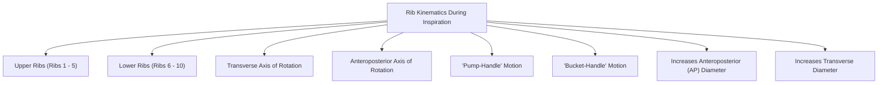
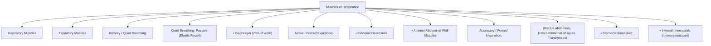
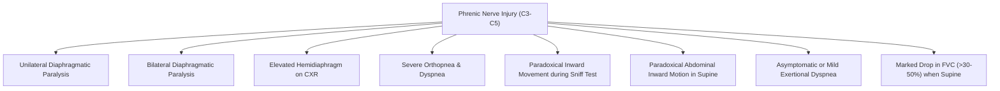

# Topic 02 — The Thoracic Cage and Respiratory Muscles

## 1. Anatomy of the Thoracic Cage and Rib Kinematics
The thoracic cage consists of 12 thoracic vertebrae, 12 pairs of ribs and costal cartilages, and the sternum.

### Rib Movements During Ventilation
1. **Upper Ribs (Ribs 1–5):** Move predominantly in the sagittal plane around a transverse axis (**"Pump-Handle Movement"**), increasing the **anteroposterior (AP) diameter** of the thorax.
2. **Lower Ribs (Ribs 6–10):** Move predominantly in the coronal plane around an anteroposterior axis (**"Bucket-Handle Movement"**), increasing the **transverse diameter** of the thorax.
3. **Floating Ribs (Ribs 11–12):** Move in a **"Pincer-like" or Caliper Movement**, expanding lateral dimensions.

---

## 2. Functional Classification of Respiratory Muscles

### 1. Primary Inspiratory Muscles
* **Diaphragm:**
  * **Innervation:** **Phrenic Nerve (C3, C4, C5)** — *"C3, 4, 5 keeps the diaphragm alive."*
  * **Mechanism:** In quiet breathing, the diaphragm descends **$1–2\text{ cm}$**, generating negative intrathoracic pressure. In deep forced inspiration, it can descend up to **$10\text{ cm}$**.
  * The diaphragm is the principal muscle of quiet inspiration. Estimates attributing a fixed percentage of tidal volume to it are approximate and depend on posture and breathing pattern.
  * **Aortic Hiatus ($T12$):** Aorta, thoracic duct, azygos vein.
  * **Esophageal Hiatus ($T10$):** Esophagus, vagus nerves (anterior and posterior trunks), esophageal branches of left gastric vessels.
  * **Vena Cava Opening ($T8$):** Inferior vena cava, branches of right phrenic nerve.

* **External Intercostals:**
  * **Innervation:** Intercostal nerves ($T1–T11$).
  * **Orientation:** Directed obliquely **downwards and forwards** ("hands in pockets"). Elevates ribs during inspiration.

### 2. Accessory Inspiratory Muscles
* **Sternocleidomastoid:** Elevates the sternum; used during heavy exertion or severe respiratory distress.
* **Scalene Muscles:** Elevate and fix the 1st and 2nd ribs during deep inspiration.
* **Pectoralis Major/Minor & Serratus Anterior:** Assist when upper limbs are fixed (tripod position in COPD).

### 3. Expiratory Muscles (Active Expiration Only)
* Quiet expiration is a **passive process** driven by the elastic recoil of lungs and chest wall.
* **Forced Expiration Muscles:**
  1. **Anterior Abdominal Wall Muscles:** Rectus abdominis, external oblique, internal oblique, transversus abdominis. Compress abdominal viscera, elevating the diaphragm, and increasing intra-abdominal and intrapleural pressures.
  2. **Internal Intercostals (Interosseous portion):** Directed obliquely **downwards and backwards**. Depress ribs during active expiration.

---

## 3. Diaphragmatic Dysfunction and Clinical Lesions

### Pathophysiology of Diaphragmatic Paralysis
1. **Unilateral Phrenic Nerve Lesion:**
   * **Causes:** Cervical spine injury, mediastinal tumors, cardiac surgery (hypothermic injury), phrenic nerve neuritis.
   * **Radiological Sign:** Elevated hemidiaphragm on Chest X-ray.
   * **Fluoroscopic Sniff Test:** Affected hemidiaphragm moves **paradoxically upwards** (superiorly) during rapid inhalation while the normal side moves downwards.

2. **Bilateral Phrenic Nerve Lesion / Diaphragmatic Weakness:**
   * **Causes:** Motor Neuron Disease (ALS), Guillain-Barré Syndrome, Myasthenia Gravis, severe acid maltase deficiency (Pompe disease).
   * **Clinical Hallmark:** Severe **orthopnea** and **abdominal paradox** (inward collapse of the anterior abdominal wall during inspiration in the supine position).
   * **Spirometry clue:** A substantial fall in FVC when moving from upright to supine supports diaphragmatic weakness. The size of the fall varies by disease severity and reference method; a single percentage is not diagnostic in isolation.
