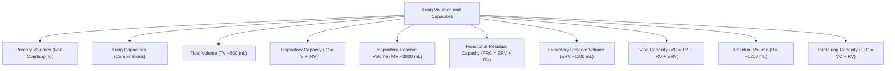
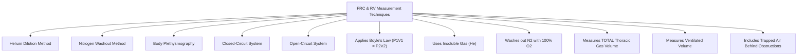
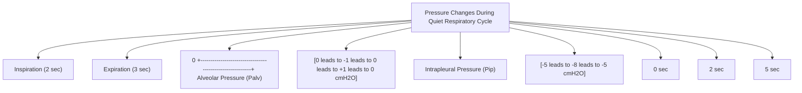
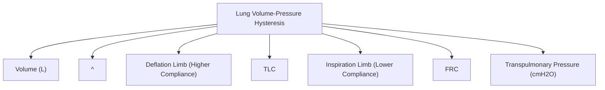

# Topic 03 — Pressures and Volumes During Normal Breathing

## 1. Standard Static Lung Volumes and Capacities

### Primary Lung Volumes

**Reference caveat:** The millilitre values below are traditional approximate values for a healthy adult man; lung volumes vary substantially with height, sex, age, posture, and body habitus. Interpret measured volumes against appropriate reference equations.
1. **Tidal volume ($V_T$ or TV):** Volume inhaled or exhaled with each quiet breath; **about 500 mL** is a traditional adult teaching value, not a universal target. In clinical ventilation, tidal volume is usually prescribed using predicted body weight rather than actual body weight.
2. **Inspiratory Reserve Volume (IRV):** Maximal additional volume inspired above normal $V_T$ ($\approx 3000\text{ mL}$).
3. **Expiratory Reserve Volume (ERV):** Maximal additional volume exhaled after peaceful end-expiration ($\approx 1100\text{ mL}$).
4. **Residual Volume (RV):** Volume remaining in lungs after maximal forced expiration ($\approx 1200\text{ mL}$). **Cannot be measured by simple spirometry.**

### Standard Lung Capacities
1. **Inspiratory Capacity (IC):** $V_T + \text{IRV} \approx 3500\text{ mL}$.
2. **Functional Residual Capacity (FRC):** $\text{ERV} + \text{RV} \approx 2300\text{ mL}$. Resting equilibrium point of respiratory system.
3. **Vital Capacity (VC or FVC):** $V_T + \text{IRV} + \text{ERV} \approx 4600\text{ mL}$.
4. **Total Lung Capacity (TLC):** $\text{VC} + \text{RV} = V_T + \text{IRV} + \text{ERV} + \text{RV} \approx 5800\text{ mL}$.

---

## 2. Measurement of Functional Residual Capacity (FRC) and Residual Volume (RV)
Because RV (and thus FRC and TLC) cannot be exhaled, standard spirometry cannot measure them. Three specialized techniques are used:

### 1. Helium Dilution Technique (Closed-Circuit)
* A spirometer of known volume ($V_1$) and helium concentration ($C_1$) is connected at end-expiration (FRC).
* Patient breathes until helium equilibrates to $C_2$.
$$V_2 (\text{FRC}) = V_1 \times \left( \frac{C_1 - C_2}{C_2} \right)$$

### 2. Nitrogen Washout Technique (Open-Circuit)
* Patient inhales $100\%\,\text{O}_2$ from FRC for several minutes; all exhaled nitrogen is collected and measured.
$$\text{FRC} = \frac{\text{Volume of Exhaled }\text{N}_2}{\text{Initial Alveolar Concentration of }\text{N}_2 (0.79)}$$

### 3. Body Plethysmography (Gold Standard)
* Based on **Boyle's Law** ($P_1 V_1 = P_2 V_2$).
* Patient sits in an airtight box and panting maneuvers are performed against a closed shutter.
* **Clinical Superiority:** Plethysmography measures **Total Thoracic Gas Volume (TGV)**, including non-communicating trapped air behind obstructed airways (e.g., bullae in emphysema), whereas gas dilution methods underestimate FRC in severe obstructive airways disease.

---

## 3. Pressure Dynamics During the Respiratory Cycle

### Key Pressure Variables
1. **Atmospheric Pressure ($P_{atm}$):** Set as baseline reference ($0\text{ cmH}_2\text{O}$).
2. **Alveolar Pressure ($P_{alv}$):**
   * *Rest (End-expiration):* $0\text{ cmH}_2\text{O}$.
   * *Mid-Inspiration:* Drops to **$-1\text{ cmH}_2\text{O}$**, creating pressure gradient drawing air in.
   * *End-Inspiration:* Returns to $0\text{ cmH}_2\text{O}$.
   * *Mid-Expiration:* Rises to **$+1\text{ cmH}_2\text{O}$**, pushing air out.
3. **Intrapleural Pressure ($P_{ip}$):**
   * Always subatmospheric (negative) under normal physiological conditions due to opposing elastic recoils of lung (inwards) and chest wall (outwards).
   * *Resting FRC:* **$-5\text{ cmH}_2\text{O}$**.
   * *End-Inspiration:* Drops to **$-8\text{ cmH}_2\text{O}$**.
   * *Forced Expiration:* Can become positive ($+30\text{ to }+50\text{ cmH}_2\text{O}$).
4. **Transpulmonary Pressure ($P_{tp}$):**
   $$P_{tp} = P_{alv} - P_{ip}$$
   * Represents the distending force holding the lungs open. Always positive under physiological conditions ($+5\text{ cmH}_2\text{O}$ at resting FRC; $+8\text{ cmH}_2\text{O}$ at end-inspiration).

---

## 4. Hysteresis in the Pressure-Volume Curve

* **Definition:** Hysteresis refers to the difference between the inflation (inspiration) limb and deflation (expiration) limb of the lung's $P-V$ curve.
* **Mechanism:**
  1. For any given transpulmonary pressure, **lung volume is greater during deflation than during inflation**.
  2. Caused by **surface tension forces** at the air-liquid interface: recruitment of collapsed alveoli during inspiration requires higher opening pressure to overcome liquid surface tension than maintaining open alveoli during deflation.
  3. Saline-filled lungs demonstrate **no hysteresis** and markedly increased compliance due to elimination of air-liquid surface tension.
