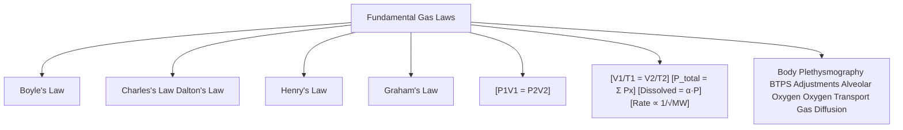

# Topic 04 — Gas Laws in Respiratory Physiology

## 1. Fundamental Physical Gas Laws

### 1. Boyle's Law
* **Statement:** At constant temperature ($T$), the volume ($V$) of a fixed mass of gas is inversely proportional to its pressure ($P$).
  $$P_1 V_1 = P_2 V_2 \quad (\text{or } P \cdot V = \text{constant})$$
* **Physiological Application:**
  1. **Inspiration:** Diaphragmatic contraction increases thoracic volume $\rightarrow$ intrathoracic pressure drops below atmospheric pressure $\rightarrow$ gas flows into lungs.
  2. **Body Plethysmography:** Used to calculate total thoracic gas volume (TGV/FRC) by measuring pressure and volume shifts during panting maneuvers.

### 2. Charles's Law
* **Statement:** At constant pressure ($P$), the volume ($V$) of a gas is directly proportional to its absolute temperature ($T$ in Kelvin).
  $$\frac{V_1}{T_1} = \frac{V_2}{T_2}$$
* **Physiological Application:** As ambient air ($20^\circ\text{C}$) enters conducting airways, it warms to body temperature ($37^\circ\text{C}$), causing gas volume expansion. Requires conversion between **STPD** (Standard Temperature, Pressure, Dry) and **BTPS** (Body Temperature, Pressure, Saturated).

### 3. Dalton's Law of Partial Pressures
* **Statement:** The total pressure exerted by a mixture of non-reacting gases is equal to the sum of the partial pressures exerted by each individual constituent gas.
  $$P_{\text{total}} = P_1 + P_2 + P_3 + \dots + P_n$$
  $$P_x = P_{\text{total}} \times F_x$$
  *Where $F_x$ is the fractional concentration of gas $x$.*
* **Physiological Application:**
  * **Ambient Air at Sea Level ($760\text{ mmHg}$):**
    * $F_{\text{O}_2} = 0.21 \implies P_{\text{O}_2} = 760 \times 0.21 = 159\text{ mmHg}$.
    * $F_{\text{N}_2} = 0.78 \implies P_{\text{N}_2} = 760 \times 0.78 = 593\text{ mmHg}$.
  * **Tracheal Air (Saturated with Water Vapor at $37^\circ\text{C}$ where $P_{\text{H}_2\text{O}} = 47\text{ mmHg}$):**
    $$P_{\text{I}\text{O}_2} = (P_{\text{atm}} - P_{\text{H}_2\text{O}}) \times F_{\text{I}\text{O}_2} = (760 - 47) \times 0.21 = 150\text{ mmHg}$$

### 4. Henry's Law
* **Statement:** The quantity of gas dissolved in a liquid at equilibrium is directly proportional to the partial pressure of that gas above the liquid and its solubility coefficient ($\alpha$).
  $$\text{Concentration of Dissolved Gas} = \alpha \times P_x$$
* **Solubility Coefficients in Blood at $37^\circ\text{C}$:**
  * $\text{Oxygen } (\text{O}_2): 0.0031\text{ mL O}_2 / 100\text{ mL blood / mmHg } P_{\text{O}_2}$.
  * $\text{Carbon Dioxide } (\text{CO}_2): 0.067\text{ mL CO}_2 / 100\text{ mL blood / mmHg } P_{\text{CO}_2}$.
* **Key Takeaway:** $\text{CO}_2$ is approximately **20 times more soluble** in aqueous blood plasma than $\text{O}_2$.

### 5. Graham's Law
* **Statement:** The rate of diffusion of a gas through a membrane is inversely proportional to the square root of its molecular weight ($\text{MW}$).
  $$\text{Rate of Diffusion} \propto \frac{1}{\sqrt{\text{MW}}}$$

---

## 2. Gas Condition Corrections (STPD, BTPS, ATPS)

| Abbreviation | Standard Condition | Temperature | Pressure | Water Vapor | Clinical Relevance |
| :--- | :--- | :--- | :--- | :--- | :--- |
| **STPD** | Standard Temp, Pressure, Dry | $0^\circ\text{C}$ ($273\text{ K}$) | $760\text{ mmHg}$ | $0\text{ mmHg}$ (Dry) | Used to express diffusion capacity ($D_L\text{CO}$) and oxygen consumption ($\dot{V}\text{O}_2$) |
| **BTPS** | Body Temp, Pressure, Saturated | $37^\circ\text{C}$ ($310\text{ K}$) | Ambient ($760\text{ mmHg}$) | $47\text{ mmHg}$ (Saturated) | Expresses all lung volumes ($V_T, \text{FVC}, \text{TLC}$) in vivo |
| **ATPS** | Ambient Temp, Pressure, Saturated | Room Temp ($\sim 20^\circ\text{C}$) | Ambient | Saturated at room temp | Raw spirometry output before BTPS correction |

---

## 3. Ideal Gas Law
Combines Boyle's, Charles's, and Avogadro's laws:
$$P \cdot V = n \cdot R \cdot T$$
*Where:*
* $P = \text{Pressure}$
* $V = \text{Volume}$
* $n = \text{Moles of gas}$
* $R = \text{Universal gas constant } (0.0821\text{ L}\cdot\text{atm/mol}\cdot\text{K})$
* $T = \text{Absolute temperature in Kelvin}$
