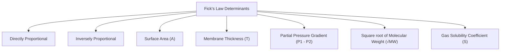
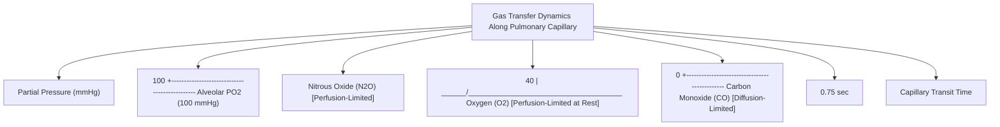
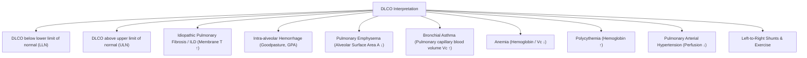

# Topic 05 — Diffusion across the Alveolo-Capillary Membrane

## 1. Fick's Law of Diffusion
The rate of gas transfer across a tissue membrane ($\dot{V}_{\text{gas}}$) is governed by Fick's Law:

$$\dot{V}_{\text{gas}} = \frac{A \times D \times (P_1 - P_2)}{T}$$

*Where:*
* $A = \text{Surface area available for diffusion } (\approx 70–100\text{ m}^2)$
* $T = \text{Thickness of alveolo-capillary membrane } (\approx 0.2–0.5\,\mu\text{m})$
* $P_1 - P_2 = \text{Partial pressure gradient across the membrane}$
* $D = \text{Diffusion coefficient of the gas} \propto \frac{\text{Solubility}}{\sqrt{\text{Molecular Weight}}}$

### Relative Diffusion Rates ($\text{CO}_2$ vs $\text{O}_2$)
* $\text{Molecular Weight: } \text{MW}_{\text{CO}_2} (44) > \text{MW}_{\text{O}_2} (32) \implies \text{Gram-for-gram, O}_2 \text{ diffuses faster in gas phase.}$
* $\text{Solubility: } \text{Solubility of CO}_2 \text{ in aqueous tissue is } \mathbf{24 \times} \text{ greater than O}_2.$
* **Combined Diffusion Constant ($D$):**
  $$\frac{D_{\text{CO}_2}}{D_{\text{O}_2}} = \frac{\text{Solubility}_{\text{CO}_2}}{\text{Solubility}_{\text{O}_2}} \times \sqrt{\frac{\text{MW}_{\text{O}_2}}{\text{MW}_{\text{CO}_2}}} = 24 \times \sqrt{\frac{32}{44}} \approx \mathbf{20}$$
* **Clinical principle:** Because CO₂ is much more soluble in biological fluids than O₂, its overall transfer is less often limited by diffusion. Diffusion impairment therefore commonly causes hypoxaemia before hypercapnia; hypercapnia usually reflects inadequate alveolar ventilation or advanced respiratory disease rather than an isolated diffusion defect.

---

## 2. Perfusion-Limited vs. Diffusion-Limited Gas Transfer

| Parameter | Perfusion-Limited Gas Exchange | Diffusion-Limited Gas Exchange |
| :--- | :--- | :--- |
| **Prototypic Gas** | **Nitrous Oxide ($\text{N}_2\text{O}$)** (and $\text{O}_2$ under normal resting conditions) | **Carbon Monoxide ($\text{CO}$)** (and $\text{O}_2$ in disease/exercise) |
| **Mechanism** | Gas does not combine with blood proteins; partial pressure in capillary rises rapidly to equal alveolar partial pressure | Gas is avidly bound by hemoglobin; plasma partial pressure remains near zero throughout transit |
| **Limiting Factor** | Volume of pulmonary blood flow ($\dot{Q}$) | Structural diffusion properties of alveolo-capillary membrane ($D_L$) |
| **Equilibration Time** | Reached rapidly within **$0.25\text{ seconds}$** (total transit time = $0.75\text{ sec}$) | Partial pressure **never equilibrates** across the capillary length |
| **How to Increase Uptake** | Increase cardiac output / blood flow | Improve membrane characteristics or alveolar partial pressure |

---

## 3. Diffusing Capacity of the Lung ($D_L\text{CO}$)

### Measurement Technique (Single-Breath Carbon Monoxide Method)
Carbon monoxide is utilized because its transfer is strictly diffusion-limited.
$$D_L\text{CO} = \frac{\dot{V}_{\text{CO}}}{\text{PACO} - \text{PcCO}} \approx \frac{\dot{V}_{\text{CO}}}{\text{PACO}}$$
*(Since $\text{PcCO} \approx 0$ due to high affinity binding to Hb).*

### Roughton-Forster Equation
Total resistance to diffusion ($1/D_L$) consists of two components in series:
$$\frac{1}{D_L} = \frac{1}{D_M} + \frac{1}{\theta \cdot V_c}$$
*Where:*
* $D_M = \text{Membrane diffusing capacity}$
* $\theta = \text{Rate of gas uptake by 1 mL of blood per mmHg partial pressure}$
* $V_c = \text{Pulmonary capillary blood volume}$

### Clinical Interpretation of $D_L\text{CO}$ Abnormalities

