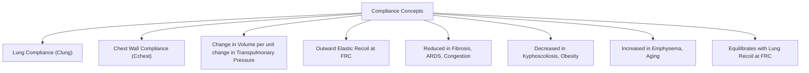
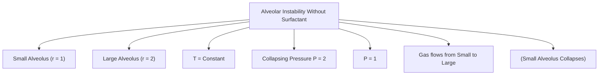

# Topic 06 — Lung Mechanics: Elastic Forces and Compliance

## 1. Compliance of the Lungs and Chest Wall

### Definitions and Equations
Compliance ($C$) is the measure of distensibility or ease of expansion of a hollow organ:
$$C = \frac{\Delta V}{\Delta P} \quad (\text{Normal Lung Compliance } C_L \approx 200\text{ mL/cmH}_2\text{O})$$

### Specific Compliance
Standardizes compliance for lung volume differences (e.g., comparing child vs adult):
$$\text{Specific Compliance} = \frac{\text{Compliance}}{\text{FRC}}$$

### Combined System Compliance ($C_{\text{total}}$)
The lungs and chest wall act as two elastic structures arranged in **series**:
$$\frac{1}{C_{\text{total}}} = \frac{1}{C_{\text{lung}}} + \frac{1}{C_{\text{chest}}}$$
* Normal $C_{\text{lung}} = 0.2\text{ L/cmH}_2\text{O}$; Normal $C_{\text{chest}} = 0.2\text{ L/cmH}_2\text{O}$.
* Total System Compliance $C_{\text{total}} = 0.1\text{ L/cmH}_2\text{O} = 100\text{ mL/cmH}_2\text{O}$.

### Clinical Alterations in Compliance
1. **Decreased Compliance ($\Delta V / \Delta P \downarrow$ — "Stiff Lungs"):**
   * *Pulmonary Causes:* Idiopathic Pulmonary Fibrosis (IPF), ARDS, Pulmonary Edema, Neonatal RDS.
   * *Chest Wall Causes:* Kyphoscoliosis, Ankylosing Spondylitis, Morbid Obesity, Circumferential Thoracic Burns.
2. **Increased Compliance ($\Delta V / \Delta P \uparrow$ — "Flabby Lungs"):**
   * Pulmonary Emphysema (destruction of elastic fibers by neutrophil elastase), Normal Aging.

---

## 2. Surface Tension and Laplace's Law

### Laplace's Law for Spherical Alveoli
$$P = \frac{2T}{r}$$
*Where:*
* $P = \text{Collapsing pressure within the alveolus}$
* $T = \text{Surface tension of liquid film}$
* $r = \text{Alveolar radius}$

### The Instability Paradox Without Surfactant
If surface tension $T$ remains constant:
* Smaller alveoli ($r \downarrow$) generate **higher collapsing pressures** ($P \uparrow$).
* Gas empties from small alveoli into larger alveoli, leading to widespread **atelectasis**.

---

## 3. Pulmonary Surfactant: Biochemistry and Physiology

```mermaid
flowchart TD
    A0["Pulmonary Surfactant"]
    A0 --> A1["Biochemical Composition"]
    A0 --> A2["Physiological Functions"]
    A0 --> A3["90% Lipids:"]
    A0 --> A4["Reduces Surface Tension (T)"]
    A0 --> A5["• Dipalmitoylphosphatidylcholine (DPPC / Lecithin)"]
    A0 --> A6["Prevents Alveolar Collapse at Low Volumes"]
    A0 --> A7["• Phosphatidylglycerol (PG)"]
    A0 --> A8["Equalizes Collapsing Pressure Across Alveoli"]
    A0 --> A9["10% Surfactant Proteins:"]
    A0 --> A10["Reduces Work of Breathing"]
    A0 --> A11["• SP-A & SP-D (Innate Immunity / Opsonins)"]
    A0 --> A12["Maintains Dry Alveolar Space (Prevents Edema)"]
```

### Synthesis and Composition
* Produced by **Type II Pneumocytes** and stored in **lamellar bodies**.
* **Major lipid constituent:** **Dipalmitoylphosphatidylcholine (DPPC)** is the principal surface-active phospholipid. Exact percentages vary by preparation and how total surfactant is measured; avoid memorising “80% of total surfactant” as a universal value.
* **Surfactant Specific Proteins (10%):**
  * **SP-A & SP-D:** Hydrophilic collectins; function in innate pulmonary immunity (opsonization of pathogens).
  * **SP-B & SP-C:** Hydrophobic membrane-active proteins; essential for rapid alignment and monolayer spreading of DPPC at the air-water interface. Mutation in *SFTPB* causes fatal neonatal RDS.

### Physiological Roles
1. **Reduces surface tension in a volume-dependent way:** As the alveolar surface area decreases during expiration, surfactant molecules become more concentrated and surface tension falls substantially. This reduces collapsing pressure ($P = 2T/r$) and helps prevent end-expiratory alveolar instability; surface tension is not literally zero across all physiological conditions.
2. **Equalizes Pressure Across Variable Sized Alveoli:** Surface tension drops more dramatically in smaller alveoli, stabilizing them alongside larger alveoli.
3. **Keeps Alveoli Dry:** Prevents high surface tension from sucking fluid out of pulmonary capillaries into alveolar spaces.

---

## 4. Infant Respiratory Distress Syndrome (IRDS / Hyaline Membrane Disease)
* **Etiology:** Deficiency of pulmonary surfactant in premature infants (gestational age $< 32–34\text{ weeks}$).
* **Exam context:** Older teaching used the amniotic-fluid lecithin:sphingomyelin ratio (often ≥2) and phosphatidylglycerol as markers of fetal lung maturity. These are historical tests and are not routinely used to decide delivery timing; current obstetric management depends on gestational age, clinical indication, and antenatal corticosteroid guidance.
* **Prevention and treatment:** When preterm birth is anticipated, antenatal corticosteroids are used according to gestational-age criteria and obstetric guidance. Neonatal care may include respiratory support and surfactant for eligible infants; exact timing and approach follow neonatal protocols.
