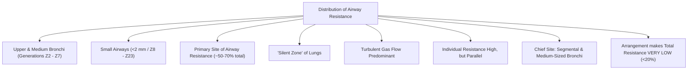
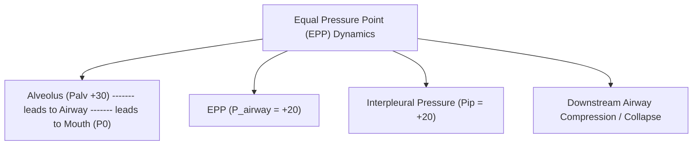
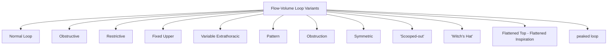

# Topic 07 — Lung Mechanics: Airway Resistance and Flow Dynamics

## 1. Poiseuille's Law and Sites of Airway Resistance

### Poiseuille's Law for Laminar Gas Flow
$$R = \frac{8 \eta L}{\pi r^4}$$
*Where:*
* $R = \text{Airway Resistance}$
* $\eta = \text{Gas Viscosity}$
* $L = \text{Airway Length}$
* $r = \text{Airway Radius}$

**Critical Principle:** Airway resistance is **inversely proportional to the fourth power of the radius ($r^4$)**. Halving airway radius increases resistance **16-fold**.

### Anatomic Distribution of Resistance
* **Upper Airway (Nose, Pharynx, Larynx):** Accounts for **$50\%$** of total airway resistance.
* **Medium-Sized Bronchi (Generations Z2–Z7):** **Chief site of resistance** in the lower respiratory tract due to turbulent flow and high velocity.
* **Small airways (commonly defined by an internal diameter <2 mm):** Each small airway has a small radius, but their extensive parallel arrangement means their combined resistance is relatively low in healthy lungs. The exact fraction depends on lung volume, disease, and measurement conditions.
  * *Reason:* Extensive parallel branching increases total cross-sectional area. The term **“silent zone”** is a useful teaching shorthand: substantial small-airway pathology may develop before routine spirometry becomes clearly abnormal, but spirometry is not invariably normal in early disease.

---

## 2. Determinants of Airway Resistance
1. **Lung Volume:** As lung volume increases (inspiration), radial traction exerted by surrounding elastic parenchyma pulls airways open, **decreasing airway resistance**. At low lung volumes (expiration), resistance increases markedly.
2. **Autonomic Control:**
   * *Parasympathetic (Vagus/ACh via $M_3$ receptors):* Bronchoconstriction and increased mucus secretion $\rightarrow$ Resistance $\uparrow$.
   * *Sympathetic ($\beta_2$-adrenergic receptors via Circulating Epinephrine):* Bronchodilation $\rightarrow$ Resistance $\downarrow$.
3. **Gas Density and Viscosity:** In turbulent flow regimes (Reynolds number $Re > 2000$), resistance depends on **gas density** ($\rho$). Breathing Helium-Oxygen mixtures (**Heliox** — lower density than room air) reduces resistance in upper airway obstruction.

---

## 3. Dynamic Airway Compression and Equal Pressure Point (EPP)

### Mechanism During Forced Expiration
1. High expiratory muscle contraction generates positive intrapleural pressure ($P_{ip} = +20\text{ cmH}_2\text{O}$) and positive alveolar pressure ($P_{alv} = P_{ip} + P_{\text{recoil}} = +20 + +10 = +30\text{ cmH}_2\text{O}$).
2. As gas flows from alveoli to mouth, airway pressure drops progressively from $+30$ to $0\text{ cmH}_2\text{O}$.
3. **Equal Pressure Point (EPP):** The anatomical site where airway pressure equals intrapleural pressure ($P_{\text{airway}} = P_{ip} = +20\text{ cmH}_2\text{O}$).
4. **Downstream Compression:** Airway segments downstream (towards mouth) from the EPP have internal pressure lower than $P_{ip}$, leading to dynamic compression and collapse.
5. **In Obstructive Disease (Emphysema):** Loss of alveolar elastic recoil ($P_{\text{recoil}} \downarrow$) shifts the EPP **upstream (closer to alveoli)** into small non-cartilaginous airways, causing premature dynamic closure and gas trapping. Patients counter this by **pursed-lip breathing** (increases mouth pressure, moving EPP downstream back into cartilaginous airways).

---

## 4. Flow-Volume Loop Morphology

