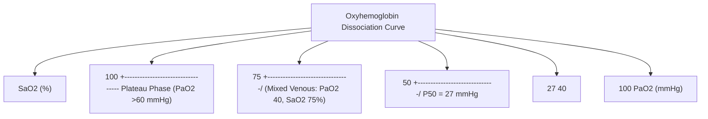

# Topic 08 — Carriage of Oxygen in Blood

## 1. Forms of Oxygen Transport
Oxygen is transported in blood in two distinct states:

1. **Dissolved Oxygen:**
   * Governed by Henry's law: $\text{Dissolved } \text{O}_2 = 0.0031 \times P_{\text{O}_2} \text{ (in mL O}_2/\text{dL blood)}$.
   * At normal arterial $P_{\text{O}_2} = 100\text{ mmHg}$, dissolved $\text{O}_2 = \mathbf{0.3\text{ mL/dL}}$.
   * Drives partial pressure gradients and chemoreceptors, but grossly insufficient for tissue metabolic requirements ($250\text{ mL/min}$).

2. **Hemoglobin-Bound Oxygen:**
   * Each gram of fully saturated Hb can bind **$1.34\text{ mL}$** of $\text{O}_2$ (Hüfner's constant; theoretical max $1.39\text{ mL}$).
   * At normal $[\text{Hb}] = 15\text{ g/dL}$ and $100\%$ saturation:
     $$\text{Bound } \text{O}_2 = 15 \times 1.34 \times 1.0 = \mathbf{20.1\text{ mL/dL}}$$

### Total Arterial Oxygen Content ($\text{CaO}_2$) Formula
$$\text{CaO}_2 = \left( 1.34 \times [\text{Hb}] \times \frac{\text{SaO}_2}{100} \right) + \left( 0.0031 \times \text{PaO}_2 \right)$$
* Normal $\text{CaO}_2 \approx 20.4\text{ mL O}_2/\text{dL blood}$.

---

## 2. Oxyhemoglobin Dissociation Curve (ODC) Dynamics

### Key Physiological Features
* **Sigmoidal Shape:** Result of **cooperative binding** (allosteric interaction among the 4 heme groups).
* **$P_{50}$ Value:** $P_{\text{O}_2}$ at which hemoglobin is $50\%$ saturated. Normal $P_{50} = \mathbf{26.8\text{ mmHg}} \approx 27\text{ mmHg}$. An index of Hb-oxygen affinity.
* **Plateau Phase ($P_{\text{O}_2} > 60\text{ mmHg}$):** Provides a safety margin; large drops in $P_{\text{O}_2}$ (from $100$ down to $60\text{ mmHg}$) result in minimal decline in $\text{SaO}_2$ ($100\%$ to $90\%$).
* **Steep Phase ($P_{\text{O}_2} < 40\text{ mmHg}$):** Allows rapid release of large quantities of $\text{O}_2$ to tissues with small drops in capillary $P_{\text{O}_2}$.

---

## 3. Factors Shifting the Oxyhemoglobin Dissociation Curve

```mermaid
flowchart TD
    A0["ODC Shift Determinants"]
    A0 --> A1["Right Shift (Decreased Affinity / P50 ↑)"]
    A0 --> A2["Left Shift (Increased Affinity / P50 ↓)"]
    A0 --> A3["Decreased pH / Increased [H+] (Acidosis)"]
    A0 --> A4["Increased pH / Decreased [H+] (Alkalosis)"]
    A0 --> A5["Increased PaCO2 (Bohr Effect)"]
    A0 --> A6["Decreased PaCO2"]
    A0 --> A7["Increased Temperature (Fever)"]
    A0 --> A8["Decreased Temperature (Hypothermia)"]
    A0 --> A9["Increased 2,3-Bisphosphoglycerate (2,3-BPG)"]
    A0 --> A10["Decreased 2,3-BPG"]
    A0 --> A11["Fetal Hemoglobin (HbF)"]
    A0 --> A12["Carboxyhemoglobin & Methemoglobin"]
```

### Mnemonic for Right Shift: **"CADET, face Right!"**
* **C** — $\text{CO}_2$ increase
* **A** — Acid / $[\text{H}^+]$ increase ($\text{pH} \downarrow$)
* **D** — 2,3-**D**PG (2,3-BPG) increase
* **E** — **E**xercise
* **T** — **T**emperature increase

### Bohr Effect
Described by Christian Bohr: Increased $\text{CO}_2$ and $[\text{H}^+]$ in metabolically active tissue blood shift the ODC to the right, weakening Hb-$\text{O}_2$ affinity and enhancing tissue $\text{O}_2$ unloading.

---

## 4. Dyshemoglobinemias

| Condition | Pathophysiology & Etiology | Key Diagnostic Findings | Specific Treatment |
| :--- | :--- | :--- | :--- |
| **Methemoglobinemia** | Heme iron is oxidised from ferrous ($\text{Fe}^{2+}$) to ferric ($\text{Fe}^{3+}$) by agents such as dapsone, nitrates/nitrites, and benzocaine | Chocolate-brown blood may occur; pulse oximetry often trends toward ~85%; PaO₂ can remain normal because it measures dissolved oxygen | Treat significant symptomatic cases with methylene blue under an appropriate protocol; consider G6PD deficiency and serotonergic drug interactions. Vitamin C is not an equivalent rapid first-line substitute in severe toxicity |
| **Carboxyhaemoglobinaemia** | CO binds haemoglobin with roughly **200–250 times** the affinity of O₂ and impairs oxygen carriage and unloading | Conventional pulse oximetry may read falsely normal; PaO₂ may be normal. Cherry-red skin is uncommon and should not be relied on. Confirm with co-oximetry | Give high-concentration oxygen; hyperbaric oxygen is considered in selected cases according to clinical severity, pregnancy, neurological/cardiac features, and local toxicology guidance |
