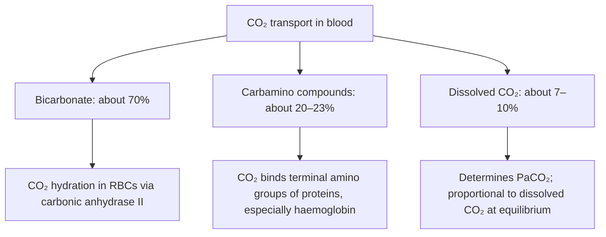
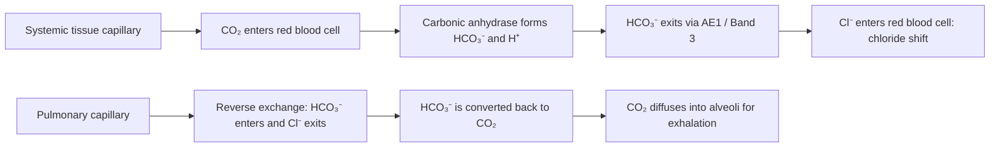
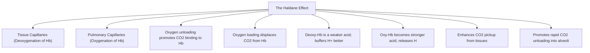
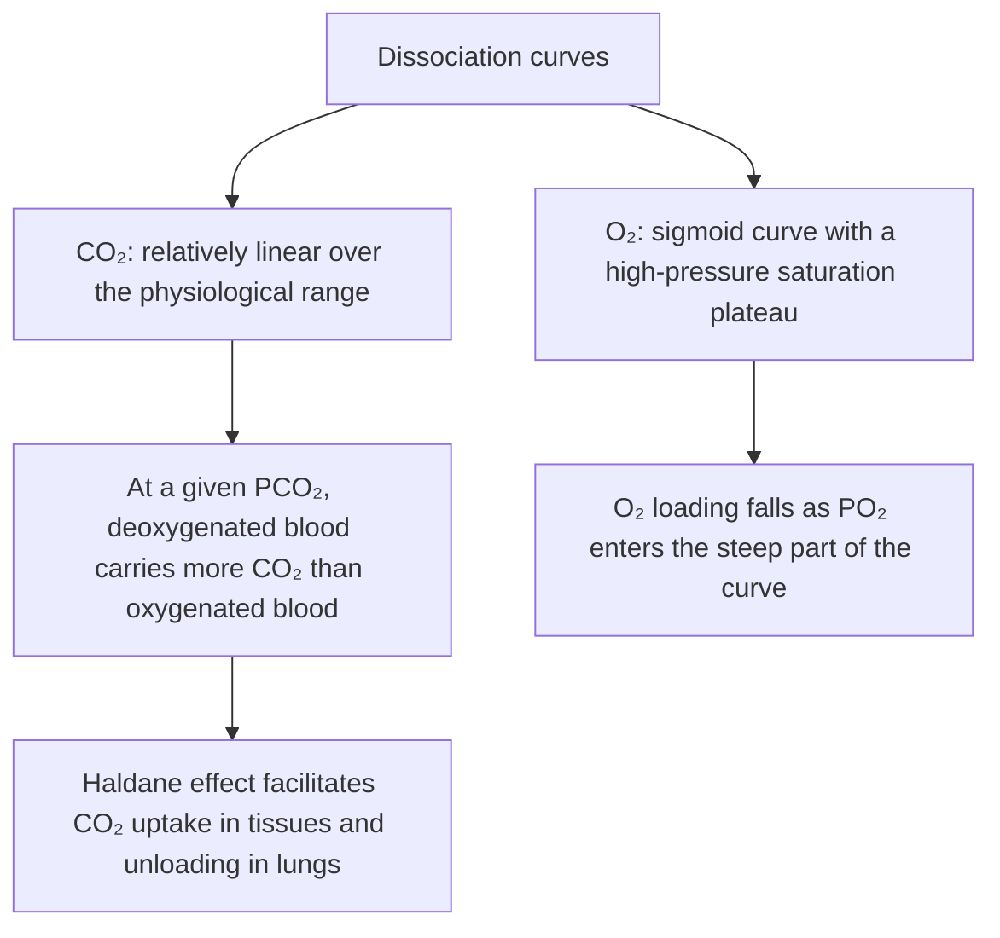

# Topic 09 — Carriage of Carbon Dioxide in Blood

## 1. Forms of Carbon Dioxide Transport in Blood
Blood carries $\text{CO}_2$ from tissue capillaries to pulmonary alveoli in three primary forms:

### Breakdown of Transport Modes
1. **Bicarbonate Ions ($\text{HCO}_3^-$) — $70\%$:**
   * $\text{CO}_2$ enters RBCs and combines with $\text{H}_2\text{O}$ via **Carbonic Anhydrase II (CA II)**:
     $$\text{CO}_2 + \text{H}_2\text{O} \xrightarrow{\text{CA II}} \text{H}_2\text{CO}_3 \rightleftharpoons \text{H}^+ + \text{HCO}_3^-$$
2. **Carbamino Compounds — $20\%$:**
   * $\text{CO}_2$ reacts directly with un-ionized terminal amino groups of hemoglobin proteins to form **Carbaminohemoglobin ($\text{HbCO}_2$)**. Does not require carbonic anhydrase.
3. **Dissolved $\text{CO}_2$ — $10\%$:**
   * Dissolved in plasma water ($\alpha = 0.067\text{ mL/dL/mmHg}$). Generates the arterial $\text{PaCO}_2$ ($40\text{ mmHg}$).

---

## 2. The Chloride Shift (Hamburger Phenomenon)

### Mechanism at Tissue Capillaries
1. Intracellular accumulation of $\text{HCO}_3^-$ inside RBCs creates a concentration gradient favoring efflux into plasma.
2. The **Anion Exchanger 1 (AE1 / Band 3 Protein)** transports $\text{HCO}_3^-$ out of the RBC in 1:1 electroneutral exchange for **Chloride ($\text{Cl}^-$)** entering the RBC.
3. **Osmotic Effect:** Inflow of $\text{Cl}^-$ increases RBC intracellular osmolarity, drawing water into red cells. Consequently, **venous red blood cells have a slightly larger mean corpuscular volume (MCV) and higher hematocrit** than arterial red blood cells.

---

## 3. The Haldane Effect

* **Definition:** Oxygenation of hemoglobin alters its affinity for $\text{CO}_2$. Deoxygenated blood can carry significantly more $\text{CO}_2$ than oxygenated blood.
* **Mechanism:**
  1. Deoxyhemoglobin is a weaker acid than oxyhemoglobin; it buffers $\text{H}^+$ ions more effectively, driving the CA equation to produce more $\text{HCO}_3^-$.
  2. Deoxyhemoglobin forms carbamino compounds more readily than oxyhemoglobin.
* **Comparison with Bohr Effect:**
  * **Bohr Effect:** Effect of $\text{CO}_2$ and $[\text{H}^+]$ on $\mathbf{\text{O}_2}$ binding.
  * **Haldane Effect:** Effect of $\text{O}_2$ on $\mathbf{\text{CO}_2}$ binding and transport.

---

## 4. Carbon Dioxide Dissociation Curve

* The $\text{CO}_2$ dissociation curve is **far more linear** than the sigmoidal $\text{O}_2$ dissociation curve over physiological ranges ($30–60\text{ mmHg}$).
* This linearity allows hyperventilating alveoli in healthy lung regions to compensate for $\text{CO}_2$ retention in diseased regions, whereas they cannot compensate for hypoxemia due to the $\text{O}_2$ saturation plateau.
