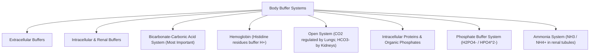
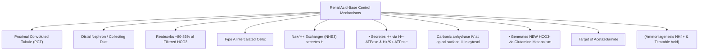

# Topic 10 — Physiological Acid–Base Balance Mechanisms

## 1. The Henderson-Hasselbalch Equation and Buffer Systems

### Henderson-Hasselbalch Equation for Bicarbonate Buffer
$$\text{pH} = \text{pK}_a + \log \left( \frac{[\text{HCO}_3^-]}{[\text{H}_2\text{CO}_3]} \right) = 6.1 + \log \left( \frac{[\text{HCO}_3^-]}{0.03 \times \text{PaCO}_2} \right)$$

*Normal Parameters:*
* $[\text{HCO}_3^-] = 24\text{ mEq/L}$
* $\text{PaCO}_2 = 40\text{ mmHg} \implies 0.03 \times 40 = 1.2\text{ mEq/L}$
* $\text{pH} = 6.1 + \log\left(\frac{24}{1.2}\right) = 6.1 + \log(20) = 6.1 + 1.3 = \mathbf{7.40}$

### Major Physiological Buffers
1. **Bicarbonate Buffer System ($\text{HCO}_3^- / \text{H}_2\text{CO}_3$):**
   * Most quantitative extracellular buffer.
   * Functions as an **open system** because $\text{CO}_2$ is continually exhaled by lungs and $\text{HCO}_3^-$ is reabsorbed/regenerated by kidneys.
2. **Protein Buffers (Hemoglobin):**
   * Imidazole groups of **histidine residues** on hemoglobin provide major intracellular buffering capacity in blood.
3. **Phosphate Buffer System ($\text{HPO}_4^{2-} / \text{H}_2\text{PO}_4^-$):**
   * Primary buffer in **intracellular fluid** and **renal tubular fluid** (titratable acid).

---

## 2. Renal Mechanisms in Acid-Base Regulation

### 1. Bicarbonate Reabsorption (PCT — $80–85\%$)
1. $\text{H}^+$ is secreted into tubular lumen via $\text{Na}^+/\text{H}^+$ exchanger 3 (**NHE3**).
2. Secreted $\text{H}^+$ combines with filtered $\text{HCO}_3^-$ to form $\text{H}_2\text{CO}_3$.
3. Apical **Carbonic Anhydrase IV** dehydrates $\text{H}_2\text{CO}_3$ to $\text{CO}_2 + \text{H}_2\text{O}$.
4. $\text{CO}_2$ diffuses into PCT cells and cytosolic **Carbonic Anhydrase II** rehydrates it to $\text{H}^+$ and $\text{HCO}_3^-$.
5. $\text{HCO}_3^-$ exits basolateral membrane into blood via $\text{Na}^+/\text{HCO}_3^-$ cotransporter (**NBCe1**).

### 2. Excretion of Net Acid and Generation of New Bicarbonate (Collecting Duct)
* **Type A Intercalated Cells:** Secretes $\text{H}^+$ via luminal **$\text{H}^+$-ATPase** and **$\text{H}^+/\text{K}^+$-ATPase**.
* **Titratable Acid:** Secreted $\text{H}^+$ buffered by luminal $\text{HPO}_4^{2-} \rightarrow \text{H}_2\text{PO}_4^-$.
* **Ammoniagenesis:** Proximal cells metabolize **Glutamine** to generate $2\text{ NH}_4^+$ and $2\text{ HCO}_3^-$. $\text{NH}_4^+$ is excreted in urine, representing the primary adaptive mechanism for chronic acid loads.

---

## 3. Time Course of Acid–Base Compensation

The speed and magnitude of compensation vary with the primary disorder and the patient’s renal, pulmonary, and circulatory function. The time ranges below are teaching approximations.

| Compensatory System | Onset of Action | Time to Maximum Effect | Capacity |
| :--- | :--- | :--- | :--- |
| **Chemical Buffers** | Immediate (seconds) | Immediate | Limited |
| **Respiratory Compensation** | Minutes ($3–12\text{ hours}$) | $12–24\text{ hours}$ | Moderate ($50\%–75\%$ complete) |
| **Renal compensation** | Begins over hours | Usually approaches its maximum over about 3–5 days | Increases or decreases bicarbonate appropriately, but compensation alone generally does **not** fully normalise pH; assess for mixed disorders when pH appears normal |

## References and interpretation notes
- [Physiology, Acid Base Balance — NCBI Bookshelf](https://www.ncbi.nlm.nih.gov/books/NBK507807/): bicarbonate buffer and expected compensation concepts. Compensation estimates are approximations and should be applied with clinical context.
