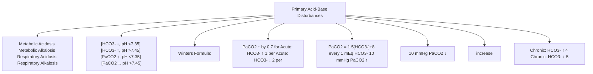
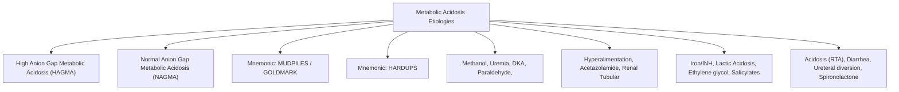

# Topic 11 — Acid–Base Disorders and Diagnostic Algorithms

## 1. Primary Acid-Base Disturbances and Expected Compensation

### Rule-Based Compensation Formulas

| Primary Disorder | Primary Defect | Compensatory Response | Expected Compensation Formula |
| :--- | :--- | :--- | :--- |
| **Metabolic Acidosis** | $[\text{HCO}_3^-] \downarrow$ | Hyperventilation ($\text{PaCO}_2 \downarrow$) | **Winters Formula:** $\text{PaCO}_2 = (1.5 \times [\text{HCO}_3^-]) + 8 \pm 2$ |
| **Metabolic Alkalosis** | $[\text{HCO}_3^-] \uparrow$ | Hypoventilation ($\text{PaCO}_2 \uparrow$) | $\text{PaCO}_2$ increases by **$0.7\text{ mmHg}$** per $1\text{ mEq/L}$ increase in $[\text{HCO}_3^-]$ |
| **Acute Respiratory Acidosis** | $\text{PaCO}_2 \uparrow$ | Renal $[\text{HCO}_3^-]$ retention | $[\text{HCO}_3^-]$ increases by **$1\text{ mEq/L}$** per $10\text{ mmHg}$ rise in $\text{PaCO}_2$ |
| **Chronic Respiratory Acidosis** | $\text{PaCO}_2 \uparrow$ | Renal $[\text{HCO}_3^-]$ regeneration | $[\text{HCO}_3^-]$ increases by **$3.5–4\text{ mEq/L}$** per $10\text{ mmHg}$ rise in $\text{PaCO}_2$ |
| **Acute Respiratory Alkalosis** | $\text{PaCO}_2 \downarrow$ | Renal $[\text{HCO}_3^-]$ excretion | $[\text{HCO}_3^-]$ decreases by **$2\text{ mEq/L}$** per $10\text{ mmHg}$ drop in $\text{PaCO}_2$ |
| **Chronic Respiratory Alkalosis** | $\text{PaCO}_2 \downarrow$ | Renal $[\text{HCO}_3^-]$ excretion | $[\text{HCO}_3^-]$ decreases by **$4–5\text{ mEq/L}$** per $10\text{ mmHg}$ drop in $\text{PaCO}_2$ |

---

## 2. Serum Anion Gap and Etiological Categories

### Anion Gap Formula
$$\text{Serum Anion Gap (AG)} = [\text{Na}^+] - \left( [\text{Cl}^-] + [\text{HCO}_3^-] \right) \quad (\text{Normal: } \mathbf{8–12\text{ mEq/L}})$$
* **Albumin correction:** Hypoalbuminaemia lowers the measured anion gap and can mask a high-gap acidosis. A common correction is **corrected AG = measured AG + 2.5 × (4.0 − albumin in g/dL)**. Reference intervals vary by analyser and laboratory.

### High Anion Gap Metabolic Acidosis (HAGMA) — **GOLDMARK**
* **G** — Glycols (Ethylene glycol, Propylene glycol)
* **O** — Oxoproline (Chronic acetaminophen use)
* **L** — Lactic Acidosis
* **D** — L-Dextrose / D-Lactate
* **M** — Methanol toxicity
* **A** — Aspirin / Salicylates
* **R** — Renal Failure / Uremia
* **K** — Ketoacidosis (DKA, Alcoholic KA, Starvation KA)

### Normal Anion Gap Metabolic Acidosis (NAGMA) — Hyperchloremic
* **Causes:** Severe Diarrhea (loss of $\text{HCO}_3^-$), Renal Tubular Acidosis (Types 1, 2, 4), Acetazolamide therapy, Ureterosigmoidostomy, Normal Saline ($0.9\%\,\text{NaCl}$) resuscitation.

---

## 3. Delta Ratio ($\Delta / \Delta$) in Mixed Acid-Base Disorders
Used in patients with HAGMA to detect underlying secondary metabolic disorders:
$$\text{Delta Ratio} = \frac{\Delta \text{Anion Gap}}{\Delta \text{HCO}_3^-} = \frac{\text{Calculated AG} - 12}{24 - \text{Measured HCO}_3^-}$$

* **Delta ratio <1 (especially <0.4–0.8):** Suggests a concurrent normal-anion-gap metabolic acidosis (e.g., diarrhoea with DKA), using the lab-appropriate normal AG and bicarbonate baseline.
* **Delta ratio about 1–2:** Compatible with a predominantly high-anion-gap metabolic acidosis, though it is an approximate heuristic rather than a definitive label.
* **Delta ratio >2:** Suggests an additional metabolic alkalosis or elevated baseline bicarbonate (e.g., vomiting with DKA), but clinical context and albumin-corrected AG matter.

## References and interpretation notes
- [Physiology, Acid Base Balance — NCBI Bookshelf](https://www.ncbi.nlm.nih.gov/books/NBK507807/): Winter formula and mixed acid–base disorder assessment. Laboratory anion-gap reference intervals and albumin correction practice vary.
