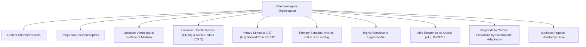
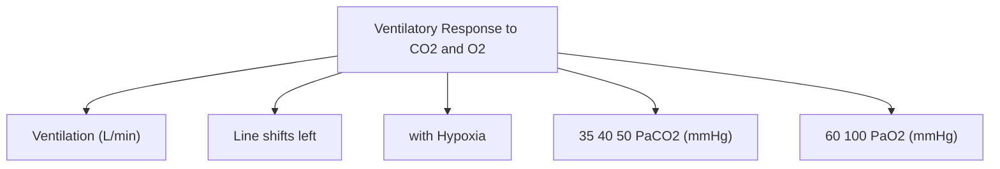

# Topic 12 — Control of Breathing I: Chemical Mechanisms

## 1. Chemoreceptor Systems and Chemical Control of Ventilation

### 1. Central Chemoreceptors
* **Anatomic Location:** Ventrolateral surface of the upper medulla oblongata (Rostral, Intermediate, and Caudal zones).
* **Mechanism of Action:**
  1. Blood-Brain Barrier (BBB) is permeable to molecular $\text{CO}_2$ but **impermeable to $\text{H}^+$ and $\text{HCO}_3^-$ ions**.
  2. Arterial $\text{CO}_2$ diffuses rapidly across the BBB into cerebrospinal fluid (CSF).
  3. In CSF, $\text{CO}_2 + \text{H}_2\text{O} \xrightarrow{\text{CA}} \text{H}^+ + \text{HCO}_3^-$.
  4. Local $[\text{H}^+]$ directly stimulates central chemoreceptors, increasing respiratory drive.
* **Sensitivity:** Accounts for **$70\%–80\%$** of the total ventilatory response to hypercapnia.

### 2. Peripheral Chemoreceptors
* **Anatomic Location:**
  * **Carotid Bodies:** Located at the bifurcation of common carotid arteries; sensory afferents run via **Glossopharyngeal Nerve (CN IX / Hering's Nerve)**.
  * **Aortic Bodies:** Located along the aortic arch; sensory afferents run via **Vagus Nerve (CN X)**.
* **Cellular Histology:**
  * **Type I (Glomus) Cells:** Neural crest derived chemoreceptor cells. Contain dense-core vesicles rich in Dopamine, Acetylcholine, ATP. In response to hypoxia, oxygen-sensitive $\text{K}^+$ channels close $\rightarrow$ cell depolarization $\rightarrow$ voltage-gated $\text{Ca}^{2+}$ entry $\rightarrow$ neurotransmitter release.
  * **Type II (Sustentacular) Cells:** Glial-like supporting cells.
* **Sensitivity:** Primary drivers of the **Hypoxic Ventilatory Response**. Respond when arterial **$\text{PaO}_2 < 60\text{ mmHg}$**. Also respond to hypercapnia and acidosis.

---

## 2. Ventilatory Response Curves

### Response to Hypercapnia
* Linear relationship between $\text{PaCO}_2$ and minute ventilation between $40\text{ and } 60\text{ mmHg}$.
* Slope increases markedly (shifts left) during concurrent hypoxia.

### Response to Hypoxia
* Non-linear hyperbolic curve.
* Minimal increase in ventilation until $\text{PaCO}_2$ drops below $60\text{ mmHg}$; below $60\text{ mmHg}$, ventilation increases steeply.

---

## 3. Oxygen-Induced Hypercapnia in Susceptible Patients

Supplementary oxygen can worsen hypercapnia in susceptible patients, especially during acute exacerbations of COPD, but this is **not explained simply by “removing the hypoxic drive.”** Important mechanisms include worsening ventilation–perfusion mismatch as hypoxic pulmonary vasoconstriction is reduced, the Haldane effect (oxygenated haemoglobin carries less CO₂), and a usually smaller or variable decrease in minute ventilation. Give controlled oxygen to the prescribed target and reassess blood gases when clinically indicated. For adults at risk of hypercapnic respiratory failure, a common initial target is SpO₂ 88–92% pending blood-gas results and local protocol. [BTS oxygen guideline](https://doi.org/10.1136/thoraxjnl-2016-209729).

## References and interpretation notes
- [British Thoracic Society guideline for oxygen use in adults in healthcare and emergency settings](https://doi.org/10.1136/thoraxjnl-2016-209729): target-controlled oxygen and blood-gas reassessment in patients at risk of hypercapnic respiratory failure. Local protocols may differ.
