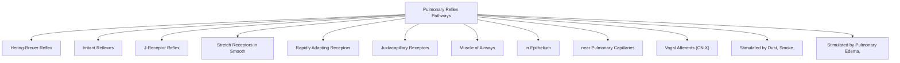
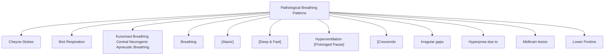

# Topic 13 — Control of Breathing II: Neural Mechanisms and Reflexes

## 1. Brainstem Respiratory Centers

```mermaid
flowchart TD
    A0["Brainstem Respiratory Centers"]
    A0 --> A1["Medullary Centers"]
    A0 --> A2["Pontine Centers"]
    A0 --> A3["Dorsal Respiratory Group (DRG)"]
    A0 --> A4["Pneumotaxic Center (Upper Pons / Nucleus Parabrachialis)"]
    A0 --> A5["• Nucleus Tractus Solitarius (NTS)"]
    A0 --> A6["• Switches off inspiration; controls respiratory rate"]
    A0 --> A7["• Primary inspiratory rhythm generator"]
    A0 --> A8["Apneustic Center (Lower Pons)"]
    A0 --> A9["Ventral Respiratory Group (VRG)"]
    A0 --> A10["• Excites DRG; prolongs inspiration"]
    A0 --> A11["• Pre-Bötzinger Complex (Pacemaker of breathing)"]
    A0 --> A12["• Suppressed by Pneumotaxic center"]
```

### Medullary Respiratory Groups
1. **Dorsal Respiratory Group (DRG):**
   * **Location:** Dorsal medulla within the **Nucleus Tractus Solitarius (NTS)**.
   * **Function:** Primary driver of quiet inspiration. Receives sensory afferents from CN IX and CN X (visceral vagal input from lung mechanoreceptors and peripheral chemoreceptors).
2. **Ventral Respiratory Group (VRG):**
   * **Location:** Ventrolateral medulla (Nucleus Ambiguus and Nucleus Retroambiguus).
   * **Function:** Inactive during quiet breathing. Active during forced inspiration and active expiration.
   * **Pre-Bötzinger Complex:** Located at upper end of VRG; contains pacemaker cells that generate primary autonomic respiratory rhythm.

### Pontine Respiratory Centers
1. **Pneumotaxic Center (Upper Pons — Nucleus Parabrachialis):**
   * **Function:** Transmits inhibitory signals to the DRG, "switching off" inspiration and regulating inspiratory duration and tidal volume. Strong stimulation increases respiratory rate.
2. **Pontine respiratory network:** Older textbooks describe an “apneustic centre” in the lower pons. Modern physiology treats pontine control as distributed networks rather than a single discrete centre; avoid interpreting the classic diagram as a complete anatomical model.
   * **Function:** Stimulates DRG to prolong inspiratory effort. Inhibited by pneumotaxic center and vagal lung afferents.

---

## 2. Pulmonary Reflex Mechanisms

| Reflex Name | Receptor Location | Primary Stimulus | Physiological Response |
| :--- | :--- | :--- | :--- |
| **Hering-Breuer Inflation Reflex** | Slowly adapting stretch receptors in smooth muscle of tracheobronchial tree | Inflation of lungs ($V_T > 1.5\text{ L}$) | Vagal inhibition of DRG; terminates inspiration to prevent over-distension |
| **Hering-Breuer Deflation Reflex** | Stretch receptors in lung parenchyma | Abrupt deflation of lungs | Stimulates rapid inspiratory effort |
| **Irritant Reflex** | Rapidly adapting epithelial receptors in airways | Noxious gases, dust, cigarette smoke, cold air | Coughing, sneezing, bronchoconstriction, hyperpnea |
| **J-Receptor (Juxtacapillary) Reflex** | Unmyelinated C-fiber endings in alveolar walls adjacent to capillaries | Pulmonary capillary congestion, interstitial edema, microemboli | **Rapid shallow breathing (tachypnea)**, dyspnea, bradycardia, hypotension |

---

## 3. Abnormal Breathing Patterns in Disease

| Pattern Name | Visual / Temporal Characteristics | Associated Clinical Conditions |
| :--- | :--- | :--- |
| **Cheyne-Stokes Breathing** | Cyclic waxing and waning tidal volumes (**crescendo-decrescendo**) separated by central apnea periods | Severe Congestive Heart Failure, Bilateral Hemispheric Brain Damage, High Altitude |
| **Biot (Ataxic) Respiration** | Completely unpredictable, irregular bursts of breathing separated by prolonged apnea | Increased Intra-cranial Pressure (ICP), Medullary Compression / Brainstem Herniation |
| **Kussmaul Breathing** | Hyperpnea with marked increase in both rate and depth; forced labored breathing | Severe Metabolic Acidosis (**Diabetic Ketoacidosis**) |
| **Central Neurogenic Hyperventilation** | Sustained, rapid, deep hyperpnea | Lesions of the midbrain or upper pons |
