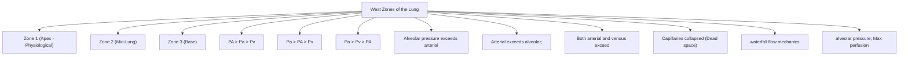
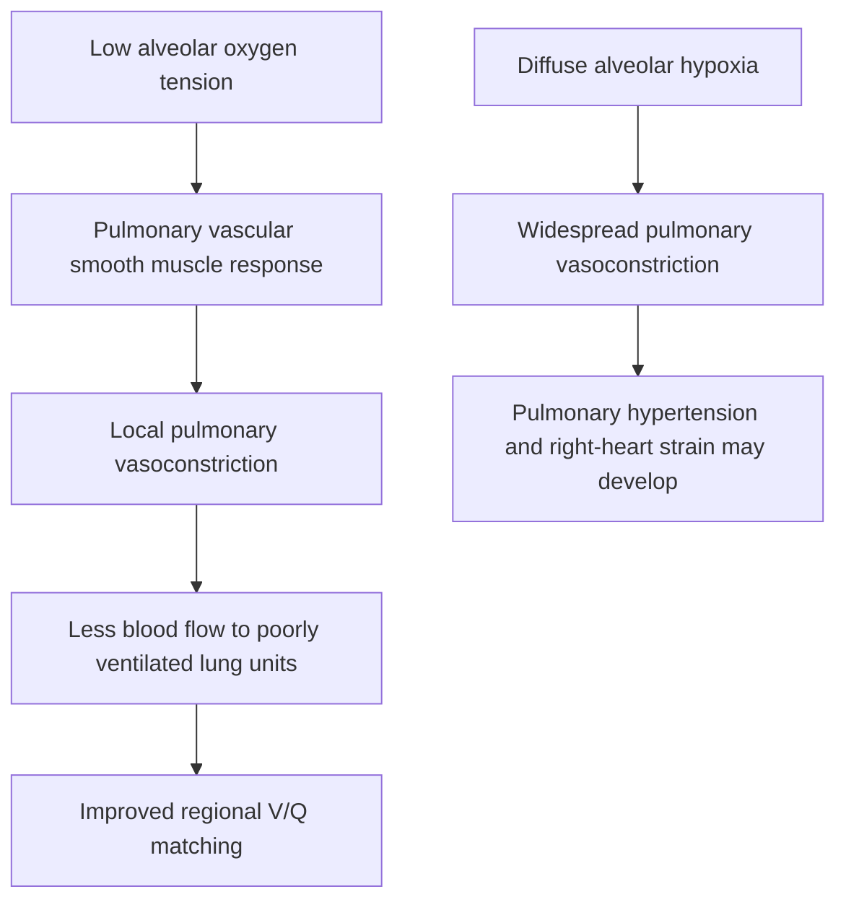
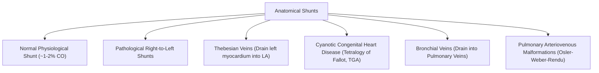
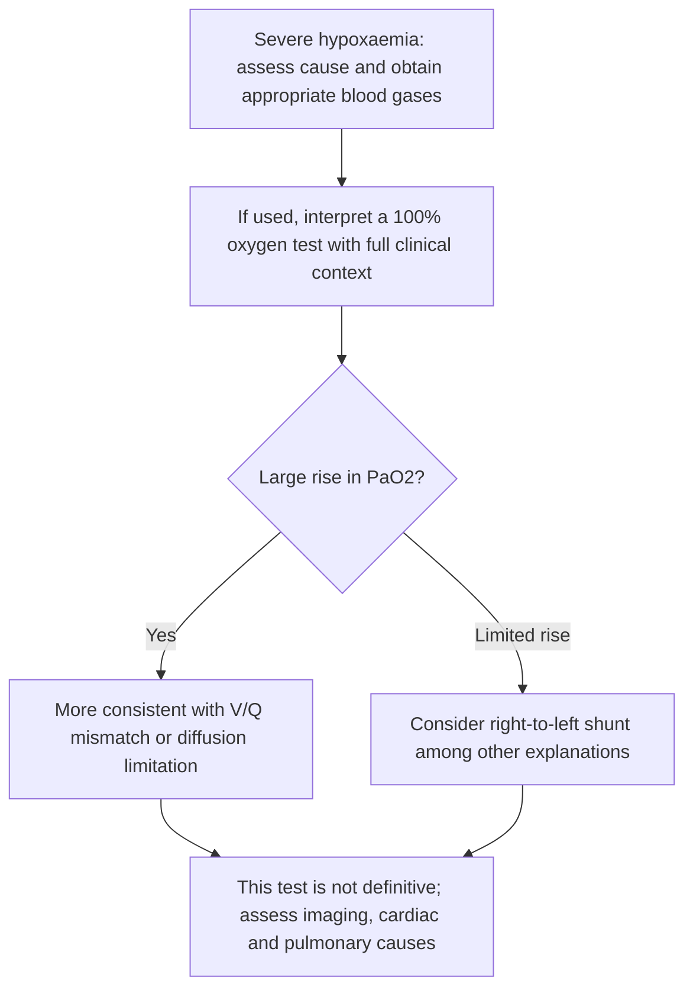

# Topic 14 — Pulmonary Circulation and Anatomical Right-to-Left Shunts

## 1. Hemodynamics of the Pulmonary Circulation
The pulmonary circulation is a low-pressure, low-resistance, high-compliance system designed to accommodate the entire cardiac output ($\approx 5\text{ L/min}$).

$$\text{Pulmonary Vascular Resistance (PVR)} = \frac{\text{Mean PAP} - \text{PCWP}}{\text{Cardiac Output}} = \frac{15 - 5}{5} = \mathbf{2\text{ mmHg/L/min}} = \mathbf{160\text{ dynes}\cdot\text{sec/cm}^5}$$
*(Normal PVR is approximately 1/10th of Systemic Vascular Resistance).*

### West Zones of the Lung

| Zone | Pressure Relationship | Capillary Status | Perfusion Dynamics | Clinical State |
| :--- | :--- | :--- | :--- | :--- |
| **Zone 1** | $P_A > P_a > P_v$ | Capillaries compressed; little or no flow | Alveolar dead-space physiology | Usually limited or absent in healthy upright lungs; may appear with low pulmonary arterial pressure, hypovolaemia, or positive-pressure ventilation |
| **Zone 2 (Mid)** | $P_a > P_A > P_v$ | Intermittently open | Flow determined by $P_a - P_A$ gradient ("Waterfall effect") | Normal mid-lung baseline |
| **Zone 3 (Base)** | $P_a > P_v > P_A$ | Fully distended | Continuous maximal flow driven by $P_a - P_v$ | Normal lower lobe baseline; maximal perfusion |

---

## 2. Hypoxic Pulmonary Vasoconstriction (HPV)

### Mechanism and Clinical Role
* **Primary trigger:** Low **alveolar** oxygen tension causes pulmonary vasoconstriction. The response increases as local alveolar PO₂ falls, but **60 mmHg is a useful teaching landmark, not an absolute on/off threshold**.
* **Intracellular Pathway:** Hypoxia inhibits voltage-gated potassium channels ($K_v$) $\rightarrow$ cell membrane depolarization $\rightarrow$ influx of $\text{Ca}^{2+}$ through L-type calcium channels $\rightarrow$ smooth muscle contraction.
* **Physiological Purpose:** Shunts pulmonary blood flow away from poorly ventilated/hypoxic lung regions towards well-ventilated regions, optimizing $V/Q$ matching.
* **Pathological Sequelae (Generalized Hypoxia):** High altitude exposure or end-stage lung disease causes **generalized HPV**, leading to acute/chronic **Pulmonary Arterial Hypertension** and secondary **Cor Pulmonale** (right ventricular hypertrophy and failure).

---

## 3. Anatomical Right-to-Left Shunts

### The $100\%\,\text{O}_2$ Hyperoxia Test for Shunt Differentiation

