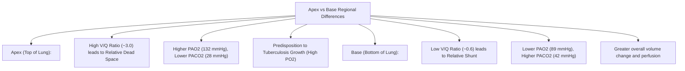
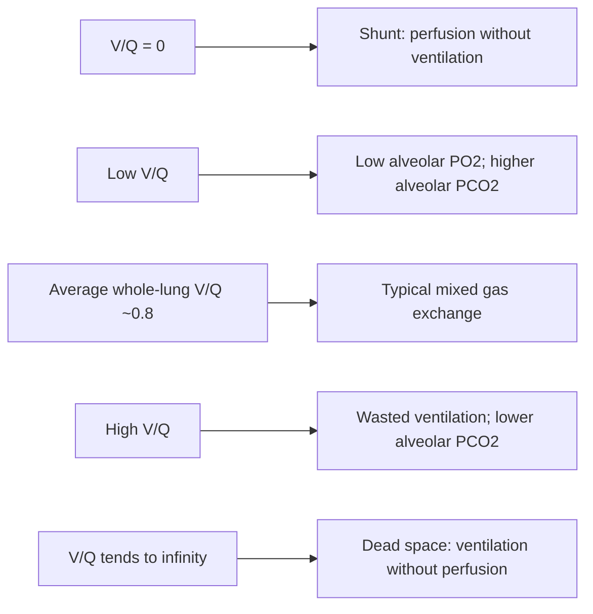

# Topic 15 — Ventilation–Perfusion ($V/Q$) Mismatching

## 1. Regional Differences in Ventilation and Perfusion
Due to gravitational effects on the lung:
* Both ventilation ($V$) and perfusion ($Q$) **increase from apex to base**.
* However, **perfusion increases much more steeply than ventilation**.
* **Overall normal whole-lung $V/Q$ ratio:** approximately **0.8** (typical teaching values: alveolar ventilation ~4 L/min and pulmonary blood flow ~5 L/min; actual values vary with body size and metabolic state).

---

## 2. Spectrum of $V/Q$ Abnormalities

---

## 3. The Alveolar Gas Equation and $P(A-a)\text{O}_2$ Gradient

### Alveolar Gas Equation
$$\text{PAO}_2 = \left[ F_{\text{I}\text{O}_2} \times (P_{\text{atm}} - P_{\text{H}_2\text{O}}) \right] - \frac{\text{PaCO}_2}{R}$$

*Standard Room Air Values ($F_{\text{I}\text{O}_2} = 0.21, P_{\text{atm}} = 760, P_{\text{H}_2\text{O}} = 47, R = 0.8$):*
$$\text{PAO}_2 = 150 - \frac{\text{PaCO}_2}{0.8}$$
*(If $\text{PaCO}_2 = 40\text{ mmHg}$, $\text{PAO}_2 = 150 - 50 = \mathbf{100\text{ mmHg}}$).*

### $P(A-a)\text{O}_2$ Gradient Calculation
$$P(A-a)\text{O}_2 = \text{PAO}_2 - \text{PaO}_2$$
* **Normal value:** The A–a gradient is low in healthy young adults breathing room air but depends on age, FiO₂, and measurement conditions; use age-appropriate limits rather than a single universal cutoff.
* **Age-Adjusted Normal Estimate:**
  $$\text{Approximate room-air estimate: } P(A-a)O_2 \lesssim \frac{\text{Age in years}}{4} + 4$$

  This is a rough teaching estimate rather than a diagnostic rule; different references use slightly different formulae.

---

## 4. Differential Diagnosis of Hypoxemia Based on $P(A-a)\text{O}_2$ Gradient

| Mechanism | $P(A-a)\text{O}_2$ Gradient | Response to $100\%\,\text{O}_2$ | Primary Clinical Examples |
| :--- | :--- | :--- | :--- |
| **Hypoventilation** | **Normal** ($<15\text{ mmHg}$) | Corrects fully | Opioid overdose, Myasthenia gravis, ALS, Guillain-Barré |
| **Low Inspired $F_{\text{I}\text{O}_2}$** | **Normal** ($<15\text{ mmHg}$) | Corrects fully | High altitude exposure |
| **$V/Q$ Mismatch** | **Elevated** ($>15\text{ mmHg}$) | Corrects fully | COPD, Asthma, Pulmonary Embolism, Mild ILD |
| **Diffusion Impairment** | **Elevated** ($>15\text{ mmHg}$) | Corrects fully | Idiopathic Pulmonary Fibrosis, Asbestosis |
| **True Shunt ($V/Q = 0$)** | **Elevated** ($>15\text{ mmHg}$) | **Minimal / Poor Response** | ARDS, Lobar Pneumonia, Pulmonary AVM, Cyanotic Heart Disease |
