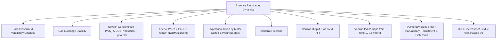
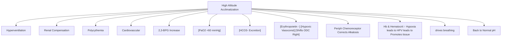

# Topic 16 — Environmental Physiology: Exercise, High Altitude and Diving

## 1. Physiological Adjustments During Exercise

* **Hyperpnea:** Ventilation increases matching metabolic demand. Arterial $\text{PaO}_2$ and $\text{PaCO}_2$ remain **remarkably constant** during moderate exercise.
* **Anaerobic Threshold:** Point where tissue oxygen delivery cannot meet demands $\rightarrow$ Lactic Acid accumulation $\rightarrow$ Metabolic Acidosis $\rightarrow$ Respiratory Compensation (Hyperventilation with drop in $\text{PaCO}_2$).
* **Pulmonary Capillary Changes:** Increased pulmonary arterial pressure causes **recruitment** (opening closed capillaries) and **distension** (widening open capillaries), driving PVR down and increasing $D_L\text{CO}$ $2–3\text{ fold}$.

---

## 2. High Altitude Physiology and Acclimatization

### Acclimatization Responses
1. **Hyperventilation:** Reduced inspired oxygen pressure at altitude stimulates the peripheral chemoreceptors. The altitude at which symptoms or a given PaO₂ occurs depends on elevation, acclimatisation, exertion, and individual physiology; 60 mmHg is not a universal trigger.
2. **Respiratory Alkalosis & Renal Compensation:** Hyperventilation drops $\text{PaCO}_2 \rightarrow$ alkalosis. Over $24–72\text{ hours}$, kidneys excrete $\text{HCO}_3^-$ to normalize pH.
3. **Erythropoietin (EPO) Surge:** Renal interstitial cells sense hypoxia $\rightarrow$ EPO secretion $\rightarrow$ RBC mass and hemoglobin concentration increase over weeks.
4. **Shift in ODC:** Increased $2,3\text{-BPG}$ shifts ODC to the right, facilitating oxygen unloading in tissues.

### High Altitude Pathology
* **Acute Mountain Sickness (AMS):** Headache, fatigue, nausea, dizziness. Treatment: Acetazolamide (carbonic anhydrase inhibitor; induces renal $\text{HCO}_3^-$ excretion causing mild metabolic acidosis, stimulating central breathing drive).
* **High-altitude pulmonary edema (HAPE):** Hypoxia-induced pulmonary vasoconstriction is heterogeneous, producing high pulmonary capillary pressures and stress failure. **Immediate descent and supplemental oxygen are priorities.** Nifedipine is generally a preventive/adjunct option when descent or oxygen is not feasible; phosphodiesterase-5 inhibitors are used only in selected circumstances under high-altitude guidance, not as routine substitutes for descent.
* **High Altitude Cerebral Edema (HACE):** Severe cerebral vasodilation $\rightarrow$ elevated ICP and ataxia. Treatment: Immediate descent, **Dexamethasone**, Hyperbaric chamber.

---

## 3. Diving Physiology and Hyperbaric Complications

```mermaid
flowchart TD
    A0["Diving & Hyperbaric Pathology"]
    A0 --> A1["Decompression Sickness ('The Bends')"]
    A0 --> A2["Arterial Gas Embolism (AGE)"]
    A0 --> A3["Rapid ascent causes dissolved Inert Nitrogen (N2)"]
    A0 --> A4["Pulmonary barotrauma from breath-holding"]
    A0 --> A5["to form gas bubbles in tissues/blood"]
    A0 --> A6["during ascent"]
    A0 --> A7["Type I: Joint pain ('Bends'), skin marbling"]
    A0 --> A8["Air enters pulmonary veins leads to Left Heart leads to Brain"]
    A0 --> A9["Type II: Spinal cord paralysis, 'Chokes' (PE)"]
    A0 --> A10["Causes acute stroke / coma"]
    A0 --> A11["Treatment: 100% O2 & Hyperbaric Recompression"]
    A0 --> A12["Treatment: Hyperbaric Oxygen Therapy"]
```

* **Nitrogen narcosis:** Neurocognitive impairment from increased inspired nitrogen partial pressure can occur during deep dives, often becoming noticeable around 30 m seawater, but onset is variable and is not defined by a strict depth threshold.
* **Decompression Sickness (Boyle's & Henry's Law):** Rapid ascent causes dissolved nitrogen gas to form bubbles in tissues and blood.
  * *Type I:* Bends (periarticular joint pain), Cutis marmorata.
  * *Type II:* Neurological deficits (spinal cord ischemia/paraplegia), Chokes (pulmonary microemboli causing cough and dyspnea).
  * *Treatment:* $100\%\,\text{O}_2$ and **Hyperbaric Recompression Chamber**.
