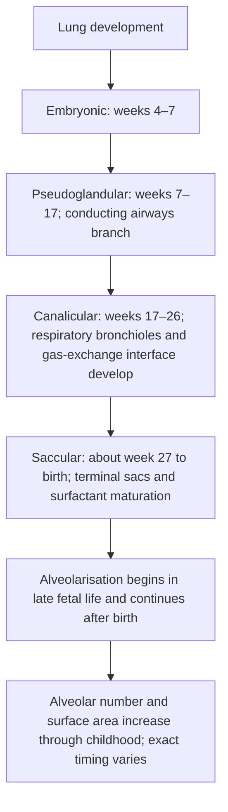
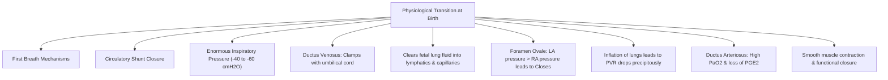

# Topic 17 — Development of the Respiratory System and Transitions at Birth

## 1. Embryological Stages of Lung Development

### Timeline and Milestones

| Stage | Gestational Age | Key Morphological Events | Viability Status |
| :--- | :--- | :--- | :--- |
| **Embryonic** | Weeks 4–7 | Respiratory diverticulum (lung bud) arises from ventral wall of foregut. Division into mainstem bronchi. | Incompatible with life |
| **Pseudoglandular** | Weeks 7–17 | Dichotomous branching up to terminal bronchioles (Z0–Z16). Histology resembles exocrine gland. | Incompatible with life |
| **Canalicular** | Weeks 17–26 | Development of respiratory bronchioles and alveolar ducts. Formation of blood-gas barrier. Type II pneumocytes appear. | **Borderline Viability** at end of phase ($\sim 24\text{ weeks}$) |
| **Saccular** | Week 27 to Birth | Formation of terminal sacs (primitive alveoli). Surfactant synthesis increases markedly. | Capable of extrauterine survival |
| **Alveolarisation** | Begins in late fetal life and continues through childhood (timing varies by source) | Secondary septation increases alveolar number and surface area; alveolarisation continues beyond infancy and early childhood. Exact estimates of alveolar number vary with method and age. | Lung structure continues maturing after birth |

---

## 2. Circulatory and Respiratory Changes at Birth

### 1. Mechanisms of the First Breath
* **Triggers:** Physical cooling, sensory handling, transient asphyxia (hypoxia, hypercapnia, acidosis) during delivery.
* **Pressure required:** Early breaths may require large transpulmonary pressures to aerate fluid-filled lungs, but a single pressure range is a historical teaching estimate and should not be treated as a universal value for all newborns.
* **Fluid Clearance:** Fetal lung fluid is absorbed via epithelial sodium channels (ENaC) stimulated by labor catecholamines.

### 2. Closure of Fetal Circulatory Shunts
1. **Foramen Ovale:** Expansion of lungs $\rightarrow$ Pulmonary Vascular Resistance drops $\rightarrow$ Pulmonary blood flow increases $\rightarrow$ Left Atrial venous return increases $\rightarrow$ Left Atrial pressure exceeds Right Atrial pressure $\rightarrow$ **Functional closure of Foramen Ovale** against septum secundum.
2. **Ductus Arteriosus:** Rise in arterial $\text{PaO}_2$ and withdrawal of maternal placental **Prostaglandin $\text{E}_2$ ($\text{PGE}_2$)** cause smooth muscle constriction of ductus. Functional closure within $10–15\text{ hours}$; anatomical fibrosis (Ligamentum arteriosum) within $2–3\text{ weeks}$. NSAIDs (Indomethacin/Ibuprofen) promote closure; $\text{PGE}_1$ maintains patency.
