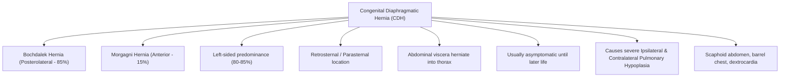
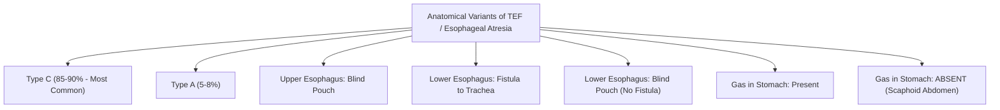

# Topic 18 — Congenital Malformations and Developmental Pulmonary Diseases

## 1. Congenital Diaphragmatic Hernia (CDH)

* **Etiology:** Failure of the **pleuroperitoneal membrane** to fuse with the septum transversum during week 8 of gestation.
* **Types:**
  1. **Bochdalek hernia:** Posterolateral defect; most cases are left-sided, although exact proportions vary among series.
  2. **Morgagni Hernia (15%):** Anterior retrosternal defect.
* **Pathophysiological Consequence:** Abdominal contents herniate into thorax during the pseudoglandular stage, compressing developing lung buds and causing severe **Ipsilateral and Contralateral Pulmonary Hypoplasia** with persistent pulmonary hypertension of the newborn (PPHN).
* **Clinical Features:** Newborn presents with severe respiratory distress, **scaphoid abdomen**, barrel-shaped chest, absent breath sounds on the left, and shift of cardiac impulse to the right.

---

## 2. Tracheoesophageal Fistula (TEF) and Esophageal Atresia (EA)

* **VACTERL Association:** **V**ertebral defects, **A**nal atresia, **C**ardiac defects, **T**racheoesophageal fistula, **E**sophageal atresia, **R**enal anomalies, **L**imb abnormalities.
* **Clinical clue:** Excessive oral secretions, coughing/choking with feeds, and inability to pass an appropriately sized orogastric/nasogastric tube raise suspicion. The insertion distance varies with infant size; do not rely on a fixed centimetre value alone.
* **Radiological Finding in Type C:** Coiled NG tube in upper chest pouch with **gas in the stomach/bowel** (indicates distal fistula).

---

## 3. Pulmonary Sequestration and CPAM

| Condition | Pathological Characteristics | Blood Supply | Key Clinical / Imaging Features |
| :--- | :--- | :--- | :--- |
| **Intralobar Sequestration (75%)** | Non-functioning lung tissue **within** normal visceral pleura | Systemic Arteries (Aorta); Drains via **Pulmonary Veins** | Recurrent lower lobe pneumonias in older children/young adults |
| **Extralobar Sequestration (25%)** | Non-functioning lung tissue **outside** visceral pleura (separate pleura) | Systemic Arteries (Aorta); Drains via **Systemic Veins (Azygos)** | Associated with other congenital anomalies (CDH); presents in neonates |
| **Congenital pulmonary airway malformation (CPAM/CCAM)** | Developmental cystic/solid lung lesion; histology depends on subtype | Usually pulmonary arterial supply | Often detected antenatally or by postnatal imaging. Malignant associations are rare and subtype-dependent; the relationship with malignancy is complex, so “rhabdomyosarcoma risk” should not be presented as a standard defining feature. Cystic pleuropulmonary blastoma is an important differential diagnosis in selected cases. |
