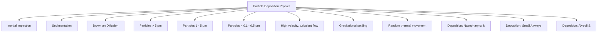
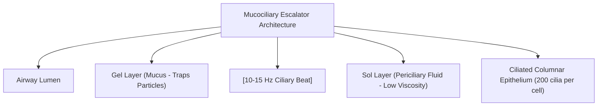
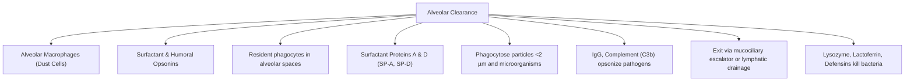

# Topic 19 — Lung Defence Mechanisms and Particle Clearance

## 1. Physical Filtering and Aerodynamic Particle Deposition

### Physical Deposition Mechanisms
1. **Inertial Impaction (Particles $> 5\,\mu\text{m}$):** High momentum prevents particles from negotiating sharp bends in nasal turbinates and tracheobronchial bifurcations. Deposited in **nasopharynx and upper large airways**.
2. **Gravitational Sedimentation (Particles $1–5\,\mu\text{m}$):** Settling under gravity as linear airflow velocity drops in distal small airways. Deposited in **terminal and respiratory bronchioles**. Target size for therapeutic aerosol inhalers ($2–3\,\mu\text{m}$).
3. **Brownian Diffusion (Particles $< 0.1\,\mu\text{m}$):** Random thermal collision with gas molecules driving particles against alveolar walls. Deposited in **alveolar spaces**.
* *Note:* Particles between $0.5\text{ and } 1\,\mu\text{m}$ often remain suspended and are exhaled without depositing.

---

## 2. The Mucociliary Escalator

### Components and Dynamics
* **Mucus Layer (Gel Layer):** Sticky, viscoelastic fluid produced by goblet cells and submucosal glands. Composed of high-molecular-weight **Mucin glycoproteins** (MUC5AC and MUC5B). Traps deposited particles.
* **Periciliary Layer (Sol Layer):** Low-viscosity aqueous fluid maintained by epithelial CFTR chloride secretion and ENaC sodium absorption. Allows unhindered ciliary recovery strokes.
* **Ciliary Mechanics:** Each ciliated cell contains $\approx 200$ cilia with a **$9+2$ axonemal microtubule arrangement**. Beat frequency is **$10–15\text{ Hz}$**, moving the gel layer upward towards the pharynx at $5–20\text{ mm/min}$.

---

## 3. Alveolar Clearance Mechanisms

* **Alveolar Macrophages ("Dust Cells"):** Primary defense of the non-ciliated respiratory zone. Phagocytose deposited submicron particles and bacteria.
* **Clearance Routes:**
  1. Migrate to terminal bronchioles to engage the mucociliary escalator.
  2. Ingest insoluble particles (e.g., silica, asbestos) causing macrophage lysis, chronic inflammatory cytokine release (IL-1, TNF-$\alpha$), and secondary pulmonary fibrosis.
  3. Drain via pulmonary lymphatics to hilar lymph nodes.

---

## 4. Primary Ciliary Dyskinesia (PCD / Kartagener Syndrome)
* **Pathophysiology:** Autosomal recessive mutations in **Dynein arm proteins** (DNAH5, DNAI1) causing ciliary immotility or uncoordinated beating.
* **Kartagener Triad:**
  1. **Situs Inversus Totalis** (due to loss of embryonic nodal ciliary rotation).
  2. **Chronic Sinusitis**.
  3. **Bronchiectasis**.
* **Diagnostic work-up:** Low nasal nitric oxide can support screening in an appropriate clinical setting. Diagnosis is based on the combined phenotype and specialised testing—often including genetic testing, high-speed video microscopy and/or transmission electron microscopy. TEM may be normal in some genetically confirmed cases and is not a universal stand-alone definitive test.
