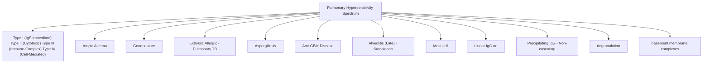

# Topic 20 — Immunology of the Lung and Hypersensitivity Reactions

## 1. Innate Immune Defenses of the Respiratory Tract

```mermaid
flowchart TD
    A0["Innate Pulmonary Immunity"]
    A0 --> A1["Antimicrobial Peptides & Proteins"]
    A0 --> A2["Pattern Recognition Receptors (PRRs)"]
    A0 --> A3["Secretory IgA (S-IgA): Major mucosal antibody"]
    A0 --> A4["Toll-Like Receptors (TLRs):"]
    A0 --> A5["Defensins (α and β): Disrupt bacterial membranes"]
    A0 --> A6["• TLR2 (Gram-positive peptidoglycans)"]
    A0 --> A7["Lysozyme: Cleaves peptidoglycan cell walls"]
    A0 --> A8["• TLR4 (Gram-negative LPS)"]
    A0 --> A9["Lactoferrin: Sequesters free iron"]
    A0 --> A10["Collectins (SP-A & SP-D): Bind microbial sugars,"]
    A0 --> A11["Cathelicidin (LL-37): Antimicrobial & chemotactic"]
    A0 --> A12["enhance macrophage phagocytosis"]
```

### Key Innate Humoral Molecules
* **Secretory IgA (S-IgA):** Dimeric antibody produced by plasma cells in submucosa; transported across epithelium via polymeric immunoglobulin receptor (pIgR). Predominant antibody in conducting airways. Prevents microbial mucosal adhesion ("immune exclusion").
* **IgG:** Predominant antibody in **alveolar spaces** (diffuses from serum).
* **Collectins (SP-A and SP-D):** Bind surface carbohydrates on pathogens via carbohydrate recognition domains (CRDs), agglutinating microbes and promoting alveolar macrophage phagocytosis.

---

## 2. Coombs and Gell Hypersensitivity Reactions in Pulmonary Disease

| Type | Mechanism | Key Mediators / Target | Classic Pulmonary Disease Examples |
| :--- | :--- | :--- | :--- |
| **Type I (Immediate)** | IgE cross-linking on mast cells → mediator release | IgE, Th2 cytokines, eosinophils | Atopic asthma and allergic rhinitis; allergic bronchopulmonary aspergillosis (ABPA) can involve multiple mechanisms, including type I and type III responses |
| **Type II (Cytotoxic)** | Autoantibodies against tissue basement membrane antigens | **Anti-$\alpha_3$ chain of Type IV Collagen**; Complement, MAC | **Goodpasture Syndrome (Anti-GBM Disease)** — Linear immunofluorescence |
| **Type III (Immune complex)** | Immune-complex formation and inflammatory activation | IgG, complement, neutrophils | Hypersensitivity pneumonitis may involve immune-complex mechanisms, especially in traditional classifications, but type IV cellular immunity is also important; SLE-related pulmonary disease has multiple mechanisms |
| **Type IV (Delayed / Cell-Mediated)** | CD4+ Th1 cells release IFN-$\gamma$, activating macrophages into epithelioid cells | Th1 cells, IFN-$\gamma$, TNF-$\alpha$, Epithelioid Histiocytes | **Pulmonary Tuberculosis** (Caseating), **Sarcoidosis** (Non-caseating) |

---

## 3. Bronchus-Associated Lymphoid Tissue (BALT)
* **Structure:** Unencapsulated mucosal lymphoid aggregates located at bronchial bifurcations underneath specialized **Microfold (M) cells**.
* **Function:** Samples luminal air antigens, presenting them to naive T and B lymphocytes to initiate local mucosal adaptive immune responses.
