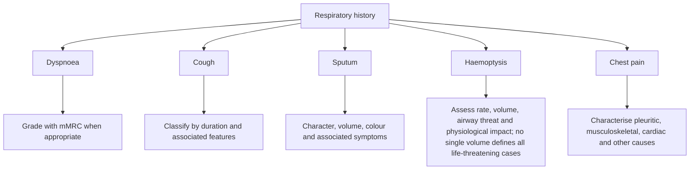
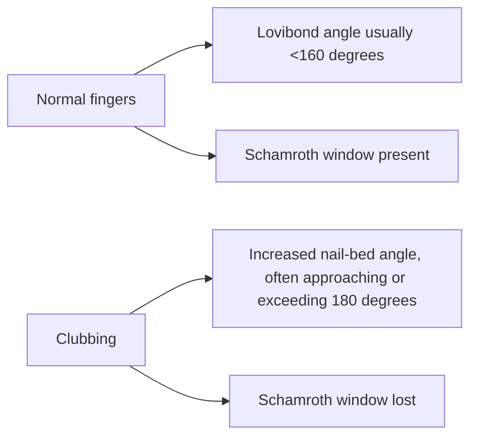
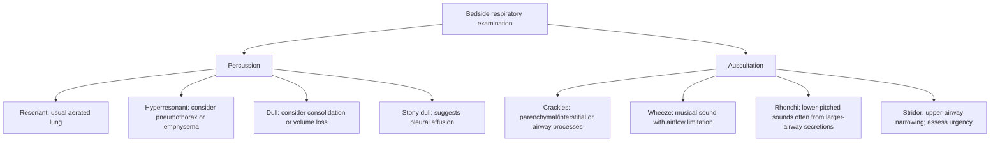

# Topic 21 — Clinical History and Physical Examination of the Respiratory System

## 1. Symptom Analysis and Severity Grading

### Modified Medical Research Council (mMRC) Dyspnea Scale
* **Grade 0:** Dyspnea only with strenuous exercise.
* **Grade 1:** Dyspnea when hurrying on level ground or walking up a slight hill.
* **Grade 2:** Walks slower than peers on level ground due to breathlessness or stops for breath when walking at own pace.
* **Grade 3:** Stops for breath after walking about $100\text{ meters}$ or a few minutes on level ground.
* **Grade 4:** Too breathless to leave the house, or breathless when dressing/undressing.

---

## 2. Physical Examination Signs

### 1. Digital Clubbing (Hippocratic Fingers)
* **Pathophysiology:** Megakaryocytes bypass pulmonary capillary filtration (due to shunting or lung disruption) $\rightarrow$ lodge in digital fingertips $\rightarrow$ release PDGF and VEGF $\rightarrow$ vascular proliferation and periosteal fibroplasia.
* **Lovibond angle:** usually <160° in normal fingers and increases toward/above 180° in established clubbing; these are approximate descriptors, not stand-alone cutoffs.
* **Schamroth's Window Test:** Loss of diamond-shaped window when dorsal surfaces of terminal phalanges are opposed.
* **Causes:** Lung Cancer (Non-Small Cell), Bronchiectasis, Lung Abscess, Idiopathic Pulmonary Fibrosis, Cyanotic Heart Disease, Infective Endocarditis, Ulcerative Colitis. (*Note: Uncomplicated COPD does NOT cause clubbing*).

---

## 3. Thoracic Physical Examination Findings

| Clinical Condition | Tracheal Position | Percussion Note | Breath Sounds | Vocal Resonance / TVF | Adventitious Sounds |
| :--- | :--- | :--- | :--- | :--- | :--- |
| **Consolidation (Pneumonia)** | Midline | **Dull** | **Bronchial** (Tubular) | **Increased** (Egophony / Whispered Pectoriloquy) | Fine / Coarse Crackles |
| **Pleural Effusion** | Deviated to **opposite** side (if large) | **Stony Dull** | Absent or diminished | **Decreased** | None (Pleural rub above level) |
| **Pneumothorax** | Deviated to **opposite** side (if tension) | **Hyperresonant** | Absent or diminished | **Decreased** | None |
| **Atelectasis (Collapse)** | Deviated to **ipsilateral** side | Dull | Absent or diminished | **Decreased** | None |
| **COPD / Emphysema** | Midline | Hyperresonant | Decreased vesicular | Decreased | Prolonged expiration, Wheezes |
