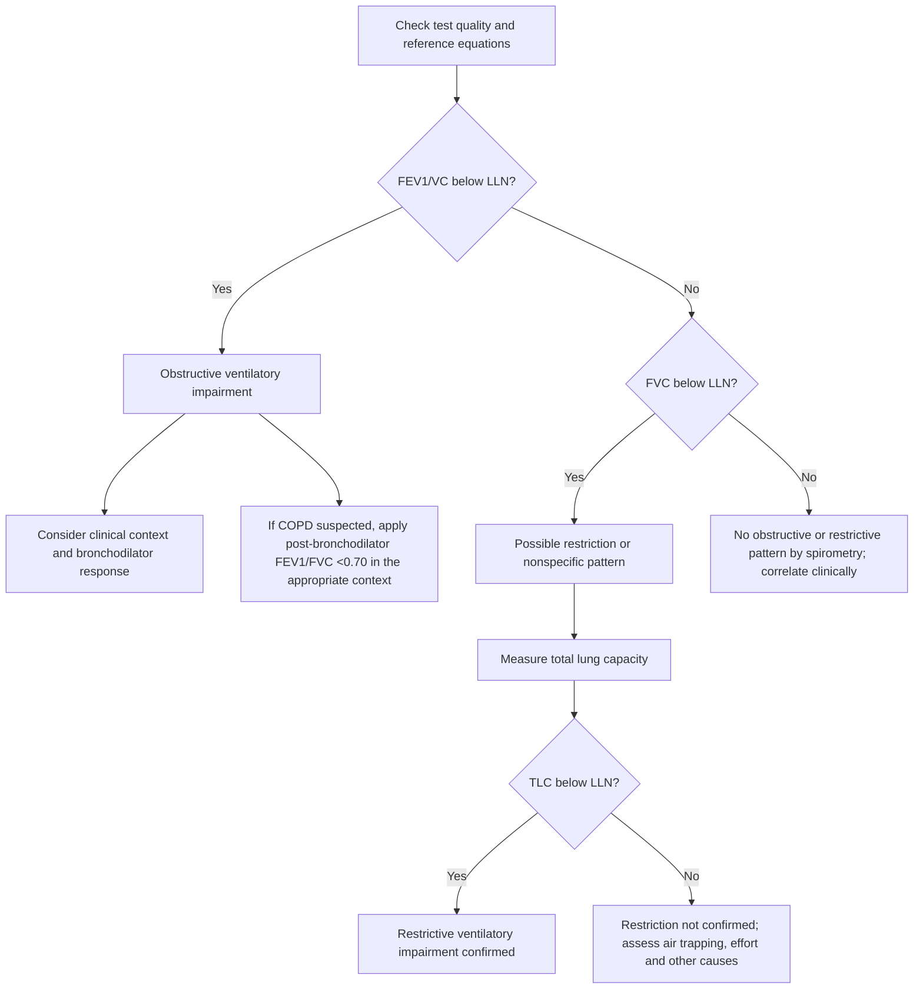
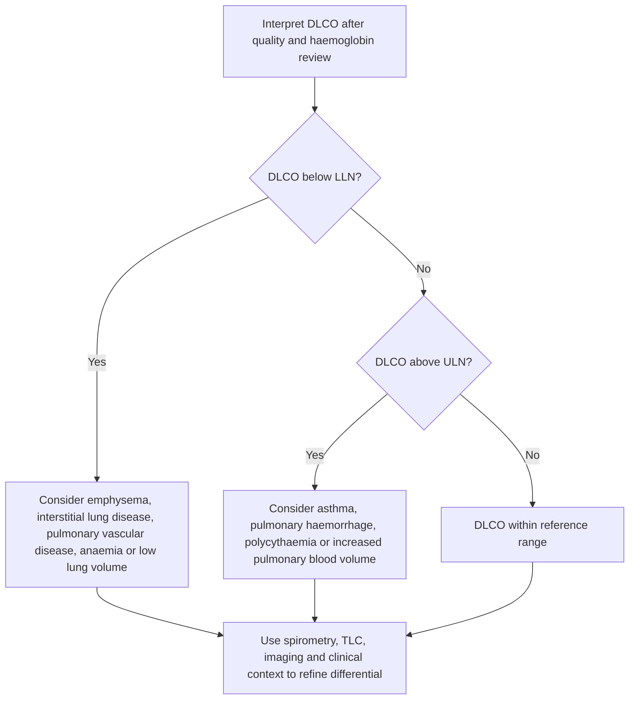

# Topic 22 — Pulmonary Function Tests and Diagnostic Algorithms

## 1. Spirometry Interpretation Algorithm

**Interpretation principle:** First assess test quality and compare results with an appropriate reference equation. For general interpretation, ATS/ERS recommends the lower limit of normal (LLN; usually the 5th percentile) rather than treating 0.70 or 80% predicted as universal cutoffs. GOLD retains a post-bronchodilator FEV₁/FVC <0.70 criterion for diagnosing COPD in the appropriate clinical context.

### Diagnostic Criteria
1. **Obstructive ventilatory impairment:** FEV₁/VC (or FEV₁/FVC when FVC is the available vital-capacity measure) below the LLN supports obstruction. For **COPD**, GOLD uses a post-bronchodilator FEV₁/FVC <0.70 in a compatible clinical context; because the fixed ratio can over- or under-classify obstruction by age, interpret borderline values with care.
   * **Severity Classification (based on $FEV_1$ % predicted):**
     * *GOLD 1 (Mild):* $FEV_1 \ge 80\%$.
     * *GOLD 2 (Moderate):* $50\% \le FEV_1 < 80\%$.
     * *GOLD 3 (Severe):* $30\% \le FEV_1 < 50\%$.
     * *GOLD 4 (Very Severe):* $FEV_1 < 30\%$.
2. **Possible restrictive pattern on spirometry:** FVC below the LLN with a normal or high FEV₁/FVC ratio raises suspicion for restriction. **Restriction is confirmed by TLC below the LLN**, measured using an appropriate lung-volume technique; FVC <80% predicted alone does not establish restriction.
3. **Bronchodilator response:** The protocol and criterion depend on the question and guideline used. The older ATS/ERS criterion was an increase in FEV₁ or FVC of ≥12% and ≥200 mL from baseline. The **2022 ERS/ATS interpretive standard** defines a significant response as >10% of the predicted value in FEV₁ or FVC. **GINA 2026 uses disease-specific criteria to support asthma diagnosis**; specify the source rather than mixing cutoffs. A bronchodilator response does not by itself distinguish asthma from COPD.

---

## 2. Diffusing Capacity ($D_L\text{CO}$) Diagnostic Algorithm

Interpret DLCO after considering haemoglobin, carboxyhaemoglobin, inspired oxygen, smoking, lung volume, and test quality. Use the lab-specific lower limit of normal rather than a universal 80% predicted threshold. DLCO patterns guide the differential but are not diagnoses.

---

## 3. Peak Expiratory Flow Rate (PEFR) and Airway Challenge
* **Peak expiratory flow (PEF):** Use the same meter and the highest of three technically acceptable readings. Average daily diurnal PEF variability >10% in adults can support variable airflow limitation under GINA guidance; thresholds vary by age and the diagnostic framework.
* **Methacholine challenge:** A direct bronchial provocation test used when asthma is suspected but baseline spirometry is nondiagnostic and testing is appropriate. The PC₂₀ threshold depends on protocol, delivery method, and laboratory standard; a positive test demonstrates airway hyperresponsiveness, which is not specific to asthma. Interpret with symptoms, medication withholding, contraindications, and local laboratory criteria.

## References and interpretation notes
- [ERS/ATS technical standard on interpretive strategies for routine lung function tests (2022)](https://doi.org/10.1183/13993003.01499-2021): use of LLN/z-scores, restriction confirmed by TLC, and bronchodilator-response criterion (>10% of predicted FEV₁ or FVC).
- [GOLD 2026 Report](https://goldcopd.org/): COPD diagnosis uses post-bronchodilator FEV₁/FVC <0.70 in an appropriate clinical context.
- [GINA 2026 Strategy Report](https://ginasthma.org/2026-gina-strategy-report/): current asthma diagnostic framework, including evidence of variable airflow limitation.
