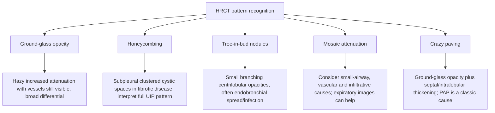
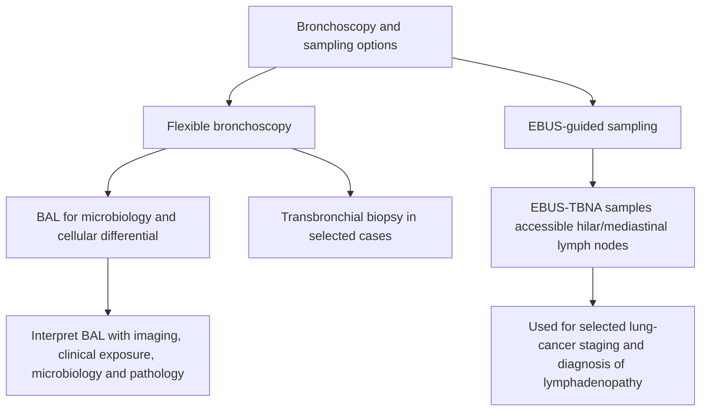

# Topic 23 — Chest Imaging Modalities and Bronchoscopic Procedures

## 1. High-Resolution Computed Tomography (HRCT) Imaging Patterns

| HRCT Pattern | Morphological Description | Classic Diagnostic Etiologies |
| :--- | :--- | :--- |
| **Ground Glass Opacities (GGO)** | Hazy increased attenuation without obscuring underlying pulmonary vessels | *Pneumocystis jirovecii* pneumonia, Hypersensitivity Pneumonitis, COVID-19, Active alveolitis |
| **Honeycombing** | Clustered subpleural cystic airspaces, often stacked in layers and associated with fibrotic architectural distortion | Strongly supports a UIP pattern in the correct distribution, but must be interpreted with the full HRCT pattern and clinical context; honeycombing is not synonymous with “end-stage fibrosis” in every case |
| **Tree-in-Bud** | Centrilobular nodular branching opacities resembling budding trees | **Endobronchial Tuberculosis**, Bacterial bronchopneumonia, Diffuse Panbronchiolitis |
| **Crazy Paving** | Ground-glass opacities overlaid with thickened interlobular and intralobular septa | **Pulmonary Alveolar Proteinosis (PAP)**, Lipoid pneumonia, ARDS |
| **Mosaic attenuation** | Patchwork variation in lung attenuation; expiratory images help identify air trapping | Small-airway disease, pulmonary vascular disease, and infiltrative processes can all produce mosaic attenuation; compare vessel calibre and expiratory images to refine the differential |

---

## 2. Bronchoscopic Diagnostic Techniques

### Bronchoalveolar Lavage (BAL) Cell Differential Diagnostics
* **Typical BAL differential in a healthy nonsmoker:** Alveolar macrophages usually predominate (often about 80–90%); lymphocytes are commonly around 5–15%, neutrophils usually <3%, and eosinophils <1%. Reference ranges vary with smoking, sampling, laboratory methods, and clinical context.
* **CD4/CD8 Ratio Adjustments:**
  * **CD4/CD8 >3.5–4:** Can support sarcoidosis in context, but sensitivity is limited and the ratio is not diagnostic alone.
  * **CD4/CD8 <1:** May occur in hypersensitivity pneumonitis and other conditions; it is not specific.
* **Milky/opaque BAL with periodic acid–Schiff (PAS)-positive material:** Strongly suggests **pulmonary alveolar proteinosis (PAP)** in the appropriate clinical and radiological context; confirm the diagnosis using the overall findings and appropriate specialist testing.

---

## 3. Thoracic Ultrasound Findings
* **Lung sliding:** Normal movement of visceral relative to parietal pleura during respiration. Absent sliding can occur with pneumothorax, but also with apnea, mainstem intubation, pleural adhesions/pleurodesis, or severe bullous disease; assess in combination with other sonographic and clinical findings.
* **A-Lines:** Horizontal hyperechoic reverberation artifacts of normal air-filled lung.
* **B-lines ("comet tails"):** Vertical hyperechoic artifacts arising from the pleural line and extending to the far field. Multiple B-lines—often defined as three or more in an intercostal space—support an interstitial syndrome, but are not specific for pulmonary oedema or ILD and require clinical context and attention to distribution.
* **Lung point:** A transition between lung sliding and absent sliding is highly specific for pneumothorax when confidently identified, but may be absent in a large pneumothorax and can be mimicked by uncommon conditions. Absence of a lung point does not exclude pneumothorax.

## References and interpretation notes
- [ATS guideline: Diagnosis and Detection of Sarcoidosis](https://pmc.ncbi.nlm.nih.gov/articles/PMC7159433/): BAL lymphocytosis/elevated CD4:CD8 ratio can support but do not independently establish sarcoidosis.
- [ATS clinical practice guideline: Clinical Utility of BAL Cellular Analysis in ILD](https://academic.oup.com/ajrccm/article/185/9/1004/8508248): BAL patterns are contextual clues, not stand-alone diagnoses.
