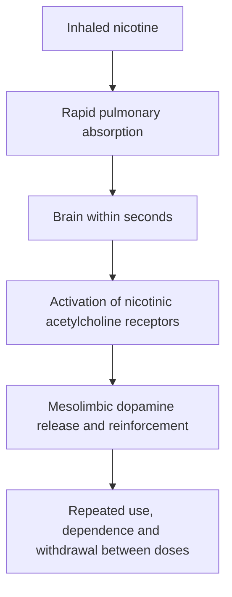
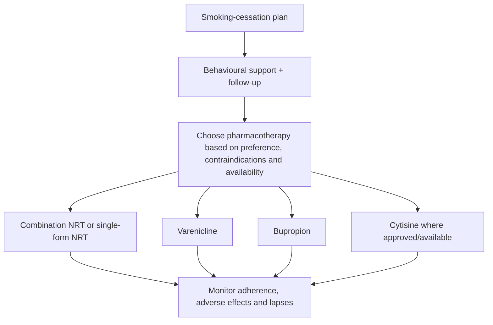

# Topic 24 — Public Health and Smoking

## 1. Neurobiology and Pharmacokinetics of Nicotine

Tobacco (*Nicotiana tabacum*) is the most commonly used substance in India, consumed via smoking, chewing, or sniffing [1, 2]. The primary psychoactive constituent is **nicotine**, a tertiary amine alkaloid [1].

### Pharmacokinetics

- **Absorption and Distribution:** Following inhalation of cigarette smoke, nicotine rapidly crosses the blood-brain barrier (BBB) and reaches the central nervous system within **10–15 seconds** [1].
- **Half-Life ($t_{1/2}$):** Approximately **2 hours** in most adults; chronic smoking does not reliably extend nicotine elimination half-life to 6–9 hours [1].
- **Metabolism:** Nicotine is heavily metabolized in the liver via the **CYP2A6 isoenzyme** into its primary inactive metabolite, **cotinine**, which undergoes further metabolism to 3-hydroxycotinine (cotinine half-life is commonly about 16–20 hours) [3, 4].
- **Biomarkers of Exposure:**
  - **Urine Cotinine:** Serves as a reliable quantitative biomarker indicating nicotine consumption over the preceding **48 hours** [4].
  - **Hair and Nail Cotinine:** Reflects chronic tobacco exposure over a period of **3 months** [4].

### Neurochemical Mechanism of Action

Nicotine acts as an agonist at both central and peripheral **nicotinic acetylcholine receptors (nAChR)** [1, 3]:

1. **Central Subunits:** The **α4β2 nAChR subunit** localized in the striatum and mesolimbic reward system is the principal mediator of nicotine dependence [1, 5].
2. **Dopaminergic Pathways:** Receptor binding causes membrane depolarization and stimulates dopamine release in the nucleus accumbens and ventral tegmental area, driving the reinforcement and pleasure pathways [1, 3].
3. **Cholinergic and Noradrenergic Effects:**
   - Increased **acetylcholine (ACh)** release enhances attention, arousal, and cognitive concentration [3].
   - Increased **norepinephrine/catecholamines** elevates systemic blood pressure, heart rate, and peripheral vascular resistance [3, 5].
4. **Chronic Receptor Neuroadaptation:** Long-term exposure leads to neuroadaptation characterized by **upregulation** of nAChRs alongside functional **receptor desensitization**, driving craving, physical tolerance, dependence, and withdrawal upon cessation [3].

---

## 2. Systemic and Clinical Toxicity

### Toxicological Aspects

- **Active Principles:** Tobacco contains nicotine, anabasine, and nornicotine [6].
- **Acute Nicotine Poisoning:** Characterized by initial autonomic stimulation followed by ganglionic blockade. Features include hypersalivation, vomiting, abdominal pain, chest pain, tremors, hypertension, AV block, **hippus** (spontaneous rhythmic alternate contraction and dilatation of the pupil), and toxic amblyopia with visual field constriction [6, 7].
- **Fatal Period:** Death typically occurs within **1–5 hours** in acute fatal ingestions [6].
- **Specific Antagonist:** **Mecamylamine** acts as an inversive/competitive antagonist [7].

### Clinical Manifestations of Chronic Use

- **Cardiovascular System:** Tobacco causes "tobacco heart," presenting with irregular heart rate, ventricular premature beats (extrasystoles), angina, and accelerated atherosclerosis [7]. Smoking exhibits a synergistic thrombotic risk when combined with oral contraceptive pills (OCPs) in young females, markedly increasing the incidence of stroke and myocardial infarction [8, 9].
- **Oral and Ocular Manifestations:** Bluish discoloration of the neck of the tooth and toxic optic neuropathy (tobacco amblyopia) [7].
- **Pulmonary Pathology:** Primary etiology for [[28 - Chronic Obstructive Pulmonary Disease]] (comprising chronic bronchitis and centriacinar emphysema) [10–12]. Biomass smoke exposure in poorly ventilated indoor environments is a major risk factor for COPD among non-smoking women in developing nations [13].
- **Oncogenesis:** Strongest etiologic link to central lung malignancies, specifically **squamous cell carcinoma** and **small cell carcinoma** [14].

---

## 3. Assessment of Dependence and Withdrawal

### Diagnostic Framework (DSM-5)

DSM-5 does **not** recognize "tobacco intoxication" as a clinical diagnostic category [4]. Clinical conditions are categorized under:

1. **Tobacco Use Disorder**
2. **Tobacco Withdrawal** [4]

### Assessment Tool: Fagerström Test

The **Fagerström Test for Nicotine Dependence (FTND)** evaluates physical reliance on nicotine [4].

- **Single Most Predictive Question:** *"After waking up in the morning, how soon do you smoke your first cigarette?"* (Smoking within 5 minutes of waking indicates severe dependence) [4, 15].

### Nicotine Withdrawal Syndrome

Abrupt cessation or reduction in tobacco intake induces a characteristic withdrawal syndrome [4, 16]:

| Clinical domain | Manifestations of nicotine withdrawal |
|---|---|
| **Neuropsychiatric** | Irritability, frustration, anger, anxiety, restlessness, depressed mood/dysphoria [4, 15] |
| **Cognitive** | Impaired concentration, difficulty executing complex tasks [4, 15] |
| **Sleep architecture** | Insomnia, vivid or disturbing dreams [4, 15, 17] |
| **Autonomic and metabolic** | **Bradycardia** (decreased heart rate), increased appetite (hunger pangs), and weight gain [4, 15, 17] |

---

### Other evidence-based options

**Cytisine/cytisinicline** is included in the WHO 2024 adult tobacco-cessation guideline where licensed and available; availability and national guidance vary.

## 4. Pharmacotherapy for Smoking Cessation

First-line medical interventions combine behavioral counseling with pharmacotherapy [18].

### 1. Nicotine Replacement Therapy (NRT)

- **Rationale:** Provides systemic nicotine to bind α4β2 receptors, substituting for cigarettes to suppress withdrawal symptoms and cravings while eliminating exposure to tar, carbon monoxide, and combustion carcinogens [5, 19, 20].
- **Available delivery systems:**
  - Transdermal patches (7 mg, 14 mg, 21 mg per 24 hours) [20]
  - Chewing gums (2 mg, 4 mg) [5, 20]
  - Oral lozenges (2 mg, 4 mg) [20]
  - Nasal sprays and oral inhalers [5, 18, 20]
- **Dosing guidelines for nicotine gum:**
  - **<25 cigarettes/day:** `2 mg` gum taken every 1–2 hours [5].
  - **≥25 cigarettes/day:** `4 mg` gum taken every 1–2 hours (maximum daily limit: **`24 mg/day`**) [5, 16].
- **Administration technique ("chew and park"):**
  - The patient must chew the gum slowly until a tingling or pepper-like taste is experienced, then "park" it between the cheek and gum to allow transmucosal absorption [16, 20].
  - **Critical precaution:** Avoid consuming acidic beverages (coffee, juices, soft drinks) or hot food for **15–20 minutes prior** to use, as low intraoral pH significantly impairs transmucosal nicotine absorption [20].
- **Standard 12-week tapering schedule:**
  - *Weeks 1–6:* 1 piece every 1–2 hours [16].
  - *Weeks 7–9:* 1 piece every 2–4 hours [16].
  - *Weeks 10–12:* 1 piece every 4–8 hours [16].
- **Combination NRT:** Pairing a long-acting transdermal patch (continuous baseline delivery) with a short-acting form (gum or lozenge for acute breakthrough cravings) achieves higher abstinence rates than monotherapy [19].

### 2. Varenicline

- **Mechanism of action:** High-affinity **partial agonist** at the central α4β2 nicotinic acetylcholine receptor [18–22].
- **Dual clinical effect:**
  1. *Agonist activity:* Submaximally stimulates dopamine release, mitigating nicotine withdrawal symptoms and cravings [19].
  2. *Antagonist activity:* Competitively blocks binding of exogenous nicotine from tobacco, preventing satisfaction or reinforcement if the patient relapses [19, 21].
- **Clinical efficacy:** Considered the most effective single-agent anti-craving drug for smoking cessation [18, 20].
- **Adverse effects:** Gastrointestinal distress (nausea, abdominal discomfort), insomnia, and abnormal/vivid dreams [19].

### 3. Bupropion

- **Mechanism of action:** A non-tricyclic antidepressant that functions as a **norepinephrine–dopamine reuptake inhibitor (NDRI)** [16, 18, 20]. It elevates synaptic concentrations of dopamine and norepinephrine, mimicking nicotine-induced neurotransmitter surges to decrease withdrawal and cravings [16, 20].
- **Adverse effects and safety profile:**
  - Agitation, anxiety, dry mouth, weight loss, and insomnia [16].
  - **Seizure risk:** Lowers the epileptic seizure threshold in a dose-dependent manner; strictly **contraindicated** in patients with baseline seizure disorders, head trauma, or eating disorders (anorexia/bulimia) [16].
  - Risk of exacerbating underlying psychosis or inducing a manic switch in bipolar patients [16].

### Summary Comparison of Pharmacotherapy

| Agent | Class / mechanism | Key advantages | Major adverse effects / contraindications |
|---|---|---|---|
| **NRT (gum/patch)** | Pure receptor agonist | Eliminates carcinogenic combustion products; flexible dosing [5, 19] | Oral irritation, dyspepsia, local skin erythema [19] |
| **Varenicline** | α4β2 nAChR partial agonist | Highest single-agent efficacy; blocks smoking reward [18, 21] | Nausea, sleep disturbance, vivid dreams [19] |
| **Bupropion** | NDRI antidepressant | Useful in patients with co-morbid depression or weight gain concerns [16] | **Contraindicated in seizure disorders**; insomnia, agitation [16] |

---

## Accuracy and currency note

This is educational revision material, not a patient-specific treatment protocol. Time-sensitive drug regimens, doses, thresholds and service pathways should be checked against the current national/local guideline before clinical use. The batch review file records the main edits and the scope of verification.

**Review log:** [[00 - Batch 1 Accuracy Review]]
