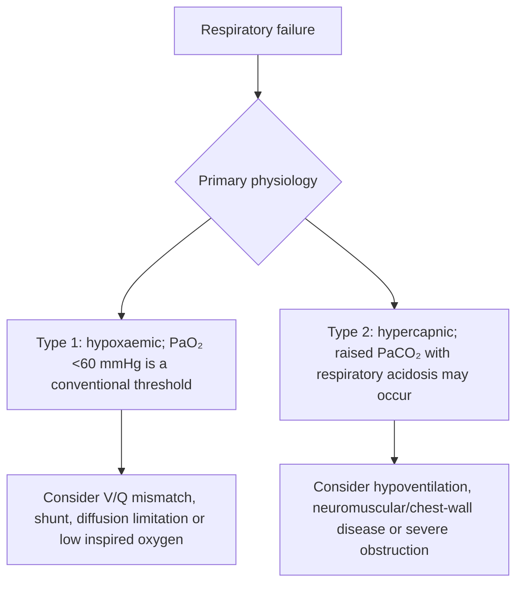
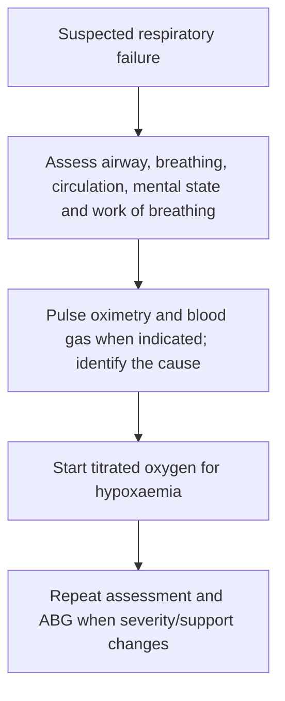
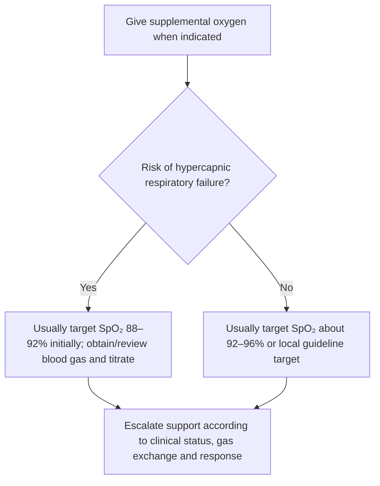
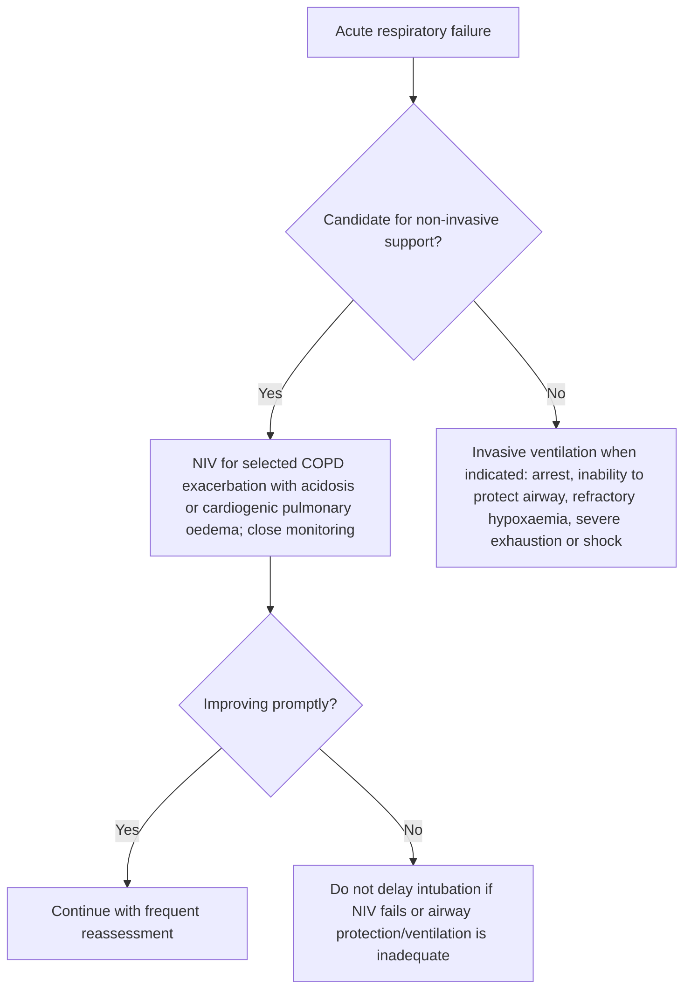

# Topic 25 — Respiratory Failure

## 1. Definition and Pathophysiological Classification

Respiratory failure is defined as the inability of the respiratory system to maintain adequate systemic arterial gas exchange, resulting in hypoxemia ($\mathrm{PaO}_2 < 60\ \mathrm{mmHg}$) with or without hypercapnia ($\mathrm{PaCO}_2 > 50\ \mathrm{mmHg}$) while breathing ambient air at sea level [23, 24].

### Etiological and Classification Matrix

| Category | Primary mechanism | Key ABG findings | Typical aetiologies |
|---|---|---|---|
| **Type 1 (hypoxaemic)** | Oxygenation failure: alveolar flooding, V/Q mismatch, intrapulmonary shunting, diffusion impairment [24–26] | $\mathrm{PaO}_2 < 60\ \mathrm{mmHg}$; $\mathrm{PaCO}_2$ normal or decreased; **P(A–a)O₂ gradient increased** [24, 26–28] | Pneumonia, acute respiratory distress syndrome (ARDS), acute cardiogenic pulmonary oedema, interstitial lung disease (ILD), pulmonary embolism [26, 28] |
| **Type 2 (hypercapnic)** | Ventilatory pump failure: extraparenchymal hypoventilation or severe airflow obstruction [26, 28–30] | $\mathrm{PaO}_2 < 60\ \mathrm{mmHg}$; $\mathrm{PaCO}_2 > 50\ \mathrm{mmHg}$; **P(A–a)O₂ gradient normal** in pure hypoventilation [26, 29, 30] | Kyphoscoliosis, ankylosing spondylitis, morbid obesity, myasthenia gravis, motor neuron disease (ALS), Guillain–Barré syndrome, opioid/sedative poisoning, chronic bronchitis [26, 28–30] |
| **Type 3 (perioperative)** | Post-surgical microatelectasis due to reduced functional residual capacity (FRC) [26, 29] | Moderate $\mathrm{PaO}_2$ decrease; mixed gas-exchange disturbance [26, 29] | Upper abdominal/thoracic surgeries, post-anaesthetic shallow breathing, splinting pain [26, 29] |
| **Type 4 (shock / hypoperfusion)** | Severe hypoperfusion of respiratory muscles under systemic shock [29] | Severe metabolic acidosis with compensatory tachypnoea, potentially leading to muscle exhaustion [29] | Cardiogenic shock, hypovolaemic shock, septic shock [29] |

---

## 2. Pathophysiology and Arterial Blood Gas Analysis

### Alveolar Gas Equation and $\mathrm{P(A-a)O}_2$ Gradient

The alveolar–arterial oxygen gradient ($\mathrm{P(A-a)O}_2$) helps distinguish intrinsic pulmonary gas-exchange disorders from pure extraparenchymal hypoventilation:

$$
P_{A O_2} = \left[ F_{I O_2} \times (P_{atm} - P_{H_2O}) \right] - \frac{P_{a CO_2}}{R}
$$

$$
P(A-a)O_2 = P_{A O_2} - P_{a O_2}
$$

Where `P_atm = 760 mmHg`, `P_H₂O = 47 mmHg`, `F_IO₂ = 0.21` (room air), and respiratory quotient `R ≈ 0.8`.

- **Pure extraparenchymal hypoventilation (Type 2):** Decreased alveolar ventilation elevates $\mathrm{PaCO}_2$, causing secondary hypoxaemia. Because the alveolo-capillary membrane is intact, the calculated $\mathrm{P(A-a)O}_2$ gradient remains **normal** (usually approximately `<15–20 mmHg` in the source draft) [29, 30].
- **Intrapulmonary gas-exchange abnormalities (Type 1):** Diseases causing V/Q mismatch, diffusion-barrier thickening, or true right-to-left shunting cause an **increased** $\mathrm{P(A-a)O}_2$ gradient [26, 28].

### Disease Progression

Untreated or severe Type 1 hypoxaemic failure increases respiratory drive and work of breathing. Over time, respiratory muscle fatigue can lead to secondary alveolar hypoventilation, causing $\mathrm{PaCO}_2$ retention and progression to **mixed Type 1 and Type 2 failure** [26, 29].

---

## 3. Clinical Presentation and Assessment

### Physical Signs of Work of Breathing

In patients with acute respiratory distress, key physical signs include:

- Flaring of alae nasi [31].
- Contraction of sternocleidomastoid and scalene accessory muscles [31].
- Intercostal and subcostal retractions [31].
- Tachypnoea (`RR > 30 breaths/min`) [32, 33].

### Features of Hypercapnia (CO₂ Narcosis)

Progressive accumulation of $\mathrm{PaCO}_2$ induces cerebral vasodilation:

- Peripheral vasodilation with warm, flushed extremities and a bounding pulse [34].
- Asterixis (flapping tremor of extended hands) [34].
- Somnolence, confusion, obtundation, muscle twitching, and papilloedema [34].

### Signs of Impending Respiratory Failure

In conditions such as acute severe asthma exacerbations, the emergence of any of the following parameters indicates impending respiratory pump collapse requiring immediate intensive care intervention [35–37]:

- **Silent chest:** Total absence of wheezing or breath sounds on auscultation due to severe airflow limitation [35–37].
- **Neurocognitive alterations:** Confusion, delirium, coma, or extreme lethargy [35–37].
- **Pulsus paradoxus:** Exaggerated drop in systolic blood pressure (`>10 mmHg`) during inspiration [36, 37].
- **Paradoxical breathing:** Inward abdominal movement during inspiration due to diaphragmatic fatigue [37].
- **Relative bradycardia:** Loss of compensatory tachycardia [37].

---

## 4. Comprehensive Management Protocol

### 1. Initial Assessment

Implement the structured **ABC framework** (airway, breathing, circulation) [35, 37].

### 2. Oxygen Therapy Targets

Supplemental oxygen must be titrated to specific physiological targets based on the underlying pathology:

- **Acute hypoxaemic patients (ward setting):** Maintain $\mathrm{SpO}_2$ between **92% and 96%** [31, 38].
- **Most acutely ill adults:** commonly target $\mathrm{SpO}_2$ around **92–96%** (or the local prescribed target); avoid both hypoxaemia and unnecessary hyperoxia [31].
- **Chronic hypercapnia risk (COPD / Type 2 failure):** Target $\mathrm{SpO}_2$ between **88% and 92%** [38].

### 3. Ventilatory Support: Non-Invasive vs. Invasive

- **Non-invasive ventilation (NIV — CPAP/BiPAP):**
  - *Indications:* Acute exacerbation of COPD with moderate hypercapnia, cardiogenic pulmonary oedema, weaning off mechanical ventilation [41, 42, 44].
  - *Contraindications:* Altered consciousness/unconsciousness, severe agitation, excessive airway secretions, persistent vomiting, severe facial trauma, or haemodynamic instability [42, 45].
- **Invasive mechanical ventilation:**
  - *Indications:* Respiratory arrest, severe or worsening acidosis (no single pH threshold should replace clinical judgement), failure of NIV, refractory hypoxaemia, or altered mental status [42, 43].

### 4. Invasive Mechanical Ventilation and Lung-Protective Strategy

In patients with acute hypoxaemic respiratory failure and ARDS, a **lung-protective ventilation strategy** is used to reduce ventilator-induced lung injury (volutrauma and barotrauma) [46, 47].

1. **Target tidal volume ($V_T$):** Set initial $V_T = 6\ \mathrm{mL/kg}$ of **predicted body weight (PBW)** [46, 47].
2. **Calculation of predicted body weight (PBW):**

   $$
   \text{Male PBW (kg)} = 50 + [2.3 \times (\text{height in inches} - 60)]
   $$

   $$
   \text{Female PBW (kg)} = 45.5 + [2.3 \times (\text{height in inches} - 60)]
   $$

3. **Ventilator parameters and titration:**
   - Use lung-protective ventilation when indicated: a common starting tidal volume is **6–8 mL/kg predicted body weight**, with lower targets (around 6 mL/kg) in ARDS and plateau-pressure monitoring; do not delay appropriate lung-protective settings while down-titrating from 8–9 mL/kg [46].
   - Set respiratory rate to match baseline minute ventilation (up to a maximum of `35 breaths/min`) [46].
   - Apply positive end-expiratory pressure (PEEP) starting at `≥5 cmH₂O` and titrate alongside $\mathrm{FiO}_2$ to maintain $\mathrm{SpO}_2$ at `88–95%` [46].
   - **Permissive hypercapnia:** Allow mild respiratory acidosis provided `pH ≥7.15`, when clinically appropriate, to avoid over-distending alveoli [43].

---

## Accuracy and currency note

This is educational revision material, not a patient-specific treatment protocol. Time-sensitive drug regimens, doses, thresholds and service pathways should be checked against the current national/local guideline before clinical use. The batch review file records the main edits and the scope of verification.

**Review log:** [[00 - Batch 1 Accuracy Review]]
