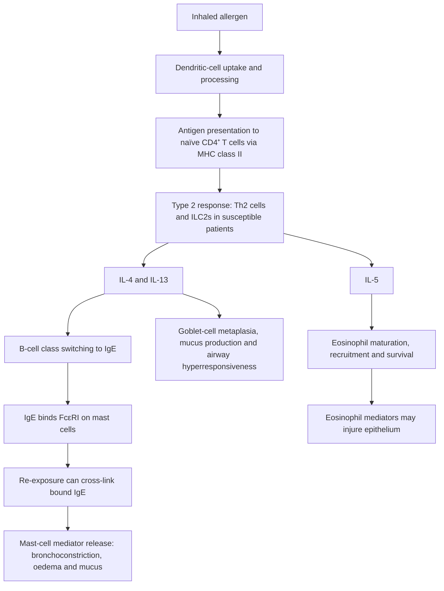

# Topic 26 — Asthma: Pathophysiology

## 1. Overview and Definition

Asthma is a **heterogeneous chronic respiratory disease**, usually characterised by airway inflammation and a history of variable respiratory symptoms (wheeze, dyspnoea, chest tightness and/or cough) together with **variable expiratory airflow limitation**. Airflow limitation is often reversible, but in longstanding disease it can become partly or persistently fixed.

Important mechanisms include:
1. **Variable airflow limitation:** Due to bronchoconstriction, airway-wall thickening/oedema and mucus plugging.
2. **Airway hyperresponsiveness (AHR):** An exaggerated bronchoconstrictor response to stimuli such as exercise, cold air, allergens, irritants or certain medicines.
3. **Airway inflammation:** The inflammatory pattern varies by phenotype. Type 2 inflammation involving Th2 cells/ILC2s, mast cells and eosinophils is common, but neutrophilic, mixed and relatively non-Type-2 patterns also occur.

Allergic asthma often involves IgE-mediated (type I) hypersensitivity, but **not all asthma is atopic or explained by a single immune pathway**.

---

## 2. Risk Factors and Etiological Triggers

The development and exacerbation of asthma involve a complex interaction between endogenous genetic susceptibility and environmental factors.

### Etiological factors: summary

| Category | Factor | Examples / relevance |
|---|---|---|
| Endogenous | Polygenic susceptibility | Gene–environment interactions; variants in the 5q cytokine region and loci such as **ADAM33** and **CHI3L1/YKL-40** have been associated with susceptibility or airway structure, but are not deterministic causes. |
| Endogenous | Atopy | Important risk factor for allergic asthma; may coexist with allergic rhinitis and atopic dermatitis. |
| Endogenous | Airway hyperresponsiveness (AHR) | Exaggerated airway narrowing in response to triggers. |
| Endogenous | Sex-related prevalence pattern | Asthma is more prevalent in boys during early childhood and often more prevalent in women during adulthood. |
| Endogenous | Obesity | Inflammatory and mechanical contributions may worsen symptoms and treatment response. |
| Environmental | Indoor and outdoor allergens | Dust mites, pollens, animal dander and fungi. |
| Environmental | Occupational exposure | Sensitisers or irritants can cause work-related asthma. Cotton, flax or hemp dust may cause byssinosis, which is not simply an IgE allergy to cotton fibres. |
| Environmental | Respiratory infection | RSV is associated with early-childhood wheezing; rhinovirus commonly precipitates exacerbations. |
| Environmental | Air pollution and irritants | Diesel particulates, nitrogen oxides ($NO_x$), sulfur dioxide ($SO_2$) and other irritants. |
| Environmental / medication | Pharmacological triggers | Non-selective beta-blockers (including ophthalmic timolol) and aspirin/NSAIDs in susceptible patients. |
| Environmental / physical | Other triggers | Exercise, cold air, strong emotions or stress in susceptible individuals. |

### Endogenous Factors
* **Atopy:** A tendency to develop IgE responses to common environmental allergens. It is an important risk factor for allergic asthma and often coexists with allergic rhinitis and atopic dermatitis, but it is not required for an asthma diagnosis.
* **Genetic susceptibility:** Asthma is polygenic. Variants in immune-regulatory regions (including the 5q cytokine cluster) and loci such as **ADAM33** and **CHI3L1** (which encodes YKL-40) have been associated with susceptibility or airway structure in studies. These are associations, not deterministic single-gene causes; no single locus should be described as the universal “strongest” asthma association.
* **Gender:** Higher prevalence in males during early childhood ($<14\text{ years}$); shifts to higher prevalence in females during adulthood.
* **Obesity:** Pro-inflammatory state mediated by adipokines (leptin, TNF-$\alpha$) that enhances AHR and impairs corticosteroid responsiveness.

### Environmental Triggers
* **Infections:** Respiratory Syncytial Virus (RSV) infection in infants ($<2\text{ years}$) is strongly linked to early-onset reactive airway disease. Rhinovirus infections frequently precipitate acute exacerbations in adults.
* **Occupational exposures:** Some agents cause sensitiser-induced occupational asthma; others act as irritants. **Byssinosis** is a work-related airway disease associated with inhalation of cotton, flax or hemp dust and is classically linked to endotoxin-containing dust, often with chest tightness on the first workday after a break. It should not be described simply as a proven IgE allergy to cotton fibres.
* **Pharmacological Agents:**
  * **Non-Selective $\beta$-Blockers:** Propranolol, timolol (even in eye drops) block $\beta_2$-mediated bronchodilation and can provoke severe bronchospasm in susceptible patients.
  * **Aspirin / NSAIDs:** Triggers **Aspirin-Exacerbated Respiratory Disease (AERD)** or **Samter's Triad**.

> **Samter's Triad (Aspirin Sensitive Asthma):**
> 1. Aspirin / NSAID Intolerance (Inhibition of COX-1 shunts arachidonic acid to the 5-LOX pathway, producing excess cysteinyl leukotrienes $LTC_4, LTD_4, LTE_4$).
> 2. Bronchial Asthma (typically severe and persistent).
> 3. Nasal Polyposis (frequently bilateral).

---

## 3. Immunopathogenesis and Cytokine Cascade

The pathophysiological hallmark of allergic (extrinsic) asthma is a **$\text{Th}2$-driven adaptive immune response**.

### Allergic asthma: immune cascade

1. An inhaled allergen (for example, pollen or dust mite antigen) is taken up and processed by dendritic cells in the airway mucosa.
2. Dendritic cells present antigen to naïve $CD4^+$ T cells via MHC class II.
3. In a susceptible host, the response may differentiate toward a Type 2 helper T-cell ($Th2$) and related Type 2 inflammatory pathway.
4. Cytokines drive the downstream response:

   | Cytokine | Principal effects |
   |---|---|
   | **IL-4** | Promotes B-cell class switching to IgE. |
   | **IL-5** | Supports eosinophil differentiation, maturation, recruitment, survival and activation. |
   | **IL-13** | Promotes mucus production, goblet-cell metaplasia and airway hyperresponsiveness; also contributes to IgE class switching with IL-4. |

5. IgE binds high-affinity $Fc\epsilon RI$ receptors on mast cells. Subsequent allergen-mediated cross-linking can trigger mast-cell mediator release.
6. Activated eosinophils may release cytotoxic granule proteins, including major basic protein (MBP) and eosinophil cationic protein (ECP), contributing to epithelial injury.

This is a useful model of allergic/Type 2 asthma, not a universal pathway for every asthma phenotype.

### Specific Roles of Key Cytokines
* **Interleukin-4 (IL-4):** Stimulates B-cell class switching to produce **IgE antibodies**. IgE binds high-affinity $Fc\epsilon RI$ receptors on mast cells and basophils.
* **Interleukin-5 (IL-5):** Principal cytokine responsible for **eosinophil differentiation, maturation, bone marrow release, recruitment, and activation**.
* **Interleukin-13 (IL-13):** Promotes bronchial hyperresponsiveness, goblet cell metaplasia, epithelial mucus hypersecretion, and subepithelial fibrosis.

### Inflammatory Cell Network
* **Mast Cells:** Localized in the lamina propria and epithelium. IgE cross-linking by allergens triggers rapid degranulation.
* **Eosinophils:** Eosinophilic granules stain with eosin; **toluidine blue is classically used to demonstrate metachromatic mast-cell granules**, not as the characteristic stain for eosinophils. Eosinophil degranulation releases cationic proteins:
  * **Major Basic Protein (MBP):** Causes direct desquamation of airway respiratory epithelium.
  * **Eosinophil Cationic Protein (ECP):** Induces pore formation in cell membranes.
  * **Eosinophil Peroxidase (EPO):** Generates reactive oxygen species and oxidative stress.

---

## 4. Biphasic Airway Response and Chemical Mediators

Allergen-triggered asthma responses can show an **early phase** followed by a **late phase**; this biphasic pattern does not occur after every trigger or in every patient.

### Early and late asthmatic responses

| Phase | Typical timing | Mechanism and findings |
|---|---|---|
| **Early / immediate phase** | Minutes after allergen exposure | Allergen cross-links IgE on mast cells, triggering mediator release. Histamine, cysteinyl leukotrienes ($LTC_4$, $LTD_4$, $LTE_4$) and prostaglandin $D_2$ contribute to bronchoconstriction, mucosal oedema and mucus secretion. |
| **Late phase** | Often several hours later (classically about 4–8 hours) | Recruitment of inflammatory cells, including eosinophils, neutrophils, basophils and $CD4^+$ $Th2$ lymphocytes, with epithelial sloughing/injury, persistent bronchoconstriction, mucus plugging and increased AHR. |

A biphasic response can occur after allergen exposure, but it does not occur after every trigger or in every patient.

### Chemical Mediators of Inflammation

| Mediator | Source Cell | Pathophysiological Action |
| :--- | :--- | :--- |
| **Histamine** | Mast cells, Basophils | **Earliest mediator** released; induces immediate smooth muscle spasm, endothelial gap formation, and mucosal edema via $H_1$ receptors. |
| **Cysteinyl leukotrienes ($LTC_4, LTD_4, LTE_4$)** | Mast cells, eosinophils and other inflammatory cells | Potent bronchoconstrictors that promote sustained bronchospasm, mucus secretion and microvascular permeability; avoid relying on a fixed potency ratio versus histamine. |
| **Prostaglandin $D_2$ ($PGD_2$)** | Mast cells | Causes marked bronchoconstriction and pulmonary vasodilation. |
| **Platelet-Activating Factor (PAF)** | Mast cells, Eosinophils | Induces platelet aggregation, eosinophil chemoattraction, and bronchial hyperreactivity. |
| **Nitric oxide / fractional exhaled NO (FeNO)** | Airway epithelium | FeNO can support assessment of Type 2 airway inflammation, particularly when elevated, but is not specific to asthma and a low value does not exclude asthma. |

---

## 5. Histopathology and Sputum Examination

Sputum and airway histology may show classic findings associated with asthma. These findings are **supportive rather than individually pathognomonic**, and are not required for routine diagnosis.

### Classic sputum findings sometimes described as the “3 Cs”

| Finding | Appearance | Interpretation |
|---|---|---|
| **Curschmann spirals** | Whorled, basophilic mucus casts shaped by small airways | Reflect mucus plugging; supportive but not specific for asthma. |
| **Charcot–Leyden crystals** | Bipyramidal crystals associated with eosinophilic inflammation | Contain galectin-10, an eosinophil-associated protein; not specific to asthma. |
| **Creola bodies** | Clusters of sloughed columnar/ciliated respiratory epithelial cells | May occur with airway epithelial injury; not individually diagnostic. |

### Characteristic Microscopic Findings
1. **Curschmann's Spirals:** Basophilic whorled mucus plugs formed by compressed mucosal secretions taking the casts of small distal bronchioles.
2. **Charcot-Leyden Crystals:** Bipyramidal crystals containing **galectin-10**, a protein highly expressed in eosinophils; these crystals are associated with eosinophilic inflammation but are not specific to asthma.
3. **Creola Bodies:** Clusters or aggregates of desquamated, sloughed columnar ciliated respiratory epithelial cells found in sputum.

### Airway Remodeling (Structural Changes)
Persistent inflammation can lead to structural changes collectively called **airway remodelling**. Some changes may persist despite treatment, but the degree of reversibility varies and should not automatically be labelled completely irreversible:
* **Subepithelial basement-membrane-zone thickening:** Collagen deposition beneath the epithelium (often called thickening of the reticular basement membrane). It is a structural-remodelling feature, not the same as thickening of the true basal lamina.
* **Smooth Muscle Hypertrophy and Hyperplasia:** Increased thickness of the muscularis layer, driven by growth factors (TGF-$\beta$, PDGF).
* **Goblet Cell and Submucosal Gland Hyperplasia:** Leads to luminal occlusion by tenacious, inspissated mucus plugs.
* **Increased Vascularity:** Neovascularization driven by VEGF, exacerbating mucosal edema.

---

## 6. Pathophysiological Mechanisms of Special Variants

### Exercise-Induced Bronchoconstriction (EIB)
High minute ventilation during strenuous exercise leads to hyperventilation-induced changes in the airway surface liquid (ASL), explained by two complementary theories:

1. **Thermal Theory (Airway Rewarming):**
   $$\text{High Ventilation} \rightarrow \text{Heat/Water Loss} \rightarrow \text{Mucosal Cooling} \rightarrow \text{Vasoconstriction} \rightarrow \text{Reactive Hyperemia} \rightarrow \text{Vascular Engorgement \& Edema} \rightarrow \text{Bronchoconstriction}$$
2. **Osmotic Theory (Airway Dehydration):**
   $$\text{Water Evaporation from ASL} \rightarrow \text{Dehydration of ASL} \rightarrow \uparrow [\text{Na}^+, \text{Cl}^-, \text{Ca}^{2+}, \text{K}^+] \rightarrow \uparrow \text{Osmolarity} \rightarrow \text{Cell Shrinkage} \rightarrow \text{Mast Cell Mediators} \rightarrow \text{Smooth Muscle Contraction}$$

---

## 7. Allergic and Non-Allergic Asthma: Clinical Phenotypes

“Extrinsic” and “intrinsic” asthma are historical terms. Current practice recognises overlapping phenotypes/endotypes (for example, allergic/Type 2-high, eosinophilic, obesity-associated and non-Type-2 asthma); these cannot always be separated using age, IgE or skin-prick testing alone.

| Feature | Allergic / atopic pattern | Non-allergic pattern |
| :--- | :--- | :--- |
| Atopy | Often present; sensitisation should match the clinical history | May be absent |
| Typical onset | Often begins in childhood, but adult-onset allergic asthma occurs | May begin in adulthood, but age is not diagnostic |
| Associated conditions | Allergic rhinitis, eczema and allergen-triggered symptoms may coexist | May be associated with obesity, irritants, infections or other phenotypes |
| Tests | Allergen-specific IgE or skin testing can support the phenotype when clinically relevant | Negative allergy testing does not establish a single alternative mechanism |
| Inflammation | Often Type 2/eosinophilic | Can be eosinophilic, neutrophilic, mixed or paucigranulocytic |

Aspirin-exacerbated respiratory disease (AERD), exercise-induced bronchoconstriction and occupational asthma are useful clinical patterns but do not map neatly onto a simple extrinsic/intrinsic distinction.

## 8. Coverage Audit

* **Review note:** Corrected overconfident genetic claims, distinguished byssinosis from allergic occupational asthma, corrected the eosinophil stain, and qualified sputum findings and older asthma phenotypes. The remaining detailed molecular mechanisms should still be checked against the original source bibliography.
* **Coverage limitations:** The uploaded text did not provide a verifiable bibliography for its original numeric citations. Confirm citations against the source notebook. Current diagnostic framing is consistent with the 2026 GINA guidance.

---

## References for reviewed clinical framing

- [Global Initiative for Asthma (GINA), 2026 Summary Guide](https://ginasthma.org/2026-gina-summary-guide/) — asthma definition, phenotypic heterogeneity and diagnostic approach.
- [GINA FAQ: What is asthma?](https://ginasthma.org/faq/) — variable symptoms and variable expiratory airflow.

> **Citation note:** Numbered citations inherited from the NotebookLM export have no accompanying bibliography in the supplied file. Verify them against your original sources before relying on them.
