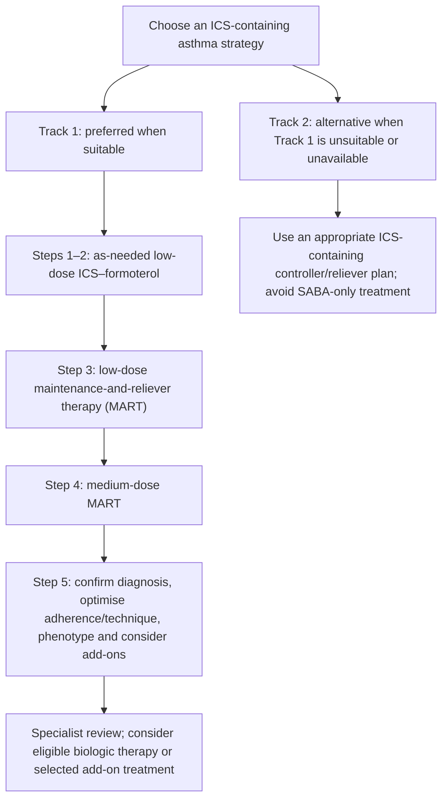
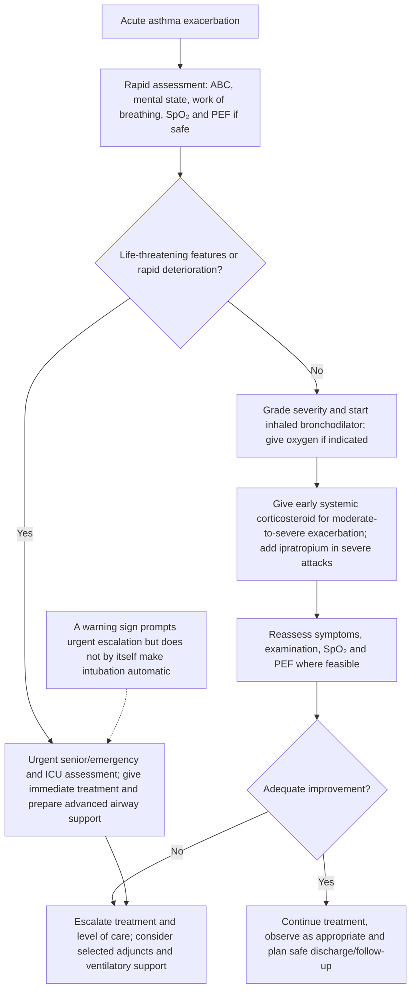

# Topic 27 — Asthma: Treatment

## 1. Diagnostic Criteria and Pulmonary Function Testing

Asthma is diagnosed from a history of **variable respiratory symptoms plus objective evidence of variable expiratory airflow**, whenever feasible. Spirometry with bronchodilator responsiveness testing is a common preferred test; one normal test does not exclude asthma, and testing may need repeating during symptoms or with additional tests.

### Diagnostic Thresholds
* **Obstructive pattern:** A reduced $\text{FEV}_1/\text{FVC}$ ratio relative to the **age-appropriate lower limit of normal (LLN)** supports airflow obstruction. Do not use the fixed COPD threshold of $0.70$ as a universal asthma diagnostic threshold; a fixed $0.80$ cutoff is also not appropriate for all children.
* **Bronchodilator responsiveness:** Compare spirometry before and about 10–15 minutes after an inhaled bronchodilator, following laboratory protocol. GINA 2026 criteria supporting asthma are:
  - **Adults:** increase in $\text{FEV}_1$ or FVC of at least $12\%$ **and** at least $200\text{ mL}$ from the pre-bronchodilator value (or PEF increase of at least $20\%$).
  - **Children aged 6–17 years:** increase in $\text{FEV}_1$ of at least $12\%$ of predicted (or PEF increase of at least $15\%$).
  $$\text{Bronchodilator response} = \frac{\text{post-BD value} - \text{pre-BD value}}{\text{pre-BD value}} \times 100\%$$
* **Average daily PEF variability over 1–2 weeks:** use morning and evening readings with the same meter and calculate daily variation as the difference between the higher and lower of those readings divided by their mean; average the daily values over the monitoring period. Excessive average variability is **$>10\%$ in adults** and **$>13\%$ in children**.
* **Exercise/bronchial challenge:** A fall in $\text{FEV}_1$ of more than $10\%$ from baseline is commonly used for exercise-induced bronchoconstriction in standard challenge protocols; exact criteria vary by protocol and population. Interpret challenge results in clinical context.

---

## 2. Current Stepwise Management in Adults and Adolescents (GINA 2026)

Management is personalised and follows an **assess–adjust–review** cycle. Check diagnosis, inhaler technique, adherence, exposures and comorbidities before stepping up treatment. All adults and adolescents should receive **ICS-containing treatment**; SABA-only treatment is not recommended because it leaves airway inflammation untreated and increases exacerbation risk.

### Track 1 — Preferred approach

Low-dose **ICS–formoterol** is used as the anti-inflammatory reliever (AIR). At Steps 3–5, the same appropriate ICS–formoterol inhaler can be used for both maintenance and relief, known as maintenance-and-reliever therapy (MART). Only ICS–formoterol combinations with an evidence-based/approved regimen can be used as MART; combinations containing other LABAs (for example, salmeterol) must not be used this way.

| Step | Preferred treatment (adults/adolescents) |
| :--- | :--- |
| **Steps 1–2** | As-needed low-dose ICS–formoterol (AIR-only). |
| **Step 3** | Low-dose maintenance ICS–formoterol plus as-needed ICS–formoterol (MART). |
| **Step 4** | Medium-dose maintenance ICS–formoterol plus as-needed ICS–formoterol (MART). |
| **Step 5** | Confirm diagnosis and optimise adherence/technique; refer for specialist phenotyping. Consider add-on LAMA and eligible biologics; a time-limited high-dose ICS–LABA/ICS–formoterol trial may be considered under specialist supervision. |

### Track 2 — Alternative when Track 1 is not feasible or suitable

| Step | Controller | Reliever |
| :--- | :--- | :--- |
| **Step 1** | Take low-dose ICS whenever SABA is used, or use an ICS–SABA combination reliever where available. | ICS–SABA or SABA with concomitant ICS as directed. |
| **Step 2** | Daily low-dose ICS. | As-needed SABA or ICS–SABA where available; use the prescribed ICS controller consistently. |
| **Step 3** | Low-dose maintenance ICS–LABA. | As-needed reliever appropriate to the regimen; do not use ICS–formoterol as MART unless the prescribed combination/device is suitable for MART. |
| **Step 4** | Medium-dose maintenance ICS–LABA. | As-needed reliever appropriate to the regimen; continue prescribed ICS-containing maintenance therapy. |
| **Step 5** | Specialist assessment; consider LAMA, phenotype-directed biologics and, only when necessary, high-dose ICS–LABA. | As-needed reliever appropriate to the regimen. |

If ICS–formoterol is unavailable, ensure an adult using SABA also takes the prescribed ICS whenever SABA is taken at Step 1, or uses daily ICS-containing therapy at higher steps. Do not interpret Track 2 as permission for SABA-only treatment. Always check the locally available inhaler strengths, approvals and maximum daily inhalations.

## 3. Children Aged 6–11 Years: GINA 2026 Overview

Children in this age group should not be managed with SABA alone. Choose therapy according to symptom pattern, exacerbation risk, age, device ability, local approvals and response to treatment.

| Step | Preferred controller/strategy | Reliever approach |
| :--- | :--- | :--- |
| **Step 1** | As-needed low-dose ICS–formoterol, or low-dose ICS with each SABA use (separate or combination inhalers, as available/approved). | An age-appropriate anti-inflammatory reliever (AIR) is preferred when available; SABA may be used if AIR is unavailable. |
| **Step 2** | Daily low-dose ICS. | As-needed age-appropriate reliever. |
| **Step 3** | Options include medium-dose ICS, low-dose ICS–LABA, or low-dose ICS–formoterol MART. | Depends on the selected regimen; MART uses ICS–formoterol for relief. |
| **Step 4** | Options include medium-dose ICS–LABA, low-dose MART, and/or referral for expert advice. | According to regimen. |
| **Step 5** | Refer for phenotyping and specialist advice; consider add-on LAMA or eligible biologics. | According to specialist plan. |

For children, medication doses, biologic eligibility and inhaler options must follow the current local product label and specialist guidance. Montelukast requires counselling about possible neuropsychiatric adverse effects.

### Acute exacerbation severity: interpret clinically

Clinical severity tables and PEF/SpO$_2$ cutoffs are aids, not substitutes for clinical judgement. Drowsiness, confusion, exhaustion, cyanosis, a silent chest, poor respiratory effort or worsening gas exchange are emergency warning signs. A “normal” or rising PaCO$_2$ in a patient with a severe attack can indicate fatigue rather than reassurance.

---

## 4. Pharmacological Profile of Anti-Asthmatic Medications

### Pharmacological classification: controller and reliever roles

| Role | Class | Examples / key distinction |
|---|---|---|
| **Controller / maintenance** | Inhaled corticosteroids (ICS) | Budesonide, fluticasone, ciclesonide; foundational anti-inflammatory treatment. |
| **Controller / maintenance** | Long-acting $\beta_2$-agonists (LABA) | Formoterol, salmeterol; in asthma, LABA should be used with ICS, not alone. |
| **Controller / add-on** | Leukotriene receptor antagonists (LTRA) | Montelukast, zafirlukast; generally less effective than ICS for preventing exacerbations; consider adverse effects. |
| **Controller / add-on** | Long-acting muscarinic antagonist (LAMA) | Tiotropium in selected patients with persistent symptoms/exacerbations despite ICS-containing therapy. |
| **Specialist add-on** | Targeted biologics | Selected patients may be eligible for anti-IgE, anti-IL-5/IL-5R, anti-IL-4R$\alpha$ or other phenotype-directed agents. |
| **Reliever** | Short-acting $\beta_2$-agonist (SABA) | Salbutamol/albuterol or terbutaline; if used in an alternative asthma regimen, ICS-containing therapy must also be used as prescribed. SABA-only treatment is not recommended for adults/adolescents in current GINA strategy. |
| **Reliever / acute care add-on** | Short-acting muscarinic antagonist (SAMA) | Ipratropium, commonly added to SABA in severe acute exacerbations. |
| **Anti-inflammatory reliever** | ICS–formoterol, where regimen/device is approved and appropriate | Can be used as-needed in the preferred GINA track; at suitable treatment steps, the same inhaler can provide maintenance-and-reliever therapy (MART). Other LABA combinations (such as salmeterol) are not interchangeable with ICS–formoterol for MART. |

### 1. Inhaled Corticosteroids (ICS)
* **Mechanism:** Binds intracellular glucocorticoid receptors $\rightarrow$ alters gene transcription ($\uparrow$ anti-inflammatory cytokines, $\downarrow$ pro-inflammatory NF-$\kappa$B transcription, $\uparrow \beta_2$-receptor density on bronchial smooth muscle).
* **Molecules:** Budesonide, Beclomethasone Dipropionate (BDP), Fluticasone Propionate, Ciclesonide.
* **Ciclesonide:** An inhaled prodrug converted to its active metabolite mainly in the lung by esterases. Its activation profile and low oropharyngeal deposition can reduce local adverse effects, but it does not eliminate systemic exposure.
* **Adverse Effects:**
  * *Oropharyngeal candidiasis:* A common local adverse effect; risk is reduced by correct inhaler technique, using a spacer with a pressurised metered-dose inhaler when appropriate, and rinsing/gargling and spitting after use.
  * *Dysphonia/hoarseness:* Can result from local laryngeal effects, including steroid-associated myopathy. Local adverse effects vary by drug, dose and device.

### 2. Targeted Biological Therapies (Severe / Refractory Asthma)

| Biologic Agent | Target Receptor / Cytokine | Minimum Age | Primary Clinical Indication |
| :--- | :--- | :--- | :--- |
| **Omalizumab** | Monoclonal Anti-IgE antibody (binds free IgE) | $\ge 6\text{ years}$ | Severe persistent allergic asthma with elevated serum IgE; uncontrolled on high-dose ICS-LABA. |
| **Mepolizumab** | Monoclonal anti-IL-5 antibody | GINA 2026: $\ge 6$ years | Severe eosinophilic asthma; reduces eosinophil counts. Local product approval/eligibility applies. |
| **Reslizumab** | Monoclonal anti-IL-5 antibody | $\ge 18$ years | Severe eosinophilic asthma; administered by IV infusion. |
| **Benralizumab** | Monoclonal anti-IL-5 receptor $\alpha$ antibody | GINA 2026: $\ge 12$ years | Severe eosinophilic asthma; promotes eosinophil depletion through antibody-dependent cellular cytotoxicity. |
| **Dupilumab** | Monoclonal anti-IL-4 receptor $\alpha$ antibody | GINA 2026: $\ge 6$ years | Severe eosinophilic/Type 2 asthma or selected oral-steroid-dependent asthma; inhibits IL-4 and IL-13 signalling. |

---

## 5. Management of Acute Severe Exacerbation (Status Asthmaticus)

An acute severe exacerbation is a life-threatening medical emergency requiring prompt systematic evaluation and aggressive pharmacological intervention.

### Acute exacerbation triage: decision pathway

1. **First assess for life-threatening features.** These include a silent chest, confusion/drowsiness/coma, paradoxical thoracoabdominal movement, respiratory exhaustion, relative bradycardia or worsening gas exchange. Marked pulsus paradoxus (classically cited as >20 mmHg in some teaching protocols) may occur, but it should not be used as a required criterion.
2. **If any danger feature is present:** obtain immediate senior/emergency and ICU assessment; give urgent treatment and prepare for advanced airway support. Intubation is based on the overall clinical state (for example, respiratory arrest, deteriorating consciousness, exhaustion or refractory gas-exchange failure); a single warning sign does not make intubation automatic in every patient.
3. **If danger features are absent:** assess severity using clinical examination, oxygen saturation ($SpO_2$) and peak expiratory flow (PEF) or spirometry if feasible and safe.
4. Start appropriate inhaled bronchodilator treatment, give systemic corticosteroids for moderate-to-severe exacerbations, provide oxygen when indicated, and reassess promptly for response or deterioration.

### Acute Management Protocol

### Immediate emergency management: first hour

| Step | Intervention | Practical points |
|---|---|---|
| **1. Oxygen** | Titrated supplemental oxygen if hypoxaemic | Many acute-asthma protocols aim for $SpO_2$ around 93–95% in adults and 94–98% in children; follow the current local guideline and titrate oxygen to target. Avoid unmonitored high-concentration oxygen when not indicated. |
| **2. Inhaled SABA** | Nebulised salbutamol, commonly 2.5–5 mg every 20 minutes for the first hour in adults, or a suitable metered-dose inhaler/spacer regimen | If response is poor in a severe attack, continuous nebulisation (for example, 10–15 mg/hour in some adult protocols) may be used under monitoring and local protocol. Dose and delivery depend on age, severity and response. |
| **3. Add ipratropium in severe attacks** | Ipratropium bromide with SABA | A commonly used adult nebulised dose is 0.5 mg with repeated doses (often every 20 minutes for the first three doses in severe cases); follow the local acute-asthma protocol. |
| **4. Systemic corticosteroid early** | Oral prednisolone is generally preferred when the patient can swallow and absorb medication | In adults, 40–50 mg daily for about 5–7 days is a commonly recommended course. Use an appropriate paediatric regimen for children; IV therapy is reserved for situations in which oral administration is not feasible or otherwise unsuitable. |
| **5. Reassess after initial treatment** | Repeat clinical assessment and objective measurements where feasible | If response is inadequate or severe features persist, escalate care rather than continuing ineffective treatment without reassessment. |
| **6. Selected refractory severe cases** | Consider IV magnesium sulfate; specialist/ICU rescue treatment when indicated | In selected adults, a single 2 g IV dose over about 20 minutes may be considered. It is not routine for every attack. IV beta$_2$-agonists may be considered in selected refractory cases with close monitoring. IV aminophylline is not routine because benefit is limited and toxicity/arrhythmias can be serious. Do not delay indicated ventilatory support. |
---

## 6. Coverage Audit

* **Review note:** Replaced outdated GINA 2019/2020 steps with the current 2026 framework; corrected age-specific diagnostic thresholds and PEF variability; updated several biologic age bands; clarified emergency escalation and restricted use of IV rescue drugs.
* **Coverage limitations:** Doses and product approvals vary by inhaler/device, age, country and protocol. Use the current local guideline/prescribing information for prescribing; confirm original NotebookLM numeric citations against the source bibliography.

---

## References for reviewed clinical recommendations

- [GINA 2026 Summary Guide](https://ginasthma.org/2026-gina-summary-guide/) — diagnosis, adult/adolescent and paediatric stepwise management, biologic eligibility and acute exacerbation guidance.
- [GINA 2026 Strategy Report](https://ginasthma.org/2026-gina-strategy-report/) — comprehensive guidance and evidence references.

> **Citation note:** The source export contains bracketed numeric citations but no matching bibliography. Verify these against the original NotebookLM sources. Recommendations and age approvals must be checked against local product labels.
