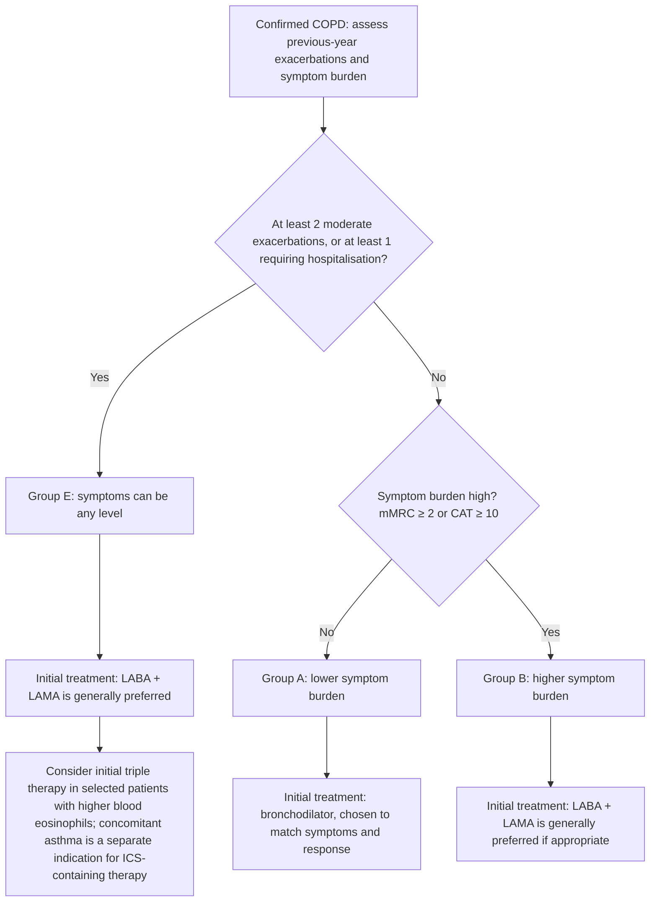

# Topic 28 — Chronic Obstructive Pulmonary Disease (COPD)

## 1. Definition and Etiopathogenesis

Chronic obstructive pulmonary disease (COPD) is a heterogeneous lung condition characterised by chronic respiratory symptoms (for example, dyspnoea, cough and/or sputum) due to airway and/or alveolar abnormalities that cause persistent airflow obstruction. In an appropriate clinical context, spirometry confirms COPD when the **post-bronchodilator** ratio $\text{FEV}_1/\text{FVC} < 0.70$. A fixed ratio should be interpreted with symptoms and exposure history; if a result is borderline (for example, 0.60–0.80), repeat spirometry may be appropriate because of biological variability.

### Etiological Factors
1. **Tobacco smoking:** A major global risk factor, but its contribution varies by population. COPD can also arise from biomass/household air pollution, occupational exposures, ambient pollution, impaired lung development and genetic susceptibility. Smoke causes epithelial injury, inflammatory-cell recruitment and oxidant–antioxidant imbalance.
2. **Biomass Smoke Exposure:** Major cause of COPD in non-smoking women in developing nations due to unvented indoor combustion of wood, crop residues, and dung.
3. **Occupational Dusts and Chemicals:** Silica, coal dust, grain dust.
4. **Genetic Predisposition — $\alpha_1$-Antitrypsin ($\alpha_1$-AT) Deficiency:**
   * **Genetics:** Autosomal codominant inheritance mapped to the *SERPINA1* gene on chromosome 14.
   * **Phenotypes:** $PiMM$ is the usual normal phenotype. **PiZZ** commonly causes severe deficiency, often with serum $\alpha_1$-antitrypsin below about $15\%$ of normal; levels can vary and should be interpreted with the laboratory reference range and clinical context.
   * **Pathophysiology:** $\alpha_1$-AT is a serum antiprotease synthesized in the liver that inhibits **neutrophil elastase**. In $PiZZ$ individuals, unopposed elastase digests elastic fibers in alveolar septa, leading to severe **panacinar emphysema** at an early age ($30–40\text{ years}$), accelerated by smoking. Misfolded $\alpha_1$-AT also accumulates in hepatocytes, causing PAS-positive, diastase-resistant globules and juvenile liver cirrhosis.

---

## 2. Pathological Subtypes and Phenotypic Comparison

COPD encompasses three overlapping pathological domains: **Chronic Bronchitis**, **Emphysema**, and **Small Airway Disease (Bronchiolitis)**.

### Chronic bronchitis and emphysema: key pathological distinctions

| Feature | Chronic bronchitis | Emphysema |
|---|---|---|
| Definition / diagnostic basis | Clinical definition: productive cough for at least 3 months in each of 2 consecutive years, after excluding other causes. | Pathological definition: permanent enlargement of airspaces distal to the terminal bronchiole with destruction of alveolar walls, without prominent fibrosis. |
| Major structural change | Mucus-gland enlargement, goblet-cell hyperplasia and mucus hypersecretion; Reid index may be increased. | Loss of alveolar walls, elastic recoil and alveolar attachments, promoting expiratory airway collapse and air trapping. |
| Physiological effect | Airway narrowing and secretion retention contribute to airflow obstruction. | Reduced elastic recoil and loss of gas-exchange surface contribute to airflow obstruction and impaired gas transfer. |

### Anatomical patterns of emphysema

| Pattern | Distribution / pathology | Typical association or clinical significance |
|---|---|---|
| **Centriacinar (centrilobular)** | Predominantly affects the proximal respiratory bronchioles, with relative sparing of distal acinar portions early on; often upper-lobe predominant. | Strongly associated with cigarette smoking; the most common pattern in smoking-related emphysema. |
| **Panacinar (panlobular)** | More uniform involvement of the entire acinus; often lower-lobe predominant. | Classically associated with severe $\alpha_1$-antitrypsin deficiency (for example, PiZZ genotype), though other causes exist. |
| **Paraseptal (distal acinar)** | Predominantly affects distal acinar structures adjacent to pleura or connective-tissue septa; may form subpleural bullae. | Bullae may predispose to spontaneous pneumothorax, including in younger adults. |

### The Reid Index in Chronic Bronchitis
The **Reid Index** measures submucosal mucous gland hypertrophy in the bronchial wall:

$$\text{Reid Index} = \frac{\text{Thickness of Submucosal Gland Layer } (b)}{\text{Total Thickness between Basement Membrane and Cartilage } (d)} = \frac{b}{d}$$

* **Normal value:** approximately $0.4$ in commonly cited pathology references; exact reference values vary by source and measurement method.
* **Chronic bronchitis:** a Reid index **above about $0.5$** supports submucosal mucous-gland enlargement, alongside goblet-cell metaplasia. It is a pathological correlate, not a standalone clinical diagnostic test.

### Historical Clinical Stereotypes: “Blue Bloaters” vs. “Pink Puffers”

These are traditional teaching labels, **not reliable contemporary clinical phenotypes**. Patients commonly have overlapping small-airway disease, chronic bronchitis and emphysema; do not infer ABGs, body habitus or prognosis from the label alone.

| Parameter | Chronic bronchitis-predominant pattern | Emphysema-predominant pattern |
| :--- | :--- | :--- |
| **Diagnostic Basis** | Clinical definition | Pathological definition |
| **Primary Lesion** | Large airway inflammation, mucus hypersecretion | Alveolar wall destruction, loss of elastic recoil |
| **Age & body habitus** | Variable; overweight is possible | Variable; low BMI/cachexia may occur in advanced disease |
| **Dyspnoea** | May be prominent as disease advances | May be prominent early and with hyperinflation; severity varies |
| **Cough & sputum** | Chronic productive cough by definition; sputum may become purulent during exacerbation | Cough/sputum vary; may be less prominent but frequently coexist |
| **Arterial blood gases** | Hypoxaemia and hypercapnia can occur, particularly in advanced disease | Gas exchange may be relatively preserved earlier; either pattern can occur as disease advances |
| **Cyanosis** | May occur with hypoxaemia; not phenotype-specific | May be absent earlier and occur in advanced disease; not phenotype-specific |
| **Diffusing capacity ($DL_{CO}$)** | Often relatively preserved unless emphysema coexists | Usually reduced in emphysema; degree varies |
| **Cor pulmonale** | Possible in advanced disease with pulmonary hypertension/hypoxaemia | Also possible in advanced disease; not confined to one phenotype |
| **Chest Radiograph** | Increased bronchovascular markings ("dirty lungs") | Hyperinflation, flattened diaphragms, enlarged retrosternal space, bullae |
| **Physical signs** | Wheeze/rhonchi and signs of airway secretions may occur | Reduced breath sounds, hyperinflation and pursed-lip breathing may occur |

> **Hoover's Sign:** Paradoxical inward movement of the lower lateral rib margins during inspiration, caused by severe hyperinflation flattening the diaphragm and altering its vector of contraction.

---

## 3. Diagnostic Evaluation and Spirometric Staging

### Spirometry
Spirometric confirmation requires persistent post-bronchodilator airflow obstruction in the appropriate clinical context. The GOLD fixed ratio is used for case confirmation, not as a stand-alone screening test:

$$\text{Post-Bronchodilator } \frac{\text{FEV}_1}{\text{FVC}} < 0.70$$

### GOLD spirometric airflow-limitation grades

Grades apply after COPD has been confirmed in the appropriate clinical context using post-bronchodilator $\text{FEV}_1/\text{FVC}<0.70$. The grade is based on post-bronchodilator $\text{FEV}_1$ as a percentage of predicted.

| GOLD grade | Descriptor | Post-bronchodilator $\text{FEV}_1$ (% predicted) |
|---|---|---:|
| **GOLD 1** | Mild | $\ge 80\%$ |
| **GOLD 2** | Moderate | $50\%$ to $<80\%$ |
| **GOLD 3** | Severe | $30\%$ to $<50\%$ |
| **GOLD 4** | Very severe | $<30\%$ |

### Symptom Assessment Tools
1. **Modified Medical Research Council (mMRC) Dyspnea Scale:**
   * *Grade 0:* Breathless only with strenuous exercise.
   * *Grade 1:* Short of breath when hurrying or walking up a slight hill.
   * *Grade 2:* Walks slower than contemporaries on level ground or stops for breath when walking at own pace.
   * *Grade 3:* Stops for breath after walking $\sim 100\text{ meters}$ or a few minutes on level ground.
   * *Grade 4:* Too breathless to leave the house, or breathless when dressing/undressing.
2. **COPD Assessment Test (CAT):** Comprehensive 8-item questionnaire evaluating symptom impact (score range 0–40; threshold $\ge 10$ indicates high symptom burden).

---

## 4. GOLD Pharmacological Management (2026 framework)

Treatment is individualised according to symptoms, exacerbation history, blood eosinophils, comorbidities, inhaler technique, treatment response and adverse effects. GOLD separates **initial treatment** from **follow-up adjustment**; the summary below is a simplified initial-treatment overview.

### GOLD 2026 initial assessment: ABE grouping

| Group | Exacerbation history in the previous year | Symptom burden | Initial pharmacological approach (general framework) |
|---|---|---|---|
| **A** | 0 or 1 moderate exacerbation, with no exacerbation requiring hospitalisation | Lower symptom burden: mMRC 0–1 and CAT $<10$ | A bronchodilator; use a long-acting bronchodilator when appropriate to symptoms and response, unless a short-acting agent is sufficient. |
| **B** | 0 or 1 moderate exacerbation, with no exacerbation requiring hospitalisation | Higher symptom burden: mMRC $\ge2$ or CAT $\ge10$ | LABA + LAMA is generally preferred if appropriate and available. |
| **E** | At least 2 moderate exacerbations or at least 1 exacerbation requiring hospitalisation | Any symptom score | LABA + LAMA is generally preferred. Consider initial triple therapy (LABA + LAMA + ICS) in selected patients with higher blood eosinophils (for example, $\ge300$ cells/$\mu$L); concomitant asthma is a separate reason to use an ICS-containing regimen. |

This table summarises initial treatment only. Follow-up treatment should be adjusted according to persistent dyspnoea, exacerbations, blood eosinophils, inhaler technique, adherence, comorbidities and adverse effects.

### Initial Pharmacological Choice Matrix

| GOLD Group | Exacerbation History | Symptoms (mMRC / CAT) | Initial Preferred Pharmacotherapy |
| :--- | :--- | :--- | :--- |
| **Group A** | 0 or 1 moderate exacerbation (no hospital admission) | mMRC 0–1, CAT $<10$ | **A Single Bronchodilator** (LABA like Formoterol/Indacaterol OR LAMA like Tiotropium). |
| **Group B** | 0 or 1 moderate exacerbation (no hospital admission) | mMRC $\ge 2$ **or** CAT $\ge 10$ | **LABA + LAMA Combination Inhaler** (e.g., Tiotropium + Olodaterol/Formoterol). |
| **Group E** | At least 2 moderate exacerbations or at least 1 exacerbation leading to hospitalisation in the previous year | Any symptom score | **LABA + LAMA** is generally preferred. Consider initial triple therapy (LABA + LAMA + ICS) when blood eosinophils are high (for example, $\ge 300\,\text{cells}/\mu\text{L}$); concomitant asthma is a separate reason to include ICS. |

> **ICS in COPD:** ICS is not recommended as routine COPD monotherapy. For patients who continue to exacerbate despite appropriate bronchodilator therapy, expected benefit from ICS increases as blood eosinophils rise; benefit may be seen from around $100\,\text{cells}/\mu\text{L}$ and is greatest at $\ge 300\,\text{cells}/\mu\text{L}$. Decisions also depend on exacerbation history and pneumonia risk. If concomitant asthma is present, use an ICS-containing regimen. Do not interpret the $300\,\text{cells}/\mu\text{L}$ threshold as the only circumstance in which ICS can be considered.

---

## 5. Systemic Manifestations ("Spill-over" Effect)

COPD is not confined to the lungs; peripheral inflammation leaks pro-inflammatory cytokines (IL-6, IL-1$\beta$, TNF-$\alpha$) into the systemic circulation, driving widespread extrapulmonary comorbidities.

### Systemic manifestations and comorbidities of COPD

| Domain | Examples | Notes |
|---|---|---|
| Skeletal muscle and nutritional | Loss of lean muscle, weakness, cachexia | May relate to inflammation, inactivity, hypoxaemia, poor intake and increased energy expenditure. |
| Cardiovascular | Ischaemic heart disease, heart failure, arrhythmias, pulmonary hypertension and cor pulmonale in advanced disease | Cardiovascular disease is an important comorbidity and contributor to morbidity/mortality. |
| Metabolic and bone | Osteoporosis, type 2 diabetes, metabolic syndrome | Risk may be affected by smoking, inactivity, inflammation and some treatments. |
| Haematological | Anaemia; secondary polycythaemia in chronic hypoxaemia | The pattern depends on comorbid disease, inflammation, iron status and oxygenation. |
| Psychological / neurological | Depression, anxiety, sleep disturbance and cognitive effects in some patients | Screen and treat where appropriate. |
| Malignancy | Increased lung-cancer risk | Smoking is a shared major risk factor; assess eligibility for screening according to applicable guidance. |
---

## 6. Disease-Modifying and Mortality-Reducing Interventions

Only a select few interventions have proven efficacy in slowing disease progression and improving survival in COPD:

### 1. Smoking Cessation
* **Efficacy:** Smoking cessation slows the accelerated decline in lung function and reduces ongoing exposure-related harm; it does not guarantee that decline stops completely.
* **Pharmacotherapy:**
  * **Varenicline:** $\alpha_4\beta_2$ nicotinic receptor partial agonist (most effective single agent).
  * **Nicotine Replacement Therapy (NRT):** Transdermal patches, chewing gum.
  * **Bupropion:** NDRI antidepressant.

### 2. Long-Term Oxygen Therapy (LTOT)
* **Physiological Goal:** Corrects chronic severe resting arterial hypoxemia and prevents secondary pulmonary hypertension and cor pulmonale.
* **Strict Indications for LTOT:**
  1. Stable resting $\text{PaO}_2 \le 55\text{ mmHg}$ or oxygen saturation $\le 88\%$.
  2. Stable resting $\text{PaO}_2$ of about $56–59\text{ mmHg}$ (or saturation around $89\%$) **plus** evidence such as peripheral oedema suggesting right-heart failure/cor pulmonale, pulmonary hypertension, or haematocrit $>55\%$.

  Assess eligibility when clinically stable and confirm persistent severe hypoxaemia on repeat measurement according to the applicable guideline. LTOT is for chronic resting hypoxaemia; isolated moderate desaturation does not automatically qualify.
* **Administration parameters:** For survival benefit in appropriately selected patients, prescribe LTOT for at least **15 hours/day** and titrate to correct chronic resting hypoxaemia (commonly aiming for PaO$_2$ above 60 mmHg or SpO$_2$ about 90% or higher, individualized by assessment). **The SpO$_2$ target of 88–92% is commonly used for initial controlled oxygen in an acute exacerbation when hypercapnia risk is present; it is not a universal long-term home-oxygen target.** Check ABGs when clinically indicated to assess CO$_2$ retention.

### 3. Surgical Interventions
* **Lung Volume Reduction Surgery (LVRS):** Surgical resection of hyperinflated, non-functional emphysematous tissue (predominantly upper lobe) to reduce hyperinflation and improve mechanical advantage of the diaphragm.

---

## 7. Coverage Audit

* **Review note:** Updated the management section to the 2026 GOLD framework, qualified the classic “blue bloater/pink puffer” stereotypes, corrected the over-restrictive ICS/eosinophil wording, and separated acute controlled-oxygen targets from LTOT titration.
* **Coverage limitations:** This is a concise framework, not the complete GOLD management cycle. Use the current full GOLD report, patient-specific exacerbation history, comorbid asthma, local availability and prescribing information for clinical decisions. Confirm original numeric citations against the source bibliography.

---

## References for reviewed clinical recommendations

- [GOLD 2026 Report and Pocket Guide](https://goldcopd.org/2026-gold-report-and-pocket-guide/) — diagnosis, ABE assessment, pharmacological treatment and oxygen-related management.
- [GOLD 2026 Report (PDF)](https://goldcopd.org/wp-content/uploads/2026/01/GOLD-REPORT-2026-v1.3-8Dec2025_WMV2.pdf) — full evidence-based strategy.

> **Citation note:** Numeric citations inherited from the NotebookLM export were not accompanied by a bibliography. Verify them against the original NotebookLM sources.
