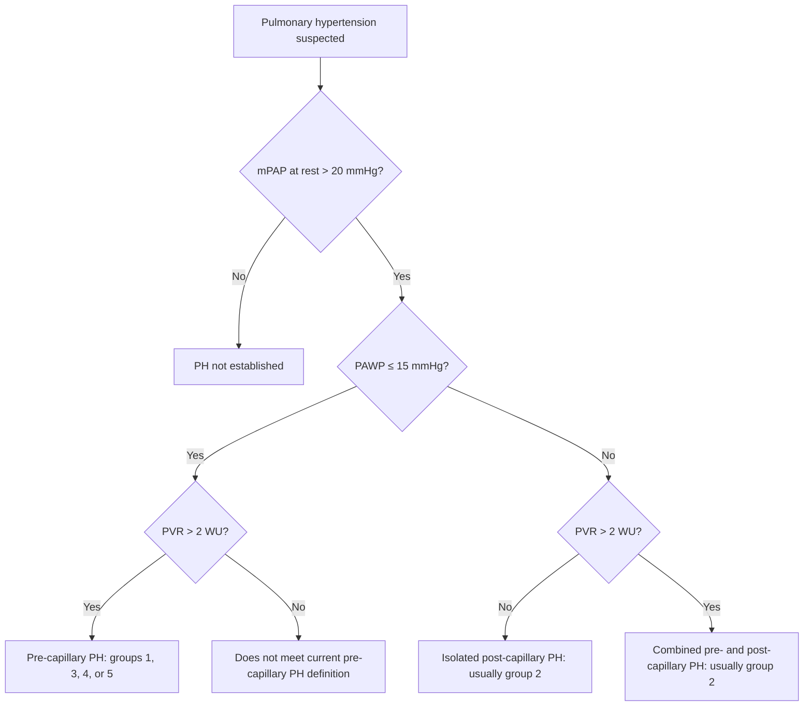
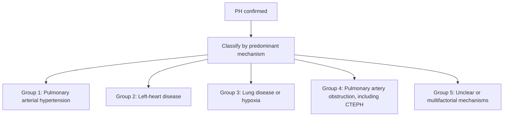
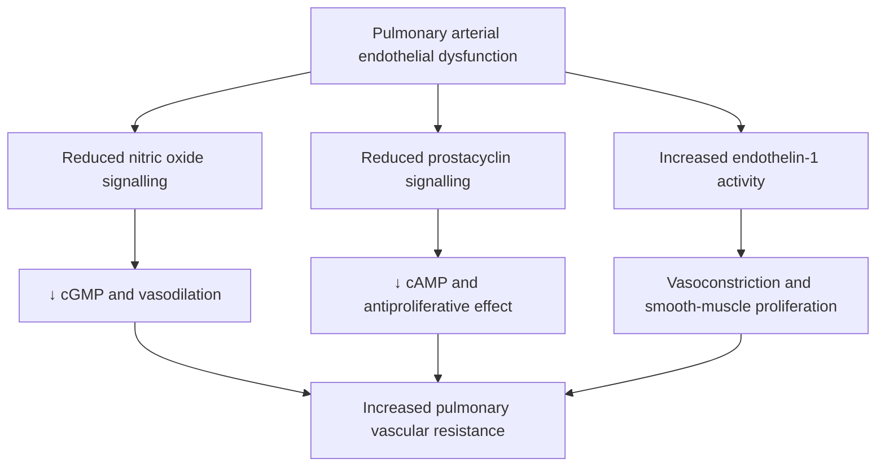
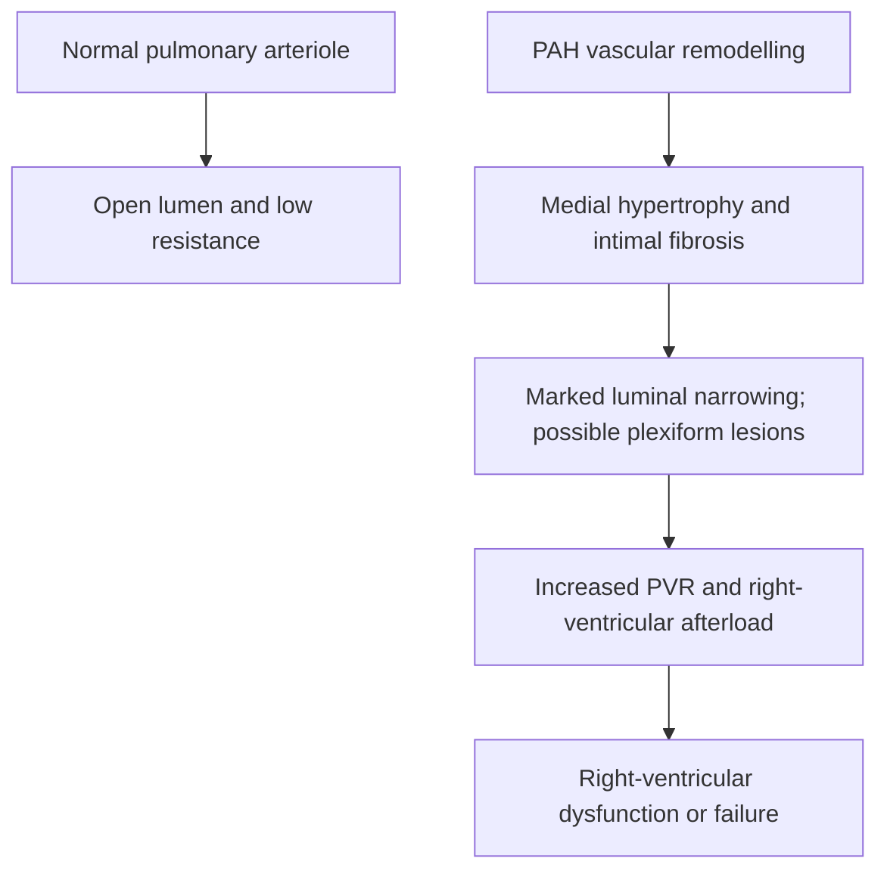
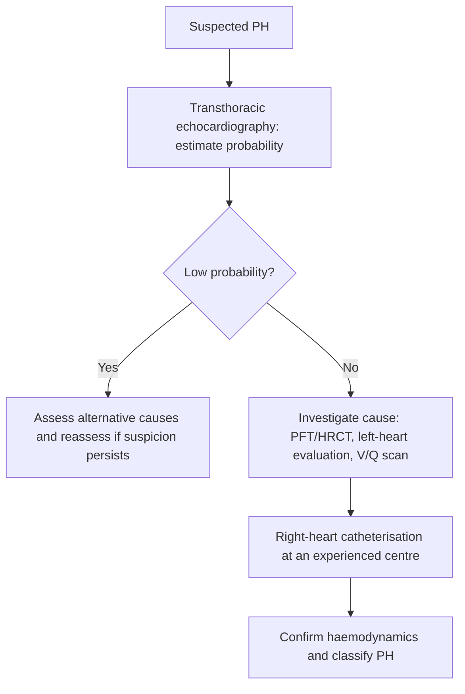
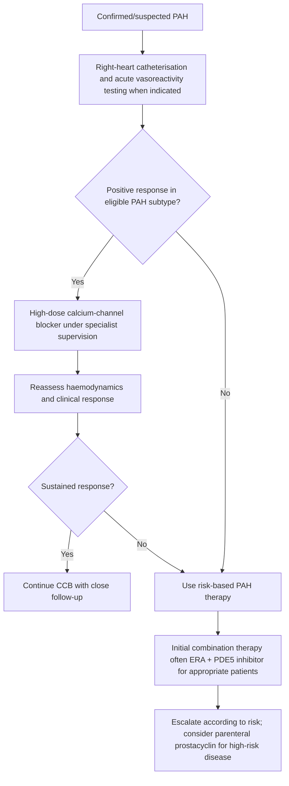

# Topic 29 — Pulmonary Hypertension

## 1. Definition and Diagnostic Hemodynamic Criteria

Pulmonary Hypertension (PH) is defined hemodynamically by an abnormal elevation in pulmonary vascular pressures measured via Right Heart Catheterization (RHC). Under the updated 2022 ESC/ERS guidelines (revised from historical criteria), PH is defined as:

$$\text{mPAP} > 20\text{ mmHg at rest}$$

Where $\text{mPAP}$ is the Mean Pulmonary Arterial Pressure.

### Complete Hemodynamic Diagnostic Matrix

| Parameter | Normal | Pre-Capillary PH | Isolated Post-Capillary PH (Ipc-PH) | Combined Pre- & Post-Capillary PH (Cpc-PH) |
| :--- | :--- | :--- | :--- | :--- |
| **Mean PAP (mPAP)** | $\le 20\text{ mmHg}$ | $> 20\text{ mmHg}$ | $> 20\text{ mmHg}$ | $> 20\text{ mmHg}$ |
| **Pulmonary Artery Wedge Pressure (PAWP / PCWP)** | $\le 15\text{ mmHg}$ | $\le 15\text{ mmHg}$ | $> 15\text{ mmHg}$ | $> 15\text{ mmHg}$ |
| **Pulmonary Vascular Resistance (PVR)** | $< 2\text{ WU}$ | $> 2\text{ Wood Units (WU)}$ | $\le 2\text{ WU}$ | $> 2\text{ WU}$ |
| **Primary Clinical Category** | Physiological state | Groups 1, 3, 4, 5 | Group 2 (Left Heart Disease) | Group 2 with vascular remodeling |

*Note on Units:* $1\text{ Wood Unit (WU)} = 80\text{ dynes}\cdot\text{sec}\cdot\text{cm}^{-5}$.
$$\text{PVR} = \frac{\text{mPAP} - \text{PAWP}}{\text{Cardiac Output (CO)}}$$

---

## 2. Clinical and Etiological Classification (Groups 1–5)

The World Health Organization (WHO) and ESC/ERS categorize Pulmonary Hypertension into five distinct clinical groups based on shared pathophysiological mechanisms, clinical presentation, and therapeutic approaches:

### 1. Group 1: Pulmonary Arterial Hypertension (PAH)
Characterized by primary intrinsic remodeling and narrowing of small pulmonary arteries ($< 500\mu\text{m}$ diameter) leading to pre-capillary PH.
* **Idiopathic PAH (IPAH):** Sporadic occurrence without identifiable environmental or genetic cause.
* **Heritable PAH (HPAH):** Autosomal dominant inheritance with reduced penetrance ($20\%$). Caused predominantly by inactivating mutations in the **BMPR2 gene** (*Bone Morphogenetic Protein Receptor Type 2*, member of TGF-$\beta$ superfamily). Normally, BMPR2 inhibits vascular smooth muscle proliferation; loss of function leads to unchecked endothelial and smooth muscle hyperplasia.
* **Drug- and Toxin-Induced PAH:**
  * Definite Risk: Appetite suppressants (Fenfluramine, Dexfenfluramine, Aminorex), Toxic Rapeseed Oil, Methamphetamine, Dasatinib.
* **Associated PAH (APAH):**
  * *Connective Tissue Diseases (CTD):* Most commonly **Systemic Sclerosis (Scleroderma)**, particularly the limited cutaneous form (CREST syndrome). Also seen in SLE and MCTD.
  * *Human Immunodeficiency Virus (HIV) Infection:* Direct viral protein interaction (gp120, Tat) driving endothelial inflammation.
  * *Portal Hypertension (Portopulmonary Hypertension):* Splanchnic vasodilation leading to circulating vasoactive toxins reaching pulmonary circulation.
  * *Congenital Heart Disease (CHD):* Systemic-to-pulmonary shunts (VSD, ASD, PDA) causing pulmonary hyperperfusion, vascular remodeling, secondary elevation of PVR, and eventual shunt reversal (**Eisenmenger Syndrome** $\rightarrow$ cyanosis, clubbing, erythrocytosis).
  * *Schistosomiasis:* Most common cause of PAH worldwide in endemic geographic regions (*Schistosoma mansoni/japonicum* egg embolization).

### 2. Group 2: PH Due to Left Heart Disease
**Most common cause of Pulmonary Hypertension overall.** Elevated left atrial pressure (LAP) transmits backward into pulmonary veins, causing passive pulmonary venous hypertension (post-capillary PH).
* Left Ventricular Systolic Dysfunction (HFrEF)
* Left Ventricular Diastolic Dysfunction (HFpEF)
* Valvular Heart Diseases: Severe Mitral Stenosis (MS), Mitral Regurgitation (MR), Aortic Stenosis (AS)
* Congenital / Acquired left heart inflow/outflow tract obstructions

### 3. Group 3: PH Due to Lung Diseases and/or Hypoxia
Hypoxic pulmonary vasoconstriction (Euler-Liljestrand mechanism) combined with destruction of the capillary bed.
* [[28 - Chronic Obstructive Pulmonary Disease]] (COPD)
* [[32 - Interstitial Lung Diseases]] (ILD)
* Sleep-Disordered Breathing ([[46 - Sleep Apnoea]])
* Alveolar hypoventilation disorders
* Chronic high-altitude exposure

### 4. Group 4: Chronic Thromboembolic Pulmonary Hypertension (CTEPH) & Other PA Obstructions
Organized, non-resolving thrombi following acute [[30 - Venous Thromboembolism and Pulmonary Embolism]] that undergo fibrous transformation, obstructing major pulmonary arteries.
* **CTEPH:** Diagnostic criteria require $\text{mPAP} > 20\text{ mmHg}$ with $\text{PAWP} \le 15\text{ mmHg}$ and persistent mismatched perfusion defects on V/Q scan after $\ge 3\text{ months}$ of effective anticoagulation. Potentially curative with surgery!

### 5. Group 5: PH with Unclear and/or Multifactorial Mechanisms
* *Hematologic Disorders:* Chronic hemolytic anemias (Sickle cell disease, Thalassemia), Myeloproliferative neoplasms.
* *Systemic Disorders:* [[33 - Sarcoidosis]], Langerhans cell histiocytosis, Gaucher disease.
* *Metabolic Disorders:* Glycogen storage diseases.
* *Others:* End-stage renal disease on hemodialysis, fibrosing mediastinitis.

---

## 3. Pathophysiology and Histopathology

### Molecular Imbalance in Endothelial Signaling
Pulmonary Arterial Hypertension results from an imbalance between endothelium-derived vasodilators/antiproliferative mediators and vasoconstrictors/mitogenic mediators:

1. **Nitric Oxide (NO) Pathway:** Decreased activity of endothelial NO synthase (eNOS) $\rightarrow$ reduced cyclic guanosine monophosphate (cGMP) $\rightarrow$ loss of vasodilation and increased vascular smooth muscle cell (VSMC) proliferation.
2. **Prostacyclin ($PGI_2$) Pathway:** Decreased prostacyclin synthase expression $\rightarrow$ reduced cyclic adenosine monophosphate (cAMP) $\rightarrow$ loss of vasodilatory and anti-aggregatory protection.
3. **Endothelin-1 (ET-1) Pathway:** Overproduction of ET-1 acting on $\text{ET}_A$ and $\text{ET}_B$ receptors on VSMCs $\rightarrow$ potent vasoconstriction, hypertrophy, and cellular proliferation.

### Histopathological Hallmarks
* **Medial Hypertrophy:** Proliferation and hypertrophy of smooth muscle cells in media of pulmonary arterioles.
* **Concentric Intimal Fibrosis:** Proliferation of myofibroblasts and collagen deposition in the intima, severely narrowing lumens.
* **Adventitial Thickening:** Fibrosis of the outer adventitial layer.
* **Plexiform Lesions (Plexiform Arteriolopathy):** Pathognomonic histopathological feature of advanced PAH (Group 1). Consists of complex, disorganized, glomeruloid tufts of capillary channels formed by proliferating endothelial cells within dilated, thin-walled arterial branches, often surrounded by fibrous tissue and inflammation.

---

## 4. Clinical Manifestations and Physical Examination

### Clinical Symptoms
Symptom onset is typically insidious, leading to significant diagnostic delay ($1.5–2\text{ years}$).
* **Exertional Dyspnea:** Earliest and most common presenting symptom, due to inability to augment Cardiac Output (CO) during physical activity.
* **Fatigue and Lethargy:** Secondary to reduced systemic tissue perfusion.
* **Exertional Syncope or Presyncope:** Sign of severe, advanced PH. Occurs during exertion when systemic peripheral vasodilation occurs, but fixed, high PVR prevents the right ventricle from increasing stroke volume $\rightarrow$ acute drop in cerebral perfusion.
* **Exertional Angina / Chest Pain:** Right ventricular ischemia caused by massive RV hypertrophy, increased RV wall tension, and compressed right coronary artery perfusion.
* **Hemoptysis:** Due to rupture of dilated, high-pressure bronchial collateral vessels or plexiform lesions.
* **Hoarseness of Voice (Ortner's Syndrome):** Compression of the left recurrent laryngeal nerve between the enlarged main pulmonary artery and the aortic arch.

### Physical Examination Signs
1. **Jugular Venous Pulse (JVP):**
   * **Giant *a* wave:** Caused by forceful right atrial contraction against a hyper-pressurized, non-compliant right ventricle during presystole.
   * **Prominent *v* wave:** Indicates secondary functional Tricuspid Regurgitation (TR) due to RV and tricuspid annular dilatation.
2. **Precordial Palpation & Auscultation:**
   * **Parasternal Heave:** Palpable lift along the left sternal border, reflecting Right Ventricular Hypertrophy (RVH).
   * **Palpable $P_2$:** Palpable closure of the pulmonary valve in the 2nd left intercostal space.
   * **Loud Pulmonary Component of S2 ($P_2 > A_2$):** Accentuated second heart sound; $P_2$ often heard beyond the apex.
   * **Narrow or Reverse Splitting of S2:** Due to delayed closure of the pulmonary valve under high pressure.
   * **Pansystolic Murmur of Tricuspid Regurgitation:** Heard best at the lower left sternal border. Exhibits **Carvallo's Sign** (murmur intensity increases during inspiration due to increased venous return).
   * **Graham Steell Murmur:** High-pitched, decrescendo diastolic murmur heard at the upper left sternal border due to functional pulmonary regurgitation under high PAP.
   * **Right-Sided S3 or S4 Gallop:** Accentuated during inspiration.
3. **Signs of Overt Right Ventricular Failure (Cor Pulmonale):**
   * Hepatomegaly (tender, smooth) and **Pulsatile Liver** (systolic pulsation matching TR).
   * Ascites, hydrothorax.
   * Dependent bilateral pitting pedal edema.
   * Peripheral cyanosis and cool extremities (low CO state).

---

## 5. Diagnostic Evaluation and Workup

### 1. Electrocardiography (ECG)
Features of Right Ventricular Overload and Right Atrial Enlargement:
* Right Axis Deviation (RAD $> +90^\circ$).
* **Right Ventricular Hypertrophy (RVH):** $R/S$ ratio $> 1$ in lead V1; $R$ wave amplitude in V1 $> 7\text{ mm}$.
* **Right Ventricular Strain Pattern:** $S_1Q_3T_3$ pattern; ST-segment depression and $T$-wave inversions in leads V1–V3 and inferior leads (II, III, aVF).
* **Right Atrial Enlargement (*P pulmonale*):** Peaked $P$ waves $> 2.5\text{ mm}$ ($0.25\text{ mV}$) in lead II.
* Deep $S$ waves in lead V6.

### 2. Chest Radiography (CXR)
* Prominent, dilated central pulmonary arteries (knuckle sign).
* Rapid peripheral tapering/pruning of pulmonary vasculature ("pruning effect").
* Right ventricular enlargement (obliteration of retrosternal clear space on lateral view).
* Right atrial enlargement (prominent right cardiac border).

### 3. Transthoracic Echocardiography (TTE)
**Primary non-invasive screening modality.**
* **Estimation of Right Ventricular Systolic Pressure (RVSP):** Measured via Tricuspid Regurgitation Velocity ($TRV$) using the modified Bernoulli equation:
  $$\text{RVSP} = 4 \times (TRV)^2 + \text{RAP}$$
  *Where $\text{RAP}$ is estimated Right Atrial Pressure based on IVC diameter and respiratory collapse.*
* **Signs of RV Pressure Overload:** RV dilatation (RV/LV diameter ratio $> 1.0$), RV free wall hypertrophy ($> 5\text{ mm}$), flattenings of interventricular septum during systole ("$D$-shaped" left ventricle on parasternal short-axis view), pericardial effusion (indicates poor prognosis).

### 4. Ventilation-Perfusion (V/Q) Scan
* **Mandatory screening test of choice to rule out Group 4 CTEPH.**
* CTEPH demonstrates one or more segmental or lobar mismatched perfusion defects (perfusion defect with preserved ventilation).
* *Note:* CT Pulmonary Angiography (CTPA) is less sensitive than V/Q scanning for small-vessel CTEPH lesions, though CTPA is useful for surgical planning.

### 5. Right Heart Catheterization (RHC)
**Gold standard required to establish definitive diagnosis of PH and guide therapy.**
* **Hemodynamic Measurements Obtained:**
  1. Mean Pulmonary Arterial Pressure (mPAP)
  2. Pulmonary Artery Wedge Pressure (PAWP / PCWP)
  3. Right Atrial Pressure (RAP)
  4. Cardiac Output (CO) via thermodilution or Fick principle
  5. Calculation of PVR and Systemic Vascular Resistance (SVR)
  6. Mixed Venous Oxygen Saturation ($SvO_2$)

### 6. Acute Vasoreactivity Testing (AVT)
Performed during baseline RHC specifically in patients with **Group 1 Idiopathic, Heritable, or Drug-Induced PAH** to identify candidates for high-dose Calcium Channel Blocker therapy.
* **Vasodilator Agents Used:** Inhaled Nitric Oxide (iNO, $10–20\text{ ppm}$), IV Epoprostenol, or IV Adenosine.
* **Definition of Positive Acute Response:**
  * Reduction in mPAP by **$\ge 10\text{ mmHg}$**
  * Reaching an absolute mPAP level of **$\le 40\text{ mmHg}$**
  * Accompanied by an **increased or unchanged Cardiac Output** (without hemodynamic collapse).
* Only $\sim 10\%$ of IPAH patients meet criteria for a positive response.

---

## 6. Pharmacotherapy and Management Protocol

### 1. General Measures and Supportive Therapy
* Diuretics (Furosemide, Spironolactone) to treat RV volume overload and peripheral edema.
* Oxygen supplementation to maintain $SpO_2 > 91\%$ (prevents hypoxic pulmonary vasoconstriction).
* Supervised pulmonary rehabilitation and avoidance of heavy isometric exercise.
* Immunization against Influenza and Pneumococcus.
* Strict contraception in females of childbearing age (pregnancy carries a $30–50\%$ maternal mortality rate in PAH!).

### 2. High-Dose Calcium Channel Blockers (CCBs)
Indicated **only** for AVT-positive responders in Group 1 PAH.
* **Drugs:** High-dose Diltiazem (if baseline HR elevated), Amlodipine, or Nifedipine (if baseline HR normal/bradycardic). Verapamil is avoided due to negative inotropic effects.
* *Dose:* High doses required (e.g., Amlodipine up to $20\text{ mg/day}$, Diltiazem up to $240–720\text{ mg/day}$).

### 3. Targeted Medical Therapies for PAH (Non-Responders)

| Pathway | Drug classes | Examples | Key caution |
|---|---|---|---|
| Endothelin | Endothelin-receptor antagonists | Bosentan, ambrisentan, macitentan | Pregnancy risk; liver/haematologic monitoring varies by drug |
| NO–cGMP | PDE-5 inhibitors or soluble guanylate-cyclase stimulator | Sildenafil, tadalafil; riociguat | **Do not combine riociguat with a PDE-5 inhibitor** |
| Prostacyclin | Prostacyclin analogues or IP-receptor agonist | Epoprostenol, treprostinil, iloprost, selexipag | Selection depends on risk, route, comorbidities and specialist assessment |

#### A. Endothelin Receptor Antagonists (ERAs)
Block vasoconstrictive and mitogenic effects of ET-1.
* **Bosentan:** Competitive dual $\text{ET}_A$ and $\text{ET}_B$ receptor antagonist.
  * *Adverse Effects:* Hepatotoxicity (dose-dependent elevation of aminotransferases; requires monthly LFT monitoring), anemia, teratogenicity, inhibition of oral contraceptives via CYP3A4 induction.
* **Ambrisentan:** Selective $\text{ET}_A$ receptor antagonist. Lower incidence of hepatotoxicity.
* **Macitentan:** Tissue-targeted dual $\text{ET}_A/\text{ET}_B$ antagonist with long receptor binding kinetics.

#### B. Nitric Oxide - cGMP Pathway Enhancers
* **Phosphodiesterase-5 (PDE-5) Inhibitors:** Inhibit cGMP degradation, raising intracellular cGMP levels $\rightarrow$ vascular smooth muscle relaxation and antiproliferative action.
  * **Sildenafil:** $20\text{ mg}$ TID.
  * **Tadalafil:** $40\text{ mg}$ OD.
  * *Adverse Effects:* Flushing, headache, dyspepsia, epistaxis, blue-tinted vision (Sildenafil via PDE-6 inhibition).
* **Soluble Guanylate Cyclase (sGC) Stimulators:**
  * **Riociguat:** Directly stimulates sGC independently of NO, and sensitizes sGC to endogenous NO.
  * *Approved Indications:* Group 1 PAH and **Group 4 CTEPH** (inoperable or persistent/recurrent after surgery).
  * **Absolute Contraindication:** Concurrent use with PDE-5 inhibitors or nitrates (causes severe, refractory systemic hypotension!).

#### C. Prostacyclin Pathway Agents
* **Synthetic Prostacyclin ($PGI_2$) Analogs:**
  * **Epoprostenol:** Continuous IV infusion via central line (half-life $\approx 3–5\text{ minutes}$). Gold standard for NYHA Class IV / high-risk PAH. Abrupt withdrawal can cause fatal rebound PH!
  * **Treprostinil:** Subcutaneous, IV, or inhaled preparation ($t_{1/2} \approx 4\text{ hours}$).
  * **Iloprost:** Inhaled formulation administered 6–9 times per day.
* **Selective IP Receptor Agonists:**
  * **Selexipag:** Non-prostanoid oral agonist at the prostacyclin IP receptor.

#### D. Novel Activin Signaling Inhibitor
* **Sotatercept:** First-in-class activin signaling inhibitor (biologic fusion protein) that acts as a ligand trap targeting activin A $\rightarrow$ rebalances pro-proliferative (activin/GDF) and anti-proliferative (BMPR2) signaling pathways to reverse vascular remodeling.

### 4. Interventional and Surgical Options
* **Pulmonary Thromboendarterectomy (PTE):** Surgical treatment of choice for **Group 4 CTEPH** with proximal, accessible thrombotic lesions. Highly effective and potentially curative!
* **Balloon Pulmonary Angioplasty (BPA):** Percutaneous option for CTEPH patients ineligible for PTE.
* **Atrial Septostomy:** Palliative procedure creating a right-to-left interatrial shunt to decompress the right atrium and ventricle, sacrificing arterial $SpO_2$ to maintain systemic Cardiac Output.
* **Lung Transplantation:** Double lung or heart-lung transplantation indicated for refractory Group 1 PAH failing maximum combination medical therapy.

---

## Accuracy and currency note

This is educational revision material, not a patient-specific treatment protocol. Time-sensitive drug regimens, doses, thresholds and service pathways should be checked against the current national/local guideline before clinical use. The batch review file records the main edits and the scope of verification.

**Review log:** [[00 - Batch 3 Accuracy Review]]
