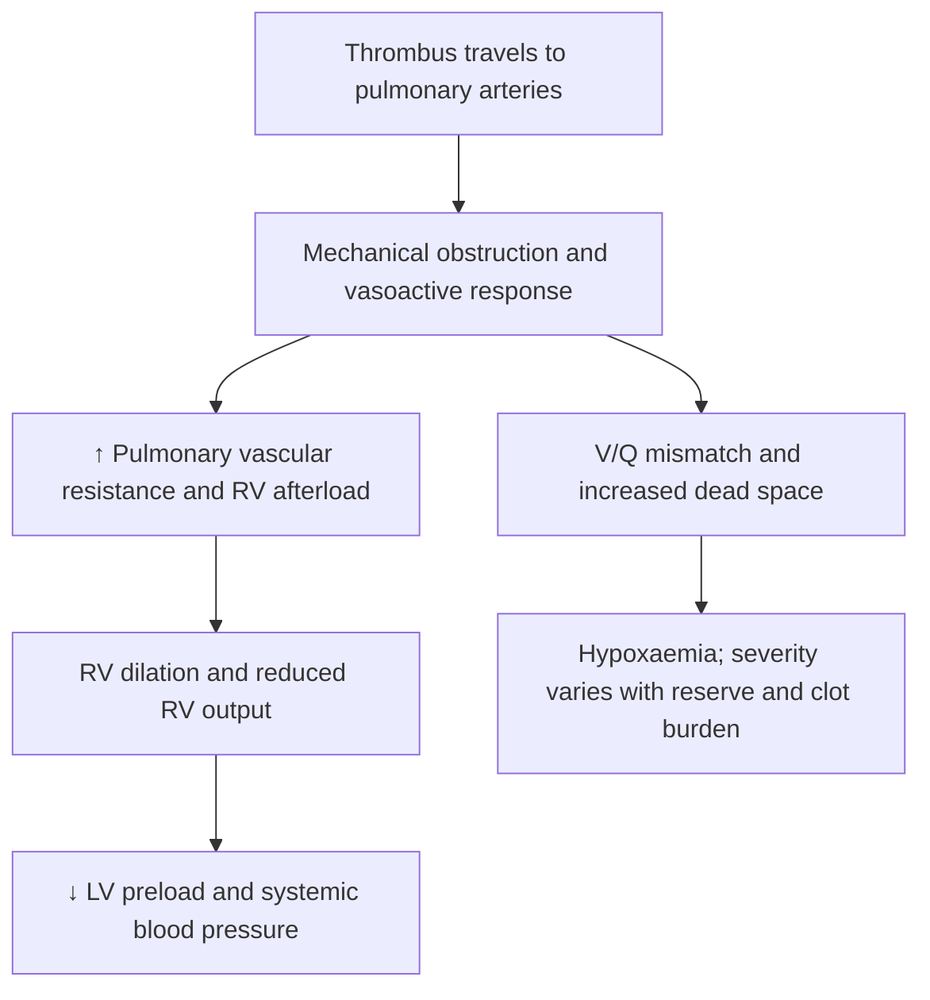
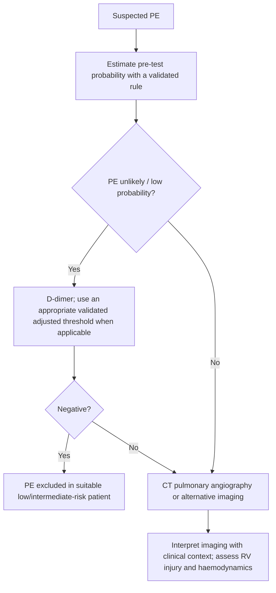
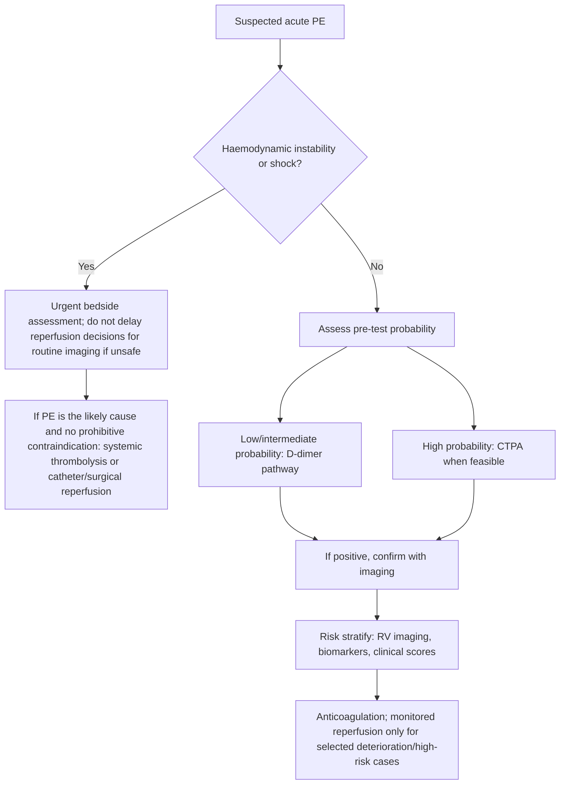
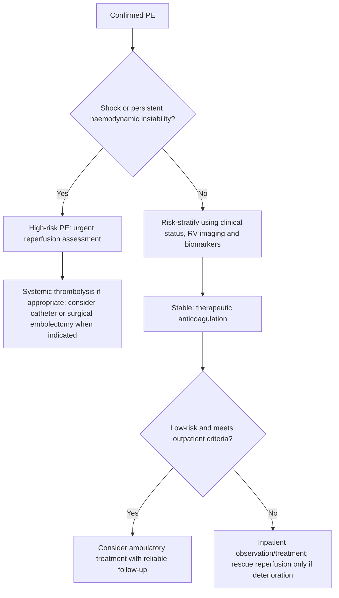

# Topic 30 — Venous Thromboembolism and Pulmonary Embolism

## 1. Etiology, Risk Factors, and Virchow's Triad

Venous Thromboembolism (VTE) encompasses Deep Vein Thrombosis (DVT) and Pulmonary Embolism (PE). PE results from the occlusion of the pulmonary arterial bed by thrombi originating from distant venous structures.

| Component of Virchow triad | Examples |
|---|---|
| Venous stasis | Immobility, surgery, paresis, heart failure, pregnancy |
| Endothelial injury | Major trauma, orthopaedic/pelvic surgery, central venous catheters |
| Hypercoagulability | Active cancer, pregnancy/postpartum, antiphospholipid syndrome, inherited thrombophilia, oestrogen exposure |

### Risk Factors for VTE
Risk factors are categorized based on Virchow's Triad:

| Risk Category | Hereditary / Congenital | Acquired (Transient / Persistent) |
| :--- | :--- | :--- |
| **Hypercoagulability** | • **Factor V Leiden Mutation** (Activated Protein C Resistance; most common overall) • Prothrombin G20210A Gene Mutation • Antithrombin III Deficiency • Protein C Deficiency • Protein S Deficiency | • Active Malignancy (Mucin-secreting adenocarcinomas) • **Antiphospholipid Antibody Syndrome (APLA)** • High-dose Estrogen / Oral Contraceptives (OCPs) • Nephrotic Syndrome (Loss of AT-III in urine) • Paroxysmal Nocturnal Hemoglobinuria (PNH) |
| **Venous Stasis** | • May-Thurner Syndrome (Left iliac vein compression) | • Major Surgery (Orthopedic, pelvic, abdominal) • Prolonged Immobilization (Bed rest $> 3\text{ days}$, long-haul travel) • Congestive Heart Failure, Post-Myocardial Infarction • Pregnancy and Puerperium |
| **Endothelial Damage**| • Homocystinuria | • Direct Vascular Trauma • Previous DVT or PE • Indwelling Central Venous Catheters / Pacemaker leads |

### Anatomic Origins of Pulmonary Emboli
* **Most Common Site of DVT Overall:** Deep veins of the calf (posterior tibial, peroneal veins).
* **Most Common Site of DVT Causing PE:** **Femoropopliteal veins** and iliofemoral venous system ($> 90\%$ of embolic source).
* Less common sources: Pelvic veins, subclavian/axillary veins (upper extremity DVT), right heart chambers.

### Clinical Signs of Deep Vein Thrombosis (DVT)
* **Unilateral Calf Swelling & Pain:** Diameter disparity $> 3\text{ cm}$ measured $10\text{ cm}$ below tibial tuberosity.
* **Pratt's Sign:** Presence of pain on lateral compression of the calf.
* **Homans' Sign:** Pain elicited in the calf/popliteal region on forced dorsiflexion of the ankle.
* **Moses' Sign:** Pain elicited on anteroposterior compression of calf muscles against the tibia.
* **Phlegmasia Alba Dolens ("Painful White Limb" / Milk Leg):** Massive iliofemoral venous thrombosis causing pale, swollen, cold limb without arterial compromise (common in pregnancy).
* **Phlegmasia Cerulea Dolens ("Painful Blue Limb"):** Fulminant venous occlusion obstructing both major axial veins and collateral channels, leading to severe venous gangrene, compartment syndrome, and hypovolemic shock.

---

## 2. Pathophysiology and Hemodynamic Impact

### 1. Hemodynamic Mechanisms
* **Critical Occlusion Threshold:** Sudden occlusion of $> 30–50\%$ of the pulmonary arterial bed induces a acute rise in PVR, leading to acute cor pulmonale.
* **Right Ventricular Failure Cascade:** RV dilatation $\rightarrow$ increased wall tension $\rightarrow$ neurohormonal activation and RV myocardial inflammation $\rightarrow$ elevated RV $O_2$ demand $\rightarrow$ **Interventricular Septal Shift (Septal Push)** bowing into the left ventricle $\rightarrow$ impaired LV diastolic filling $\rightarrow$ reduced stroke volume and Cardiac Output $\rightarrow$ systemic hypotension, cardiogenic/obstructive shock, and death.

### 2. Gas Exchange Abnormalities
* **Increased Physiological Dead Space:** Occlusion of blood flow to ventilated alveoli creates a high Ventilation/Perfusion ratio ($\text{V/Q} \rightarrow \infty$).
* **Intrapulmonary Shunting and Hypoxemia:** Redistribution of blood flow through over-perfused, non-occluded lung regions creates low $\text{V/Q}$ areas and right-to-left shunting.
* **Hyperventilation and Hypocapnia:** Hypoxemia and stimulation of unmyelinated $J$-receptors trigger tachypnea, resulting in **Respiratory Alkalosis** (decreased $PaCO_2$, elevated $pH$).
* **Pulmonary Infarction:** Occurs in $< 10\%$ of cases (primarily distal emboli occluding small vessels), as lung parenchyma receives dual oxygen supply from bronchial circulation and direct alveolar diffusion.

---

## 3. Clinical Presentation and Risk Stratification

### Clinical Features
* **Classic Symptom Triad:** Dyspnea + Pleuritic Chest Pain + Hemoptysis (present together in $< 20\%$ of patients).
* **Dyspnea with Clear Lung Fields:** Classic presentation hallmark of acute PE.
* **Symptoms:**
  * Sudden-onset dyspnea (most common symptom, present in $> 80\%$).
  * Pleuritic chest pain (due to pleural irritation from distal ischemia).
  * Substernal oppressive chest pain (indicates acute RV ischemia).
  * Hemoptysis (indicates pulmonary infarction).
  * Syncope or sudden collapse (indicates massive PE with subtotal arterial occlusion).
* **Physical Examination Findings:**
  * Tachypnea ($RR > 20\text{ breaths/min}$; most common physical sign).
  * Tachycardia ($HR > 100\text{ bpm}$).
  * Accentuated, loud pulmonary component of second heart sound ($P_2$).
  * Right-sided $S_3$ or $S_4$ gallop.
  * Wide, fixed splitting of $S_2$.
  * Low-grade fever ($< 38^\circ\text{C}$).
  * Distended neck veins (elevated JVP).

### Clinical Prediction Rules (Wells Score for PE)

| Clinical Parameter (Wells Score) | Assigned Points |
| :--- | :--- |
| **Clinical signs and symptoms of DVT** (objective swelling, pain) | **+ 3.0** |
| **Alternative diagnosis is less likely than PE** | **+ 3.0** |
| **Heart rate $> 100\text{ beats/min}$** | **+ 1.5** |
| **Immobilization $\ge 3$ consecutive days OR surgery in previous 4 weeks** | **+ 1.5** |
| **Previous objectively proven PE or DVT** | **+ 1.5** |
| **Hemoptysis** | **+ 1.0** |
| **Malignancy** (under treatment, treated in past 6 months, or palliative) | **+ 1.0** |

#### Clinical Probability Interpretation Strategies:
* **Two-Tier Model:**
  * **PE Unlikely:** Score **$\le 4.0$** $\rightarrow$ Order Quantitative **D-Dimer Test**.
  * **PE Likely:** Score **$> 4.0$** $\rightarrow$ Order **CT Pulmonary Angiography (CTPA)** directly.
* **Three-Tier Model:**
  * Low Probability (0–1 point), Intermediate Probability (2–6 points), High Probability ($\ge 7$ points).

---

## 4. Diagnostic Evaluation and Workup

### 1. D-Dimer Assay
* **Mechanism:** Fibrin degradation product generated when cross-linked fibrin is cleaved by plasmin.
* **Testing Method:** Latex agglutination or ELISA.
* **Clinical Role:** **High Sensitivity ($> 95\%$), High Negative Predictive Value (NPV).** Used strictly to **rule out** PE in patients with low or intermediate clinical probability (Wells score $\le 4$).
* **Standard Threshold:** $500\text{ ng/mL}$ (or $0.5\text{ mg/L}$).
* **Age-Adjusted D-Dimer Cutoff:** For patients $> 50\text{ years}$:
  $$\text{Age-Adjusted Threshold} = \text{Age (years)} \times 10\text{ ng/mL}$$
* **Diagnostic Pitfall:** D-Dimer is reduced or **false negative in Factor XIII Deficiency**, because without Factor XIII, covalent cross-linking of fibrin monomers does not occur, preventing D-dimer formation. Elevated in pregnancy, cancer, surgery, infection, DIC.

### 2. Electrocardiography (ECG)
Most common finding is **Sinus Tachycardia**.
* **Specific Pattern:** **$S_1Q_3T_3$ Pattern (McGinn-White Sign):**
  * Prominent, deep $S$ wave in Lead I.
  * Prominent $Q$ wave in Lead III.
  * Inverted $T$ wave in Lead III.
* **Signs of Right Ventricular Strain:**
  * $T$-wave inversions in leads V1 to V4.
  * Right Axis Deviation (RAD) or transient Right Bundle Branch Block (RBBB).

### 3. Chest Radiography (CXR)
Often normal (classic finding: dyspnea with normal CXR). Specific radiological signs include:

| CXR sign | Classic description | Exam use |
|---|---|---|
| Hampton hump | Peripheral pleural-based wedge opacity | Uncommon, nonspecific |
| Westermark sign | Focal oligemia distal to obstruction | Uncommon, nonspecific |
| Fleischner sign | Prominent central pulmonary artery | Nonspecific |
| Palla sign | Enlarged right descending pulmonary artery | Nonspecific |
| Knuckle / abrupt cut-off sign | Abrupt termination of a pulmonary artery | Uncommon |

A normal chest radiograph does **not** exclude PE; these are historical signs, not diagnostic tests.

* **Hampton's Hump:** Shallow, dome-shaped, peripheral wedge-shaped consolidation/opacity with its base abutting the pleura and apex pointing toward the hilum (represents pulmonary infarction).
* **Westermark's Sign:** Focal area of oligemia (hyperlucency) distal to the occluded pulmonary artery branch.
* **Fleischner's Sign:** Prominent, dilated central main pulmonary artery.
* **Palla's Sign:** Dilated right descending pulmonary artery.
* **Chang's / Knuckle Sign:** Dilated main pulmonary artery terminating abruptly.
* Atelectasis (linear band-like) and small, elevated hemidiaphragm.

### 4. CT Pulmonary Angiography (CTPA)
**Non-invasive Investigation of Choice (IOC) for acute PE.**
* Demonstrates direct intraluminal vascular filling defects.
* **"Polo Mint Sign":** Thin rim of contrast surrounding a central non-enhancing thrombus on axial cross-section.
* **"Railroad Track Sign":** Central filling defect surrounded by contrast along the vessel length.
* Identifies saddle emboli at the main pulmonary artery bifurcation.

### 5. Ventilation-Perfusion (V/Q) Scan
Indicated in patients with **severe renal impairment** (elevated serum creatinine), **severe iodinated contrast allergy**, or during **pregnancy**.
* Demonstrates **$\text{V/Q}$ Mismatch:** Multiple segmental or lobar perfusion defects in areas with normal ventilation.

### 6. Echocardiography
Bedside test of choice in hemodynamically unstable patients.
* **McConnell's Sign:** Regional wall motion abnormality characterized by **severe hypokinesis/akinesis of the RV free wall with normal contractility and hyperkinesis of the RV apex** (highly specific for acute PE).
* RV dilatation (RV/LV ratio $> 1.0$), interventricular septal flattening (septal push), clot visualization in main pulmonary arteries.

### 7. Invasive Pulmonary Angiography
**Gold Standard diagnostic investigation**, though rarely performed due to the high diagnostic accuracy of CTPA.

---

## 5. Comprehensive Management Protocols

### 1. Definition of Acute High-Risk (Massive) PE
Delineated by the presence of **Hemodynamic Instability**, defined as any one of:
1. **Cardiac Arrest:** Requirement for cardiopulmonary resuscitation.
2. **Obstructive Shock:** Systolic BP $< 90\text{ mmHg}$ or vasopressors required to maintain $BP \ge 90\text{ mmHg}$ despite adequate filling status, accompanied by end-organ hypoperfusion (oliguria, altered mental status, cold clammy skin).
3. **Persistent Hypotension:** Systolic BP $< 90\text{ mmHg}$ or a systolic BP drop of $\ge 40\text{ mmHg}$ lasting $> 15\text{ minutes}$, not caused by new-onset arrhythmia, hypovolemia, or sepsis.

### 2. Immediate Management of High-Risk / Massive PE
* **Initial anticoagulation while awaiting imaging:** Consider when clinical probability is high and diagnostic delay is expected, after assessing bleeding risk; UFH is often selected when rapid reversal or intervention may be needed. Do not give a fixed bolus automatically to every suspected case.
* **Systemic Thrombolytic Therapy:** Drug of Choice. Rapidly restores pulmonary perfusion and decompress right ventricle.
  * **Alteplase (rt-PA):** $100\text{ mg}$ IV infusion over **2 hours** (or accelerated regimen of $0.6\text{ mg/kg}$ over $15\text{ minutes}$, max $50\text{ mg}$).
  * *Alternative Agents:* Streptokinase ($250,000\text{ U}$ loading dose over $30\text{ min}$, followed by $100,000\text{ U/hr}$ for 12–24 hours) or Urokinase.
  * *Window of Efficacy:* Effective up to **14 days** following acute symptom onset.
* **Surgical Pulmonary Embolectomy or Catheter-Directed Thrombolysis:** Indicated when thrombolysis is strictly contraindicated (e.g., recent intracranial hemorrhage, major active bleeding, ischemic stroke within 3 months, spinal/brain surgery) or when systemic thrombolysis has failed.

### 3. Management of Non-High-Risk (Submassive & Low-Risk) PE
Hemodynamically stable patients are managed with anticoagulation:

#### A. Initial Parenteral Anticoagulation (5–10 Days)
* **Low Molecular Weight Heparin (LMWH):**
  * **Enoxaparin:** $1\text{ mg/kg}$ SC every 12 hours OR $1.5\text{ mg/kg}$ SC once daily.
  * Preferred over UFH due to lower risk of Heparin-Induced Thrombocytopenia (HIT) and predictable bioavailability.
* **Fondaparinux:** $7.5\text{ mg}$ SC OD (weight-based: $5\text{ mg}$ if $< 50\text{ kg}$; $10\text{ mg}$ if $> 100\text{ kg}$). Factor Xa inhibitor.
* **Unfractionated Heparin (UFH):** Preferred in severe renal impairment ($\text{CrCl} < 30\text{ mL/min}$) as it is metabolized by the reticuloendothelial system. Titrated to maintain aPTT at $1.5–2.5 \times$ control baseline.

#### B. Oral Anticoagulation Phase
* **Direct Oral Anticoagulants (DOACs):** First-line long-term therapy for non-cancer VTE.
  * **Rivaroxaban:** $15\text{ mg}$ BID with food for 21 days, followed by $20\text{ mg}$ OD.
  * **Apixaban:** $10\text{ mg}$ BID for 7 days, followed by $5\text{ mg}$ BID.
  * **Dabigatran / Edoxaban:** Started after 5–10 days of initial parenteral heparin therapy.
* **Vitamin K Antagonist (Warfarin):**
  * Initiated concurrently with parenteral heparin on Day 1.
  * Overlapped with heparin for a **minimum of 5 days AND until the INR is $\ge 2.0$ for at least 24 consecutive hours** (target therapeutic INR range: **2.0–3.0**).
  * *Note:* Never give Warfarin monotherapy initially, as it causes a transient hypercoagulable state due to rapid depletion of short-half-life Protein C and Protein S!

#### C. Anticoagulation Duration
* **First Provoked PE** (transient surgical/trauma risk factor): **3 Months**.
* **Unprovoked PE / Persistent Risk Factor / Active Malignancy / APLA:** Extended / **Indefinite Anticoagulation**.

### 4. Inferior Vena Cava (IVC) Filters
Indicated **only** in specific clinical scenarios:
1. Absolute contraindication to therapeutic anticoagulation in a patient with acute DVT/PE.
2. Recurrent objectively proven PE despite adequate, therapeutic anticoagulation.
3. Development of severe, life-threatening bleeding complications on anticoagulation.

| Clinical situation | Common approach | Notes |
|---|---|---|
| Most haemodynamically stable adults | A DOAC when suitable; LMWH/UFH or a VKA-based strategy in selected circumstances | Check renal function, interactions, cancer status, bleeding risk and local formulary |
| Need for rapid titration/reversal or unstable renal function | IV unfractionated heparin may be preferred | Individualise according to clinical setting |
| Pregnancy | LMWH is generally preferred | Avoid DOACs; warfarin is generally avoided for VTE treatment during pregnancy |
| Severe renal impairment, antiphospholipid syndrome, or special populations | Specialist-guided alternative strategy | Do not apply a single creatinine-clearance cutoff to every anticoagulant |

---

## Accuracy and currency note

This is educational revision material, not a patient-specific treatment protocol. Time-sensitive drug regimens, doses, thresholds and service pathways should be checked against the current national/local guideline before clinical use. The batch review file records the main edits and the scope of verification.

**Review log:** [[00 - Batch 3 Accuracy Review]]
