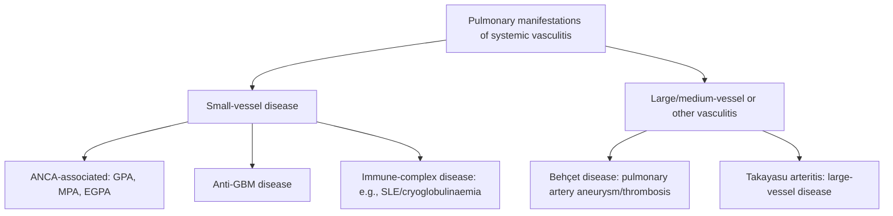
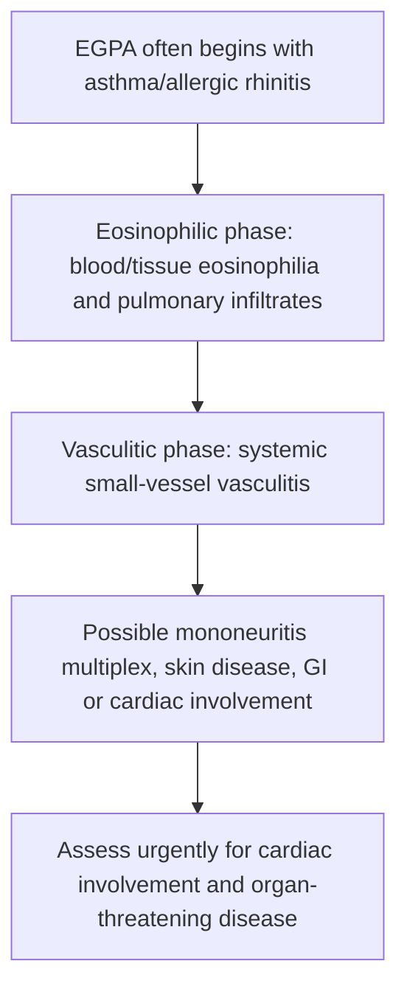
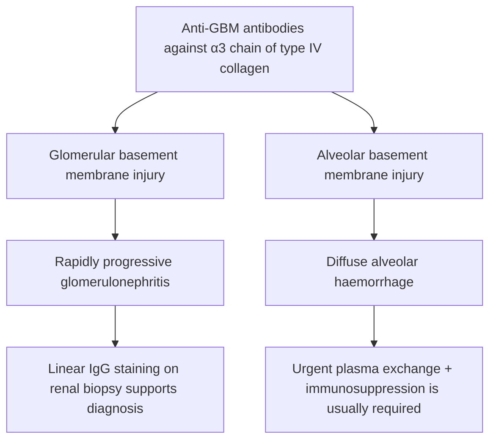
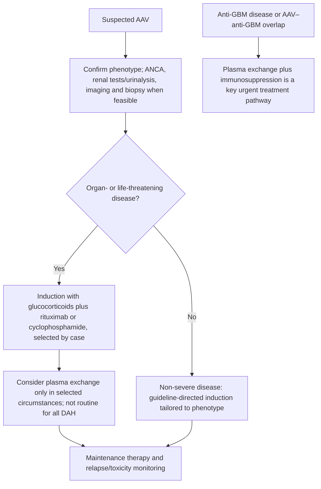

# Topic 31 — Pulmonary Involvement in Vasculitis

## 1. Classification of Vasculitides Affecting the Lung

Pulmonary vasculitides are inflammatory conditions characterized by blood vessel destruction within the pulmonary vascular bed. Classification follows the **2012 Revised Chapel Hill Consensus Conference (CHCC)** framework based on predominant vessel caliber:

### Classification Matrix

| Vessel Caliber Category | Primary Vasculitic Entities | Target Vessel Caliber | Primary Pulmonary Manifestations | Key Serological Markers |
| :--- | :--- | :--- | :--- | :--- |
| **ANCA-Associated Small Vessel** | • Granulomatosis with Polyangiitis (GPA) • Microscopic Polyangiitis (MPA) • Eosinophilic Granulomatosis with Polyangiitis (EGPA) | Intraparenchymal arterioles, capillaries, venules | Cavitating nodules, Diffuse Alveolar Hemorrhage (DAH), Asthma | • **c-ANCA (PR3-ANCA)** in GPA • **p-ANCA (MPO-ANCA)** in MPA & EGPA |
| **Immune Complex Small Vessel** | • Anti-GBM Disease (Goodpasture Syndrome) • IgA Vasculitis (Henoch-Schönlein Purpura) • Cryoglobulinemic Vasculitis | Capillaries, venules | Pulmonary-Renal Syndrome, Diffuse Alveolar Hemorrhage | • Anti-$\alpha_3(\text{IV})$ Collagen antibodies • IgA immune deposits |
| **Variable / Large Vessel** | • Takayasu Arteritis • Behçet's Disease | Aorta, main pulmonary arteries | Pulmonary artery stenosis, pulmonary arterial aneurysms | • ESR / CRP elevated • HLA-B51 in Behçet's |

*Exclusion Note:* **Polyarteritis Nodosa (PAN)** is a medium-vessel necrotizing vasculitis that classic textbook teaching emphasizes **SPARES the pulmonary vessels**.

---

## 2. ANCA Serology and Immunofluorescence Mechanics

Antineutrophil Cytoplasmic Antibodies (ANCA) are autoantibodies directed against enzymes contained within the primary (azurophilic) granules of neutrophils and monocytes.

| Pattern / antibody | Association (not absolute) | Exam point |
|---|---|---|
| c-ANCA by indirect immunofluorescence; PR3-ANCA | GPA | PR3 strongly supports GPA in the right clinical context |
| p-ANCA by indirect immunofluorescence; MPO-ANCA | MPA; some EGPA | MPO may occur in several conditions; interpret with phenotype |
| ANCA negative | Does not exclude AAV | AAV remains a clinicopathological diagnosis |

### Immunofluorescence Patterns
1. **c-ANCA (Cytoplasmic ANCA):**
   * *Pattern:* Diffuse, granular cytoplasmic fluorescence on ethanol-fixed neutrophils.
   * *Target Antigen:* **Proteinase-3 (PR3)**.
   * *Diagnostic Association:* Highly specific for **Granulomatosis with Polyangiitis (GPA)** ($80–90\%$ sensitivity in active generalized disease).
2. **p-ANCA (Perinuclear ANCA):**
   * *Pattern:* Fluorescence concentrated around the nuclear membrane (artifact caused by ethanol fixation causing basic proteins to migrate to the negatively charged nucleus).
   * *Target Antigen:* **Myeloperoxidase (MPO)**.
   * *Diagnostic Association:* Associated with **Microscopic Polyangiitis (MPA)** ($60–80\%$) and **EGPA** ($40–50\%$).

### Sensitivity and Antigen Specificity Matrix

| Disease Entity | c-ANCA (Anti-PR3) Positive | p-ANCA (Anti-MPO) Positive | ANCA Negative |
| :--- | :--- | :--- | :--- |
| **Granulomatosis with Polyangiitis (GPA)** | **80 – 90%** | 0 – 10% | $\sim 10\%$ |
| **Microscopic Polyangiitis (MPA)** | 10 – 20% | **60 – 80%** | 10 – 15% |
| **Eosinophilic Granulomatosis with Polyangiitis (EGPA)** | 10% | **40 – 50%** | 35 – 50% |
| **Renal Limited Pauci-Immune Glomerulonephritis** | 20% | **64%** | 15 – 20% |

---

## 3. Granulomatosis with Polyangiitis (GPA / Wegener's)

### Clinical Triad and Features
GPA affects males and females equally, typically presenting in the 4th to 5th decades of life.
* **Classic Clinical Triad:** Upper Respiratory Tract + Lower Respiratory Tract + Renal Involvement.

| Organ system | Typical GPA manifestations |
|---|---|
| Upper airway | Chronic sinusitis, crusting/ulceration, septal damage, subglottic stenosis |
| Lower respiratory tract | Nodules/cavities, pulmonary infiltrates, diffuse alveolar haemorrhage, pleuritis |
| Kidney | Pauci-immune necrotising crescentic glomerulonephritis; haematuria/proteinuria |

The triad of ENT, lung and renal disease is classic, but no single organ pattern is obligatory.

1. **Upper Respiratory Tract (92% across disease course):**
   * Chronic purulent rhinosinusitis, nasal crusting, epistaxis.
   * **Nasal Septum Perforation** leading to **Saddle Nose Deformity**.
   * **Strawberry Gingivitis:** Pathognomonic hyperplastic, reddish-purple desquamative gingivitis with petechial hemorrhages.
   * **Subglottic Stenosis (16%):** Fibrotic narrowing of the upper trachea below the vocal cords; manifests as stridor and dyspnea.
   * Otitis media, conductive and sensorineural hearing loss.
2. **Lower Respiratory Tract (85%):**
   * Cough, dyspnea, pleuritic chest pain, hemoptysis.
   * Multiple, bilateral pulmonary nodules or infiltrates that frequently undergo central **thick-walled cavitation**.
   * Diffuse Alveolar Hemorrhage (DAH).
3. **Renal Manifestations (77%):**
   * Segmental necrotizing crescentic **Pauci-Immune Rapidly Progressive Glomerulonephritis (RPGN)** leading to renal failure, hematuria, and red blood cell casts.
4. **Ocular & Cutaneous:**
   * Proptosis, scleritis, episcleritis, orbital pseudotumor. Palpable purpura.

### Pathological Findings
* **Triad of Histopathology:**
  1. **Necrotizing Granulomatous Inflammation:** Large areas of **Geographic Necrosis** surrounded by palisading histiocytes, giant cells, and lymphocytes.
  2. **Necrotizing Vasculitis:** Involving small arteries, arterioles, capillaries, and venules.
  3. **Pauci-Immune Glomerulonephritis:** Absence or scant deposition of immunoglobulins on direct immunofluorescence.
* **Biopsy Diagnostic Yield:** Highest diagnostic yield is obtained via **open lung biopsy or thoracoscopic lung biopsy** (nasal mucosal biopsy often yields non-specific inflammation).

---

## 4. Microscopic Polyangiitis (MPA)

### Clinical and Pathological Characteristics
MPA is a systemic necrotizing small-vessel vasculitis that lacks granulomatous inflammation. Mean age of presentation is 45–55 years ($M > F$).
* **Histopathology:**
  * **Necrotizing Vasculitis WITHOUT Granulomas.**
  * **Leukocytoclastic Vasculitis:** Fragmentation of neutrophil nuclei (nuclear debris / leukocytoclasia) within small vessel walls.
  * **Pauci-Immune Glomerulonephritis:** Necrotizing crescentic GN identical to GPA.

| Feature | GPA | MPA |
|---|---|---|
| Granulomatous inflammation | Typically present | Typically absent |
| Upper-airway destructive disease | Common | Uncommon |
| Pulmonary nodules/cavitation | More characteristic | Less characteristic |
| Diffuse alveolar haemorrhage / GN | Can occur | Can occur |
| Common ANCA association | PR3-ANCA more frequent | MPO-ANCA more frequent |

ANCA pattern is supportive, not a stand-alone diagnosis.

### Primary Manifestations
* **Pulmonary:** **Diffuse Alveolar Hemorrhage (DAH)** secondary to pulmonary capillaritis is the dominant pulmonary manifestation. Presents with sudden dyspnea, hemoptysis, drop in hemoglobin, bilateral infiltrates, and an **elevated Diffusion Capacity for Carbon Monoxide ($DLCO\uparrow$)** due to alveolar red blood cell uptake of CO.
* **Renal:** Rapidly Progressive Glomerulonephritis ($> 80\%$).
* **Cutaneous:** Palpable purpura, livedo reticularis.

---

## 5. Eosinophilic Granulomatosis with Polyangiitis (EGPA / Churg-Strauss)

### Clinical Phases and Triad
EGPA is a rare necrotizing vasculitis characterized by **Asthma + Blood/Tissue Eosinophilia + Extravascular Granulomas**. Age of onset is 40–50 years ($F > M$).

1. **Prodromal / Allergic Phase:** Severe, difficult-to-control bronchial asthma, allergic rhinitis, and nasal polyposis.
2. **Eosinophilic Phase:** Marked peripheral blood eosinophilia ($> 1000/\mu\text{L}$ or $> 10\%$ of total WBCs), tissue eosinophilic infiltration causing transient migratory pulmonary infiltrates, and eosinophilic gastroenteritis.
3. **Vasculitic Phase:** Systemic small-vessel necrotizing vasculitis affecting nerves, skin, and heart:
   * **Mononeuritis Multiplex:** Asymmetric peripheral neuropathy (e.g., wrist drop, foot drop).
   * **Cardiac Involvement:** Eosinophilic myocarditis, coronary vasculitis, and restrictive cardiomyopathy. **Cardiac disease is the single most common cause of mortality in EGPA!**
   * Cutaneous palpable purpura and subcutaneous nodules.

### Laboratory and Histopathology
* **p-ANCA (anti-MPO) positive** in $40–50\%$ of cases. Marked elevation of serum total $IgE$.
* **Histopathology:** Necrotizing granulomatous vasculitis with prominent intra- and extravascular **eosinophilic infiltrates**.

---

## 6. Anti-Glomerular Basement Membrane Disease (Goodpasture Syndrome)

### Pathopathogenesis
Autoimmune disease caused by circulating **IgG autoantibodies** directed against the non-collagenous domain 1 (NC1) of the **$\alpha_3$ chain of Type IV Collagen** [$\alpha_3(IV)NC1$], present in glomerular and alveolar basement membranes.
* **Hypersensitivity Class:** **Type II Cytotoxic Hypersensitivity**.
* **Triggers:** Cigarette smoking, hydrocarbon solvent exposure, upper respiratory viral infections. (Smoking dramatically increases the risk of lung hemorrhage in anti-GBM disease!).
* Bimodal Age Distribution: $20–30\text{ years}$ (male predominance, presenting with pulmonary-renal syndrome) and $60–70\text{ years}$ (males and females equally, presenting with isolated glomerulonephritis).

### Clinical and Laboratory Hallmarks
* **Pulmonary-Renal Syndrome:** Co-occurrence of Diffuse Alveolar Hemorrhage (hemoptysis, dyspnea, anemia) and RPGN (oliguria, hematuria).
* **Pulmonary Function Test:** **Markedly Increased DLCO ($DLCO \uparrow\uparrow$)**, reflecting intra-alveolar hemoglobin binding inhaled CO.
* **Renal Biopsy & Direct Immunofluorescence (DIF):** Diagnostic gold standard. Demonstrates **smooth, continuous LINEAR deposition of IgG** (and C3) along the basement membranes of glomeruli and alveoli. (In contrast to the granular deposits of immune-complex GN or pauci-immune pattern of ANCA vasculitis).

---

## 7. Differential Diagnosis: Small Vessel Vasculitides

| Feature | GPA (Wegener's) | MPA | EGPA (Churg-Strauss) | Anti-GBM Disease |
| :--- | :--- | :--- | :--- | :--- |
| **ANCA Association** | **c-ANCA (PR3)** ($80-90\%$) | **p-ANCA (MPO)** ($60-80\%$) | **p-ANCA (MPO)** ($40-50\%$) | Negative (ANCA $-$) |
| **Granulomas** | **Present** (Necrotizing) | **Absent** | **Present** (Eosinophilic) | **Absent** |
| **Upper Airway** | **Severe** (Saddle nose, subglottic) | Absent / Spared | Nasal polyps, rhinitis | Absent |
| **Pulmonary Lesions** | Cavitating nodules | Alveolar Hemorrhage | Migratory infiltrates | Alveolar Hemorrhage |
| **Asthma / Eosinophilia** | Absent | Absent | **Prominent (Diagnostic)** | Absent |
| **Renal Histology** | Pauci-immune RPGN | Pauci-immune RPGN | Pauci-immune RPGN | **Linear IgG Deposition** |
| **Major Mortality Cause** | Renal failure / Infection | Renal failure / DAH | **Cardiomyopathy / Cardiac** | Renal failure / DAH |

---

## 8. Management Guidelines and Induction Protocols

### 1. Remission Induction (Severe / Organ-Threatening Disease)
Indicated for severe pulmonary hemorrhage, RPGN, neurological involvement, or cardiac disease:
* **High-Dose Glucocorticoids:** IV Pulse **Methylprednisolone $1\text{ g/day}$ for 3 consecutive days**, followed by oral Prednisolone ($1\text{ mg/kg/day}$, tapered gradually).
* **PLUS Immunosuppressive Agent:** Choose one of:
  1. **Rituximab:** Chimeric anti-CD20 monoclonal antibody ($375\text{ mg/m}^2$ IV weekly for 4 weeks OR $1000\text{ mg}$ IV on Days 1 and 15). Non-inferior and preferred in young patients (preserves fertility).
  2. **Cyclophosphamide:** Oral ($2\text{ mg/kg/day}$) or pulsed IV ($15\text{ mg/kg}$ every 2–3 weeks). Requires oral hydration and Mesna to prevent hemorrhagic cystitis.

### 2. Role of Plasma Exchange (Plasmapheresis)
* **Mandatory Indication:** **Anti-GBM Disease** (removes circulating toxic anti-$\alpha_3(IV)$ autoantibodies; combined with steroids and cyclophosphamide).
* **AAV Indications:** Severe Diffuse Alveolar Hemorrhage with hypoxemic respiratory failure, or concurrent severe acute kidney injury (serum creatinine $> 5.7\text{ mg/dL}$ [$500\mu\text{mol/L}$]).

### 3. Targeted Biological Agents
* **Mepolizumab:** Humanized monoclonal antibody against **Interleukin-5 (IL-5)**, the key cytokine driving eosinophil maturation and survival. Approved specifically for remission induction and maintenance in **EGPA**.

### 4. Remission Maintenance Phase
Continued for **18 to 24 months** following successful remission:
* Low-dose oral Prednisolone combined with **Azathioprine** ($2\text{ mg/kg/day}$), **Methotrexate** ($20–25\text{ mg/week}$), or maintenance **Rituximab** (every 6 months).

### 5. Infection Prophylaxis
* **Pneumocystis jirovecii Pneumonia (PJP) Prophylaxis:** Mandatory for all patients receiving cyclophosphamide or heavy immunosuppression. **Trimethoprim-Sulfamethoxazole (Co-trimoxazole)** $800/160\text{ mg}$ single double-strength tablet orally 3 times per week.

---

## Accuracy and currency note

This is educational revision material, not a patient-specific treatment protocol. Time-sensitive drug regimens, doses, thresholds and service pathways should be checked against the current national/local guideline before clinical use. The batch review file records the main edits and the scope of verification.

**Review log:** [[00 - Batch 3 Accuracy Review]]
