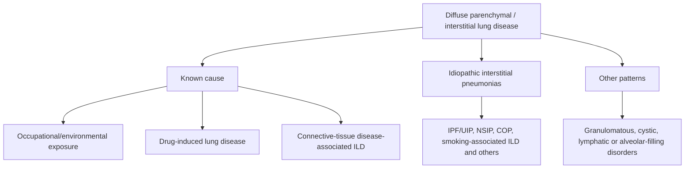
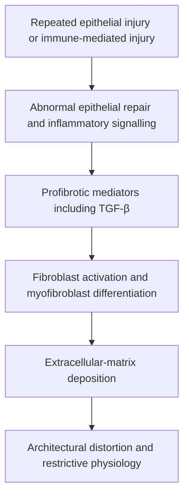
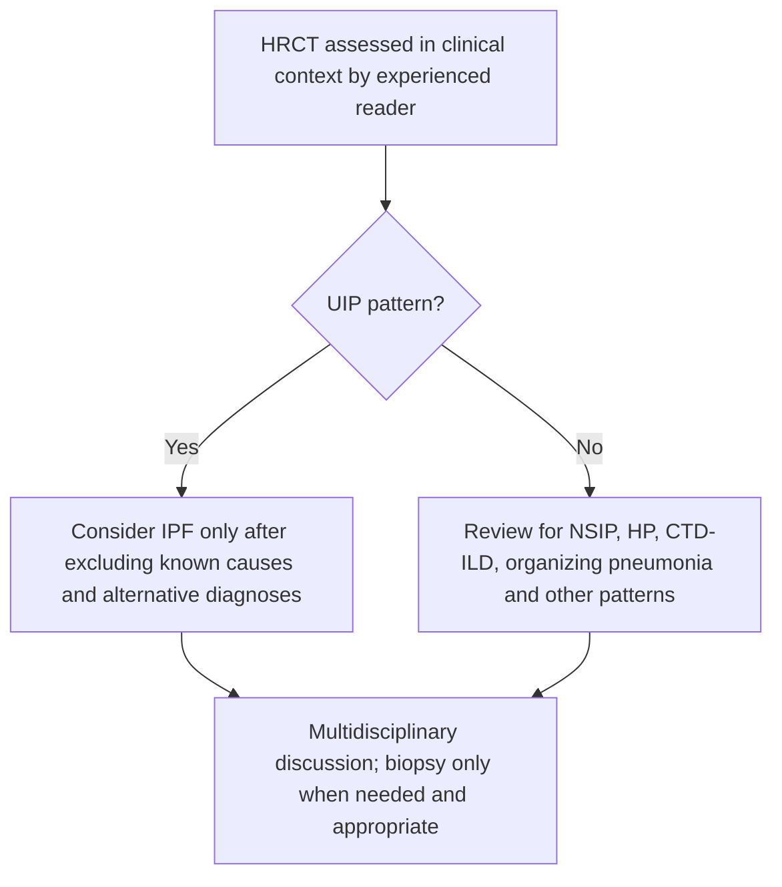
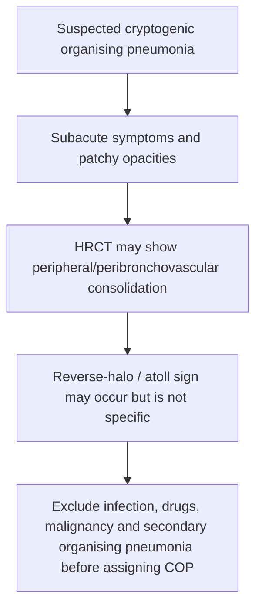
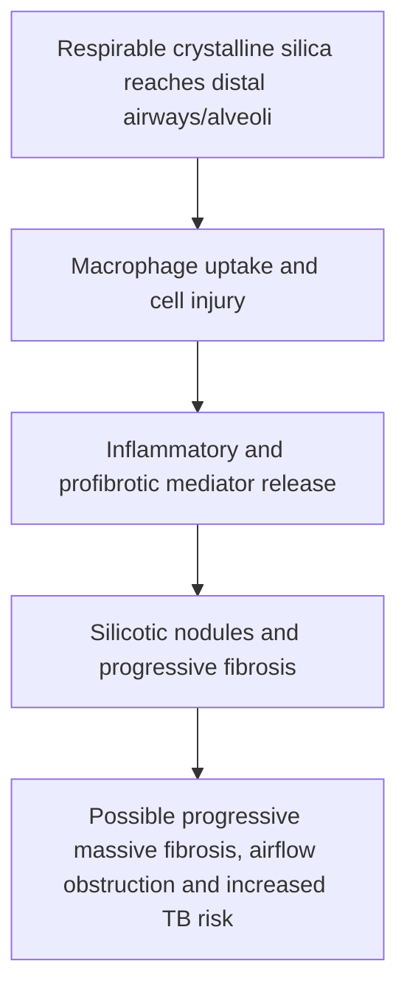
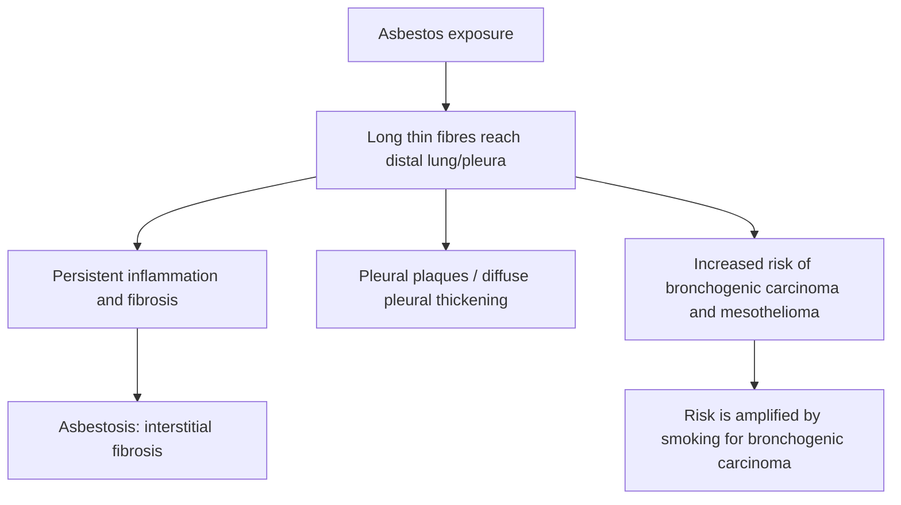

# Topic 32 — Interstitial Lung Diseases

## 1. Classification and Overview

Diffuse Parenchymal Lung Diseases (DPLD), commonly termed Interstitial Lung Diseases (ILD), comprise a heterogeneous group of non-neoplastic pulmonary disorders affecting the alveolar walls, perivascular, and perilymphatic interstitial tissues.

### Comprehensive Classification

| Clinical Category | Specific Disease Entities | Dominant Histopathological / Radiological Pattern |
| :--- | :--- | :--- |
| **Idiopathic Interstitial Pneumonias (IIP)** | • Idiopathic Pulmonary Fibrosis (IPF) • Nonspecific Interstitial Pneumonia (NSIP) • Cryptogenic Organizing Pneumonia (COP / BOOP) • Acute Interstitial Pneumonia (AIP / Hamman-Rich) | • Usual Interstitial Pneumonia (UIP) • Cellular / Fibrosing NSIP • Intra-alveolar Masson bodies • Diffuse Alveolar Damage (DAD) |
| **Known Cause: Exposure / Environmental** | • Silicosis, Asbestosis, Coal Worker's Pneumoconiosis • Berylliosis, Hard Metal Disease | • Silicotic nodules, Ferruginous bodies • Non-caseating granulomas |
| **Known Cause: Drug-Induced** | • Bleomycin, Busulfan, Methotrexate, Amiodarone, Nitrofurantoin, Cyclophosphamide | • Variable: UIP, NSIP, or DAD pattern |
| **Known Cause: Autoimmune / CTD-ILD** | • Systemic Sclerosis (SSc), Rheumatoid Arthritis (RA) • Dermatomyositis / Polymyositis, SLE, Sjögren's | • **NSIP pattern** (most common overall in CTD) • **UIP pattern** (most common in RA) |
| **Granulomatous Disorders** | • [[33 - Sarcoidosis]] • Hypersensitivity Pneumonitis (HP / EAA) | • Non-caseating naked granulomas • Poorly-formed centrilobular granulomas |
| **Smoking-Related ILD** | • Desquamative Interstitial Pneumonia (DIP) • Respiratory Bronchiolitis-associated ILD (RB-ILD) | • Intra-alveolar brown pigment-laden macrophages |
| **Rare Cystic / Miscellaneous** | • Lymphangioleiomyomatosis (LAM) • Pulmonary Langerhans Cell Histiocytosis (PLCH) | • Thin-walled cysts (LAM: $F, 20-40y$) • Upper lobe cysts/nodules (PLCH: CD1a+) |

---

## 2. Pathophysiology and Pulmonary Function Test (PFT) Hallmarks

### Pathophysiological Sequence
1. **Repetitive Epithelial Injury:** Environmental, genetic, or autoimmune triggers cause micro-injuries to alveolar epithelial cells (pneumocytes).
2. **Pro-Fibrotic Signaling Cascade:** Injured pneumocytes and immune cells release potent cytokines: **TGF-$\beta$** (Transforming Growth Factor-beta; primary driver of fibrogenesis), **PDGF** (Platelet-Derived Growth Factor), **FGF-2**, and **VEGF**.
3. **Fibroblast Activation:** Differentiation of local fibroblasts into contractile **myofibroblasts**, aggregating in active **Fibroblastic Foci**.
4. **Extracellular Matrix Deposition:** Excessive collagen accumulation leads to alveolar septal destruction, loss of lung compliance, and irreversible parenchymal remodeling.

### PFT Findings in Restrictive Defect
ILD displays a classic **Restrictive Ventilatory Defect**:
* **Total Lung Capacity (TLC):** Decreased ($< 80\%$ of predicted).
* **Forced Vital Capacity (FVC):** Decreased.
* **$\text{FEV}_1 / \text{FVC}$ Ratio:** **Normal or Increased** ($> 70–80\%$), because forced expiratory volume in 1 second and forced vital capacity decrease proportionally.
* **Diffusion Capacity of the Lung for Carbon Monoxide (DLCO):** **Markedly Reduced ($DLCO \downarrow$)**, reflecting destruction of the alveolo-capillary membrane and interstitial thickening.
* **Arterial Blood Gas:** Resting or exercise-induced hypoxemia with an **increased Alveolar-arterial oxygen gradient [$\text{P(A-a)O}_2 \uparrow$]**.

---

## 3. Idiopathic Pulmonary Fibrosis (IPF)

### Clinical Presentation and Genetics
IPF is a chronic, progressive, fibrosing interstitial pneumonia of unknown etiology occurring predominantly in older adults ($> 50\text{ years}$), with a male predominance ($M > F$) and a strong association with cigarette smoking.
* **Genetic Predisposition:** Heterozygous promoter mutation in the **MUC5B gene** ($rs35705950$) is present in $> 30–50\%$ of IPF patients (increases mucin production and impairs mucociliary clearance). Telomerase gene mutations (*TERT, TERC*).
* **Clinical Symptoms:**
  * Insidious onset of progressive exertional dyspnea.
  * Chronic, dry, non-productive cough.
  * Fatigue and weight loss.
* **Physical Examination:**
  * **Digital Clubbing:** Present in $50\%$ of patients.
  * **Bibasal Fine Late-Inspiratory "Velcro" Crepitations / Crackles:** Persistent, dry crackles heard over lower lung fields that do not clear with coughing.

### Histopathology and HRCT: Usual Interstitial Pneumonia (UIP) Pattern
High-resolution CT is central to IPF assessment. A definite UIP pattern may allow diagnosis without lung biopsy when the clinical context is compatible and alternative causes of UIP have been assessed in multidisciplinary discussion; an imaging pattern alone does not prove IPF.

1. **HRCT Criteria for Definite UIP Pattern:**
   * **Subpleural, Basal Predominance.**
   * **Reticular Opacities** and septal thickening.
   * **Honeycombing:** Clustered, thick-walled, subpleural cystic airspaces ($3–10\text{ mm}$ diameter) stacked in rows.
   * **Traction Bronchiectasis / Bronchiolectasis:** Irregular luminal dilatation of airways caused by surrounding parenchymal fibrous retraction.
   * Absence of inconsistent features (no extensive ground-glass opacities, micronodules, or mosaic attenuation).
2. **Histopathology (UIP Pattern):**
   * **Spatial and Temporal Heterogeneity:** Alternating regions of normal lung tissue, active **Fibroblastic Foci** (pale-staining aggregates of young myofibroblasts), and dense, hypocellular collagenous scar tissue.

### Pharmacotherapy and Management
* **Antifibrotic Therapy:** Slows the rate of FVC decline; does not reverse existing fibrosis.
  1. **Nintedanib:** Small-molecule **triple tyrosine kinase inhibitor** targeting VEGFR (1–3), FGFR (1–3), and PDGFR ($\alpha, \beta$). Dose: $150\text{ mg}$ PO BID. (Adverse effect: Diarrhea, elevated LFTs).
  2. **Pirfenidone:** Oral antifibrotic agent that downregulates TGF-$\beta$ synthesis and TNF-$\alpha$ secretion. Dose: Titrated up to $801\text{ mg}$ PO TID. (Adverse effect: Photosensitivity, rash, nausea).
* **Contraindicated Therapies:** Systemic Glucocorticoids, Azathioprine, and $N$-acetylcysteine combination therapy is **strictly CONTRAINDICATED** in IPF (the PANTHER-IPF trial demonstrated increased mortality and hospitalizations!).
* **Prognosis:** Median survival is $3–5\text{ years}$ from diagnosis ($50\%$ 5-year mortality). **Lung Transplantation** is the only definitive cure for end-stage IPF.

---

## 4. Nonspecific Interstitial Pneumonia (NSIP)

### Features and Comparison with UIP
NSIP occurs in younger patients (5th decade), females $>$ males, and is non-smoking related. It is the **most common pattern of ILD associated with Connective Tissue Diseases** (especially Systemic Sclerosis, Polymyositis/Dermatomyositis, MCTD, and Sjögren's Syndrome).

| Feature | UIP pattern | NSIP pattern |
|---|---|---|
| Temporal appearance | Patchy, heterogeneous fibrosis | More uniform / temporally homogeneous inflammation or fibrosis |
| Distribution | Often basal and subpleural | Often basal; subpleural sparing may be present |
| HRCT hallmark | Reticulation, traction bronchiectasis, honeycombing in definite UIP | Ground-glass opacity, fine reticulation; honeycombing less prominent |
| Associations | IPF; also CTD, HP and other causes | CTD, idiopathic NSIP, drug-related disease |

A UIP pattern is not synonymous with idiopathic pulmonary fibrosis; exclude secondary causes.

### HRCT and Histopathology
* **Histopathology:** **Temporal and Spatial HOMOGENEITY.** Uniform alveolar septal thickening composed of lymphocytes/plasma cells (Cellular NSIP) or uniform dense collagen deposition (Fibrosing NSIP), without active fibroblastic foci or structural distortion.
* **HRCT Findings:**
  * Bilateral, symmetric **Ground-Glass Opacities (GGOs)** with lower zone predominance.
  * Fine reticular opacities and traction bronchiectasis.
  * **Subpleural Sparing:** Characteristic preservation of the immediate subpleural parenchyma in lower lobes.
  * Minimal or absent honeycombing.
* **Treatment:** Highly responsive to **Systemic Glucocorticoids** (Prednisolone) combined with **Mycophenolate Mofetil (MMF)**, Azathioprine, or Cyclophosphamide. (In Systemic Sclerosis ILD, high-dose steroids are avoided to prevent Scleroderma Renal Crisis; MMF is first-line).

---

## 5. Other Idiopathic Interstitial Pneumonias

### 1. Cryptogenic Organizing Pneumonia (COP / BOOP)
Previously termed Bronchiolitis Obliterans Organizing Pneumonia (BOOP).
* **Pathology:** Intra-alveolar buds of loose granulation tissue composed of fibroblasts and myofibroblasts embedded in connective matrix (**Masson Bodies**) filling alveolar spaces and respiratory bronchioles.
* **HRCT Finding:** Patchy, bilateral peripheral or peribronchovascular consolidations.
* **Reverse Halo Sign (Atoll Sign):** Pathognomonic central area of ground-glass opacity surrounded by a complete or partial crescentic rim of consolidation.
* **Treatment:** Excellent, dramatic response to **Systemic Glucocorticoids**.

### 2. Smoking-Associated ILD
* **Desquamative Interstitial Pneumonia (DIP):** Diffuse, uniform intra-alveolar accumulation of **pigment-laden smoker's macrophages** ("brown macrophages") filling alveolar spaces throughout the lung. Responsive to smoking cessation and steroids.
* **Respiratory Bronchiolitis-Associated ILD (RB-ILD):** Pigment-laden macrophages localized specifically within respiratory bronchioles and adjacent alveoli.

### 3. Acute Interstitial Pneumonia (AIP / Hamman-Rich Syndrome)
Rapidly progressive, fulminant form of ILD presenting as acute respiratory distress in previously healthy individuals. Biopsy shows **Diffuse Alveolar Damage (DAD)** with hyaline membranes (identical to ARDS). High mortality ($> 50\%$).

### 4. Lymphocytic Interstitial Pneumonia (LIP)
Diffuse infiltration of alveolar septa by polyclonal lymphocytes and plasma cells. Strongly associated with **Sjögren's Syndrome** and **HIV infection**. HRCT shows thin-walled perivascular cysts and ground-glass opacities.

---

## 6. Occupational and Environmental Lung Diseases (Pneumoconioses)

### 1. Silicosis
Caused by inhalation of crystalline silicon dioxide ($\text{SiO}_2$ / quartz) dust in sandblasting, hard-rock mining, quarrying, stone-cutting, and ceramics.
* **Pathogenesis:** Inhaled silica particles ($1–5\mu\text{m}$) are ingested by **Pulmonary Alveolar Macrophages (PAM)** $
ightarrow$ silica causes phagolysosomal membrane rupture $
ightarrow$ release of lysosomal enzymes and pro-inflammatory cytokines (IL-1, TNF-$\alpha$) $
ightarrow$ macrophage death and intense fibroblast proliferation.
* **Radiology (CXR/HRCT):**
  * Small, round nodular opacities predominantly involving the **Upper Lung Zones**.
  * **Egg-Shell Calcification:** Pathognomonic circumferential calcification of the periphery of hilar and mediastinal lymph nodes.
  * Progressive Massive Fibrosis (PMF): Coalescence of small nodules into large fibrous masses.
* **Complications:**
  * **Silicotuberculosis:** Silica impairs macrophage function, markedly increasing susceptibility to *Mycobacterium tuberculosis*.
  * Increased risk of Bronchogenic Carcinoma.
  * **Caplan Syndrome:** Co-occurrence of pneumoconiosis (silicosis/coal worker's) with Rheumatoid Arthritis, presenting with large necrobiotic rheumatoid nodules in the lungs.

### 2. Asbestosis
Occupational disease caused by inhalation of hydrated magnesium silicate asbestos fibers (shipbuilding, construction, insulation, brake lining manufacture).
* **Pathology:**
  * **Asbestos Bodies (Ferruginous Bodies):** Pathognomonic golden-brown, beaded, dumbbell-shaped fibers coated with an iron-protein complex (ferritin/hemosiderin); highlighted by **Prussian Blue Stain**.
* **Radiology (CXR/HRCT):**
  * Reticular opacities with subpleural fibrosis predominantly in the **Lower Lung Zones**.
  * **Parietal Pleural Plaques:** Pathognomonic smooth, dense, often calcified fibrous plaques involving the parietal and diaphragmatic pleura (posterolateral lower zones).
* **Malignancy Risk:**
  * **Bronchogenic Carcinoma:** **Most common malignancy** in asbestos-exposed individuals (risk magnified exponentially by cigarette smoking!).
  * **Malignant Pleural Mesothelioma:** **Most specific malignancy** associated with asbestos (90% attributable to asbestos exposure; smoking does NOT increase mesothelioma risk).

### 3. Beryllium Disease (Berylliosis)
Inhalation of beryllium dust in aerospace, electronics, nuclear, and telecommunications industries.
* **Pathology:** Form non-caseating epithelioid granulomas indistinguishable from Sarcoidosis.
* **Diagnostic Test:** **Beryllium Lymphocyte Proliferation Test (BeLPT)** using peripheral blood or BAL cells.

---

## 7. Hypersensitivity Pneumonitis (Extrinsic Allergic Alveolitis)

Immunologically mediated inflammatory lung disease affecting alveoli and terminal bronchioles, triggered by repeated inhalation of environmental organic dusts or low-molecular-weight chemical antigens in sensitized individuals.

### Immunopathogenesis
* **Combined Hypersensitivity Reaction:** Involves both **Type III (Immune Complex-mediated)** immune response in acute phase and **Type IV (Cell-Mediated / $\text{Th}_1$)** delayed hypersensitivity response with granuloma formation in subacute/chronic phases.

### Etiological Spectrum

| Disease Entity | Triggering Antigen | Source / Exposure |
| :--- | :--- | :--- |
| **Farmer's Lung** | *Saccharopolyspora rectivirgula* (Thermophilic actinomycetes) | Moldy hay, grain, silage |
| **Bagassosis** | *Thermoactinomyces sacchari* | Moldy sugarcane bagasse |
| **Bird Fancier's / Pigeon Breeder's** | Avian serum proteins, mucin | Bird droppings, feathers, pigeon coops |
| **Cheese Washer's Lung** | *Penicillium casei* / *Aspergillus clavatus* | Moldy cheese dust |
| **Malt Worker's Lung** | *Aspergillus clavatus* | Moldy barley |
| **Humidifier / Hot Tub Lung** | *Mycobacterium avium* complex (MAC) / Thermophilic fungi | Contaminated mist from hot tubs, AC units |
| **Maple Bark Stripper's Disease** | *Cryptostroma corticale* | Moldy maple bark |

### Diagnostic Findings
1. **Bronchoalveolar Lavage (BAL):** Marked lymphocytosis ($> 30–50\%$) with a **Reversed $\text{CD4}/\text{CD8}$ Ratio ($< 1.0$)** due to predominant $\text{CD8}^+$ cytotoxic T-cell influx.
2. **Histopathology:** Poorly formed, non-caseating interstitial granulomas, interstitial lymphocytic infiltration, and cellular bronchiolitis.
3. **HRCT Findings:** Centrilobular ground-glass nodules, mosaic attenuation (air trapping on expiratory CT), and **"Headcheese Sign"** (co-existence of ground-glass opacity, normal lung, and air trapping).
4. **Treatment:** Complete antigen avoidance, personal protective equipment, and systemic steroids for acute/subacute exacerbations.

---

## 8. Diagnostic Comparison Matrix of Common ILDs

| Parameter | IPF | NSIP | Hypersensitivity Pneumonitis | Sarcoidosis |
| :--- | :--- | :--- | :--- | :--- |
| **Onset** | Insidious, $> 50\text{y}$ | Subacute, 40-50y | Acute / Subacute | Young adults (20-40y) |
| **Smoking Relation** | Strong association | No association | Non-smokers (mostly) | Non-smokers |
| **Predominant HRCT Zone** | **Lower lobes (Basal)** | **Lower lobes (Basal)** | **Mid to Upper lobes** | **Upper / Mid lobes** |
| **Key HRCT Sign** | Subpleural Honeycombing | Subpleural Sparing | Headcheese sign / Mosaic | Bilateral Hilar Adenopathy |
| **BAL Lymphocytes** | Neutrophils / Eosinophils | Lymphocytes | **$\text{CD8}^+ > \text{CD4}^+$ ($< 1.0$)** | **$\text{CD4}^+ > \text{CD8}^+$ ($> 3.5$)** |
| **Histopathology** | UIP (Temporal heterogeneity) | Uniform NSIP | Poorly formed granulomas | **Well-formed naked granulomas** |
| **Steroid Response** | **Contraindicated (Harmful)** | Highly Responsive | Responsive | Highly Responsive |

---

## Accuracy and currency note

This is educational revision material, not a patient-specific treatment protocol. Time-sensitive drug regimens, doses, thresholds and service pathways should be checked against the current national/local guideline before clinical use. The batch review file records the main edits and the scope of verification.

**Review log:** [[00 - Batch 3 Accuracy Review]]
