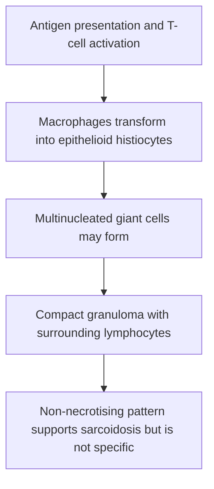
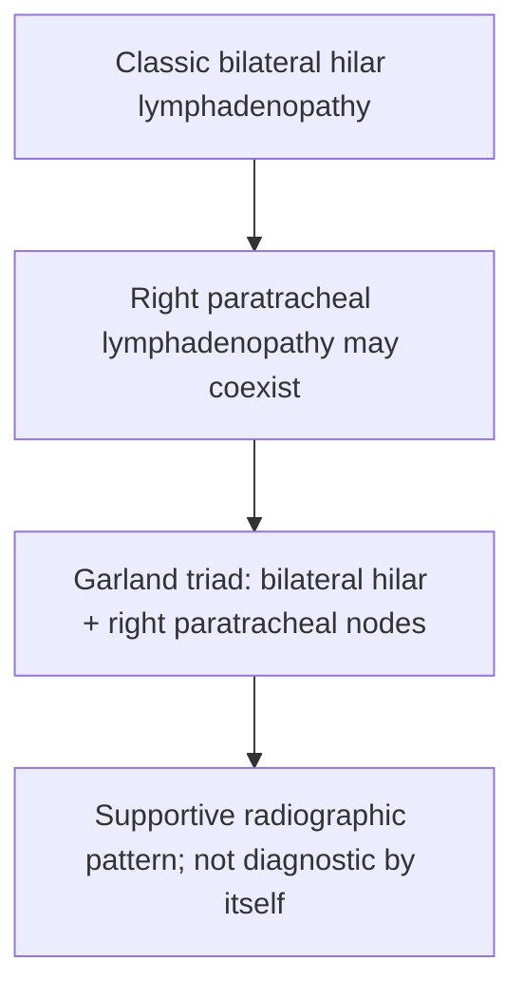
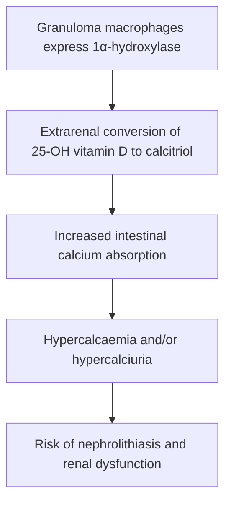
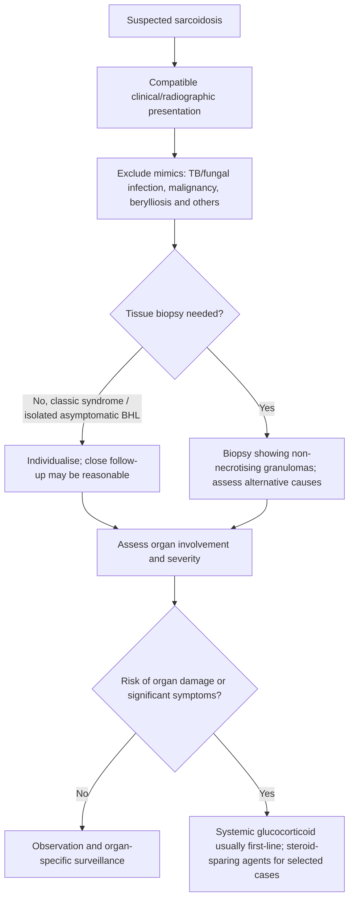

# Topic 33 — Sarcoidosis

## 1. Etiopathogenesis and Immunological Cascade

Sarcoidosis is a systemic, chronic inflammatory disorder of unknown etiology characterized by the formation of non-caseating (non-necrotizing) epithelioid cell granulomas in multiple organs.

### Epidemiology
* Peak incidence in young adults aged **20 to 40 years**.
* Female predominance ($F > M$).
* Higher prevalence and disease severity among African Americans and Northern European (Scandinavian) populations.

```mermaid
flowchart TD
A[Unidentified antigen(s) in susceptible host] --> B[Antigen-presenting cells activate CD4+ T cells]
B --> C[Th1 / Th17 immune response and cytokine release]
C --> D[Macrophage activation and epithelioid granuloma formation]
D --> E[Non-necrotising granulomas in affected organs]
E --> F[Possible resolution, persistent inflammation or fibrosis]
```

### Immunological Mechanics
1. **Compartmentalized Hyper-Immunity:** Local accumulation of activated $\text{CD4}^+$ T-helper cells ($\text{Th}_1$ phenotype) at sites of active disease (lungs/lymph nodes), releasing high levels of **Interleukin-2 (IL-2)** and **Interferon-gamma (IFN-$\gamma$)**.
2. **Peripheral Anergy:** Paradoxical suppression of systemic cell-mediated immunity in peripheral blood, manifesting as **cutaneous anergy (negative Tuberculin / Mantoux skin test)**.
3. **Tumor Necrosis Factor-alpha (TNF-$\alpha$):** Critical driver produced by alveolar macrophages that maintains structural integrity of granulomas.
4. **Bronchoalveolar Lavage (BAL) Profile:** Marked lymphocytic alveolitis characterized by a strikingly **elevated $\text{CD4}^+/\text{CD8}^+$ T-cell ratio ($> 3.5:1$)**.

---

## 2. Histopathology and Pathognomonic Inclusion Bodies

### Histopathological Characteristics
* **"Naked" Granulomas:** Pathognomonic **well-formed, non-caseating (non-necrotizing) epithelioid cell granulomas**. Called "naked" because they consist of tightly packed epithelioid histiocytes and multinucleated giant cells surrounded by only a sparse, thin outer rim of lymphocytes (unlike the dense lymphocytic mantle of tuberculous granulomas).
* **Concentric Lamellar Fibrosis:** Granulomas resolve from the periphery inward, transforming into fibrotic hyaline scars.



### Pathognomonic Microscopic Inclusions in Giant Cells

| Inclusion / finding | Appearance / association | Caution |
|---|---|---|
| Asteroid body | Stellate eosinophilic inclusion in giant cell | Not specific to sarcoidosis |
| Schaumann body | Laminated calcified inclusion | Not specific |
| Hamazaki–Wesenberg body | Pigmented inclusion in lymph node sinuses (not a defining giant-cell hallmark) | Avoid treating as diagnostic |

1. **Schaumann Bodies (Conchoidal Bodies):** Concentrically laminated, basophilic calcified structures composed of calcium phosphate and protein complexes found within the cytoplasm of giant cells.
2. **Asteroid Bodies:** Star-shaped, stellate, eosinophilic cytoplasmic inclusions with radiating arms composed of microfilaments and microtubules.
3. **Hamazaki-Wesenberg Bodies:** Yellow-brown, PAS-positive, oval lysosomal structures containing lipofuscin, located within giant cell cytoplasm or extracellular matrix.

---

## 3. Multisystem Clinical Manifestations

Sarcoidosis can affect virtually any organ system in the body:

| Organ | Common manifestations / evaluation |
|---|---|
| Lung / intrathoracic nodes | Bilateral hilar/mediastinal adenopathy, parenchymal disease |
| Skin | Erythema nodosum, lupus pernio, plaques |
| Eye | Uveitis; screen for ocular involvement |
| Heart | Conduction block, arrhythmia, cardiomyopathy |
| Nervous system | Cranial neuropathies, meningitis, other neurosarcoidosis |
| Calcium / kidney | Hypercalcaemia or hypercalciuria, nephrolithiasis |
| Liver / spleen | Hepatic involvement, hepatosplenomegaly |

### 1. Pulmonary Manifestations (90% of Patients)
* Often asymptomatic, discovered incidentally on routine chest radiograph.
* Symptomatic patients present with dry cough, progressive exertional dyspnea, and vague retrosternal chest tightness.
* Physical exam of the chest is frequently normal even in the presence of extensive radiological infiltrates.

### 2. Cutaneous Manifestations (25%)
* **Erythema Nodosum:** Painful, tender, erythematous subcutaneous nodules occurring on anterior shins. Marker of acute, benign, self-limiting sarcoidosis (associated with Löfgren syndrome; excellent prognosis).
* **Lupus Pernio:** **Pathognomonic lesion of chronic sarcoidosis.** Violaceous, indurated, swollen plaques and nodules involving the nose, cheeks, ears, lips, and forehead. Associated with upper respiratory tract granulomas and chronic fibrotic lung disease; refractory to treatment.
* **Scar Sarcoidosis:** Reactivation of inflammation within old, previously quiescent cutaneous scars or tattoo sites, causing them to become raised, purplish, and indurated.

### 3. Ocular Manifestations (25%)
* **Anterior Uveitis (Iridocyclitis):** Most common ocular lesion. Presents with eye redness, photophobia, floaters, and reduced visual acuity.
* Posterior uveitis, retinal vasculitis, conjunctival granulomas, lacrimal gland enlargement, and keratoconjunctivitis sicca.

### 4. Cardiac Sarcoidosis (5–10% Clinical; 25% Autopsy)
Clinically silent in many cases, but represents a major cause of sudden death.
* **Complete Atrioventricular (AV) Block** and bundle branch blocks.
* **Fatal Ventricular Arrhythmias** (VT/VF) due to myocardial granulomatous scars.
* Restrictive Cardiomyopathy and Congestive Heart Failure.

### 5. Neurological Manifestations (Neurosarcoidosis - 5%)
* **Cranial Nerve VII (Facial Nerve) Palsy:** Most common neurological manifestation (can be unilateral or bilateral).
* Optic Neuritis (CN II).
* Hypothalamic-Pituitary Lesions causing **Diabetes Insipidus** and hyperprolactinemia.
* Chronic aseptic meningitis.

### 6. Reticuloendothelial & Renal
* Non-tender, mobile bilateral cervical, epitrochlear, and inguinal lymphadenopathy.
* Hepatosplenomegaly.
* Hypercalciuria and Nephrocalcinosis leading to renal failure.

---

## 4. Classic Eponymous Clinical Syndromes

### 1. Löfgren Syndrome (Acute Benign Triad)
A distinct acute presentation of sarcoidosis carrying an **excellent prognosis** ($> 85\%$ spontaneous resolution within 2 years).

| Syndrome | Classic features | Prognostic note |
|---|---|---|
| Löfgren syndrome | Erythema nodosum, bilateral hilar lymphadenopathy, ankle periarthritis/arthritis, often fever | Often favourable course |

* **Triad Components:**
  1. **Bilateral Hilar Lymphadenopathy (BHL)** on CXR.
  2. **Erythema Nodosum** on lower extremities.
  3. **Migratory Polyarthritis** (predominantly involving ankle joints).
* Accompanied by fever and malaise. HLA-DRB1*03 positive.

### 2. Heerfordt Syndrome (Uveoparotid Fever Tetrad)
Rare acute presentation characterized by four features:

| Syndrome | Classic tetrad | Exam point |
|---|---|---|
| Heerfordt syndrome | Uveitis, parotid enlargement, fever, facial nerve palsy | Uncommon multisystem presentation |

1. **Anterior Uveitis**
2. **Bilateral, Painless Parotid Gland Enlargement**
3. **Facial Nerve Palsy (CN VII)**
4. **Low-Grade Fever**

---

## 5. Radiological Staging (Scadding Criteria)

Chest radiography remains the primary tool for initial staging using the **Scadding System**:

| Scadding stage | Chest radiograph |
|---|---|
| 0 | Normal chest radiograph |
| I | Bilateral hilar lymphadenopathy (± mediastinal lymphadenopathy) without parenchymal infiltrates |
| II | Lymphadenopathy with parenchymal infiltrates |
| III | Parenchymal infiltrates without hilar lymphadenopathy |
| IV | Fibrosis / architectural distortion |

Scadding stages describe chest radiographic appearances, not a linear mandatory progression.

| Scadding Stage | Radiographic Findings | Frequency at Diagnosis | Spontaneous Remission Rate |
| :--- | :--- | :--- | :--- |
| **Stage 0** | Normal Chest Radiograph (isolated extrapulmonary disease) | $5 - 10\%$ | N/A |
| **Stage I** | **Bilateral Hilar Lymphadenopathy (BHL)** alone (with/without right paratracheal adenopathy = **Garland Triad / 1-2-3 Sign**) | **45 – 50%** | **60 – 80%** (High) |
| **Stage II** | **Bilateral Hilar Lymphadenopathy PLUS Parenchymal Infiltrates** (reticulonodular opacities) | **25 – 30%** | **50 – 60%** |
| **Stage III** | **Parenchymal Infiltrates ALONE** (Without Hilar Lymphadenopathy) | $15\%$ | $30\%$ |
| **Stage IV** | **End-Stage Pulmonary Fibrosis** (Upper lobe predominance, traction bronchiectasis, honeycombing, architectural distortion) | $5 - 10\%$ | **0%** (Irreversible) |

*Garland Triad (1-2-3 Sign):* Co-existence of (1) Right Hilar, (2) Left Hilar, and (3) Right Paratracheal lymphadenopathy.



---

## 6. Diagnostic Evaluation and Laboratory Workup

### 1. Serum Angiotensin-Converting Enzyme (ACE) Level
* Elevated in $60–80\%$ of patients with active sarcoidosis.
* Secreted by epithelioid histiocytes within granulomas.
* **Clinical Utility:** Useful for **monitoring disease activity** and response to treatment, but **NOT diagnostic** (low specificity; elevated in fungal infections, TB, Gaucher disease, hyperthyroidism).

### 2. Calcium Metabolism Abnormalities
* **Hypercalciuria (20%) and Hypercalcemia (10%):**
* **Mechanism:** Activated alveolar macrophages within sarcoid granulomas express uncontrolled **$1-\alpha$-hydroxylase enzyme**, converting 25-hydroxyvitamin D into active **1,25-dihydroxycholecalciferol [$1,25-(OH)_2D_3$]**. This increases intestinal calcium absorption and bone resorption, suppressed PTH levels, and increases risk of nephrolithiasis.



### 3. Bronchoalveolar Lavage (BAL)
* Lymphocytic alveolitis with **$\text{CD4}^+/\text{CD8}^+$ Ratio $> 3.5:1$** (sensitivity $53\%$, specificity $94\%$).

### 4. Biopsy (Gold Standard Diagnostic Confirmation)
* Diagnosis rests on a compatible clinical/radiological presentation, non-necrotising granulomatous inflammation when tissue is obtained, and exclusion of alternative causes. Biopsy can be deferred in selected characteristic presentations (e.g., classic Löfgren syndrome or asymptomatic bilateral hilar lymphadenopathy) after assessing mimics and follow-up needs.
* **Preferred Biopsy Sites:**
  * **EBUS-TBNA (Endobronchial Ultrasound-guided Transbronchial Needle Aspiration):** Highest yield ($> 90\%$) for mediastinal/hilar lymph nodes.
  * Transbronchial Lung Biopsy (TBLB).
  * Biopsy of accessible skin lesions (avoid erythema nodosum lesions as they represent panniculitis without granulomas; biopsy **lupus pernio** or scar sites).

---

## 7. Management Guidelines and Algorithms



### 1. Indications for Pharmacotherapy
Sarcoidosis does **NOT** require treatment in all patients.
* **Observation (No Treatment):** Asymptomatic Stage I disease or Löfgren syndrome (spontaneous resolution rate $> 80\%$).
* **Absolute Indications for Systemic Treatment:**
  1. Cardiac Sarcoidosis (arrhythmias, heart block).
  2. Neurosarcoidosis.
  3. Ocular Sarcoidosis refractory to topical steroids.
  4. Persistent Hypercalcemia / Hypercalciuria.
  5. Symptomatic, progressive Stage II, III, or IV pulmonary disease with declining PFTs.
  6. Disfiguring cutaneous disease (Lupus Pernio).

### 2. First-Line Pharmacotherapy
* **Oral Glucocorticoids:** Primary therapeutic agent.
  * **Initial Dose:** Prednisolone **$20–40\text{ mg/day}$** (or $0.5\text{ mg/kg/day}$) for 4 to 8 weeks.
  * **Tapering:** Down to maintenance dose ($5–10\text{ mg/day}$) over 6 to 12 months.

### 3. Second-Line (Steroid-Sparing) Immunosuppressants
Indicated for steroid toxicity, steroid resistance, or chronic maintenance:
* **Methotrexate:** Drug of Choice among second-line agents ($10–25\text{ mg/week}$ PO or SC).
* **Azathioprine:** $1.5–2.5\text{ mg/kg/day}$.
* **Mycophenolate Mofetil (MMF):** $1000\text{ mg}$ PO BID.
* **Hydroxychloroquine:** Highly effective for **cutaneous sarcoidosis (lupus pernio)** and **hypercalcemia** (inhibits $1-\alpha$-hydroxylase in granulomas).

### 4. Third-Line Biological Therapy
* **Anti-TNF-$\alpha$ Monoclonal Antibodies:**
  * **Infliximab** ($3–5\text{ mg/kg}$ IV at 0, 2, 6 weeks then every 6–8 weeks) or **Adalimumab**.
  * Highly effective for refractory lupus pernio, neurosarcoidosis, and chronic fibrosing pulmonary sarcoidosis (directly disrupts the TNF-$\alpha$ cytokine network sustaining granulomas).

---

## Accuracy and currency note

This is educational revision material, not a patient-specific treatment protocol. Time-sensitive drug regimens, doses, thresholds and service pathways should be checked against the current national/local guideline before clinical use. The batch review file records the main edits and the scope of verification.

**Review log:** [[00 - Batch 3 Accuracy Review]]
