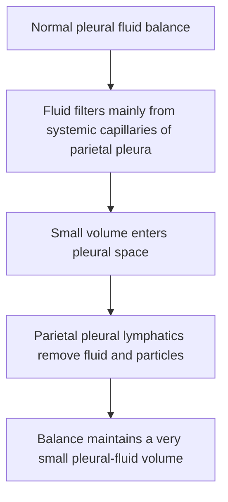
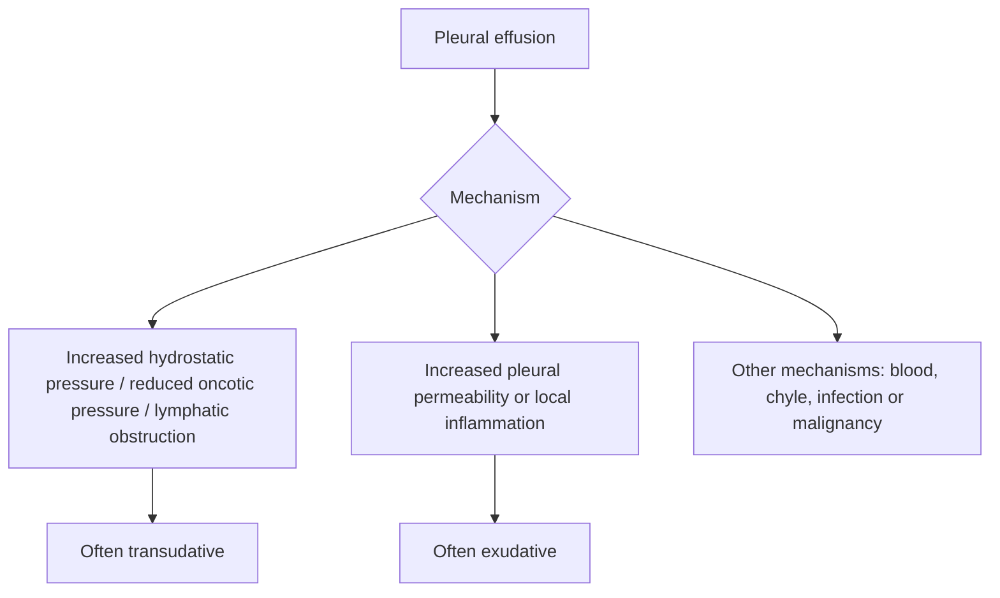
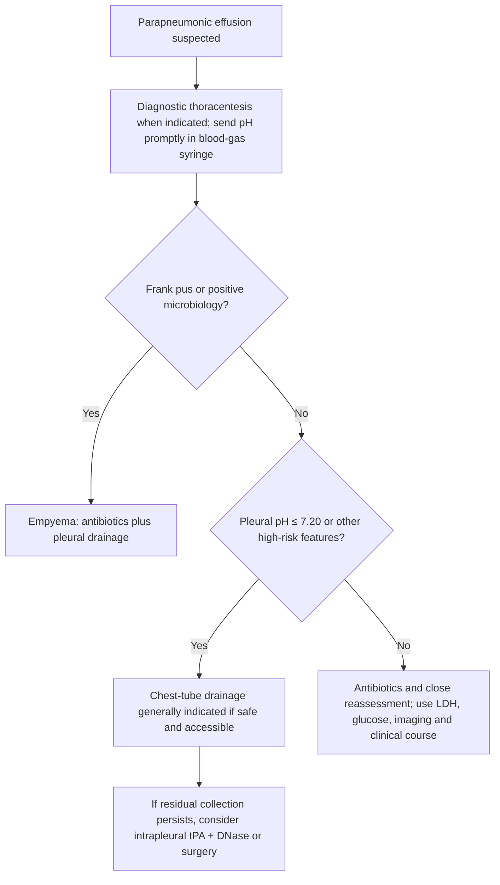

# Topic 34 — Pleural Diseases

## 1. Applied Anatomy and Normal Pleural Fluid Dynamics

The pleural space is a potential cavity bounded by two mesothelial membranes:
* **Parietal Pleura:** Covers the inner thoracic wall, diaphragm, and mediastinum. Receives systemic arterial blood supply (intercostal, internal mammary, and pericardiophrenic arteries) and is innervated by somatic nerves (intercostal and phrenic nerves). Consequently, parietal pleural inflammation produces sharp, localized **pleuritic chest pain**.
* **Visceral Pleura:** Covers the pulmonary parenchyma and invaginates into interlobar fissures. Receives bronchial arterial blood supply and drains into pulmonary veins. Lacks somatic sensory innervation; hence, visceral pleural lesions are painless.

### Normal Fluid Dynamics
* **Normal Volume:** Approximately **0.1 to 0.3 mL/kg** (10–20 mL total per individual), acting as a low-friction lubricant.
* **Normal Composition:** Clear, acellular to paucicellular (<1500 cells/$\mu$L, predominantly macrophages and lymphocytes), protein content < 1.5 g/dL, pH ~ 7.60, glucose concentration equal to serum levels, and LDH < 50% of serum levels.
* **Formation and Clearance:** Fluid enters the pleural space primarily from parietal systemic capillaries driven by hydrostatic pressure gradients, and is reabsorbed via specialized **parietal pleural lymphatic stomata** located in the lower mediastinal and diaphragmatic parietal pleura. The lymphatic system possesses a compensatory reabsorptive capacity up to 20 times the normal rate of fluid formation.

---

## 2. Pathophysiology and Light's Diagnostic Criteria

Pleural effusion develops when fluid formation exceeds lymphatic clearance capacity or when lymphatic drainage is pathologically impaired.

### Light's Criteria (Gold Standard Classification)
To distinguish between transudative and exudative effusions, thoracentesis fluid is analyzed against serum parameters. An effusion is defined as an **exudate** if **at least one** of the following three criteria is met:

$$\text{1. } \frac{\text{Pleural Fluid Protein}}{\text{Serum Protein}} > 0.5$$

$$\text{2. } \frac{\text{Pleural Fluid LDH}}{\text{Serum LDH}} > 0.6$$

$$\text{3. Pleural Fluid LDH} > \frac{2}{3} \times \text{Upper Limit of Normal (ULN) Serum LDH}$$

* **Diagnostic Sensitivity and Specificity:** Light's criteria exhibit a sensitivity of ~98% for exudates, but a slightly lower specificity (~83%).
* **The "Pseudo-Exudate" Pitfall:** In patients with congestive heart failure who have undergone aggressive diuretic therapy, hemoconcentration elevates pleural fluid protein and LDH levels, misclassifying a transudate as an exudate.
* **Correction Rules for Diuresed Heart Failure:**
  * **Serum-to-Pleural Fluid Albumin Gradient:** $(\text{Serum Albumin} - \text{Pleural Fluid Albumin}) > 1.2\text{ g/dL}$ indicates a **transudate**.
  * **Serum-to-Pleural Fluid Protein Gradient:** $(\text{Serum Protein} - \text{Pleural Fluid Protein}) > 3.1\text{ g/dL}$ indicates a **transudate**.

---

## 3. Etiological Matrix of Pleural Effusions

| Effusion Type | Primary Underlying Mechanism | Characteristic Pleural Fluid Parameters | Major Clinical Etiologies |
| :--- | :--- | :--- | :--- |
| **Transudate** | Imbalance in systemic hydrostatic or oncotic pressures; normal pleural membranes | Protein < 3.0 g/dL, PF/Serum Protein < 0.5, PF/Serum LDH < 0.6, Normal pH (7.60) | **Congestive Heart Failure** (most common overall), Cirrhosis with Hepatic Hydrothorax, Nephrotic Syndrome, Peritoneal Dialysis, Hypoalbuminemia, Urinothorax |
| **Exudate (Infectious)** | Direct bacterial/tubercular invasion triggering local vascular permeability | High neutrophils (acute) or lymphocytes (TB), pH < 7.20 in complicated, High ADA (>40 U/L) in TB | Parapneumonic Effusion, Empyema, [[Tuberculous Pleurisy]], Fungal/Parasitic Pleuritis |
| **Exudate (Malignant)** | Tumor involvement of pleura or lymphatic obstruction | Cytology positive, high lymphocytes, low glucose (<60 mg/dL) in advanced disease | Bronchogenic Carcinoma, Breast Cancer, Lymphoma, Malignant Pleural Mesothelioma |
| **Exudate (Autoimmune)** | Immune complex deposition and local inflammatory cascades | Extremely low glucose (<30 mg/dL in RA), high RF, low C3/C4 complement | Rheumatoid Arthritis, Systemic Lupus Erythematosus (SLE), Drug-induced Lupus |
| **Chylothorax** | Thoracic duct disruption/obstruction | Milk-like opalescent fluid, Triglycerides > 110 mg/dL, Chylomicrons present | Lymphoma, Thoracic Surgery / Trauma, Filariasis |
| **Pseudochylothorax** | Longstanding effusion with cell lysis and cholesterol accumulation | Turbid fluid, Triglycerides < 50 mg/dL, Cholesterol > 200 mg/dL, Cholesterol crystals | Longstanding Rheumatoid Pleurisy, Chronic Tuberculous Effusion |

---

## 4. Comprehensive Pleural Fluid Analysis

### 1. Visual Appearance
* **Straw-Colored / Serous:** Typical for transudates, early parapneumonic, or TB effusions.
* **Frankly Purulent:** Empyema.
* **Sanguineous / Hemorrhagic:** Pleural Hematocrit > 50% of peripheral blood hematocrit defines a **Hemothorax** (requires chest tube drainage). If pleural hematocrit is 1–50%, suspect Malignancy, Trauma, or Pulmonary Embolism.
* **Milky / Turbid:** Requires centrifugation: if supernatant clears, turbidity was due to cellular debris; if supernatant remains milky, perform lipid analysis to differentiate Chylothorax from Pseudochylothorax.

### 2. Biochemical Parameters
* **Pleural Fluid pH:**
  * Normal: ~7.60.
  * $\text{pH} < 7.20$: Indicates complicated parapneumonic effusion, empyema, esophageal rupture (Boerhaave syndrome), rheumatoid pleurisy, tuberculous pleurisy, or advanced malignancy.
  * $\text{pH} < 7.00$: Strongly indicates empyema or esophageal rupture; mandates immediate **tube thoracostomy**.
* **Pleural Fluid Glucose:**
  * Low ($< 60\text{ mg/dL}$ or Pleural/Serum ratio $< 0.5$): Rheumatoid arthritis (often $< 30\text{ mg/dL}$), Empyema, Complicated parapneumonic effusion, Tuberculosis, Malignancy, Lupus pleuritis.
* **Adenosine Deaminase (ADA):**
  * High ($\ge 40\text{ U/L}$): High diagnostic sensitivity and specificity ($>90\%$) for **Tuberculous Pleurisy** in endemic regions. False positives occur in empyema, lymphoma, and rheumatoid effusion.
* **Pleural Fluid Amylase:**
  * Elevated (above upper limit of normal serum amylase or Pleural/Serum ratio $> 1.0$): Acute or Chronic Pancreatitis, Pancreaticopleural Fistula, Esophageal Rupture (salivary amylase isoform), and Adenocarcinoma of Lung/Ovary.

### 3. Differential Cell Count
* **Neutrophil Predominance ($>50\%$):** Acute pleural injury — Parapneumonic effusion, Pulmonary Embolism, Acute Pancreatitis.
* **Lymphocyte Predominance ($>50\%$):** Chronic granulomatous or malignant processes — Tuberculosis, Malignancy, Lymphoma, Sarcoidosis, Rheumatoid pleurisy.
* **Eosinophilic Effusion ($>10\%$):** Presence of air (Pneumothorax) or blood (Hemothorax) in the pleural space, drug reactions (Nitrofurantoin, Dantrolene), Churg-Strauss syndrome (EGPA), or parasitic infections (Paragonimiasis).

---

## 5. Specific Clinical Entities and Management

### 1. Parapneumonic Effusion and Empyema
* **Pathological Stages:**
  1. *Exudative Phase (Uncomplicated):* Rapid sterile exudation into pleural space in response to adjacent parenchymal pneumonia. Responsive to systemic antibiotics alone.
  2. *Fibrinopurulent Phase (Complicated):* Bacterial invasion into pleural space causing fibrin deposition, loculations, reduced pH ($<7.20$), low glucose ($<60\text{ mg/dL}$), and elevated LDH ($>1000\text{ U/L}$).
  3. *Organizing Phase (Empyema):* Fibroblast invasion forms a dense, non-elastic fibrous peel over visceral and parietal pleura ("trapped lung"), requiring surgical intervention.
* **Indications for Tube Thoracostomy (Chest Tube Insertion):**
  * Frank pus or turbid purulent fluid on aspiration.
  * Positive Gram stain or culture of pleural fluid.
  * Pleural fluid $\text{pH} < 7.20$ or Glucose $< 40\text{ mg/dL}$.
  * Presence of loculations on chest ultrasonography.
* **Intrapleural Fibrinolytic Therapy:** Combination of **tissue Plasminogen Activator (tPA)** and **Recombinant Human DNase** administered intrapleurally enhances drainage of loculated empyemas by degrading fibrin septa and clearing bacterial DNA viscosity, reducing the need for surgical decortication.

### 2. Malignant Pleural Effusion (MPE)
* **Etiology:** Adenocarcinoma of lung (most common), breast carcinoma, lymphoma, ovarian carcinoma.
* **Pathophysiology:** Direct tumor seeding onto parietal pleura with tumor-induced angiogenesis and lymphatic drainage occlusion.
* **Clinical Features:** Exertional dyspnea, dull aching chest pain, weight loss. Radiographs frequently demonstrate a massive effusion with **contralateral mediastinal shift**.
* **Diagnostic Workup:** Pleural fluid cytology (yield ~60% on first tap, ~85% on three serial taps). If cytology is negative, thoracoscopic (VATS) pleural biopsy is the diagnostic procedure of choice.
* **Definitive Management:**
  * *Indwelling Pleural Catheter (IPC):* Preferred for patients with expandable or non-expandable ("trapped") lung, allowing outpatient intermittent self-drainage.
  * *Chemical Pleurodesis:* Administered via chest tube following complete lung re-expansion. Sclerosing agents induce intense pleural inflammation and symphysis. **Sterile Talc poudrage/slurry** is the most effective sclerosing agent (alternative agents: Doxycycline, Bleomycin).

### 3. Tuberculous Pleurisy
* **Mechanism:** Delayed-type hypersensitivity (Type IV) reaction to mycobacterial antigens released into the pleural space following rupture of a subpleural Ghon focus.
* **Clinical Features:** Acute onset fever, non-productive cough, pleuritic chest pain in young adults.
* **Diagnostic Triad:** Lymphocytic exudate ($>80\%$), elevated ADA ($\ge 40\text{ U/L}$), and elevated Interferon-gamma ($\text{IFN}-\gamma > 140\text{ pg/mL}$).
* **Treatment:** Standard 6-month Antitubercular Therapy (ATT) regimen: 2 months of Isoniazid, Rifampicin, Pyrazinamide, Ethambutol (2HRZE) followed by 4 months of Isoniazid and Rifampicin (4HR).

### 4. Malignant Pleural Mesothelioma
* **Etiology:** Primary malignant neoplasm of pleural mesothelial cells strongly linked to occupational **asbestos exposure** (latency period 20–50 years). Amphibole fibers (Crocidolite) pose the highest carcinogenic risk.
* **Molecular Markers:** Deletion of chromosome 9p21 (*CDKN2A* gene), loss of *BAP1* (BRCA1-associated protein-1) expression on immunohistochemistry.
* **Immunohistochemical Markers:** Positive for **Calretinin**, **Cytokeratin 5/6**, **WT-1** (Wilms Tumor-1), and **D2-40** (Podoplanin); negative for CEA and TTF-1 (differentiating it from metastatic adenocarcinoma).
* **Radiological Findings:** Diffuse nodular pleural thickening ($>1\text{ cm}$), involvement of the mediastinal parietal pleura, encasement of the lung, and loss of thoracic volume.

---

## Accuracy and currency note

This is educational revision material, not a patient-specific treatment protocol. Time-sensitive drug regimens, doses, thresholds and service pathways should be checked against the current national/local guideline before clinical use. The batch review file records the main edits and the scope of verification.

**Review log:** [[00 - Batch 4 Accuracy Review]]
