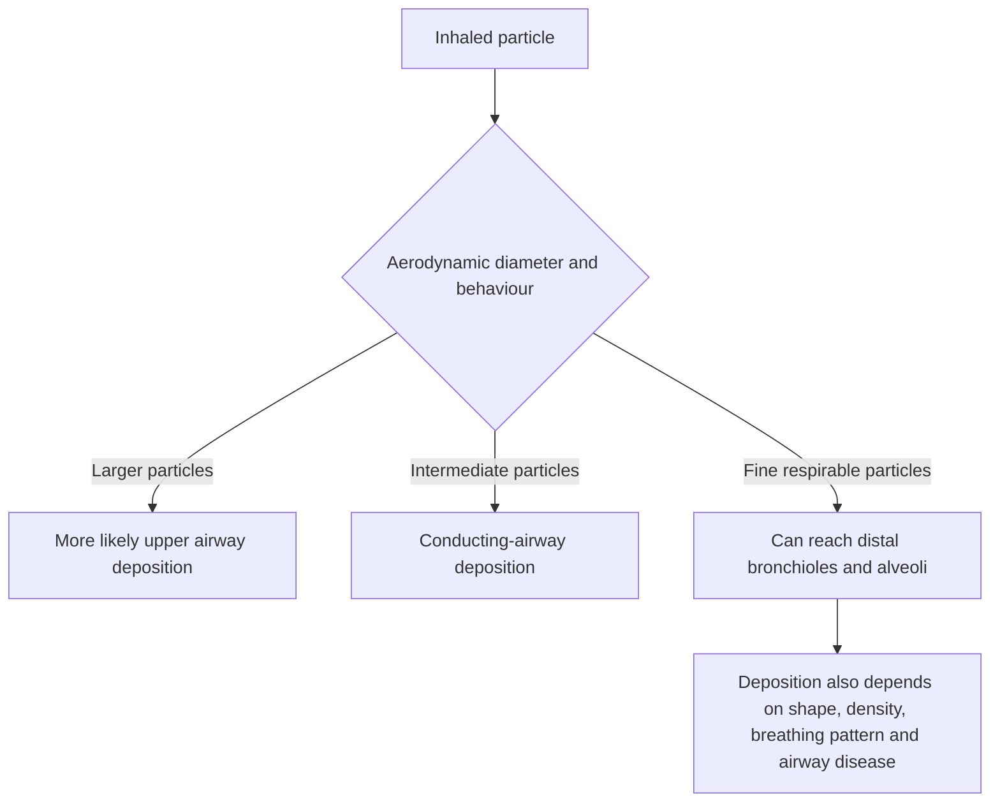
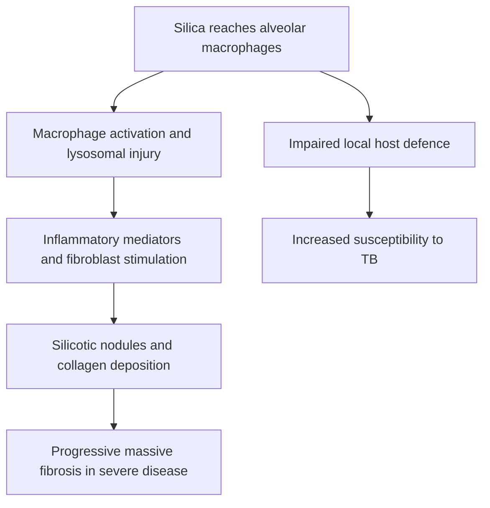
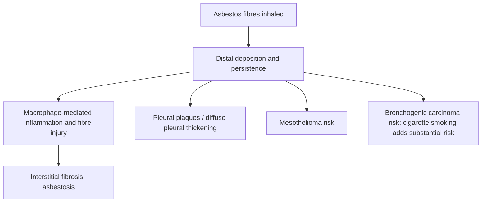

# Topic 35 — Occupational and Environmental Lung Disease

## 1. Mechanisms of Inhalation Injury and Aerodynamic Physics

The site and pattern of occupational respiratory injury are dictated by particle size, solubility, concentration, duration of exposure, and host clearance mechanisms.

### Aerodynamic Particle Deposition
* **$> 10\ \mu\text{m}$:** Trapped in the upper nasopharyngeal airway via inertial impaction; cleared by sneezing or swallowing.
* **$2.5 - 10\ \mu\text{m}$:** Deposited in tracheobronchial airways via gravitational sedimentation; cleared by the mucociliary escalator.
* **$1 - 5\ \mu\text{m}$ (Respirable Zone):** Penetrate into terminal respiratory bronchioles and alveoli, where they settle by diffusion and are phagocytosed by alveolar macrophages.
* **$< 0.5\ \mu\text{m}$:** Remain suspended in air and are largely exhaled without deposition.

---

## 2. Inorganic Dust Diseases (Pneumoconioses)

Pneumoconioses represent non-neoplastic lung reactions to inhaled inorganic mineral dusts.

| Disease / exposure | Typical pattern | Important associations |
|---|---|---|
| Silicosis | Upper-lobe nodules; eggshell node calcification may occur; progressive massive fibrosis | Increased TB risk |
| Coal workers’ pneumoconiosis | Coal macules/nodules; severe disease may progress to massive fibrosis | Coal dust exposure |
| Asbestosis | Basal/subpleural fibrosis; pleural plaques | Bronchogenic carcinoma and mesothelioma; smoking strongly increases bronchogenic-carcinoma risk |
| Chronic beryllium disease | Sarcoid-like granulomatous disease | Beryllium exposure; sensitisation testing |
| Hypersensitivity pneumonitis | Inflammatory/fibrotic ILD after antigen exposure | Organic antigens; exposure history is key |

### 1. Silicosis
* **Occupational Exposures:** Quartz mining, stone cutting, sandblasting, quarrying, ceramics, glass manufacturing, and foundry work.
* **Pathophysiology:**
  * Inhalation of crystalline free silica ($\text{SiO}_2$, quartz).
  * Alveolar macrophages phagocytose silica crystals $
ightarrow$ silica causes disruption of phagolysosomal membranes $
ightarrow$ release of lysosomal enzymes, free radicals, and pro-inflammatory/pro-fibrotic cytokines (**IL-1**, **TNF-$\alpha$**, **TGF-$\beta$**).
  * Macrophage apoptosis releases silica crystals back into the alveolar space, perpetuating a chronic inflammatory and fibrotic loop.
* **Histopathology:** **Silicotic Nodule** — Pathognomonic acellular concentric whorled collagenous nodule with a dense hyalinized center and peripheral zone of macrophages. Under polarized light microscopy, silica crystals exhibit **birefringence**.

* **Radiological Findings:**
  * Multiple small ($1–3\text{ mm}$) rounded nodular opacities predominantly in the **upper lung zones**.
  * **"Eggshell Calcification":** Calcification of the periphery of hilar and mediastinal lymph nodes (seen in 5% of patients, highly characteristic).
* **Clinical Complications:**
  * **Silicotuberculosis:** Silica markedly impairs cell-mediated immunity and alveolar macrophage phagocytic function, conferring a **3- to 5-fold increased risk of *Mycobacterium tuberculosis*** infection.
  * **Progressive Massive Fibrosis (PMF):** Coalescence of small silicotic nodules into large fibrotic masses ($>2\text{ cm}$), leading to respiratory failure and cor pulmonale.
  * **Carcinogenicity:** Crystalline silica is classified by IARC as a Group 1 human carcinogen.

---

### 2. Asbestosis and Asbestos-Related Pleuropulmonary Disease
* **Occupational Exposures:** Shipbuilding, insulation, brake lining manufacture, demolition, construction, and pipefitting.
* **Fiber Types:**
  1. *Serpentine (Chrysotile - White Asbestos):* Flexible, curly fibers; accounts for >90% of industrial use. Cleared more readily from airways.
  2. *Amphibole (Crocidolite - Blue Asbestos, Amosite - Brown Asbestos):* Straight, rigid, needle-like fibers. Penetrate deep into lung parenchyma and pleura; highly pathogenic and oncogenic.
* **Pathology of Asbestosis:**
  * Diffuse pulmonary interstitial fibrosis predominantly affecting the **lower lung zones** and subpleural regions.
  * **Asbestos Bodies (Ferruginous Bodies):** Golden-brown, dumbbell-shaped, beaded rod-like structures consisting of an asbestos fiber coated with an iron-protein complex (ferritin and hemosiderin). Stain intensely positive with **Prussian blue**.

* **Pleural Manifestations of Asbestos Exposure:**
  * **Pleural Plaques:** Most common manifestation of asbestos exposure. Well-circumscribed, smooth, dense collagenous thickenings on the parietal pleura (predominantly anterolateral lower thoracic walls and bilateral diaphragmatic domes), frequently calcified. They spare the costophrenic angles and do **not** represent a pre-malignant lesion.
  * **Benign Asbestos Pleural Effusion:** Exudative hemorrhagic effusion occurring within 10–20 years of exposure.
  * **Diffuse Pleural Thickening:** Fibrosis of parietal and visceral pleura causing restrictive lung impairment.
* **Asbestos-Associated Malignancies:**
  * **Bronchogenic Carcinoma:** The most common malignancy associated with asbestos exposure. Smoking and asbestos act **synergistically**, increasing the relative risk of lung cancer up to **60-fold** in smoking asbestos workers.
  * **Malignant Pleural Mesothelioma:** The most specific malignancy caused by asbestos (attributable to asbestos in >80% of cases). Has a long latency period (20–50 years) and is **not** associated with cigarette smoking.

---

### 3. Coal Worker's Pneumoconiosis (CWP)
* **Occupational Exposure:** Underground coal mining (anthracite coal poses higher risk than bituminous coal).
* **Spectrum of Disease:**
  1. *Asymptomatic Anthracosis:* Benign carbon pigment accumulation in alveolar macrophages without parenchymal architecture disruption.
  2. *Simple CWP:* Characterized by **Coal Macules** (dust-laden macrophages surrounding respiratory bronchioles) and **Coal Nodules** (cleared carbon surrounded by delicate collagen network), leading to focal **centrilobular emphysema**. Predominantly involves upper lobes.
  3. *Complicated CWP (Progressive Massive Fibrosis):* Development of fibrous masses $>2\text{ cm}$ in diameter with central ischemic necrosis and cavitation.
* **Caplan Syndrome:** Combination of pneumoconiosis (CWP, Silicosis, or Asbestosis) and **Rheumatoid Arthritis**, characterized by the rapid appearance of multiple bilateral peripheral subpleural pulmonary necrobiotic nodules ($0.5–5\text{ cm}$) on a background of pneumoconiosis.

---

### 4. Beryllium Disease (Berylliosis)
* **Occupational Exposures:** Aerospace engineering, electronics manufacturing, nuclear power industries, telecommunications, and dental alloy fabrication.
* **Pathophysiology:** Inhaled beryllium acts as a hapten, binding to HLA-DP molecules to trigger a cell-mediated Type IV hypersensitivity immune response.
* **Histopathology:** **Non-caseating granulomas** in lung parenchyma and hilar lymph nodes, histologically indistinguishable from [[33 - Sarcoidosis]].
* **Diagnostic Test:** **Beryllium Lymphocyte Proliferation Test (BeLPT)** using peripheral blood or bronchoalveolar lavage (BAL) fluid.

---

## 3. Organic Dust Diseases and Toxic Gas Inhalation

| Exposure group | Examples / mechanism | Clinical pattern |
|---|---|---|
| Organic dusts | Cotton dust (byssinosis), mouldy hay / bird antigens (HP) | Exposure-linked symptoms; HP may cause inflammatory or fibrotic ILD |
| Irritant/toxic gases | Chlorine, ammonia, nitrogen oxides and other inhaled irritants | Acute airway injury; severe exposure can cause delayed pulmonary oedema |
| Prevention | Exposure history, industrial hygiene, ventilation, substitution, respiratory protection | Workplace surveillance and removal from exposure when indicated |

### 1. Byssinosis ("Monday Morning Chest Tightness")
* **Occupational Exposure:** Textile industry workers handling raw cotton, flax, hemp, or jute.
* **Pathogenesis:** Inhalation of endotoxins produced by gram-negative bacteria contaminating raw cotton fibers, stimulating direct non-immunological histamine release from lung mast cells.
* **Clinical Course:** Characterized by chest tightness, dyspnea, and dry cough that occurs specifically on the **first day back to work after a weekend or holiday ("Monday morning feeling")**. Symptoms gradually subside as the workweek progresses due to mast cell histamine depletion (tachyphylaxis).

### 2. Hypersensitivity Pneumonitis (Extrinsic Allergic Alveolitis)
* **Pathophysiology:** Immunologically mediated inflammation of lung parenchyma caused by repeated inhalation of organic agricultural or avian antigens.
* **Key Occupational Syndromes:**
  * **Farmer's Lung:** Inhalation of thermophilic actinomycetes (*Saccharopolyspora rectivirgula* / *Micropolyspora faeni*) from moldy hay.
  * **Bird Fancier's / Handler's Lung:** Exposure to avian serum proteins found in pigeon/bird droppings and feathers.
  * **Bagassosis:** Exposure to moldy sugarcane residue (*Thermoactinomyces sacchari*).
* **Clinical Forms:**
  * *Acute:* Chills, fever, cough, dyspnea occurring 4–8 hours post-exposure. HRCT reveals ground-glass opacities and centrilobular nodules.
  * *Chronic:* Progressive exertional dyspnea, fatigue, weight loss, subpleural fibrosis, and traction bronchiectasis.
* **BAL Findings:** Marked lymphocytosis ($>30–50\%$) with a **reversed CD4+:CD8+ ratio ($<1.0$)**.

### 3. Toxic Gas Inhalation
* **Silo-Filler's Disease:** Caused by inhaling **Nitrogen Dioxide ($\text{NO}_2$)** gas produced by fermenting grain stored in farm silos. Converts to nitric and nitrous acid upon contact with mucosal moisture, causing acute pulmonary edema and late-onset **Bronchiolitis Obliterans**.
* **Chemical Pneumonitis:** Caused by high-solubility gases (Ammonia, Chlorine, Sulfur Dioxide) causing immediate upper airway irritation, or low-solubility gases (Phosgene, Ozone) penetrating to alveoli causing delayed ARDS.

---

## 4. Diagnostic Summary Matrix

| Occupational Disease | Primary Offending Agent | Key Exposure Sources | Dominant Radiological & Histological Findings | Diagnostic Hallmark |
| :--- | :--- | :--- | :--- | :--- |
| **Silicosis** | Crystalline Free Silica ($\text{SiO}_2$) | Mining, Sandblasting, Quarrying, Ceramics | Upper lobe nodular opacities; Concentric whorled collagenous nodules | Polarized birefringence; Eggshell lymph calcification; High TB risk |
| **Asbestosis** | Amphibole / Serpentine Asbestos Fibers | Shipbuilding, Insulation, Construction | Lower lobe interstitial fibrosis; Parietal pleural plaques | Prussian blue positive dumbbell-shaped Asbestos Bodies |
| **Coal Worker's Pneumoconiosis** | Coal Mine Dust (Carbon) | Underground Coal Mining | Upper lobe coal macules/nodules; Centrilobular emphysema | Black-pigmented lungs; Caplan syndrome association |
| **Berylliosis** | Beryllium Metal / Alloys | Aerospace, Nuclear, Electronics | Non-caseating granulomas (Upper lobes/Hilar nodes) | Positive Beryllium Lymphocyte Proliferation Test (BeLPT) |
| **Byssinosis** | Raw Cotton / Flax Dust | Textile Mills | Transient airflow obstruction on spirometry | Monday morning chest tightness improving across week |
| **Farmer's Lung** | *Saccharopolyspora rectivirgula* | Moldy Hay / Silage | Centrilobular ground-glass nodules; Air trapping | BAL CD4+:CD8+ ratio $< 1.0$; Serum precipitating antibodies |

---

## Accuracy and currency note

This is educational revision material, not a patient-specific treatment protocol. Time-sensitive drug regimens, doses, thresholds and service pathways should be checked against the current national/local guideline before clinical use. The batch review file records the main edits and the scope of verification.

**Review log:** [[00 - Batch 4 Accuracy Review]]
